# CUMI 制作全纪录 · IP 设计课堂

统计快照：2026-09-19T00:55:59.909985+08:00

本材料按真实任务、现存产物和可定位原话整理。教学补绘、候选方案、未通过验收的结果均另行标明。配图以保留产物的展示副本为主；高分辨率图片按原比例缩小，最长边不超过2560像素。重新打开历史页面拍摄的截图、为课堂重现的图形和后来补做的教学图，均单独标明。

## 先看9步主线

### 第一步：确定要做什么角色

最初只有做一个学院角色的想法，长什么样、用在哪里都还没定。

这一步要做：找到一个容易认出来、适合学院使用的角色方向。

- 问清谁会使用、会出现在哪些场合。
- 画出不同的头部、身体和符号方向。
- 并排比较，留下更容易识别的轮廓。
- 选中最早的紫色圆鼻原图，再进入局部修改。

关键决定：先问清使用者和用途，再把不同轮廓放在一起比较。

做到哪了：看过多条方向和十款新候选后，回头选中最早的紫色圆鼻原图，开始逐一修改细节。

记住：先明确角色要解决什么问题，再判断一张图好不好。

### 第二步：把长相固定下来

修改呆毛和尾巴时，整张图的颜色和绒毛也跟着变，角色越改越不稳定。

这一步要做：确定以后都照着做的一张标准角色图。

- 逐项检查呆毛、耳朵、尾巴和绒毛。
- 发现改小地方却弄脏整张图的问题。
- 回到清楚的原图，只处理指定位置。
- 保存标准图，作为后续制作的共同依据。

关键决定：只改指定位置，并在8月13日把用户用PS修过的图定为统一依据。

做到哪了：CUMI的名字和主要外形逐步确定，尾巴、后脑勺和绒毛有了共同标准，也交出了第一版网站包。

记住：一旦确认角色长相，后续每张图都要拿回来对照。

### 第三步：换六套衣服，保持同一个角色

每换一套衣服，角色的头身比例、大小和材质都可能变。

这一步要做：让六种身份看起来都属于同一个CUMI。

- 把六个角色放在同一张对照图里。
- 统一头身比例、脚的位置和视觉大小。
- 检查衣服、帽子、配饰有没有遮挡或穿进身体。
- 制作平面版时，再核对服装和角色身份。

关键决定：先固定身体比例和毛绒质感，再分别调整服装与配饰。

做到哪了：六套立体造型获得阶段认可；平面版和部分比例修改仍有待确认稿。

记住：成套设计要放在一起检查，单张好看还不够。

### 第四步：把角色变成一套标识和图案

完整角色适合大画面，但印在小物品上还需要更简洁的图形。

这一步要做：做出大小都能用、组合起来也统一的标识和纹样。

- 把头像、呆毛和文字分别整理清楚。
- 检查边缘、间距和小尺寸下的识别度。
- 尝试不同大小和疏密的图案组合。
- 把选中的图案用到卡片和纸巾展示中。

关键决定：从已经确定的头像、呆毛和文字出发，分别整理，再试不同排列。

做到哪了：形成标识、角色卡和多组纹样，还能调节图案的颜色、大小与疏密。

记住：先把单个图形做准确，再考虑怎样重复和组合。

### 第五步：让角色动得顺畅

静态图片能看，连起来播放后却出现卡顿、黑边、闪烁和突然跳动。

这一步要做：让旋转、出场和页面过渡连贯自然。

- 先画出每一幕的动作和连接方式。
- 用一小段验证速度与过渡。
- 检查中间画面的边缘、文字和角色位置。
- 接入网页后，再从头播放一次。

关键决定：先试一小段，再检查开始、中间和结束；发现问题时只改对应部分。

做到哪了：完成转台视频和多段网页动画，也记录了清边误伤角色、文字被裁等返工。

记住：动画要完整播放检查，停在最后一帧看不出全部问题。

### 第六步：把内容装进一个好用的网站

手稿、影片和动画越来越多，改好的内容有时没有出现在实际打开的网站里。

这一步要做：让用户从同一个入口看到完整、清楚、能操作的内容。

- 确认网站的文件夹和打开入口。
- 把手稿、场景图和影片放进对应页面。
- 用实际字样确认字体和排版效果。
- 逐项试翻页、播放、放大和跳转。

关键决定：先确认正在打开哪一版，再统一字体、页面顺序和图片交互。

做到哪了：手稿可以翻页放大，五段视频进入放映室，粗圆字体也同步到实际交付版。

记住：检查时要打开真正交付的那一版，不能只看工作文件。

### 第七步：把故事和制作过程讲清楚

角色已经做出来，但学生还看不懂它的故事，也看不到中间的选择。

这一步要做：把成品拆成学生能够跟着理解的故事和步骤。

- 先用短简介讲清故事发生了什么。
- 拆成镜头，写出动作、声音和时长。
- 整理已有过程图，补上便于理解的比较图。
- 给历史图片和后补教学图分别标注。

关键决定：故事先写简介再拆镜头；设计过程用对照图解释，并标清哪些图是后来为教学补做的。

做到哪了：完成3分钟故事方案、30个镜头的分镜和课堂材料；这里的分镜不是已经完成的短片。

记住：教学可以补充解释，但要分清当时的过程与后来补做的说明。

### 第八步：让同一个角色走进日常用品

把标识放到衣服、包装和文具上，常会遇到位置不对、图形变样或材质失真。

这一步要做：让不同产品保留CUMI的特点，同时看起来像各自真实的材料。

- 先确定物品用途、尺寸和图案位置。
- 固定角色与标识，再尝试材质表现。
- 放大检查文字、透视、厚度和清晰度。
- 把选中的效果图整理进网站，保留失败对照。

关键决定：先确认标识和摆放位置，再分别处理布料、刺绣、纸张、月饼和盒子的表现。

做到哪了：形成纸巾、服装、月饼、盲盒和文具等展示内容；交付的是视觉方案，未完成实物生产。

记住：换产品时可以换材料和场景，已经确认的标识与角色比例要守住。

### 第九步：做好最终首页，交出完整网站

竖版星空图需要变成横版首页，第一次却重画了整张图，丢失细节并留下接缝。

这一步要做：保住已有画面，补齐两侧，并交付完整可打开的网站。

- 先比较原图和第一次错误扩图。
- 保留原图，只补画左右新增区域。
- 检查细节与接缝，说明还存在的差异。
- 按用户选定版本替换首页，再另存完整网站包。

关键决定：保留中间的原图，只补画两边；把接缝的已知问题说明后，再由用户决定采用哪一版。

做到哪了：9月19日用户知悉接缝差异后选定当前图，00:36完成独立打包，首页、尘埃和告别动画一同交付。

记住：交付时既要说明完成了什么，也要留下这个版本仍有的问题。

## 展开完整制作过程

## 01 / 2026-07-31 / 先问清楚：给谁做，做来用在哪里

项目真正的起点是7月31日，而不是后来的网站改版。老师先要求一次只问一个问题，逐步确认学院师生、温柔治愈、校园活动和可做2D及3D的目标。

需求建立，非定稿

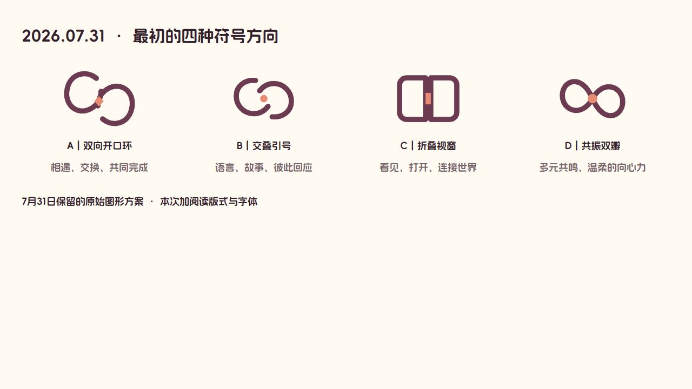

原始HTML图形；本次补拍，添加阅读版式与统一字体

### 怎么做

- 输入：学院背景、师生受众和喜欢的参考。
- 行动：逐问逐答，明确气质、使用场景、符号识别、可换装与中英文名字。
- 判断：用户希望角色本身好看，同时能提炼出鲜明符号。
- 产出：一组设计条件；此时没有已确认的CUMI角色。

### 踩过的坑

- 很早就试图把“国际传播”等抽象概念变成造型，用户不断问它是否好看、是否适合作头部。
- “90%女性”等受众数据来自用户口述，不是本次独立统计。

### 下次怎么避免

- 把功能目标和审美偏好分开记录。
- 先用3—5张参考图说明轮廓、比例和表情，不只堆概念词。

> 现在我们一起一步一步拆解设计这个IP 但是请在你回答前先向我提问 要求一次只回答一个问题

2026-07-31；[{"source": "rollout-2026-07-31T18-28-57-019fb7b8-4f75-7a70-a8b0-e174f7e9d1ca.jsonl", "lines": "67", "date": "2026-07-31", "thread": "019fb7b8-4f75-7a70-a8b0-e174f7e9d1ca"}]

> 身材比例 五官风格 可被提取的强烈符号

2026-07-31；[{"source": "rollout-2026-07-31T18-28-57-019fb7b8-4f75-7a70-a8b0-e174f7e9d1ca.jsonl", "lines": "254", "date": "2026-07-31", "thread": "019fb7b8-4f75-7a70-a8b0-e174f7e9d1ca"}]

依据：[{"source": "rollout-2026-07-31T18-28-57-019fb7b8-4f75-7a70-a8b0-e174f7e9d1ca.jsonl", "lines": "31", "date": "2026-07-31T10:39:22.615Z", "thread": "019fb7b8-4f75-7a70-a8b0-e174f7e9d1ca"}, {"source": "rollout-2026-07-31T18-28-57-019fb7b8-4f75-7a70-a8b0-e174f7e9d1ca.jsonl", "lines": "67", "date": "2026-07-31T10:43:03.580Z", "thread": "019fb7b8-4f75-7a70-a8b0-e174f7e9d1ca"}, {"source": "rollout-2026-07-31T18-28-57-019fb7b8-4f75-7a70-a8b0-e174f7e9d1ca.jsonl", "lines": "77", "date": "2026-07-31T10:43:40.435Z", "thread": "019fb7b8-4f75-7a70-a8b0-e174f7e9d1ca"}, {"source": "rollout-2026-07-31T18-28-57-019fb7b8-4f75-7a70-a8b0-e174f7e9d1ca.jsonl", "lines": "167", "date": "2026-07-31T10:47:54.369Z", "thread": "019fb7b8-4f75-7a70-a8b0-e174f7e9d1ca"}, {"source": "rollout-2026-07-31T18-28-57-019fb7b8-4f75-7a70-a8b0-e174f7e9d1ca.jsonl", "lines": "254", "date": "2026-07-31T10:54:02.715Z", "thread": "019fb7b8-4f75-7a70-a8b0-e174f7e9d1ca"}]

## 02 / 2026-07-31—08-08 / 多次推倒重来：符号、猫、抽象小生命、鹅与星星

最初没有直接得到CUMI。项目先探索有鲜明符号的头部，后来试猫、抽象小生命、鹅和星星；这些方向经历多次否定。

早期方案被否定

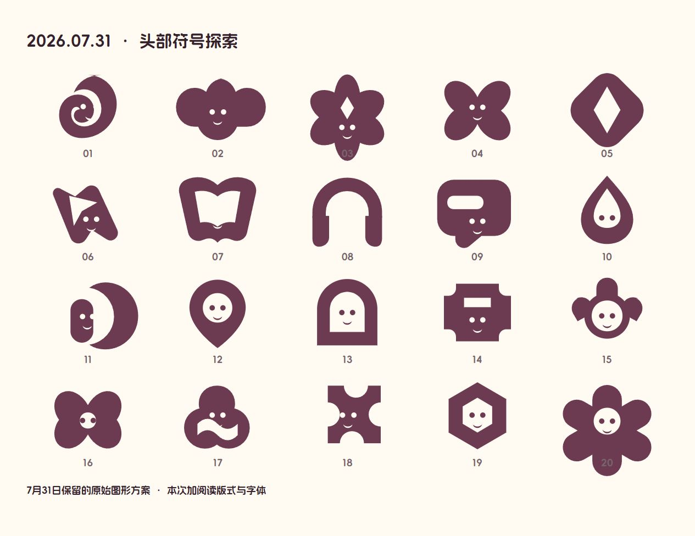

原始HTML图形；本次补拍，添加阅读版式与统一字体

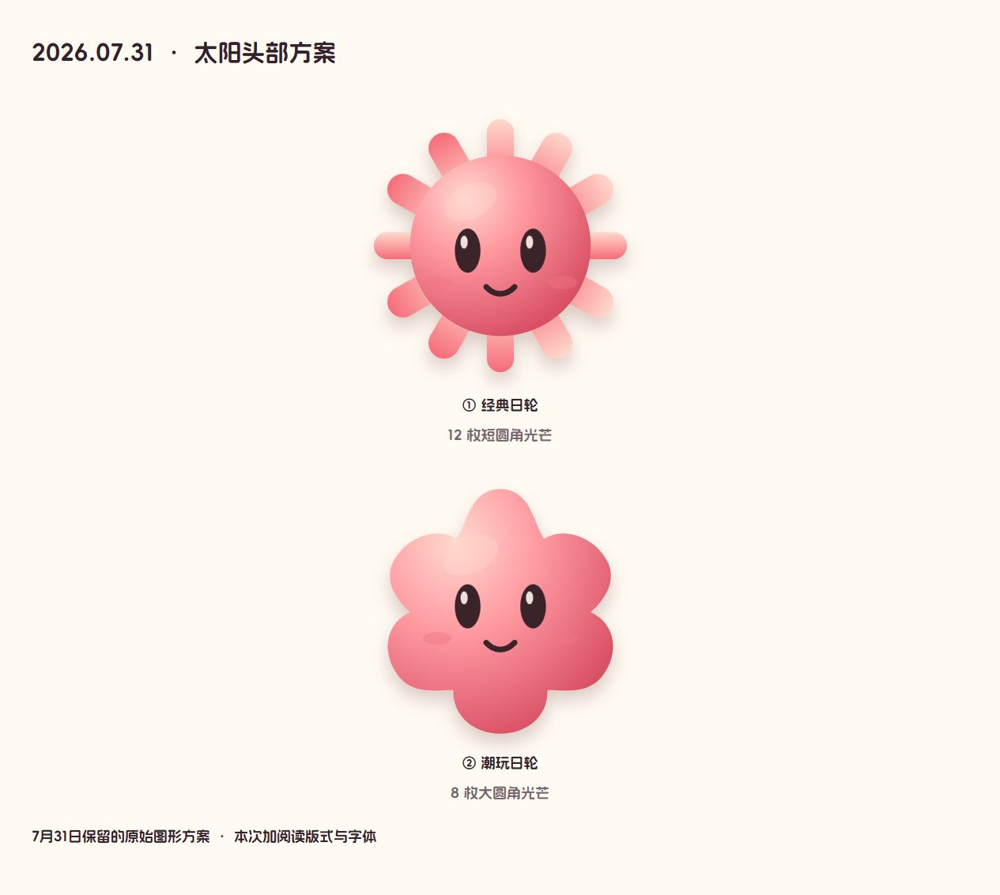

原始HTML图形；本次补拍，添加阅读版式与统一字体

当时生成的原始候选，未采用

### 怎么做

- 输入：头部符号、猫、抽象小生命、鹅和星星等候选方向。
- 行动：画几何小图、20种剪影；试提示词和Tapnow；继续换原型。
- 判断：很多图只是满足“可爱、圆润”等词，整体造型仍未通过用户判断。
- 产出：被淘汰的候选与更明确的审美标准。

### 踩过的坑

- 用随机几何变化代替角色设计。
- 一味追问“哪个好看”，把本应由设计者完成的初筛交给用户。
- 用抽象气质词描述角色，仍不足以判断具体的轮廓和比例。

### 下次怎么避免

- 每轮写清只比较哪一项：轮廓、比例或表情。
- 展示前先淘汰自己也不认可的方案。
- 保留被否定版本和理由，防止后续又回到原地。

> 你给我出图之前 需要自己审视一下到底好不好看再发给我

2026-08-08；[{"source": "rollout-2026-07-31T18-28-57-019fb7b8-4f75-7a70-a8b0-e174f7e9d1ca.jsonl", "lines": "4785", "date": "2026-08-08", "thread": "019fb7b8-4f75-7a70-a8b0-e174f7e9d1ca"}]

依据：[{"source": "rollout-2026-07-31T18-28-57-019fb7b8-4f75-7a70-a8b0-e174f7e9d1ca.jsonl", "lines": "403", "date": "2026-07-31T11:02:00.850Z", "thread": "019fb7b8-4f75-7a70-a8b0-e174f7e9d1ca"}, {"source": "rollout-2026-07-31T18-28-57-019fb7b8-4f75-7a70-a8b0-e174f7e9d1ca.jsonl", "lines": "1544", "date": "2026-07-31T13:10:29.983Z", "thread": "019fb7b8-4f75-7a70-a8b0-e174f7e9d1ca"}, {"source": "rollout-2026-07-31T18-28-57-019fb7b8-4f75-7a70-a8b0-e174f7e9d1ca.jsonl", "lines": "2064", "date": "2026-08-01T07:52:43.067Z", "thread": "019fb7b8-4f75-7a70-a8b0-e174f7e9d1ca"}, {"source": "rollout-2026-07-31T18-28-57-019fb7b8-4f75-7a70-a8b0-e174f7e9d1ca.jsonl", "lines": "3165", "date": "2026-08-01T09:13:39.320Z", "thread": "019fb7b8-4f75-7a70-a8b0-e174f7e9d1ca"}, {"source": "rollout-2026-07-31T18-28-57-019fb7b8-4f75-7a70-a8b0-e174f7e9d1ca.jsonl", "lines": "3960", "date": "2026-08-08T12:47:20.089Z", "thread": "019fb7b8-4f75-7a70-a8b0-e174f7e9d1ca"}, {"source": "rollout-2026-07-31T18-28-57-019fb7b8-4f75-7a70-a8b0-e174f7e9d1ca.jsonl", "lines": "5062", "date": "2026-08-08T13:47:46.898Z", "thread": "019fb7b8-4f75-7a70-a8b0-e174f7e9d1ca"}, {"source": "rollout-2026-07-31T18-28-57-019fb7b8-4f75-7a70-a8b0-e174f7e9d1ca.jsonl", "lines": "5299", "date": "2026-08-08T14:49:31.170Z", "thread": "019fb7b8-4f75-7a70-a8b0-e174f7e9d1ca"}, {"source": "rollout-2026-07-31T18-28-57-019fb7b8-4f75-7a70-a8b0-e174f7e9d1ca.jsonl", "lines": "5346", "date": "2026-08-08T14:52:33.210Z", "thread": "019fb7b8-4f75-7a70-a8b0-e174f7e9d1ca"}]

## 03 / 2026-08-09 / 先出现紫色原图，再比较十款，最后回选原图

8月9日21:46先得到紫色圆鼻原图，随后又做了十种新方向。22:37，老师贴回最早那张紫色图，认为有潜力，开始提出鼻子等局部修改。

候选形成，尚未定稿

原始候选，未采用

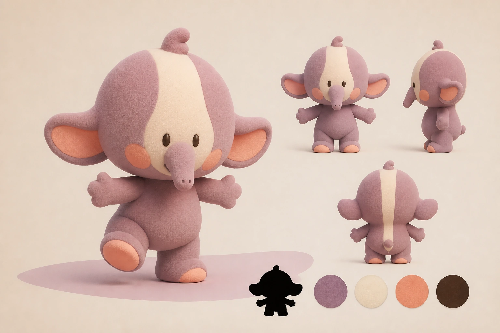

原始候选

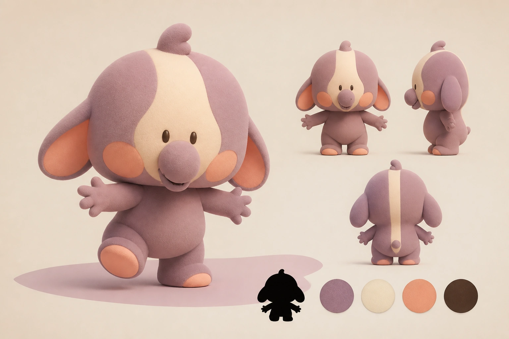

历史原图；与后来另存的v1不是同一张

### 怎么做

- 先出原图：21:46得到紫色、宽耳、奶油色中轴和圆鼻的原图。
- 继续比较：21:49提出十种新方案，22:14完成十张候选。
- 明确选择：22:37贴回最早的紫色原图，认为有潜力，但鼻子还需调整。
- 进入修改：保留喜欢的整体风格，开始逐一调整鼻子、呆毛、耳朵和尾巴。

### 踩过的坑

- AI自评较高的方案，仍可能被老师否定。评分不能代替真实选择。
- 文件名里的v1不是最早的原图；只看编号，容易拿错后续修改的基础。

### 下次怎么避免

- 把选中的图单独保存，记录选择日期与文件对应关系。
- 进入局部修改后，每轮说明保留什么、只改哪里。

> 你需要自己做审视

2026-08-09；[{"source": "rollout-2026-07-31T18-28-57-019fb7b8-4f75-7a70-a8b0-e174f7e9d1ca.jsonl", "lines": "6153", "date": "2026-08-09", "thread": "019fb7b8-4f75-7a70-a8b0-e174f7e9d1ca"}]

> 一次性给我出10个不同种类 不同风格的设计看看

2026-08-09；[{"source": "rollout-2026-07-31T18-28-57-019fb7b8-4f75-7a70-a8b0-e174f7e9d1ca.jsonl", "lines": "6798", "date": "2026-08-09", "thread": "019fb7b8-4f75-7a70-a8b0-e174f7e9d1ca"}]

依据：[{"source": "rollout-2026-07-31T18-28-57-019fb7b8-4f75-7a70-a8b0-e174f7e9d1ca.jsonl", "lines": "6290", "date": "2026-08-09T10:13:47.638Z", "thread": "019fb7b8-4f75-7a70-a8b0-e174f7e9d1ca"}, {"source": "rollout-2026-07-31T18-28-57-019fb7b8-4f75-7a70-a8b0-e174f7e9d1ca.jsonl", "lines": "6394", "date": "2026-08-09T10:29:51.306Z", "thread": "019fb7b8-4f75-7a70-a8b0-e174f7e9d1ca"}, {"source": "rollout-2026-07-31T18-28-57-019fb7b8-4f75-7a70-a8b0-e174f7e9d1ca.jsonl", "lines": "6630", "date": "2026-08-09T10:54:58.452Z", "thread": "019fb7b8-4f75-7a70-a8b0-e174f7e9d1ca"}, {"source": "rollout-2026-07-31T18-28-57-019fb7b8-4f75-7a70-a8b0-e174f7e9d1ca.jsonl", "lines": "6661", "date": "2026-08-09T10:58:05.416Z", "thread": "019fb7b8-4f75-7a70-a8b0-e174f7e9d1ca"}, {"source": "rollout-2026-07-31T18-28-57-019fb7b8-4f75-7a70-a8b0-e174f7e9d1ca.jsonl", "lines": "6744", "date": "2026-08-09T13:30:19.962Z", "thread": "019fb7b8-4f75-7a70-a8b0-e174f7e9d1ca"}, {"source": "rollout-2026-07-31T18-28-57-019fb7b8-4f75-7a70-a8b0-e174f7e9d1ca.jsonl", "lines": "6750", "date": "2026-08-09T13:43:59.777Z", "thread": "019fb7b8-4f75-7a70-a8b0-e174f7e9d1ca"}, {"source": "rollout-2026-07-31T18-28-57-019fb7b8-4f75-7a70-a8b0-e174f7e9d1ca.jsonl", "lines": "6798", "date": "2026-08-09T13:49:38.456Z", "thread": "019fb7b8-4f75-7a70-a8b0-e174f7e9d1ca"}, {"source": "rollout-2026-07-31T18-28-57-019fb7b8-4f75-7a70-a8b0-e174f7e9d1ca.jsonl", "lines": "6911", "date": "2026-08-09T14:37:03.901Z", "thread": "019fb7b8-4f75-7a70-a8b0-e174f7e9d1ca"}, {"source": "rollout-2026-07-31T18-28-57-019fb7b8-4f75-7a70-a8b0-e174f7e9d1ca.jsonl", "lines": [6770], "date": "2026-08-09T13:45:51.174Z", "thread": "019fb7b8-4f75-7a70-a8b0-e174f7e9d1ca"}, {"source": "rollout-2026-07-31T18-28-57-019fb7b8-4f75-7a70-a8b0-e174f7e9d1ca.jsonl", "lines": [6772], "date": "2026-08-09T13:46:28.438Z", "thread": "019fb7b8-4f75-7a70-a8b0-e174f7e9d1ca"}, {"source": "rollout-2026-07-31T18-28-57-019fb7b8-4f75-7a70-a8b0-e174f7e9d1ca.jsonl", "lines": [6782], "date": "2026-08-09T13:47:24.414Z", "thread": "019fb7b8-4f75-7a70-a8b0-e174f7e9d1ca"}, {"source": "rollout-2026-07-31T18-28-57-019fb7b8-4f75-7a70-a8b0-e174f7e9d1ca.jsonl", "lines": [6784], "date": "2026-08-09T13:48:10.423Z", "thread": "019fb7b8-4f75-7a70-a8b0-e174f7e9d1ca"}, {"source": "rollout-2026-07-31T18-28-57-019fb7b8-4f75-7a70-a8b0-e174f7e9d1ca.jsonl", "lines": [6792], "date": "2026-08-09T13:49:27.740Z", "thread": "019fb7b8-4f75-7a70-a8b0-e174f7e9d1ca"}, {"source": "rollout-2026-07-31T18-28-57-019fb7b8-4f75-7a70-a8b0-e174f7e9d1ca.jsonl", "lines": [6799], "date": "2026-08-09T13:49:38.457Z", "thread": "019fb7b8-4f75-7a70-a8b0-e174f7e9d1ca"}, {"source": "rollout-2026-07-31T18-28-57-019fb7b8-4f75-7a70-a8b0-e174f7e9d1ca.jsonl", "lines": [6827], "date": "2026-08-09T13:53:24.403Z", "thread": "019fb7b8-4f75-7a70-a8b0-e174f7e9d1ca"}, {"source": "rollout-2026-07-31T18-28-57-019fb7b8-4f75-7a70-a8b0-e174f7e9d1ca.jsonl", "lines": [6832], "date": "2026-08-09T13:54:52.660Z", "thread": "019fb7b8-4f75-7a70-a8b0-e174f7e9d1ca"}, {"source": "rollout-2026-07-31T18-28-57-019fb7b8-4f75-7a70-a8b0-e174f7e9d1ca.jsonl", "lines": [6843], "date": "2026-08-09T13:57:20.297Z", "thread": "019fb7b8-4f75-7a70-a8b0-e174f7e9d1ca"}, {"source": "rollout-2026-07-31T18-28-57-019fb7b8-4f75-7a70-a8b0-e174f7e9d1ca.jsonl", "lines": [6848], "date": "2026-08-09T13:59:16.736Z", "thread": "019fb7b8-4f75-7a70-a8b0-e174f7e9d1ca"}, {"source": "rollout-2026-07-31T18-28-57-019fb7b8-4f75-7a70-a8b0-e174f7e9d1ca.jsonl", "lines": [6859], "date": "2026-08-09T14:01:49.291Z", "thread": "019fb7b8-4f75-7a70-a8b0-e174f7e9d1ca"}, {"source": "rollout-2026-07-31T18-28-57-019fb7b8-4f75-7a70-a8b0-e174f7e9d1ca.jsonl", "lines": [6864], "date": "2026-08-09T14:03:36.996Z", "thread": "019fb7b8-4f75-7a70-a8b0-e174f7e9d1ca"}, {"source": "rollout-2026-07-31T18-28-57-019fb7b8-4f75-7a70-a8b0-e174f7e9d1ca.jsonl", "lines": [6875], "date": "2026-08-09T14:07:04.273Z", "thread": "019fb7b8-4f75-7a70-a8b0-e174f7e9d1ca"}, {"source": "rollout-2026-07-31T18-28-57-019fb7b8-4f75-7a70-a8b0-e174f7e9d1ca.jsonl", "lines": [6880], "date": "2026-08-09T14:08:33.127Z", "thread": "019fb7b8-4f75-7a70-a8b0-e174f7e9d1ca"}, {"source": "rollout-2026-07-31T18-28-57-019fb7b8-4f75-7a70-a8b0-e174f7e9d1ca.jsonl", "lines": [6891], "date": "2026-08-09T14:12:13.279Z", "thread": "019fb7b8-4f75-7a70-a8b0-e174f7e9d1ca"}, {"source": "rollout-2026-07-31T18-28-57-019fb7b8-4f75-7a70-a8b0-e174f7e9d1ca.jsonl", "lines": [6896], "date": "2026-08-09T14:14:11.134Z", "thread": "019fb7b8-4f75-7a70-a8b0-e174f7e9d1ca"}, {"source": "rollout-2026-07-31T18-28-57-019fb7b8-4f75-7a70-a8b0-e174f7e9d1ca.jsonl", "lines": [6911], "date": "2026-08-09T14:37:03.901Z", "thread": "019fb7b8-4f75-7a70-a8b0-e174f7e9d1ca"}]

## 04 / 2026-08-09—08-10 / 修改小地方，却把整张图越改越脏

鼻子、呆毛、后脑勺、耳朵和尾巴逐步调整，角色身份越来越清楚。但连续生成式编辑让颜色发黄、绒毛变糊，并出现三角形纹理。

经历失败后局部修正；母版仍在随后由用户PS校正

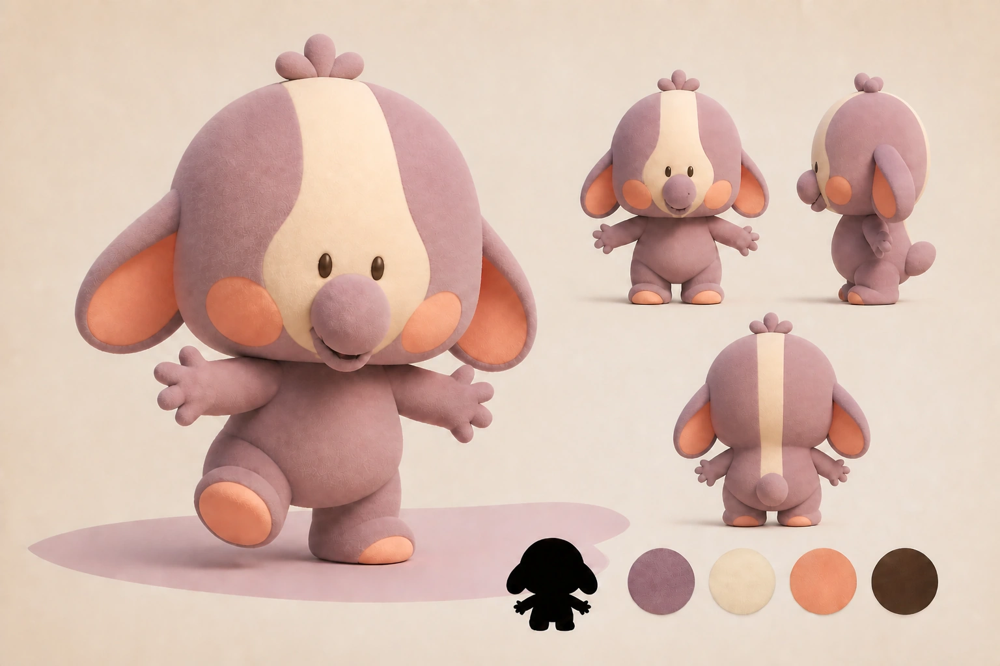

原始迭代稿

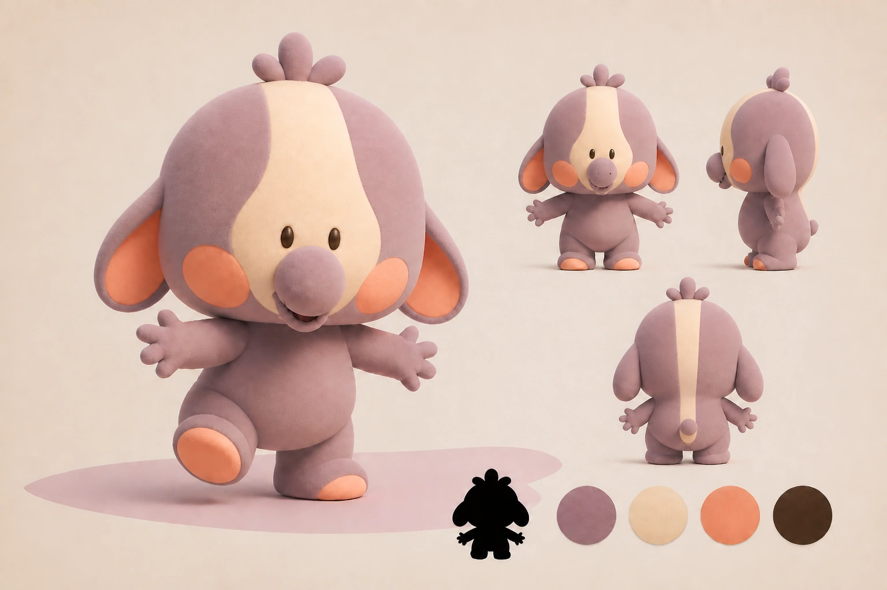

原始迭代稿，不标成最终

原始修正版

### 怎么做

- 输入：紫色角色初图。
- 行动：扁鼻、三瓣呆毛、圆后脑、大尾巴、背面耳朵与剪影逐项修改。
- 判断：造型接近满意，材质却倒退；恢复质感不能把毛绒换成光滑塑料。
- 产出：v5到v20等版本；后来改为局部编辑，并对允许区域之外的像素作差异检查。

### 踩过的坑

- 每次局部要求都重算全图，造成颜色与纹理积累偏差。
- 只看“出了4K文件”，忽略尾巴连接是否自然。
- 助手声称恢复干净后，用户仍指出纹理没有解决。

### 下次怎么避免

- 固定一张后续都要遵守的标准图（母版），另存每轮；写清可改区域和不可改特征。
- 造型验收和材质验收分开，必须放大对比。
- 局部像素检查能证明没动其他区域，仍需目视检查连接与阴影。

> 颜色相比于最初的版本有点脏有点黄 但是毛绒质感不对 而且有浅浅的三角形纹路

2026-08-10；[{"source": "rollout-2026-07-31T18-28-57-019fb7b8-4f75-7a70-a8b0-e174f7e9d1ca.jsonl", "lines": "7369", "date": "2026-08-10", "thread": "019fb7b8-4f75-7a70-a8b0-e174f7e9d1ca"}]

> 那个三角形纹理是不可接受的 不要给我看类似的东西 我要的是干净的毛绒纹理

2026-08-10；[{"source": "rollout-2026-07-31T18-28-57-019fb7b8-4f75-7a70-a8b0-e174f7e9d1ca.jsonl", "lines": "7522", "date": "2026-08-10", "thread": "019fb7b8-4f75-7a70-a8b0-e174f7e9d1ca"}]

依据：[{"source": "rollout-2026-07-31T18-28-57-019fb7b8-4f75-7a70-a8b0-e174f7e9d1ca.jsonl", "lines": "7013", "date": "2026-08-09T15:02:40.280Z", "thread": "019fb7b8-4f75-7a70-a8b0-e174f7e9d1ca"}, {"source": "rollout-2026-07-31T18-28-57-019fb7b8-4f75-7a70-a8b0-e174f7e9d1ca.jsonl", "lines": "7041", "date": "2026-08-09T15:12:58.250Z", "thread": "019fb7b8-4f75-7a70-a8b0-e174f7e9d1ca"}, {"source": "rollout-2026-07-31T18-28-57-019fb7b8-4f75-7a70-a8b0-e174f7e9d1ca.jsonl", "lines": "7067", "date": "2026-08-09T15:21:42.641Z", "thread": "019fb7b8-4f75-7a70-a8b0-e174f7e9d1ca"}, {"source": "rollout-2026-07-31T18-28-57-019fb7b8-4f75-7a70-a8b0-e174f7e9d1ca.jsonl", "lines": "7369", "date": "2026-08-09T16:50:56.561Z", "thread": "019fb7b8-4f75-7a70-a8b0-e174f7e9d1ca"}, {"source": "rollout-2026-07-31T18-28-57-019fb7b8-4f75-7a70-a8b0-e174f7e9d1ca.jsonl", "lines": "7522", "date": "2026-08-10T11:32:26.249Z", "thread": "019fb7b8-4f75-7a70-a8b0-e174f7e9d1ca"}, {"source": "rollout-2026-07-31T18-28-57-019fb7b8-4f75-7a70-a8b0-e174f7e9d1ca.jsonl", "lines": "7775", "date": "2026-08-10T12:55:05.959Z", "thread": "019fb7b8-4f75-7a70-a8b0-e174f7e9d1ca"}, {"source": "rollout-2026-07-31T18-28-57-019fb7b8-4f75-7a70-a8b0-e174f7e9d1ca.jsonl", "lines": "7788", "date": "2026-08-10T12:58:05.972Z", "thread": "019fb7b8-4f75-7a70-a8b0-e174f7e9d1ca"}, {"source": "rollout-2026-07-31T18-28-57-019fb7b8-4f75-7a70-a8b0-e174f7e9d1ca.jsonl", "lines": "7882", "date": "2026-08-10T13:18:45.724Z", "thread": "019fb7b8-4f75-7a70-a8b0-e174f7e9d1ca"}]

## 05 / 2026-08-10—08-12 / 从一个角色，变成CUMI／酷咪和网页角色手册

8月10日用户明确要求把角色和学院联系起来，做完整角色手册，并选择前端网页以便嵌入视频和GIF。8月11日确定CUMI／酷咪。

网页方向与命名确认

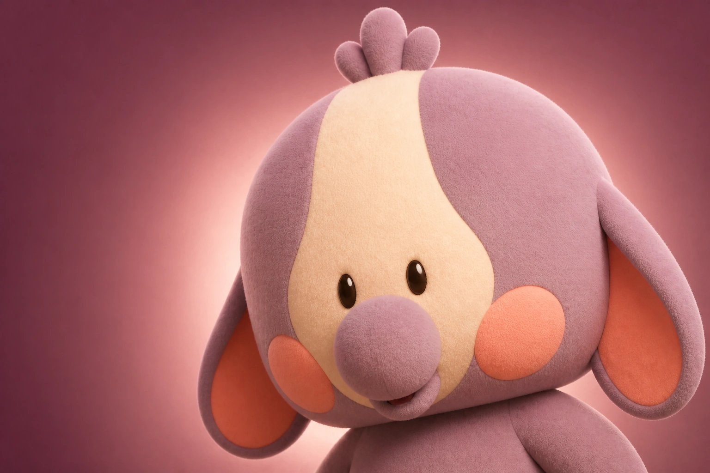

项目保留素材，当前文件可能经后续修订

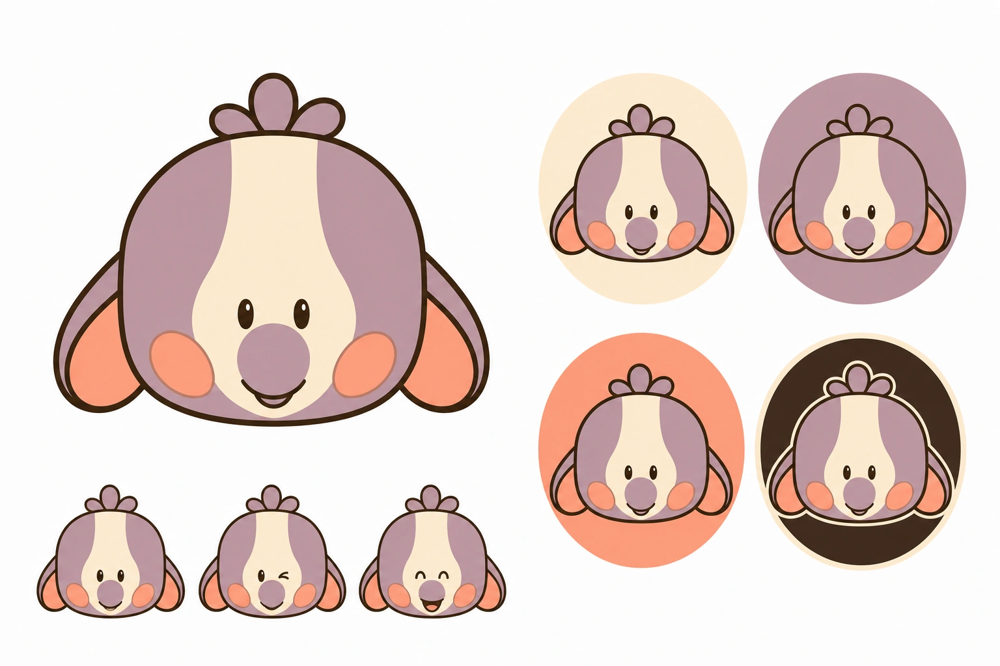

原始方案

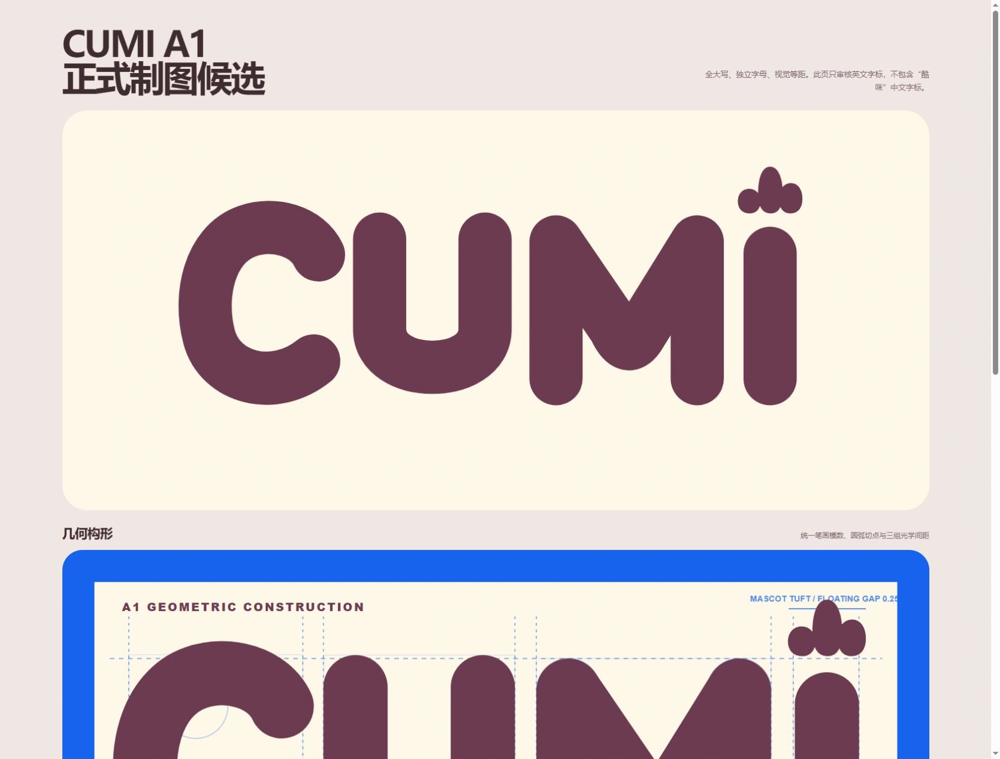

原始审稿文件

### 怎么做

- 输入：角色图和学院背景。
- 行动：整理角色故事、名字、版式草案和页面顺序，逐步加入2D头像、字标、三视图与服装。
- 判断：学院关系通过故事和署名表达，封面仍以角色为主。
- 产出：可浏览的角色手册、命名和四类Logo方向。

### 踩过的坑

- 把基础概念图直接当封面；用户要求另做角色主视觉。
- 学校信息容易抢走角色作品的主角位置。
- 草图、候选、定稿没有在页面上清楚区分。

### 下次怎么避免

- 先画页面清单，逐页标“草图/待验收/定稿”。
- 角色内容和学校关系各有位置，不用每页重复宣传。

> 做成前端网页吧 同时支持嵌入视频和gif等格式

2026-08-10；[{"source": "rollout-2026-07-31T18-28-57-019fb7b8-4f75-7a70-a8b0-e174f7e9d1ca.jsonl", "lines": "8008", "date": "2026-08-10", "thread": "019fb7b8-4f75-7a70-a8b0-e174f7e9d1ca"}]

> 封面还是要围绕角色本身来做设计

2026-08-11；[{"source": "rollout-2026-07-31T18-28-57-019fb7b8-4f75-7a70-a8b0-e174f7e9d1ca.jsonl", "lines": "8316", "date": "2026-08-11", "thread": "019fb7b8-4f75-7a70-a8b0-e174f7e9d1ca"}]

> 酷咪吧

2026-08-11；[{"source": "rollout-2026-07-31T18-28-57-019fb7b8-4f75-7a70-a8b0-e174f7e9d1ca.jsonl", "lines": "8870", "date": "2026-08-11", "thread": "019fb7b8-4f75-7a70-a8b0-e174f7e9d1ca"}]

依据：[{"source": "rollout-2026-07-31T18-28-57-019fb7b8-4f75-7a70-a8b0-e174f7e9d1ca.jsonl", "lines": "7915", "date": "2026-08-10T13:29:13.019Z", "thread": "019fb7b8-4f75-7a70-a8b0-e174f7e9d1ca"}, {"source": "rollout-2026-07-31T18-28-57-019fb7b8-4f75-7a70-a8b0-e174f7e9d1ca.jsonl", "lines": "8008", "date": "2026-08-10T14:18:50.685Z", "thread": "019fb7b8-4f75-7a70-a8b0-e174f7e9d1ca"}, {"source": "rollout-2026-07-31T18-28-57-019fb7b8-4f75-7a70-a8b0-e174f7e9d1ca.jsonl", "lines": "8118", "date": "2026-08-10T15:24:11.308Z", "thread": "019fb7b8-4f75-7a70-a8b0-e174f7e9d1ca"}, {"source": "rollout-2026-07-31T18-28-57-019fb7b8-4f75-7a70-a8b0-e174f7e9d1ca.jsonl", "lines": "8316", "date": "2026-08-10T16:20:56.531Z", "thread": "019fb7b8-4f75-7a70-a8b0-e174f7e9d1ca"}, {"source": "rollout-2026-07-31T18-28-57-019fb7b8-4f75-7a70-a8b0-e174f7e9d1ca.jsonl", "lines": "8848", "date": "2026-08-11T14:42:08.811Z", "thread": "019fb7b8-4f75-7a70-a8b0-e174f7e9d1ca"}, {"source": "rollout-2026-07-31T18-28-57-019fb7b8-4f75-7a70-a8b0-e174f7e9d1ca.jsonl", "lines": "8870", "date": "2026-08-11T14:44:51.799Z", "thread": "019fb7b8-4f75-7a70-a8b0-e174f7e9d1ca"}, {"source": "rollout-2026-07-31T18-28-57-019fb7b8-4f75-7a70-a8b0-e174f7e9d1ca.jsonl", "lines": "8909", "date": "2026-08-11T14:53:32.417Z", "thread": "019fb7b8-4f75-7a70-a8b0-e174f7e9d1ca"}]

## 06 / 2026-08-12—08-13 / 锁母版，分三个检查点，再交第一包

用户暂停制作，用PS亲自修了后脑勺和尾巴，指定后续全部以这张图为准。任务拆成标准系统、服装与二维延展、动态与整体收束三组。8月13日首次独立打包。

首次网站包有工具验证；当前旧ZIP已不在工作区

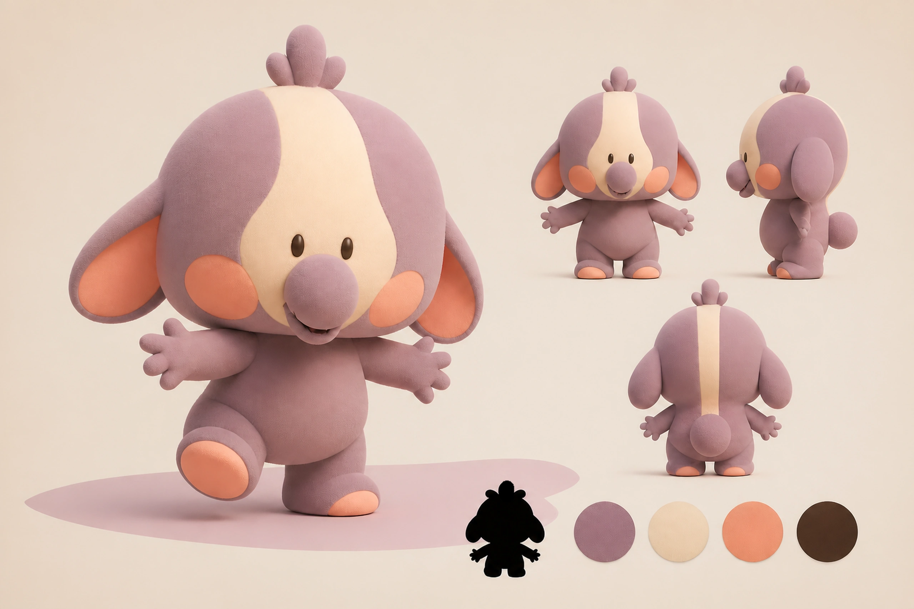

用户原始修正版的项目归档

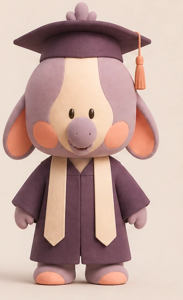

原始归档参考

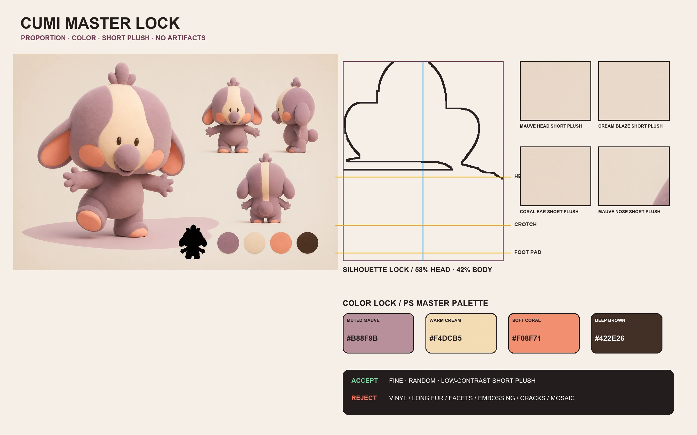

项目过程文件，具体生成日待文件日志进一步核定

### 怎么做

- 输入：用户PS修正的唯一母版、第一版学士服及校徽。
- 行动：落实无鼻孔、帽子与呆毛同材质、六服装、特征拆解和八方向转台。
- 判断：只有通过检查点验收，才继续下一个阶段。
- 产出：第一个网站ZIP，历史日志记录108文件、63本地引用、0缺失。

### 踩过的坑

- 母版未锁时批量扩展，错误被复制到六套衣服。
- 用户暂停后重新明确规范，说明此前执行没有守住比例和细节。
- 网站服务停止后“网页打不开”，需要区分文件坏了还是本地服务没启动。

### 下次怎么避免

- 把唯一母版复制进项目并记录文件名/文件内容校验值。
- 每个检查点都包含作品图、网页截图、未完成项。
- 交付包有固定入口和启动脚本，并做独立解压验证。

> 后续所有角色生成的图片都基于给我你的这张图来制作

2026-08-13；[{"source": "rollout-2026-07-31T18-28-57-019fb7b8-4f75-7a70-a8b0-e174f7e9d1ca.jsonl", "lines": "12923", "date": "2026-08-13", "thread": "019fb7b8-4f75-7a70-a8b0-e174f7e9d1ca"}]

> 按之前确定的规范全部去掉

2026-08-13；[{"source": "rollout-2026-07-31T18-28-57-019fb7b8-4f75-7a70-a8b0-e174f7e9d1ca.jsonl", "lines": "12941", "date": "2026-08-13", "thread": "019fb7b8-4f75-7a70-a8b0-e174f7e9d1ca"}]

依据：[{"source": "rollout-2026-07-31T18-28-57-019fb7b8-4f75-7a70-a8b0-e174f7e9d1ca.jsonl", "lines": "12336", "date": "2026-08-12T14:45:23.605Z", "thread": "019fb7b8-4f75-7a70-a8b0-e174f7e9d1ca"}, {"source": "rollout-2026-07-31T18-28-57-019fb7b8-4f75-7a70-a8b0-e174f7e9d1ca.jsonl", "lines": "12904", "date": "2026-08-12T17:24:37.072Z", "thread": "019fb7b8-4f75-7a70-a8b0-e174f7e9d1ca"}, {"source": "rollout-2026-07-31T18-28-57-019fb7b8-4f75-7a70-a8b0-e174f7e9d1ca.jsonl", "lines": "12923", "date": "2026-08-12T17:32:33.519Z", "thread": "019fb7b8-4f75-7a70-a8b0-e174f7e9d1ca"}, {"source": "rollout-2026-07-31T18-28-57-019fb7b8-4f75-7a70-a8b0-e174f7e9d1ca.jsonl", "lines": "12946", "date": "2026-08-12T17:36:52.594Z", "thread": "019fb7b8-4f75-7a70-a8b0-e174f7e9d1ca"}, {"source": "rollout-2026-07-31T18-28-57-019fb7b8-4f75-7a70-a8b0-e174f7e9d1ca.jsonl", "lines": "13490", "date": "2026-08-12T20:26:18.854Z", "thread": "019fb7b8-4f75-7a70-a8b0-e174f7e9d1ca"}, {"source": "rollout-2026-07-31T18-28-57-019fb7b8-4f75-7a70-a8b0-e174f7e9d1ca.jsonl", "lines": "14015", "date": "2026-08-13T10:20:31.900Z", "thread": "019fb7b8-4f75-7a70-a8b0-e174f7e9d1ca"}, {"source": "rollout-2026-07-31T18-28-57-019fb7b8-4f75-7a70-a8b0-e174f7e9d1ca.jsonl", "lines": "14123", "date": "2026-08-13T11:27:33.252Z", "thread": "019fb7b8-4f75-7a70-a8b0-e174f7e9d1ca"}, {"source": "rollout-2026-07-31T18-28-57-019fb7b8-4f75-7a70-a8b0-e174f7e9d1ca.jsonl", "lines": "14131", "date": "2026-08-13T11:34:09.497Z", "thread": "019fb7b8-4f75-7a70-a8b0-e174f7e9d1ca"}]

## 07 / 2026-08-13—08-15 / 六套服装扩展：统一角色比“换六件衣服”难得多

六套服装需要同样的身体比例、裸足、毛绒和大小，还要有不同动作、配色与对应三视图。修纹理时一度把毛绒改成了塑料般的柔光。用户再次明确禁止。

六角色阶段获用户确认，部分后续字体问题未收口

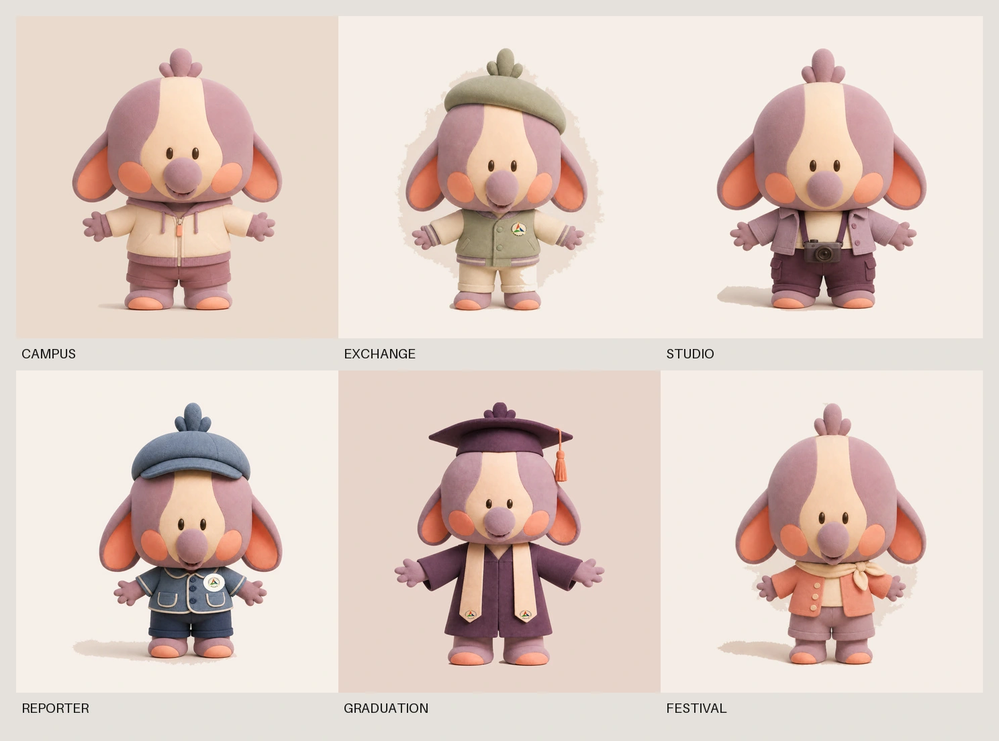

原始过程文件

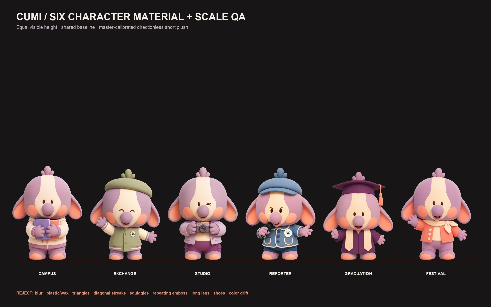

原始验收图

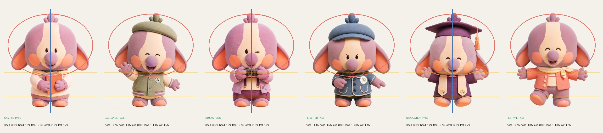

原始过程图，不自动等同定稿

### 怎么做

- 输入：六张服装图、母版比例、用户抠好的透明PNG。
- 行动：去鞋、统一2K尺寸和脚底线，制作独立海报、对应三视图、合集与2D头像。
- 判断：用户指出比例、腿长、材质和三视图错误，要求返工。8月14日确认“这6个可以了”。
- 产出：六张透明2048×2048角色图、服装海报和组合展示。

### 踩过的坑

- 尺寸一样不等于视觉大小和比例一样。
- 把无异常纹理误解成无毛绒。
- 三视图用了不穿衣服的母版，和页面服装对不上。
- 用户早已不要移动端，助手却反复做窄屏适配和验证。

### 下次怎么避免

- 先做1套通过，再批量扩到6套。
- 同屏叠加比较头顶线、脚底线、头宽、腿长。
- 只做用户要求的桌面范围，避免把时间花在明确排除的端。

> 你明明知道母版里是毛绒的质感 你现在说只保留了均匀柔光材质 我问你毛绒呢 在哪 你为什么突然给我改材质

2026-08-14；[{"source": "rollout-2026-08-13T14-41-18-019ff9da-9086-7e71-a9ac-7ffb0f350661.jsonl", "lines": "2111", "date": "2026-08-14", "thread": "019ff9da-9086-7e71-a9ac-7ffb0f350661"}]

> 这6个可以了 继续吧

2026-08-14；[{"source": "rollout-2026-08-13T14-41-18-019ff9da-9086-7e71-a9ac-7ffb0f350661.jsonl", "lines": "3412", "date": "2026-08-14", "thread": "019ff9da-9086-7e71-a9ac-7ffb0f350661"}]

> 我之前说过 不用做手机移动端的版本

2026-08-14；[{"source": "rollout-2026-08-13T14-41-18-019ff9da-9086-7e71-a9ac-7ffb0f350661.jsonl", "lines": "3673", "date": "2026-08-14", "thread": "019ff9da-9086-7e71-a9ac-7ffb0f350661"}]

依据：[{"source": "rollout-2026-08-13T14-41-18-019ff9da-9086-7e71-a9ac-7ffb0f350661.jsonl", "lines": "30", "date": "2026-08-13T06:42:55.293Z", "thread": "019ff9da-9086-7e71-a9ac-7ffb0f350661"}, {"source": "rollout-2026-08-13T14-41-18-019ff9da-9086-7e71-a9ac-7ffb0f350661.jsonl", "lines": "287", "date": "2026-08-13T07:01:48.051Z", "thread": "019ff9da-9086-7e71-a9ac-7ffb0f350661"}, {"source": "rollout-2026-08-13T14-41-18-019ff9da-9086-7e71-a9ac-7ffb0f350661.jsonl", "lines": "392", "date": "2026-08-13T07:09:51.272Z", "thread": "019ff9da-9086-7e71-a9ac-7ffb0f350661"}, {"source": "rollout-2026-08-13T14-41-18-019ff9da-9086-7e71-a9ac-7ffb0f350661.jsonl", "lines": "884", "date": "2026-08-13T10:32:26.483Z", "thread": "019ff9da-9086-7e71-a9ac-7ffb0f350661"}, {"source": "rollout-2026-08-13T14-41-18-019ff9da-9086-7e71-a9ac-7ffb0f350661.jsonl", "lines": "1993", "date": "2026-08-13T15:40:40.567Z", "thread": "019ff9da-9086-7e71-a9ac-7ffb0f350661"}, {"source": "rollout-2026-08-13T14-41-18-019ff9da-9086-7e71-a9ac-7ffb0f350661.jsonl", "lines": "2111", "date": "2026-08-13T16:07:55.114Z", "thread": "019ff9da-9086-7e71-a9ac-7ffb0f350661"}, {"source": "rollout-2026-08-13T14-41-18-019ff9da-9086-7e71-a9ac-7ffb0f350661.jsonl", "lines": "2116", "date": "2026-08-13T16:08:49.547Z", "thread": "019ff9da-9086-7e71-a9ac-7ffb0f350661"}, {"source": "rollout-2026-08-13T14-41-18-019ff9da-9086-7e71-a9ac-7ffb0f350661.jsonl", "lines": "2123", "date": "2026-08-13T16:11:12.487Z", "thread": "019ff9da-9086-7e71-a9ac-7ffb0f350661"}, {"source": "rollout-2026-08-13T14-41-18-019ff9da-9086-7e71-a9ac-7ffb0f350661.jsonl", "lines": "3412", "date": "2026-08-14T03:17:00.168Z", "thread": "019ff9da-9086-7e71-a9ac-7ffb0f350661"}, {"source": "rollout-2026-08-13T14-41-18-019ff9da-9086-7e71-a9ac-7ffb0f350661.jsonl", "lines": "3525", "date": "2026-08-14T03:37:01.521Z", "thread": "019ff9da-9086-7e71-a9ac-7ffb0f350661"}, {"source": "rollout-2026-08-13T14-41-18-019ff9da-9086-7e71-a9ac-7ffb0f350661.jsonl", "lines": "3673", "date": "2026-08-14T04:13:38.929Z", "thread": "019ff9da-9086-7e71-a9ac-7ffb0f350661"}]

## 08 / 2026-08-14—08-15 / 标识精修：把喜欢的草图逐步规范起来

独立任务处理呆毛、CUMI、头像和中文“酷咪”。呆毛与I的间距、多瓣高低、圆润曲率、纯色扁平和中文笔画关系都反复校正。

透明头像SVG通过独立复核；其他字标经历多轮返工

原始过程图

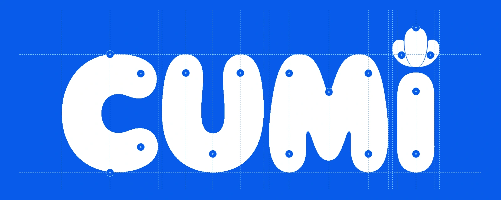

原始迭代稿

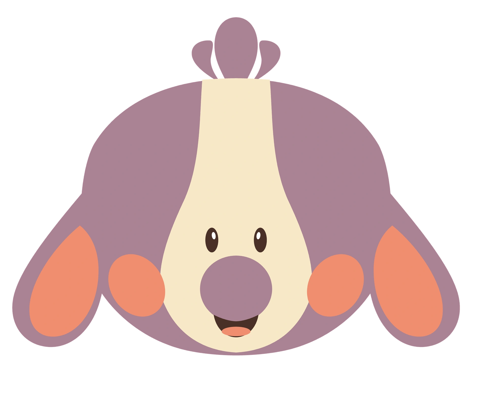

原始导出预览

### 怎么做

- 输入：用户选定草图、角色母版和既有呆毛符号。
- 行动：先调效果图，再按几何关系精修；头像导出透明SVG，由子agent制作和复核。
- 判断：几何图不能只是装饰性的圆；精修要保留选中轮廓。
- 产出：透明头像SVG与预览、几何构造图、各字标版本。

### 踩过的坑

- 用户要求微调原图，助手却换成旧版或另一个造型。
- 先喊最终版，再发现中文锯齿、粘连和边缘坑洼。
- 把圆弧展示画成无意义的小圆堆，没说明几何关系。

### 下次怎么避免

- 锁定当前选中的版本，每次只处理列出的差异。
- 矢量化之前先验收造型；矢量化之后检查小尺寸识别、闭合路径与透明背景。
- 复核要既有结构检查，也有参考图对比。

> 呆毛和I必须保持距离不能连在一起

2026-08-14；[{"source": "rollout-2026-08-14T19-52-03-01a0001d-6bdf-7f70-8026-4a9ad3d1aa9f.jsonl", "lines": "733", "date": "2026-08-14", "thread": "01a0001d-6bdf-7f70-8026-4a9ad3d1aa9f"}]

> 在这个基础上用几何制作作为微调

2026-08-14；[{"source": "rollout-2026-08-14T19-52-03-01a0001d-6bdf-7f70-8026-4a9ad3d1aa9f.jsonl", "lines": "1027", "date": "2026-08-14", "thread": "01a0001d-6bdf-7f70-8026-4a9ad3d1aa9f"}]

> 我要的是纯扁平的2D效果 不要任何阴影

2026-08-14；[{"source": "rollout-2026-08-14T19-52-03-01a0001d-6bdf-7f70-8026-4a9ad3d1aa9f.jsonl", "lines": "2967", "date": "2026-08-14", "thread": "01a0001d-6bdf-7f70-8026-4a9ad3d1aa9f"}]

依据：[{"source": "rollout-2026-08-14T19-52-03-01a0001d-6bdf-7f70-8026-4a9ad3d1aa9f.jsonl", "lines": "52", "date": "2026-08-14T11:54:45.348Z", "thread": "01a0001d-6bdf-7f70-8026-4a9ad3d1aa9f"}, {"source": "rollout-2026-08-14T19-52-03-01a0001d-6bdf-7f70-8026-4a9ad3d1aa9f.jsonl", "lines": "258", "date": "2026-08-14T12:10:41.753Z", "thread": "01a0001d-6bdf-7f70-8026-4a9ad3d1aa9f"}, {"source": "rollout-2026-08-14T19-52-03-01a0001d-6bdf-7f70-8026-4a9ad3d1aa9f.jsonl", "lines": "361", "date": "2026-08-14T12:17:37.052Z", "thread": "01a0001d-6bdf-7f70-8026-4a9ad3d1aa9f"}, {"source": "rollout-2026-08-14T19-52-03-01a0001d-6bdf-7f70-8026-4a9ad3d1aa9f.jsonl", "lines": "733", "date": "2026-08-14T12:41:06.476Z", "thread": "01a0001d-6bdf-7f70-8026-4a9ad3d1aa9f"}, {"source": "rollout-2026-08-14T19-52-03-01a0001d-6bdf-7f70-8026-4a9ad3d1aa9f.jsonl", "lines": "1027", "date": "2026-08-14T12:59:24.425Z", "thread": "01a0001d-6bdf-7f70-8026-4a9ad3d1aa9f"}, {"source": "rollout-2026-08-14T19-52-03-01a0001d-6bdf-7f70-8026-4a9ad3d1aa9f.jsonl", "lines": "1251", "date": "2026-08-14T13:12:20.022Z", "thread": "01a0001d-6bdf-7f70-8026-4a9ad3d1aa9f"}, {"source": "rollout-2026-08-14T19-52-03-01a0001d-6bdf-7f70-8026-4a9ad3d1aa9f.jsonl", "lines": "5414", "date": "2026-08-14T18:13:20.735Z", "thread": "01a0001d-6bdf-7f70-8026-4a9ad3d1aa9f"}, {"source": "rollout-2026-08-14T19-52-03-01a0001d-6bdf-7f70-8026-4a9ad3d1aa9f.jsonl", "lines": "5700", "date": "2026-08-14T20:01:02.032Z", "thread": "01a0001d-6bdf-7f70-8026-4a9ad3d1aa9f"}, {"source": "rollout-2026-08-14T19-52-03-01a0001d-6bdf-7f70-8026-4a9ad3d1aa9f.jsonl", "lines": "6126", "date": "2026-08-15T05:40:21.091Z", "thread": "01a0001d-6bdf-7f70-8026-4a9ad3d1aa9f"}, {"source": "rollout-2026-08-14T19-52-03-01a0001d-6bdf-7f70-8026-4a9ad3d1aa9f.jsonl", "lines": "6253", "date": "2026-08-15T05:53:31.531Z", "thread": "01a0001d-6bdf-7f70-8026-4a9ad3d1aa9f"}]

## 09 / 2026-08-14 / 六个2D角色：形式变扁平，身份不能变

单独的二维终稿任务并没有一次过。用户要求全身、统一站姿、纯扁平，但第一轮把衣服和帽子过度简化，角色比例也被质疑。

返工，V3候选待视觉验收

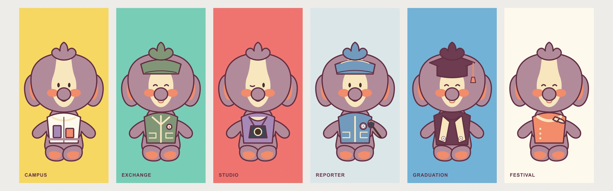

原始返工前版本

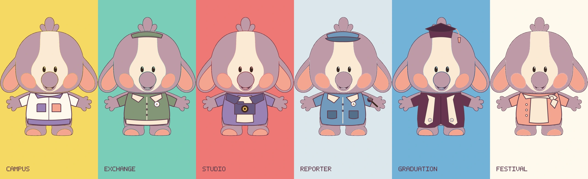

原始候选

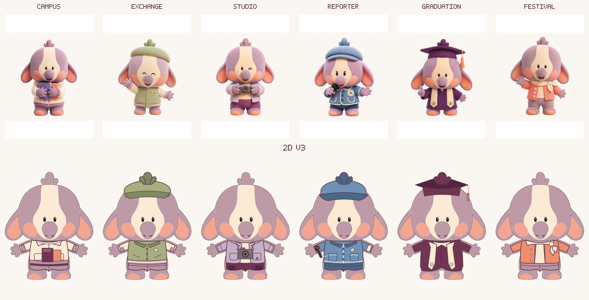

原始过程校对图

### 怎么做

- 输入：六套3D服装和严格比例要求。
- 行动：制作V1、V2，逐套核对帽型、开襟、短裤、相机、麦克风和学位服。
- 判断：助手承认V2衣服结构不合格，只能保留已确认身体母形。
- 产出：V3规格和后续候选文件；这条任务末段未记录用户对V3的正式视觉验收。

### 踩过的坑

- “扁平化”被误解成任意简化服装与身体。
- 一开始就称最终稿，让用户承担发现明显偏差的工作。

### 下次怎么避免

- 把六张原3D和六张2D放在一张校对表，逐项打勾。
- 把“可复用身体”与“每套衣服”分层，锁住比例。

> 不要改变角色比例！！！！！！ 如果改了 这个不可接受

2026-08-14；[{"source": "rollout-2026-08-14T19-52-36-01a0001d-ef05-7611-970b-ec4d76e65151.jsonl", "lines": "1149", "date": "2026-08-14", "thread": "01a0001d-ef05-7611-970b-ec4d76e65151"}]

依据：[{"source": "rollout-2026-08-14T19-52-36-01a0001d-ef05-7611-970b-ec4d76e65151.jsonl", "lines": "93", "date": "2026-08-14T11:56:04.256Z", "thread": "01a0001d-ef05-7611-970b-ec4d76e65151"}, {"source": "rollout-2026-08-14T19-52-36-01a0001d-ef05-7611-970b-ec4d76e65151.jsonl", "lines": "106", "date": "2026-08-14T11:57:05.616Z", "thread": "01a0001d-ef05-7611-970b-ec4d76e65151"}, {"source": "rollout-2026-08-14T19-52-36-01a0001d-ef05-7611-970b-ec4d76e65151.jsonl", "lines": "371", "date": "2026-08-14T12:14:42.985Z", "thread": "01a0001d-ef05-7611-970b-ec4d76e65151"}, {"source": "rollout-2026-08-14T19-52-36-01a0001d-ef05-7611-970b-ec4d76e65151.jsonl", "lines": "524", "date": "2026-08-14T12:36:10.089Z", "thread": "01a0001d-ef05-7611-970b-ec4d76e65151"}, {"source": "rollout-2026-08-14T19-52-36-01a0001d-ef05-7611-970b-ec4d76e65151.jsonl", "lines": "1095", "date": "2026-08-14T14:47:53.591Z", "thread": "01a0001d-ef05-7611-970b-ec4d76e65151"}, {"source": "rollout-2026-08-14T19-52-36-01a0001d-ef05-7611-970b-ec4d76e65151.jsonl", "lines": "1143", "date": "2026-08-14T14:54:35.982Z", "thread": "01a0001d-ef05-7611-970b-ec4d76e65151"}, {"source": "rollout-2026-08-14T19-52-36-01a0001d-ef05-7611-970b-ec4d76e65151.jsonl", "lines": "1149", "date": "2026-08-14T14:59:33.642Z", "thread": "01a0001d-ef05-7611-970b-ec4d76e65151"}]

## 10 / 2026-08-14—08-16 / 转台视频：8张图轮播和真正平滑旋转是两回事

先把8张角度图交给用户抠透明通道，再做10秒透明视频。第一版被指出“一卡一卡”；随后改用用RIFE在两张动作图之间补出过渡画面，先试一小段再做全片。

第一次不合格；RIFE版有输出和检查记录

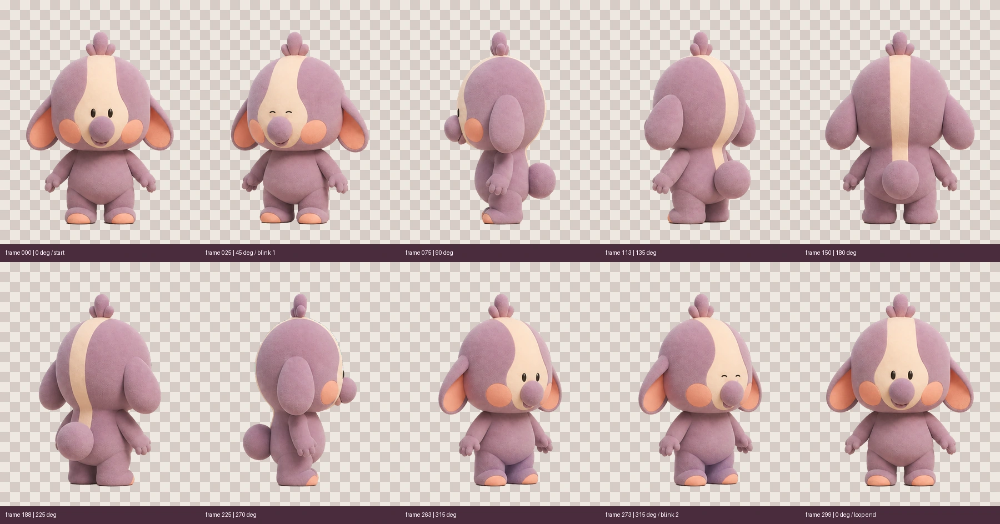

原始过程验收图

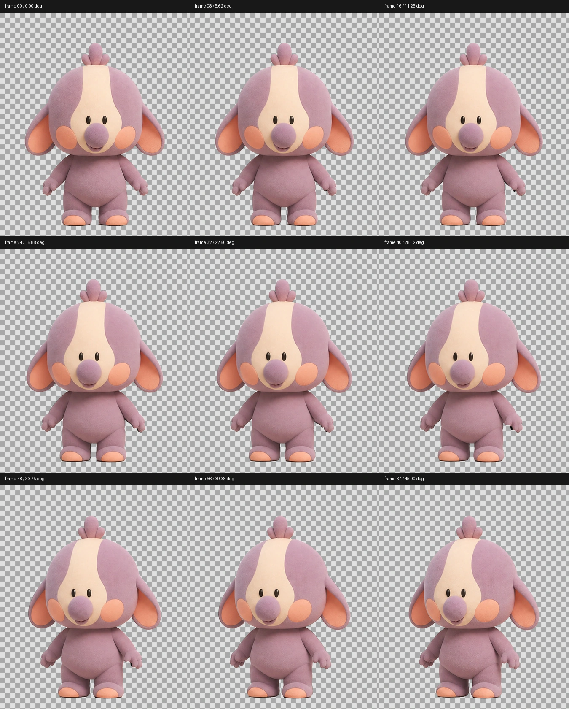

原始试片对照图

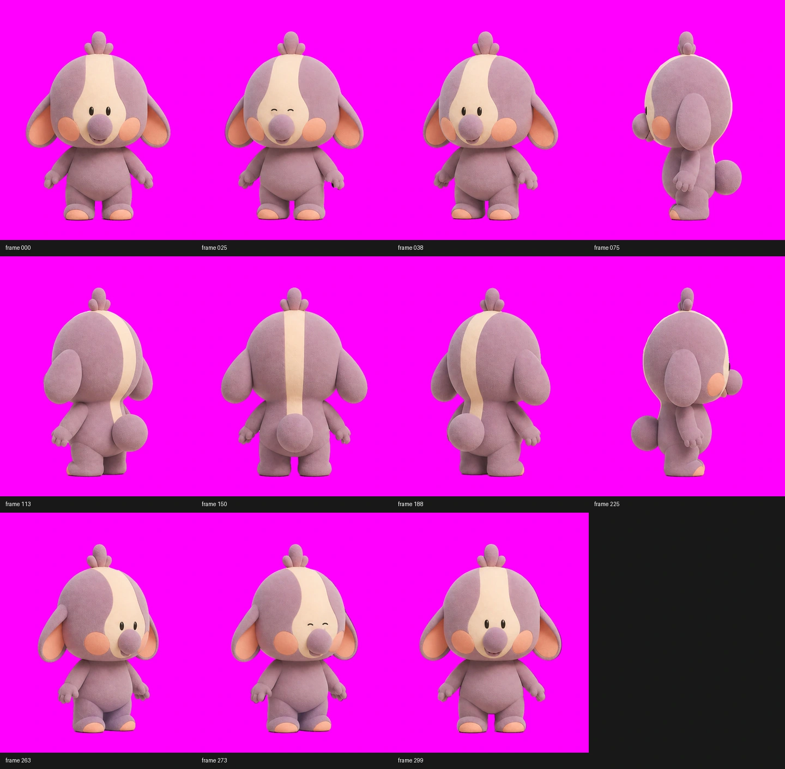

原始验收图

### 怎么做

- 输入：8方向角色图，用户处理的透明PNG。
- 行动：确定无阴影、纯角色、自然眨眼；生成10秒视频；返工时把颜色和透明度分开补帧。
- 判断：有300帧文件不等于动作自然，还要看重影、耳朵变形和透明边缘。
- 产出：900×1100、30fps、10秒、带透明通道的WebM，日志记录275项测试通过。

### 踩过的坑

- 第一版主要是角度图切换，未达到用户所说连贯旋转。
- 透明通道与角色细节必须一起检查，不能只看视频能播放。

### 下次怎么避免

- 先做0°到45°试片，确认无双影和融化再做全长。
- 在黑底、棋盘底和亮色底检查边缘，同时看中间帧。

> 我要的是连贯的旋转 这一卡一卡的是啥

2026-08-16；[{"source": "rollout-2026-08-14T19-52-03-01a0001d-6bdf-7f70-8026-4a9ad3d1aa9f.jsonl", "lines": "7424", "date": "2026-08-16", "thread": "01a0001d-6bdf-7f70-8026-4a9ad3d1aa9f"}]

依据：[{"source": "rollout-2026-08-14T19-53-47-01a0001f-035f-7770-9fae-1aa78be31285.jsonl", "lines": "435", "date": "2026-08-14T12:23:10.274Z", "thread": "01a0001f-035f-7770-9fae-1aa78be31285"}, {"source": "rollout-2026-08-14T19-53-47-01a0001f-035f-7770-9fae-1aa78be31285.jsonl", "lines": "454", "date": "2026-08-14T12:23:58.960Z", "thread": "01a0001f-035f-7770-9fae-1aa78be31285"}, {"source": "rollout-2026-08-14T19-52-03-01a0001d-6bdf-7f70-8026-4a9ad3d1aa9f.jsonl", "lines": "6676", "date": "2026-08-16T10:41:28.216Z", "thread": "01a0001d-6bdf-7f70-8026-4a9ad3d1aa9f"}, {"source": "rollout-2026-08-14T19-52-03-01a0001d-6bdf-7f70-8026-4a9ad3d1aa9f.jsonl", "lines": "6707", "date": "2026-08-16T10:43:06.960Z", "thread": "01a0001d-6bdf-7f70-8026-4a9ad3d1aa9f"}, {"source": "rollout-2026-08-14T19-52-03-01a0001d-6bdf-7f70-8026-4a9ad3d1aa9f.jsonl", "lines": "7424", "date": "2026-08-16T11:27:09.618Z", "thread": "01a0001d-6bdf-7f70-8026-4a9ad3d1aa9f"}, {"source": "rollout-2026-08-14T19-52-03-01a0001d-6bdf-7f70-8026-4a9ad3d1aa9f.jsonl", "lines": "7509", "date": "2026-08-16T11:36:16.724Z", "thread": "01a0001d-6bdf-7f70-8026-4a9ad3d1aa9f"}, {"source": "rollout-2026-08-14T19-52-03-01a0001d-6bdf-7f70-8026-4a9ad3d1aa9f.jsonl", "lines": "7987", "date": "2026-08-16T12:30:59.537Z", "thread": "01a0001d-6bdf-7f70-8026-4a9ad3d1aa9f"}]

## 11 / 2026-08-15—08-18 / 网页精修：对齐、字体、渐变和浏览器一致性

页面精修集中暴露了“代码改了，眼前却没变”的问题：Logo看起来没对齐、粗圆字体样式不对、渐变硬线反复出现、Chrome看不到SVG。

分批改善；8/16备份明确字体最终修正尚未合入

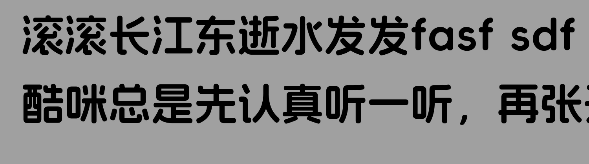

项目过程检查图，具体生成日需以日志核定

原始迭代文件

原始迭代文件

### 怎么做

- 输入：用户截图、指定字体、透明Logo与现有网页。
- 行动：逐页比较Codex预览和本地Chrome；检查SVG内部留白、字体的粗细与圆角参数、渐变图层及实际打开的路径。
- 判断：元素框左对齐不等于图形可见边缘左对齐；测试通过也不代表看到的字形就是目标字形。
- 产出：逐页修订、8月18日512行项目总记录、8月19日网站包。

### 踩过的坑

- 修左边渐变时把整页越改越黑，换背景后又把角色弄糊。
- 不核实字体实际样貌就声称已换Bold-Round。
- 有些检查只覆盖Codex浏览器，未证明用户的Chrome效果。
- 长对话中前面承诺逐渐丢失，用户要求另存记录。

### 下次怎么避免

- 固定截图视口与实际文件版本，复现用户打开方式。
- 检查渲染后的字形、SVG可见边界和多段渐变接缝。
- 每次交付附本次改了什么、未解决什么；别把字体未收口的包写成最终。

> 你自己看看这个对齐了吗 你能自己检查一下再发给我吗

2026-08-15；[{"source": "rollout-2026-08-13T14-41-18-019ff9da-9086-7e71-a9ac-7ffb0f350661.jsonl", "lines": "7689", "date": "2026-08-15", "thread": "019ff9da-9086-7e71-a9ac-7ffb0f350661"}]

> 能不能自己检查一下再给我！！！！！！！！改几次了

2026-08-16；[{"source": "rollout-2026-08-16T18-17-48-01a00a13-d903-7a51-a241-da36eb86287e.jsonl", "lines": "3094", "date": "2026-08-16", "thread": "01a00a13-d903-7a51-a241-da36eb86287e"}]

> 我感觉你已经忘了之前我们做过什么

2026-08-18；[{"source": "rollout-2026-08-16T18-17-48-01a00a13-d903-7a51-a241-da36eb86287e.jsonl", "lines": "5073", "date": "2026-08-18", "thread": "01a00a13-d903-7a51-a241-da36eb86287e"}]

依据：[{"source": "rollout-2026-08-13T14-41-18-019ff9da-9086-7e71-a9ac-7ffb0f350661.jsonl", "lines": "7616", "date": "2026-08-15T14:53:08.943Z", "thread": "019ff9da-9086-7e71-a9ac-7ffb0f350661"}, {"source": "rollout-2026-08-13T14-41-18-019ff9da-9086-7e71-a9ac-7ffb0f350661.jsonl", "lines": "7689", "date": "2026-08-15T15:19:38.600Z", "thread": "019ff9da-9086-7e71-a9ac-7ffb0f350661"}, {"source": "rollout-2026-08-13T14-41-18-019ff9da-9086-7e71-a9ac-7ffb0f350661.jsonl", "lines": "7853", "date": "2026-08-15T16:19:54.843Z", "thread": "019ff9da-9086-7e71-a9ac-7ffb0f350661"}, {"source": "rollout-2026-08-13T14-41-18-019ff9da-9086-7e71-a9ac-7ffb0f350661.jsonl", "lines": "7999", "date": "2026-08-15T17:19:59.553Z", "thread": "019ff9da-9086-7e71-a9ac-7ffb0f350661"}, {"source": "rollout-2026-08-13T14-41-18-019ff9da-9086-7e71-a9ac-7ffb0f350661.jsonl", "lines": "8052", "date": "2026-08-15T17:39:03.896Z", "thread": "019ff9da-9086-7e71-a9ac-7ffb0f350661"}, {"source": "rollout-2026-08-16T18-17-48-01a00a13-d903-7a51-a241-da36eb86287e.jsonl", "lines": "32", "date": "2026-08-16T10:19:00.173Z", "thread": "01a00a13-d903-7a51-a241-da36eb86287e"}, {"source": "rollout-2026-08-16T18-17-48-01a00a13-d903-7a51-a241-da36eb86287e.jsonl", "lines": "2533", "date": "2026-08-16T13:38:09.337Z", "thread": "01a00a13-d903-7a51-a241-da36eb86287e"}, {"source": "rollout-2026-08-16T18-17-48-01a00a13-d903-7a51-a241-da36eb86287e.jsonl", "lines": "3094", "date": "2026-08-16T15:38:46.066Z", "thread": "01a00a13-d903-7a51-a241-da36eb86287e"}, {"source": "rollout-2026-08-16T18-17-48-01a00a13-d903-7a51-a241-da36eb86287e.jsonl", "lines": "3239", "date": "2026-08-16T16:01:08.741Z", "thread": "01a00a13-d903-7a51-a241-da36eb86287e"}, {"source": "rollout-2026-08-16T18-17-48-01a00a13-d903-7a51-a241-da36eb86287e.jsonl", "lines": "5073", "date": "2026-08-18T11:14:11.516Z", "thread": "01a00a13-d903-7a51-a241-da36eb86287e"}, {"source": "rollout-2026-08-16T18-17-48-01a00a13-d903-7a51-a241-da36eb86287e.jsonl", "lines": "5201", "date": "2026-08-18T12:51:19.230Z", "thread": "01a00a13-d903-7a51-a241-da36eb86287e"}, {"source": "rollout-2026-08-16T18-17-48-01a00a13-d903-7a51-a241-da36eb86287e.jsonl", "lines": "5593", "date": "2026-08-18T16:48:47.664Z", "thread": "01a00a13-d903-7a51-a241-da36eb86287e"}]

## 12 / 2026-08-16—08-20 / 文创先想“为什么有人愿意用”，再做产品

文创任务从调研和产品选择开始，经历纹样、盲盒、纸巾、包装和服装。20cm毛绒盲盒在比例和展示方式上多次失手，用户暂时叫停，转做15cm纸巾。

纸巾阶段获用户确认；盲盒方案停止；服装继续探索

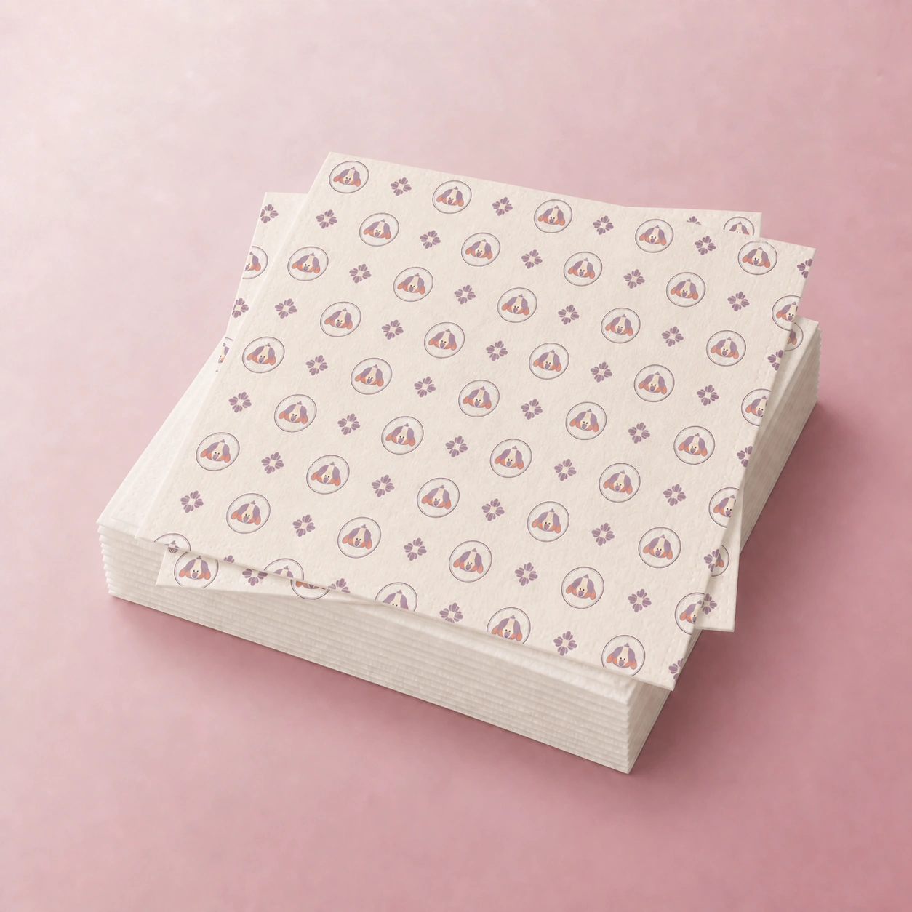

原始迭代稿

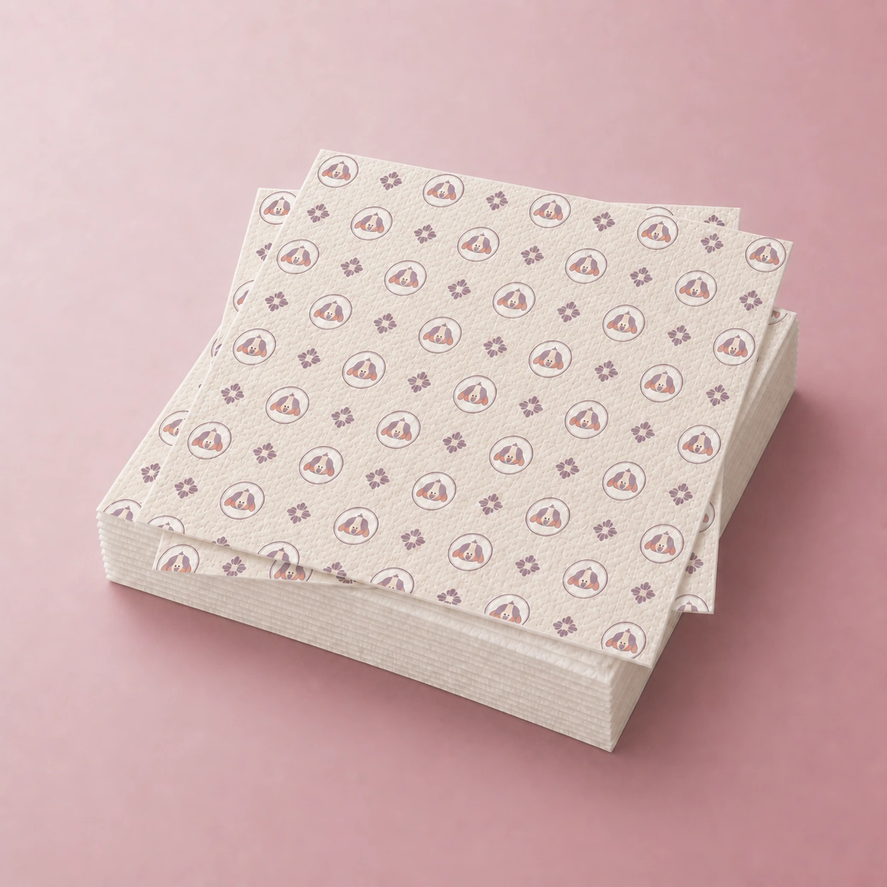

原始批准稿归档

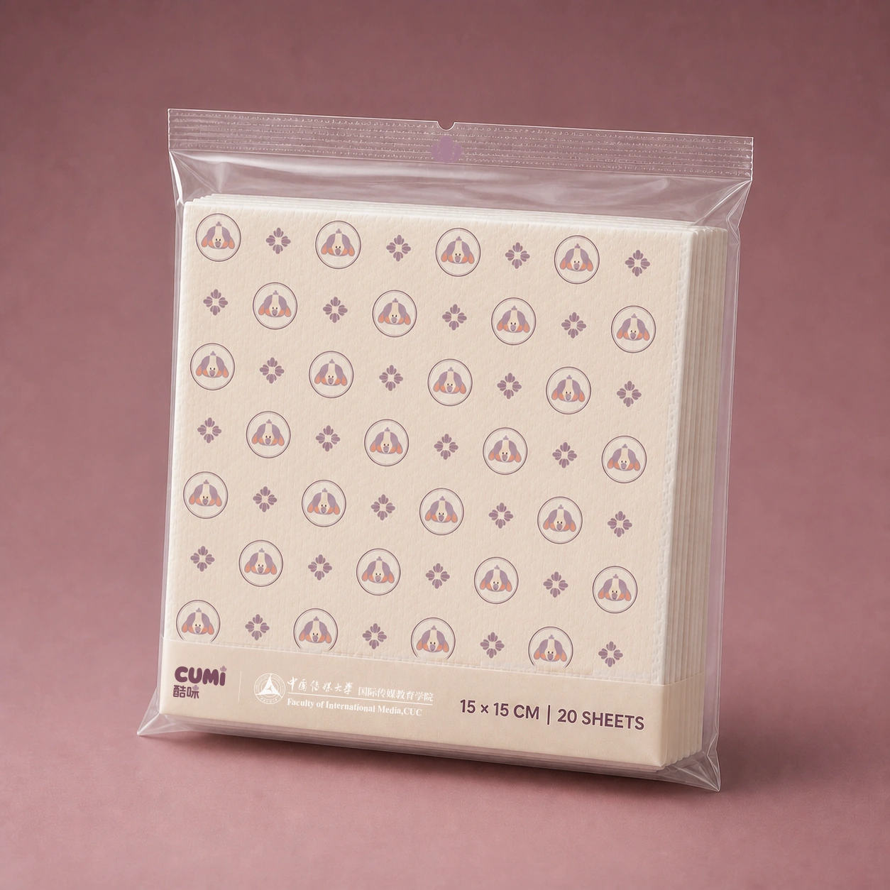

原始包装候选

### 怎么做

- 输入：原始SVG、四组纹样和希望制作的日常物品。
- 行动：研究文创吸引力；做四套纸巾图案、45°视角、柔软压纹、生活场景和20张装透明袋。
- 判断：图案正确还不够，纸必须看着软、真实，包装要保留原Logo和颜色。
- 产出：用户确认四款纸巾与四张场景图，归档到FINAL-2026-08-20。盲盒暂时停止。

### 踩过的坑

- 已有六个角色却反复重新生成，比例和大小再次漂移。
- 用“东方展台”套入不适合角色的风格。
- 纸巾方格变形、变硬、缺格、图案像贴上去而非印上去。
- “能生产且不贵”只是用户要求，日志没有实物打样和制造成本验证。

### 下次怎么避免

- 先列素材清单，优先用现有批准资产。
- 产品先验证形状、材质、印刷比例，再做场景和包装。
- 效果图、打样图、生产图分别标明，不把渲染当可制造证明。

> 这里不是有6个现成的文件吗 你直接在项目文件夹找就好了呀 不用重新生成

2026-08-20；[{"source": "rollout-2026-08-16T19-43-35-01a00a62-63d5-7162-b4cb-f5093dfa19ec.jsonl", "lines": "2198", "date": "2026-08-20", "thread": "01a00a62-63d5-7162-b4cb-f5093dfa19ec"}]

> 这是母版 也不要改角色的身材比例 你原封不动的拿就行了

2026-08-20；[{"source": "rollout-2026-08-16T19-43-35-01a00a62-63d5-7162-b4cb-f5093dfa19ec.jsonl", "lines": "2637", "date": "2026-08-20", "thread": "01a00a62-63d5-7162-b4cb-f5093dfa19ec"}]

> 这四张图 和之前定稿的四张图存好

2026-08-20；[{"source": "rollout-2026-08-16T19-43-35-01a00a62-63d5-7162-b4cb-f5093dfa19ec.jsonl", "lines": "3859", "date": "2026-08-20", "thread": "01a00a62-63d5-7162-b4cb-f5093dfa19ec"}]

依据：[{"source": "rollout-2026-08-16T19-43-35-01a00a62-63d5-7162-b4cb-f5093dfa19ec.jsonl", "lines": "9", "date": "2026-08-16T11:44:29.394Z", "thread": "01a00a62-63d5-7162-b4cb-f5093dfa19ec"}, {"source": "rollout-2026-08-16T19-43-35-01a00a62-63d5-7162-b4cb-f5093dfa19ec.jsonl", "lines": "272", "date": "2026-08-16T12:26:21.996Z", "thread": "01a00a62-63d5-7162-b4cb-f5093dfa19ec"}, {"source": "rollout-2026-08-16T19-43-35-01a00a62-63d5-7162-b4cb-f5093dfa19ec.jsonl", "lines": "1856", "date": "2026-08-20T04:29:27.936Z", "thread": "01a00a62-63d5-7162-b4cb-f5093dfa19ec"}, {"source": "rollout-2026-08-16T19-43-35-01a00a62-63d5-7162-b4cb-f5093dfa19ec.jsonl", "lines": "1944", "date": "2026-08-20T04:48:46.348Z", "thread": "01a00a62-63d5-7162-b4cb-f5093dfa19ec"}, {"source": "rollout-2026-08-16T19-43-35-01a00a62-63d5-7162-b4cb-f5093dfa19ec.jsonl", "lines": "2198", "date": "2026-08-20T06:15:56.611Z", "thread": "01a00a62-63d5-7162-b4cb-f5093dfa19ec"}, {"source": "rollout-2026-08-16T19-43-35-01a00a62-63d5-7162-b4cb-f5093dfa19ec.jsonl", "lines": "2633", "date": "2026-08-20T08:40:12.070Z", "thread": "01a00a62-63d5-7162-b4cb-f5093dfa19ec"}, {"source": "rollout-2026-08-16T19-43-35-01a00a62-63d5-7162-b4cb-f5093dfa19ec.jsonl", "lines": "2967", "date": "2026-08-20T10:19:53.064Z", "thread": "01a00a62-63d5-7162-b4cb-f5093dfa19ec"}, {"source": "rollout-2026-08-16T19-43-35-01a00a62-63d5-7162-b4cb-f5093dfa19ec.jsonl", "lines": "3164", "date": "2026-08-20T11:00:38.874Z", "thread": "01a00a62-63d5-7162-b4cb-f5093dfa19ec"}, {"source": "rollout-2026-08-16T19-43-35-01a00a62-63d5-7162-b4cb-f5093dfa19ec.jsonl", "lines": "3242", "date": "2026-08-20T11:25:51.084Z", "thread": "01a00a62-63d5-7162-b4cb-f5093dfa19ec"}, {"source": "rollout-2026-08-16T19-43-35-01a00a62-63d5-7162-b4cb-f5093dfa19ec.jsonl", "lines": "3600", "date": "2026-08-20T12:48:47.280Z", "thread": "01a00a62-63d5-7162-b4cb-f5093dfa19ec"}, {"source": "rollout-2026-08-16T19-43-35-01a00a62-63d5-7162-b4cb-f5093dfa19ec.jsonl", "lines": "3859", "date": "2026-08-20T14:12:54.657Z", "thread": "01a00a62-63d5-7162-b4cb-f5093dfa19ec"}, {"source": "rollout-2026-08-16T19-43-35-01a00a62-63d5-7162-b4cb-f5093dfa19ec.jsonl", "lines": "3900", "date": "2026-08-20T14:23:50.403Z", "thread": "01a00a62-63d5-7162-b4cb-f5093dfa19ec"}]

## 13 / 2026-08-20 / 透明转台清边：修8帧，别伤到整段角色

现成360°视频去背景之后有黑边和腿下黑块。修复一度把脖子、腋下、腿部也抠透明，还产生闪烁；用户要求只处理有问题的帧和区域。

返工后用户确认该页没问题

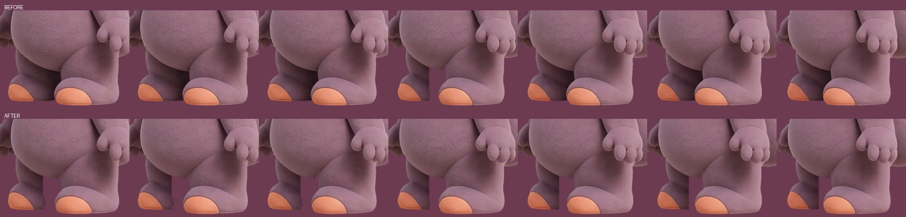

历史工具实际查看过的原始检查图

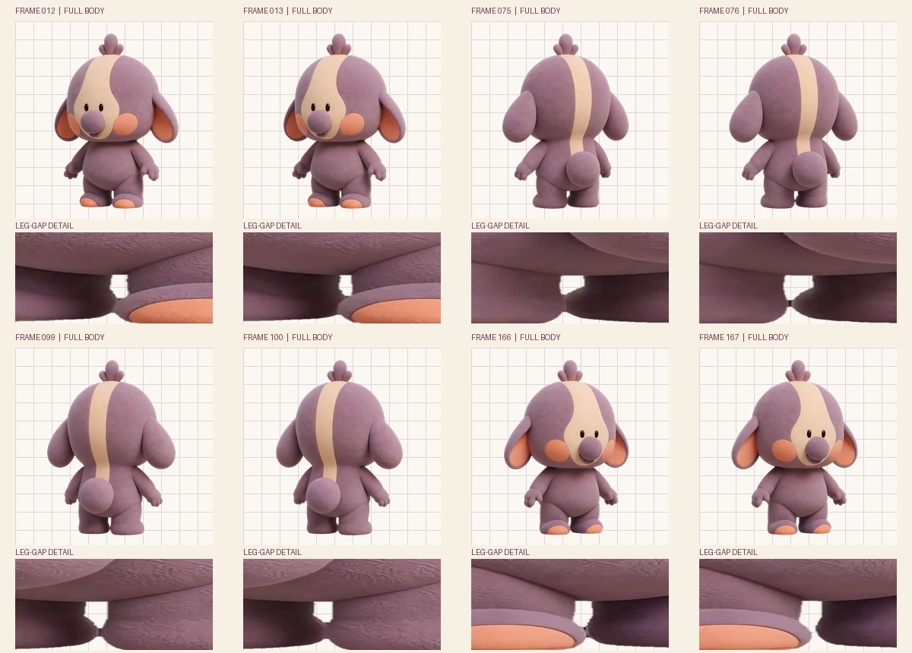

历史工具实际查看过的原始检查图

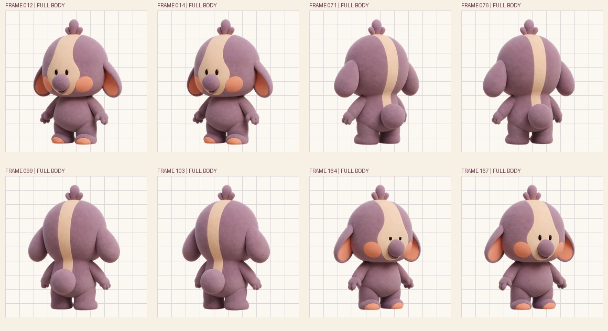

历史工具实际查看过的原始检查图

### 怎么做

- 输入：完整转台视频和用户标出的错误角度。
- 行动：转透明WebM，检查黑边；改为给具体错误连通区域设置清理位置，而非全图抠暗色。
- 判断：黑色背景与角色暗部不能用同一个颜色阈值全部删掉。
- 产出：透明WebM；历史工具结果有视频带透明背景的标记与针对性测试，用户表示这页没问题。

### 踩过的坑

- 全局修改扩大影响，把原本正常的帧也改坏。
- 只看静态抽帧会漏掉播放时的闪烁。

### 下次怎么避免

- 保存逐帧编号，先标出错误区域再动手。
- 复核黑眼睛、腋下和腿缝是否仍完整；整段循环播放检查闪烁。

> 你不能只改有问题的8帧褪下的部分吗 其他的的地方不要动

2026-08-20；[{"source": "rollout-2026-08-20T11-38-34-01a01d3f-c91d-7f20-8c14-3685ae2bd502.jsonl", "lines": "2808", "date": "2026-08-20", "thread": "01a01d3f-c91d-7f20-8c14-3685ae2bd502"}]

> 你改的都是没问题的几帧

2026-08-20；[{"source": "rollout-2026-08-20T11-38-34-01a01d3f-c91d-7f20-8c14-3685ae2bd502.jsonl", "lines": "3177", "date": "2026-08-20", "thread": "01a01d3f-c91d-7f20-8c14-3685ae2bd502"}]

依据：[{"source": "rollout-2026-08-20T11-38-34-01a01d3f-c91d-7f20-8c14-3685ae2bd502.jsonl", "lines": "1738", "date": "2026-08-20T07:36:11.528Z", "thread": "01a01d3f-c91d-7f20-8c14-3685ae2bd502"}, {"source": "rollout-2026-08-20T11-38-34-01a01d3f-c91d-7f20-8c14-3685ae2bd502.jsonl", "lines": "2268", "date": "2026-08-20T08:28:34.144Z", "thread": "01a01d3f-c91d-7f20-8c14-3685ae2bd502"}, {"source": "rollout-2026-08-20T11-38-34-01a01d3f-c91d-7f20-8c14-3685ae2bd502.jsonl", "lines": "2600", "date": "2026-08-20T09:23:54.972Z", "thread": "01a01d3f-c91d-7f20-8c14-3685ae2bd502"}, {"source": "rollout-2026-08-20T11-38-34-01a01d3f-c91d-7f20-8c14-3685ae2bd502.jsonl", "lines": "2808", "date": "2026-08-20T09:52:35.775Z", "thread": "01a01d3f-c91d-7f20-8c14-3685ae2bd502"}, {"source": "rollout-2026-08-20T11-38-34-01a01d3f-c91d-7f20-8c14-3685ae2bd502.jsonl", "lines": "3042", "date": "2026-08-20T10:44:52.248Z", "thread": "01a01d3f-c91d-7f20-8c14-3685ae2bd502"}, {"source": "rollout-2026-08-20T11-38-34-01a01d3f-c91d-7f20-8c14-3685ae2bd502.jsonl", "lines": "3177", "date": "2026-08-20T11:03:13.610Z", "thread": "01a01d3f-c91d-7f20-8c14-3685ae2bd502"}, {"source": "rollout-2026-08-20T11-38-34-01a01d3f-c91d-7f20-8c14-3685ae2bd502.jsonl", "lines": "3658", "date": "2026-08-20T12:06:37.013Z", "thread": "01a01d3f-c91d-7f20-8c14-3685ae2bd502"}, {"source": "rollout-2026-08-20T11-38-34-01a01d3f-c91d-7f20-8c14-3685ae2bd502.jsonl", "lines": "3701", "date": "2026-08-20T12:09:47.629Z", "thread": "01a01d3f-c91d-7f20-8c14-3685ae2bd502"}, {"source": "rollout-2026-08-20T11-38-34-01a01d3f-c91d-7f20-8c14-3685ae2bd502.jsonl", "lines": "3721", "date": "2026-08-20T12:12:30.994Z", "thread": "01a01d3f-c91d-7f20-8c14-3685ae2bd502"}]

## 14 / 2026-08-20—08-21 / 卡片和纹样：只换展示方式，角色本身保持不变

单独任务从修长腿转向制作6张宇宙角色卡，再做平面图案。用户多次强调给的图直接贴上去，不能改颜色、动作、材质和Logo。

卡片/纹样有产物；开头单图比例任务无独立完成证据

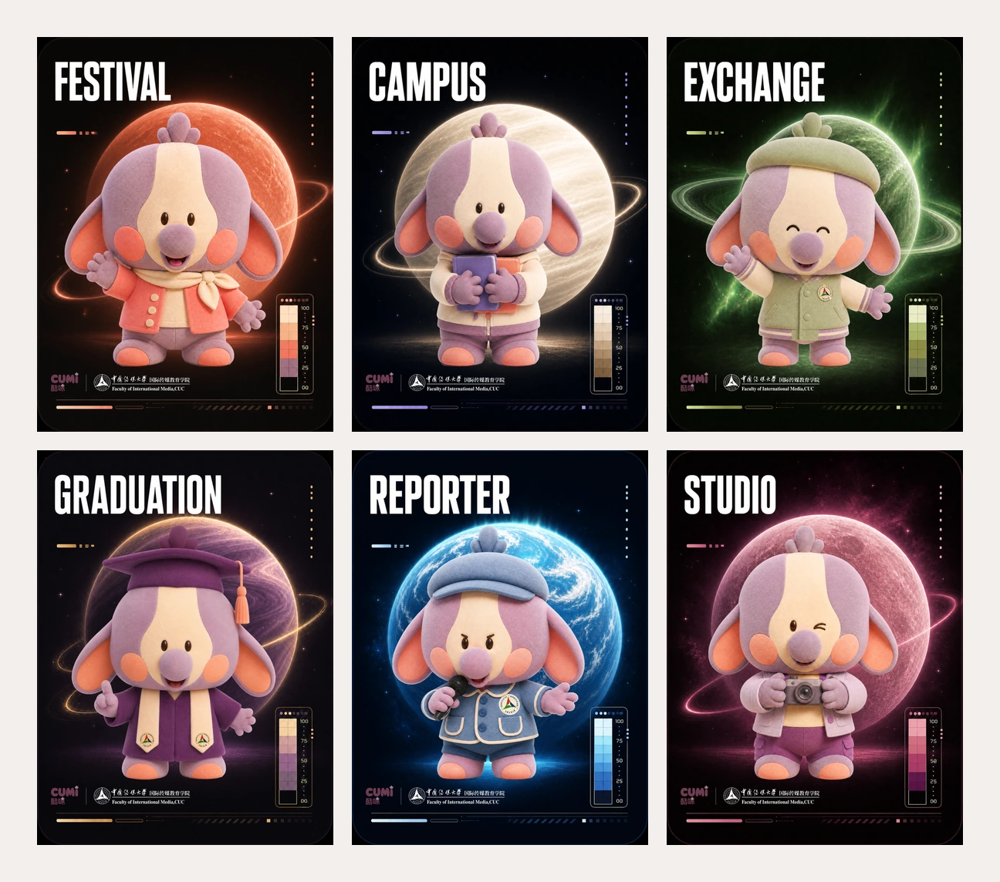

原始过程图

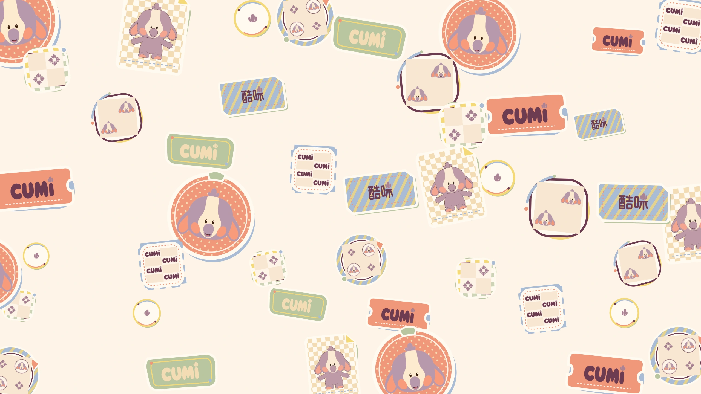

原始前一版

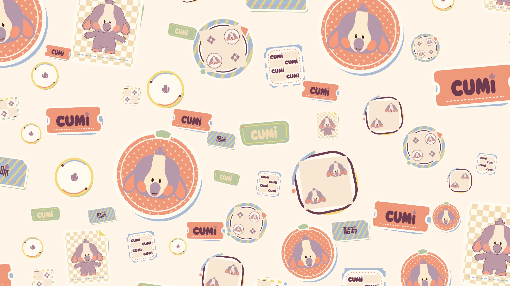

原始后续版

### 怎么做

- 输入：六张角色图、组合SVG、卡片参考。
- 行动：每套卡用不同配色和星球，输出2K；纹样从重复单元转为独立随机构图。
- 判断：卡片排版需要修Logo重叠；纹样需要密度和大小层次，而非看得出机械平铺。
- 产出：2K卡片；57个独立图标位置的密集展示SVG/PNG/JSON；原无缝单元另保留用于包装。

### 踩过的坑

- 角色被重绘导致暗色和比例变化。
- 用户让优化图标，却把整张已喜欢的布局换掉。
- 开头腿长修改没有在这条任务里形成独立完整的检查与确认。

### 下次怎么避免

- 把“版式改动”和“角色改动”明确分开。
- 展示图可随机排，包装母版另留无缝拼接版本。

> 图片我都给你了 你直接贴上去就行

2026-08-20；[{"source": "rollout-2026-08-20T22-36-11-01a01f99-daf5-79c3-8fe5-be256d92534e.jsonl", "lines": "339", "date": "2026-08-20", "thread": "01a01f99-daf5-79c3-8fe5-be256d92534e"}]

> 排版怎么变了 我要的是这个

2026-08-21；[{"source": "rollout-2026-08-20T22-36-11-01a01f99-daf5-79c3-8fe5-be256d92534e.jsonl", "lines": "743", "date": "2026-08-21", "thread": "01a01f99-daf5-79c3-8fe5-be256d92534e"}]

依据：[{"source": "rollout-2026-08-20T22-36-11-01a01f99-daf5-79c3-8fe5-be256d92534e.jsonl", "lines": "10", "date": "2026-08-20T14:36:27.311Z", "thread": "01a01f99-daf5-79c3-8fe5-be256d92534e"}, {"source": "rollout-2026-08-20T22-36-11-01a01f99-daf5-79c3-8fe5-be256d92534e.jsonl", "lines": "48", "date": "2026-08-20T14:42:20.543Z", "thread": "01a01f99-daf5-79c3-8fe5-be256d92534e"}, {"source": "rollout-2026-08-20T22-36-11-01a01f99-daf5-79c3-8fe5-be256d92534e.jsonl", "lines": "211", "date": "2026-08-20T15:15:41.983Z", "thread": "01a01f99-daf5-79c3-8fe5-be256d92534e"}, {"source": "rollout-2026-08-20T22-36-11-01a01f99-daf5-79c3-8fe5-be256d92534e.jsonl", "lines": "339", "date": "2026-08-20T15:55:30.565Z", "thread": "01a01f99-daf5-79c3-8fe5-be256d92534e"}, {"source": "rollout-2026-08-20T22-36-11-01a01f99-daf5-79c3-8fe5-be256d92534e.jsonl", "lines": "743", "date": "2026-08-20T17:20:17.684Z", "thread": "01a01f99-daf5-79c3-8fe5-be256d92534e"}, {"source": "rollout-2026-08-20T22-36-11-01a01f99-daf5-79c3-8fe5-be256d92534e.jsonl", "lines": "801", "date": "2026-08-20T17:33:25.567Z", "thread": "01a01f99-daf5-79c3-8fe5-be256d92534e"}, {"source": "rollout-2026-08-20T22-36-11-01a01f99-daf5-79c3-8fe5-be256d92534e.jsonl", "lines": "973", "date": "2026-08-20T19:20:35.802Z", "thread": "01a01f99-daf5-79c3-8fe5-be256d92534e"}, {"source": "rollout-2026-08-20T22-36-11-01a01f99-daf5-79c3-8fe5-be256d92534e.jsonl", "lines": "1128", "date": "2026-08-20T19:45:14.980Z", "thread": "01a01f99-daf5-79c3-8fe5-be256d92534e"}]

## 15 / 2026-08-20 / 五角色比例专项：交候选，不抢着说最终

另一条独立任务要求按图6修五个角色的身材，颜色、动作和绒毛不变。完成了五个文件，但没有用户后续视觉确认。

候选已生成，视觉验收未记录

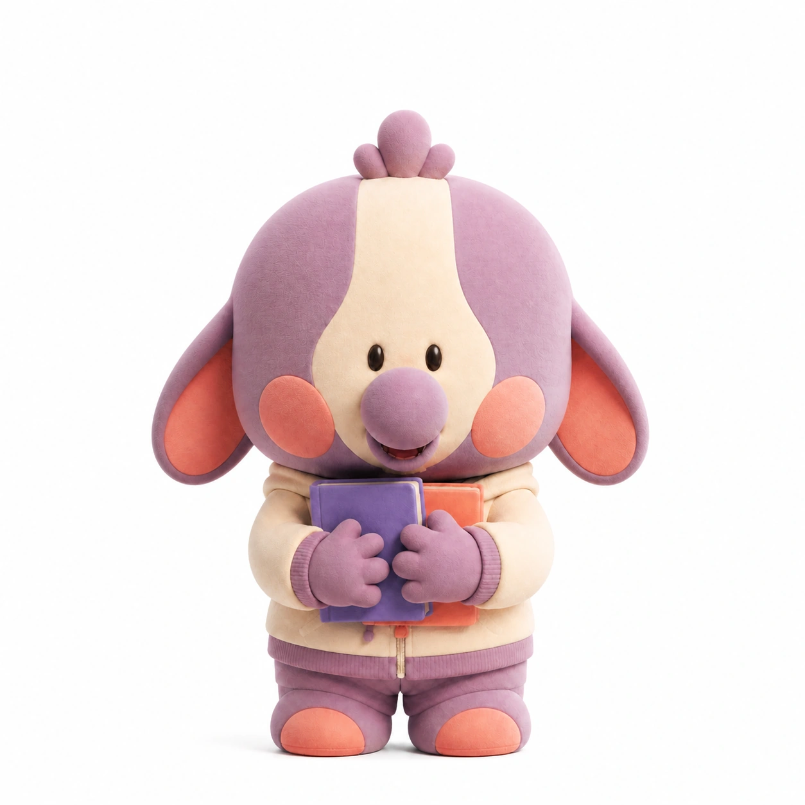

原始候选

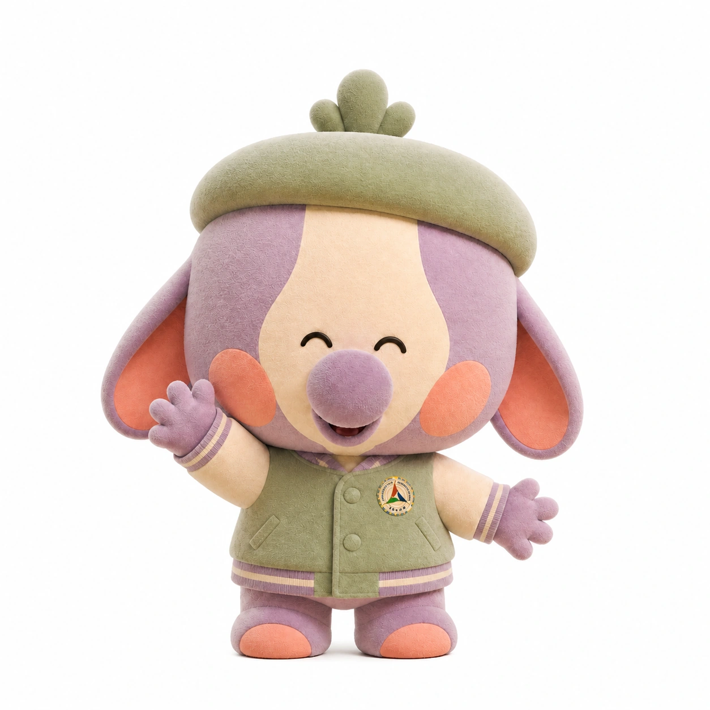

原始候选

### 怎么做

- 输入：5张待改角色与第6张比例参考。
- 行动：按大头、短圆身体、短臂、短腿编辑，分别另存。
- 判断：能读出1254×1254尺寸只证明文件完整，不证明比例和材质全部合格。
- 产出：5张候选PNG，原图未覆盖。

### 踩过的坑

- 分辨率检查很容易被写成视觉修图成功。

### 下次怎么避免

- 输出时清楚写候选、待确认，并提供原图/参考/修改图三列。

> 不要改变颜色 动作 材质和质感

2026-08-20；[{"source": "rollout-2026-08-20T22-58-46-01a01fae-8737-7862-b65d-d54b1947f263.jsonl", "lines": "9", "date": "2026-08-20", "thread": "01a01fae-8737-7862-b65d-d54b1947f263"}]

依据：[{"source": "rollout-2026-08-20T22-58-46-01a01fae-8737-7862-b65d-d54b1947f263.jsonl", "lines": "9", "date": "2026-08-20T14:59:13.277Z", "thread": "01a01fae-8737-7862-b65d-d54b1947f263"}, {"source": "rollout-2026-08-20T22-58-46-01a01fae-8737-7862-b65d-d54b1947f263.jsonl", "lines": "54", "date": "2026-08-20T15:06:52.795Z", "thread": "01a01fae-8737-7862-b65d-d54b1947f263"}]

## 16 / 2026-08-20—08-22 / 从展示页变成会动的品牌片段

网页改版加入写实贴纸、悬停放大、卡片展开、四Logo开场和动态纹样。开场先做分镜，反复修改角度、材质、节奏与结尾。

多个网页动效完成并打包；记录仍有独立SVG一致性测试未过

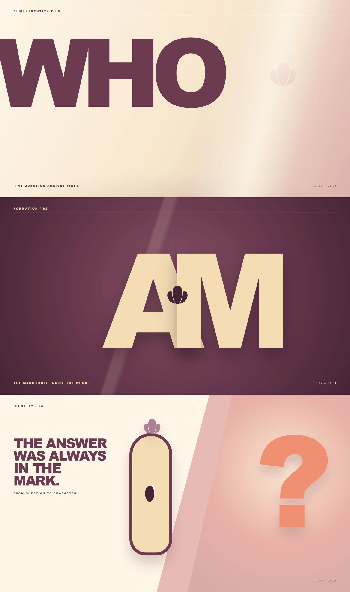

原始过程预览

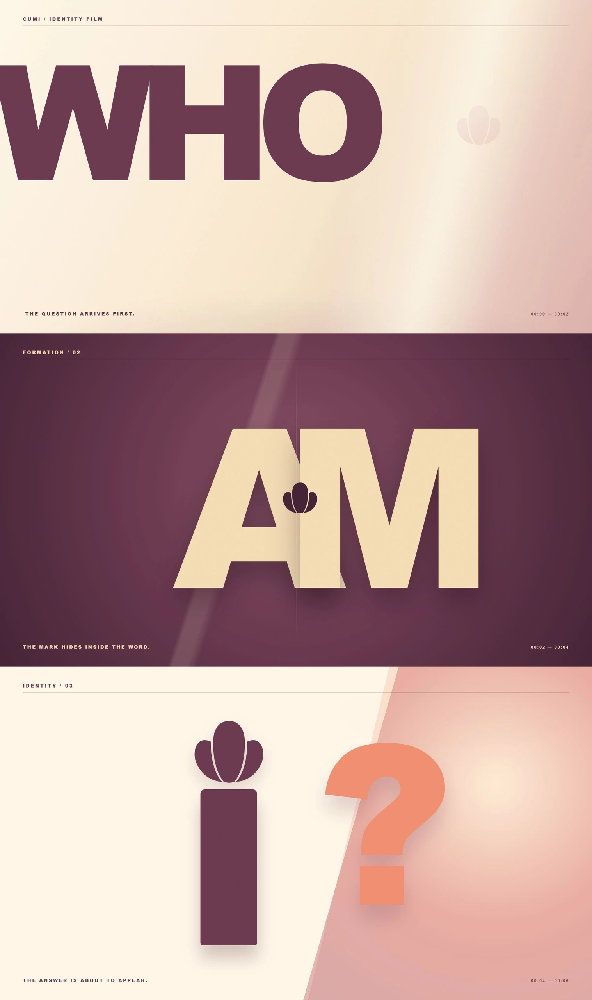

原始过程预览

原始后续修正版

### 怎么做

- 输入：原始SVG、六角色卡和用户草图。
- 行动：做分镜、WHO AM I开场、四Logo依次出场、角色结束画面；做纹样40%—100%随机缩放。
- 判断：用户不接受廉价亚克力效果和不居中的Logo；节奏从2秒、1.5秒再调到1秒。
- 产出：网页动效、贴纸和卡片交互、纹样动画与BYEBYE结尾；8月22日closing-final包。

### 踩过的坑

- 图形外框居中但可见图形偏移。
- 把“只动Logo”做成棋盘格也动。
- Chrome看不到动画或校徽颜色不对。
- 动画本身可播，不等于中途不裁字、不挡脚。

### 下次怎么避免

- 分镜先确定每幕构图、停留和过渡，再写动画。
- 用SVG已有图层，只选择要动的那层。
- 分别检查开始、中间、结束和鼠标交互状态。

> 不要动棋盘格 只让logo动起来

2026-08-21；[{"source": "rollout-2026-08-21T14-46-52-01a0225b-5468-71a2-b885-48209275af67_01a02312-885a-7a73-98fb-98607700b1c9.jsonl", "lines": "6898", "date": "2026-08-21", "thread": "01a0225b-5468-71a2-b885-48209275af67"}]

> 我要的是写实的风格 而且酷咪单独展示的那个格子太大了 我要的是高级感 艺术感

2026-08-21；[{"source": "rollout-2026-08-21T14-46-52-01a0225b-5468-71a2-b885-48209275af67_01a02312-885a-7a73-98fb-98607700b1c9.jsonl", "lines": "4177", "date": "2026-08-21", "thread": "01a0225b-5468-71a2-b885-48209275af67"}]

依据：[{"source": "rollout-2026-08-20T11-38-34-01a01d3f-c91d-7f20-8c14-3685ae2bd502.jsonl", "lines": "3830", "date": "2026-08-20T12:27:35.471Z", "thread": "01a01d3f-c91d-7f20-8c14-3685ae2bd502"}, {"source": "rollout-2026-08-20T11-38-34-01a01d3f-c91d-7f20-8c14-3685ae2bd502.jsonl", "lines": "4398", "date": "2026-08-20T13:29:04.466Z", "thread": "01a01d3f-c91d-7f20-8c14-3685ae2bd502"}, {"source": "rollout-2026-08-20T11-38-34-01a01d3f-c91d-7f20-8c14-3685ae2bd502.jsonl", "lines": "5956", "date": "2026-08-20T16:49:47.945Z", "thread": "01a01d3f-c91d-7f20-8c14-3685ae2bd502"}, {"source": "rollout-2026-08-21T14-46-52-01a0225b-5468-71a2-b885-48209275af67_01a02312-885a-7a73-98fb-98607700b1c9.jsonl", "lines": "986", "date": "2026-08-21T07:34:09.157Z", "thread": "01a0225b-5468-71a2-b885-48209275af67"}, {"source": "rollout-2026-08-21T14-46-52-01a0225b-5468-71a2-b885-48209275af67_01a02312-885a-7a73-98fb-98607700b1c9.jsonl", "lines": "1486", "date": "2026-08-21T07:52:46.332Z", "thread": "01a0225b-5468-71a2-b885-48209275af67"}, {"source": "rollout-2026-08-21T14-46-52-01a0225b-5468-71a2-b885-48209275af67_01a02312-885a-7a73-98fb-98607700b1c9.jsonl", "lines": "2153", "date": "2026-08-21T08:22:31.392Z", "thread": "01a0225b-5468-71a2-b885-48209275af67"}, {"source": "rollout-2026-08-21T14-46-52-01a0225b-5468-71a2-b885-48209275af67_01a02312-885a-7a73-98fb-98607700b1c9.jsonl", "lines": "2858", "date": "2026-08-21T08:48:01.677Z", "thread": "01a0225b-5468-71a2-b885-48209275af67"}, {"source": "rollout-2026-08-21T14-46-52-01a0225b-5468-71a2-b885-48209275af67_01a02312-885a-7a73-98fb-98607700b1c9.jsonl", "lines": "4177", "date": "2026-08-21T10:12:44.341Z", "thread": "01a0225b-5468-71a2-b885-48209275af67"}, {"source": "rollout-2026-08-21T14-46-52-01a0225b-5468-71a2-b885-48209275af67_01a02312-885a-7a73-98fb-98607700b1c9.jsonl", "lines": "5736", "date": "2026-08-21T11:47:39.518Z", "thread": "01a0225b-5468-71a2-b885-48209275af67"}, {"source": "rollout-2026-08-21T14-46-52-01a0225b-5468-71a2-b885-48209275af67_01a02312-885a-7a73-98fb-98607700b1c9.jsonl", "lines": "6898", "date": "2026-08-21T13:24:27.306Z", "thread": "01a0225b-5468-71a2-b885-48209275af67"}, {"source": "rollout-2026-08-21T14-46-52-01a0225b-5468-71a2-b885-48209275af67_01a02312-885a-7a73-98fb-98607700b1c9.jsonl", "lines": "7071", "date": "2026-08-21T13:39:00.939Z", "thread": "01a0225b-5468-71a2-b885-48209275af67"}, {"source": "rollout-2026-08-21T14-46-52-01a0225b-5468-71a2-b885-48209275af67_01a02312-885a-7a73-98fb-98607700b1c9.jsonl", "lines": "8215", "date": "2026-08-21T16:40:25.253Z", "thread": "01a0225b-5468-71a2-b885-48209275af67"}, {"source": "rollout-2026-08-21T14-46-52-01a0225b-5468-71a2-b885-48209275af67_01a02312-885a-7a73-98fb-98607700b1c9.jsonl", "lines": "8292", "date": "2026-08-21T16:48:53.448Z", "thread": "01a0225b-5468-71a2-b885-48209275af67"}]

## 17 / 2026-08-22—08-23 / 最后一轮动效细修：不要让修A把B改坏

故事光线、器官交互、配色实验台、2D/3D对照和六服装动效继续细化。用户反复指出光线变样、对齐偏差、裁耳朵、裁字、动画提前结束以及打开了旧包。

版本包有明确结构验证；具体审美仍以用户后续反馈为准

项目保留过程素材

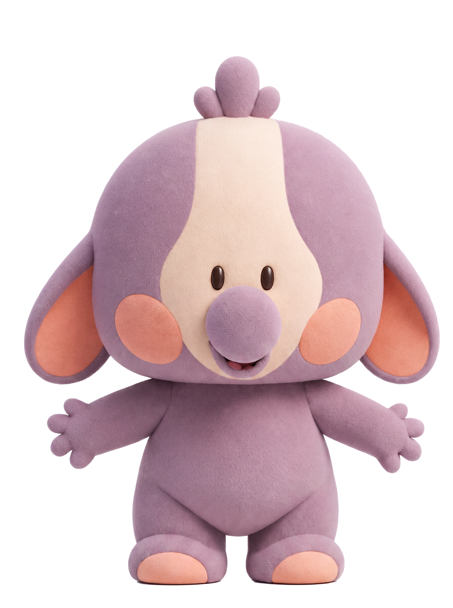

项目保留素材

原始素材，非8月23日网页截图

### 怎么做

- 输入：透明角色、用户画出的光线路径、确定好的素材和页面。
- 行动：限定区域修光线；做色卡与服装联动；做六种身份动效和卡片入场。
- 判断：动效应等该版块进入视口再启动；检查中间帧后才找到STUDIO字母被遮罩裁切的真正原因。
- 产出：8月23日motion-final包。工具结果记录421个文件都与打包前完全一致、138引用0缺失、ZIP检查通过。

### 踩过的坑

- 修清晰度改变了已认可光线；修布局让耳朵被切。
- 先推测Chrome不播放是状态问题，后来发现旧包根本没有新代码。
- 先说字母裁切不是遮罩，后续才承认改错方向并删硬遮罩。
- 助手曾把1980×1080称为16:9，实际是11:6；教课时应纠正这个比例名称。

### 下次怎么避免

- 打开路径和版本先核对，再排查浏览器。
- 给已认可内容设保护清单，改动后逐项比对。
- 动画必须录下中途和结束画面；不要只看最后一帧。
- 规格写尺寸就按尺寸，不要把1980误写成常见的1920。

> 没变化呀 你自己检查好了再发出来

2026-08-23；[{"source": "rollout-2026-08-22T13-40-24-01a027fc-0c90-7120-9c43-50f6a1997d67.jsonl", "lines": "5033", "date": "2026-08-23", "thread": "01a027fc-0c90-7120-9c43-50f6a1997d67"}]

> 我要的是这张图的里一模一样的光线

2026-08-22；[{"source": "rollout-2026-08-22T13-40-24-01a027fc-0c90-7120-9c43-50f6a1997d67.jsonl", "lines": "1097", "date": "2026-08-22", "thread": "01a027fc-0c90-7120-9c43-50f6a1997d67"}]

依据：[{"source": "rollout-2026-08-22T13-40-24-01a027fc-0c90-7120-9c43-50f6a1997d67.jsonl", "lines": "528", "date": "2026-08-22T08:32:16.607Z", "thread": "01a027fc-0c90-7120-9c43-50f6a1997d67"}, {"source": "rollout-2026-08-22T13-40-24-01a027fc-0c90-7120-9c43-50f6a1997d67.jsonl", "lines": "1097", "date": "2026-08-22T09:17:46.207Z", "thread": "01a027fc-0c90-7120-9c43-50f6a1997d67"}, {"source": "rollout-2026-08-22T13-40-24-01a027fc-0c90-7120-9c43-50f6a1997d67.jsonl", "lines": "2080", "date": "2026-08-22T11:01:12.351Z", "thread": "01a027fc-0c90-7120-9c43-50f6a1997d67"}, {"source": "rollout-2026-08-22T13-40-24-01a027fc-0c90-7120-9c43-50f6a1997d67.jsonl", "lines": "3033", "date": "2026-08-22T15:49:25.379Z", "thread": "01a027fc-0c90-7120-9c43-50f6a1997d67"}, {"source": "rollout-2026-08-22T13-40-24-01a027fc-0c90-7120-9c43-50f6a1997d67.jsonl", "lines": "3644", "date": "2026-08-22T17:09:20.278Z", "thread": "01a027fc-0c90-7120-9c43-50f6a1997d67"}, {"source": "rollout-2026-08-22T13-40-24-01a027fc-0c90-7120-9c43-50f6a1997d67.jsonl", "lines": "4105", "date": "2026-08-23T05:13:10.231Z", "thread": "01a027fc-0c90-7120-9c43-50f6a1997d67"}, {"source": "rollout-2026-08-22T13-40-24-01a027fc-0c90-7120-9c43-50f6a1997d67.jsonl", "lines": "4383", "date": "2026-08-23T05:48:18.640Z", "thread": "01a027fc-0c90-7120-9c43-50f6a1997d67"}, {"source": "rollout-2026-08-22T13-40-24-01a027fc-0c90-7120-9c43-50f6a1997d67.jsonl", "lines": "4931", "date": "2026-08-23T09:07:43.437Z", "thread": "01a027fc-0c90-7120-9c43-50f6a1997d67"}, {"source": "rollout-2026-08-22T13-40-24-01a027fc-0c90-7120-9c43-50f6a1997d67.jsonl", "lines": "4958", "date": "2026-08-23T09:10:10.314Z", "thread": "01a027fc-0c90-7120-9c43-50f6a1997d67"}, {"source": "rollout-2026-08-22T13-40-24-01a027fc-0c90-7120-9c43-50f6a1997d67.jsonl", "lines": "5117", "date": "2026-08-23T09:26:30.008Z", "thread": "01a027fc-0c90-7120-9c43-50f6a1997d67"}, {"source": "rollout-2026-08-22T13-40-24-01a027fc-0c90-7120-9c43-50f6a1997d67.jsonl", "lines": "5530", "date": "2026-08-23T11:32:16.646Z", "thread": "01a027fc-0c90-7120-9c43-50f6a1997d67"}, {"source": "rollout-2026-08-22T13-40-24-01a027fc-0c90-7120-9c43-50f6a1997d67.jsonl", "lines": "5975", "date": "2026-08-23T12:24:02.126Z", "thread": "01a027fc-0c90-7120-9c43-50f6a1997d67"}]

## 18 / 2026-08-22—08-23 / 把Logo放上衣服：位置、版型、清晰度都要守住

服装独立任务明确前面穿着者左胸放组合Logo、后领下放呆毛。经历多次暖白色尝试、黑色款、模特图，再合成一张16:9的4K图。

4K候选生成并检查，最终审美批准未记录

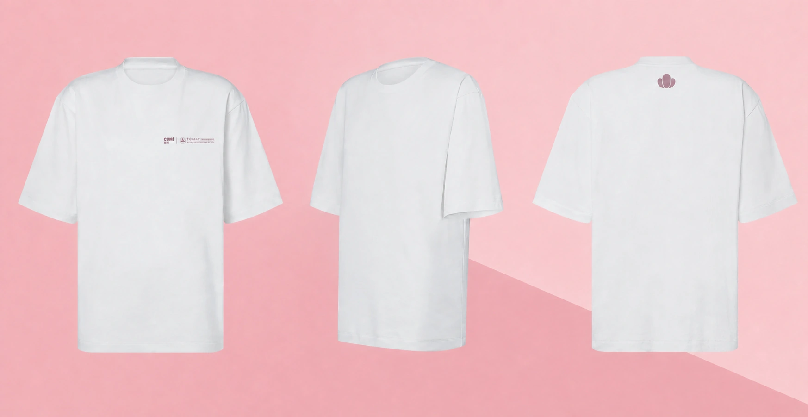

原始候选

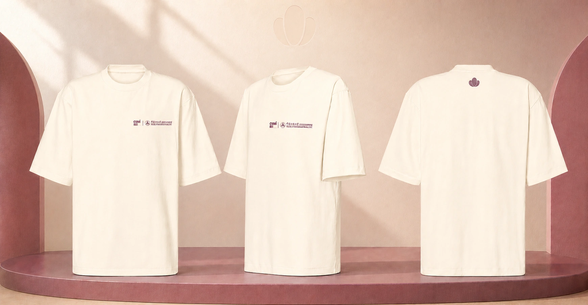

原始候选

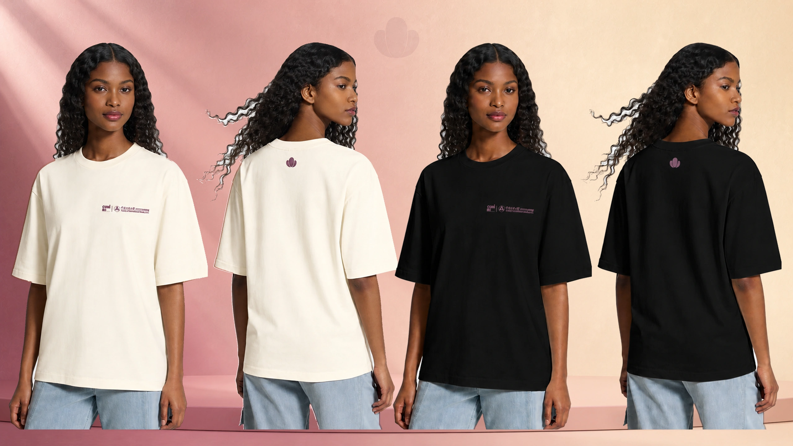

原始4K候选

### 怎么做

- 输入：指定衣服模板、原始SVG和Logo位置。
- 行动：调整后背Logo大小和透视，试颜色，再恢复清晰度，组合米白/黑色正反面。
- 判断：只换颜色不等于换高级版型；反复生成可能让衣服和人物模糊。
- 产出：3840×2160四人服装合成候选图。

### 踩过的坑

- Logo与画面装饰重叠，衣服角度不匹配。
- 换色时清晰度退化，用户要求回到第一张状态。
- 最终仍被明确标为候选，没有用户最终批准记录。

### 下次怎么避免

- 把衣服、人物、Logo与背景分别控制。
- 颜色测试在固定原图上做，避免每次全部重绘。
- 保持穿着者左胸语义，别把观看者左边当成穿着者左边。

> 画质糊了 修复到第一张的状态 衣服颜色不要变

2026-08-22；[{"source": "rollout-2026-08-22T18-53-27-01a0291a-a7d1-7ed0-bb3c-1ac43ef9e1d5.jsonl", "lines": "576", "date": "2026-08-22", "thread": "01a0291a-a7d1-7ed0-bb3c-1ac43ef9e1d5"}]

依据：[{"source": "rollout-2026-08-22T18-53-27-01a0291a-a7d1-7ed0-bb3c-1ac43ef9e1d5.jsonl", "lines": "9", "date": "2026-08-22T10:55:20.244Z", "thread": "01a0291a-a7d1-7ed0-bb3c-1ac43ef9e1d5"}, {"source": "rollout-2026-08-22T18-53-27-01a0291a-a7d1-7ed0-bb3c-1ac43ef9e1d5.jsonl", "lines": "311", "date": "2026-08-22T12:45:33.156Z", "thread": "01a0291a-a7d1-7ed0-bb3c-1ac43ef9e1d5"}, {"source": "rollout-2026-08-22T18-53-27-01a0291a-a7d1-7ed0-bb3c-1ac43ef9e1d5.jsonl", "lines": "375", "date": "2026-08-22T12:49:30.094Z", "thread": "01a0291a-a7d1-7ed0-bb3c-1ac43ef9e1d5"}, {"source": "rollout-2026-08-22T18-53-27-01a0291a-a7d1-7ed0-bb3c-1ac43ef9e1d5.jsonl", "lines": "576", "date": "2026-08-22T15:29:02.778Z", "thread": "01a0291a-a7d1-7ed0-bb3c-1ac43ef9e1d5"}, {"source": "rollout-2026-08-22T18-53-27-01a0291a-a7d1-7ed0-bb3c-1ac43ef9e1d5.jsonl", "lines": "643", "date": "2026-08-22T15:33:51.858Z", "thread": "01a0291a-a7d1-7ed0-bb3c-1ac43ef9e1d5"}, {"source": "rollout-2026-08-22T18-53-27-01a0291a-a7d1-7ed0-bb3c-1ac43ef9e1d5.jsonl", "lines": "842", "date": "2026-08-22T16:13:29.772Z", "thread": "01a0291a-a7d1-7ed0-bb3c-1ac43ef9e1d5"}, {"source": "rollout-2026-08-22T18-53-27-01a0291a-a7d1-7ed0-bb3c-1ac43ef9e1d5.jsonl", "lines": "1181", "date": "2026-08-22T16:43:10.393Z", "thread": "01a0291a-a7d1-7ed0-bb3c-1ac43ef9e1d5"}]

## 19 / 2026-09-03 / 让角色有自己的故事

从8份课程资料学讲故事，再为 CUMI 写出3分钟短片方案和分镜，最后整理成课堂网站与作业材料。

已交付教学材料；电影停留在前期制作

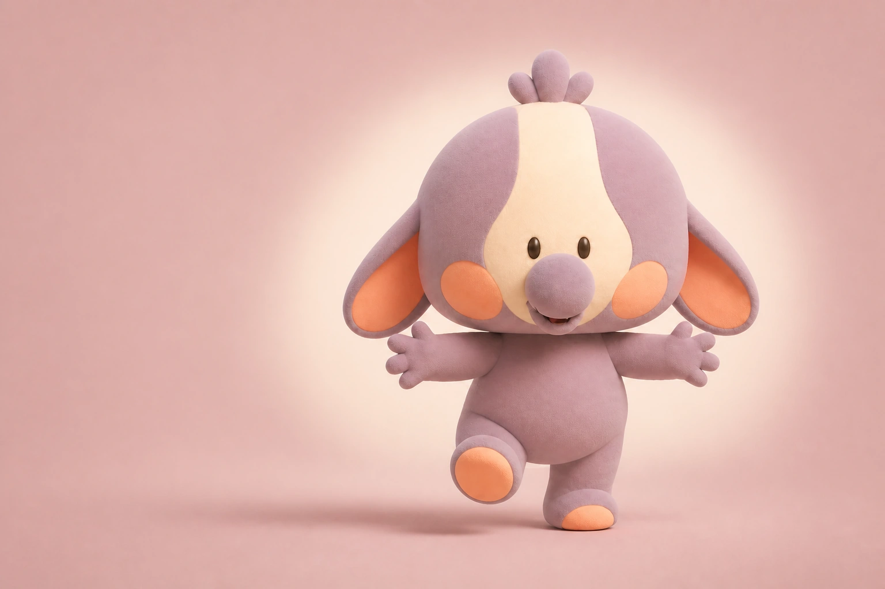

历史网页配图

历史网页配图

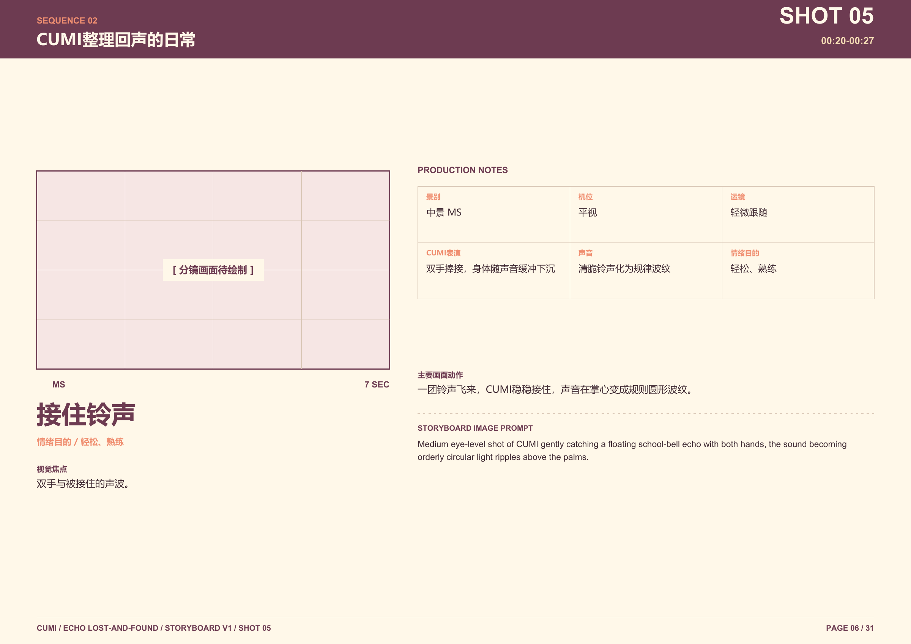

本次回看历史分镜PDF；原页明确写着“分镜画面待绘制”

### 怎么做

- 第1步：先读课程资料，整理故事、角色、剧本和分镜各自要解决的问题。
- 第2步：最初直接写了完整剧本，用户要求先看简介，于是提出6个方向并选中《回声失物招领处》。
- 第3步：删去新增的配角，让 CUMI 成为唯一角色，用环境和声音推动故事。
- 第4步：把27个镜头扩成30个，逐个核对时长，共180秒，并整理成分镜网站和31页PDF。
- 第5步：再整理40个校园选题，做成可筛选的作业网站和6页PDF。

### 踩过的坑

- 交付的是剧本、分镜、题库与教学网页；没有证据表明该3分钟完整电影已制作。

### 下次怎么避免

- 先选梗概，再扩写剧本；先锁定角色数量，再做镜头。
- 镜头数量要服务于观众理解，不要用空镜或长停顿硬凑3分钟。

> 先不要着急出剧本的细节 你先给我几个不同的故事简介

2026-09-03 20:33；[{"source": "rollout-2026-09-03T20-25-11-01a0673a-f423-7921-b553-52cad5a390fc.jsonl", "lines": [226], "date": "2026-09-03 20:33", "thread": null}]

> 我希望这是一个CUMI作为完全主角的位置 我也不想设计另外一个角色

2026-09-03 20:38；[{"source": "rollout-2026-09-03T20-25-11-01a0673a-f423-7921-b553-52cad5a390fc.jsonl", "lines": [316], "date": "2026-09-03 20:38", "thread": null}]

依据：[{"source": "rollout-2026-09-03T20-25-11-01a0673a-f423-7921-b553-52cad5a390fc.jsonl", "lines": "", "date": "", "thread": null}]

## 20 / 2026-09-08 / 把真实资料与教学补图分清楚

为了讲清设计方法，9月8日开始补做角色来源、身体比例和五官比较图；这些图是后来用于教学的解释材料，需要与早期真实设计记录分开。

课堂网站已有产物和检查记录；其中包含明确的后补教学图

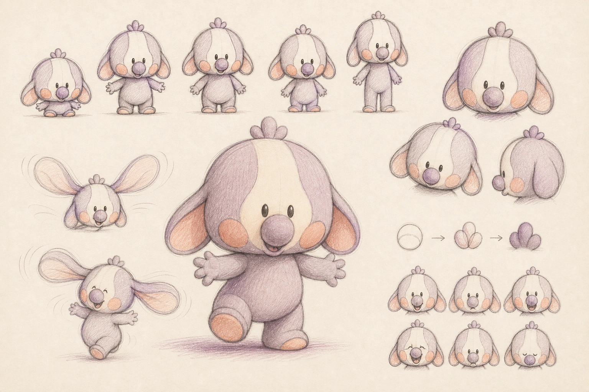

历史产物

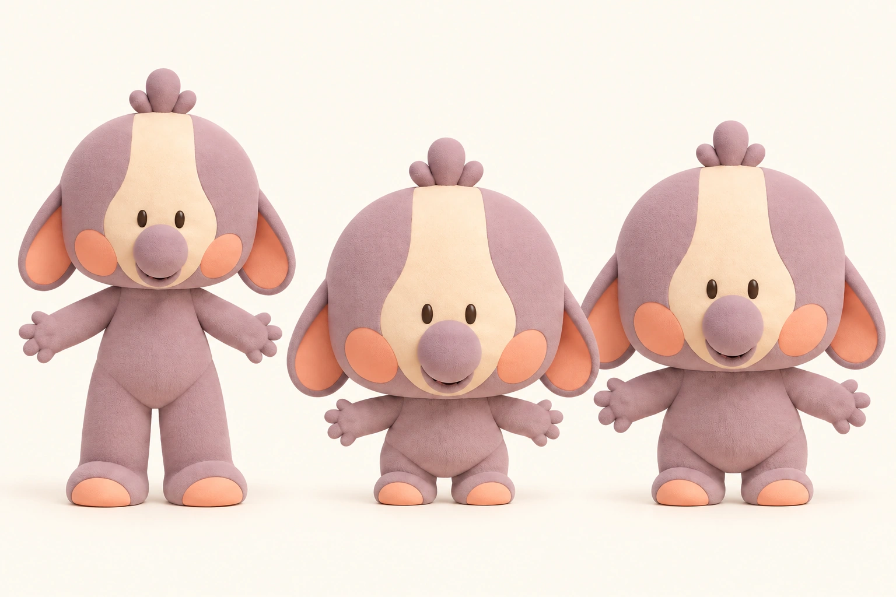

后补教学图

### 怎么做

- 第1步：用户提出把已有 CUMI 角色的设计过程倒过来拆解，先整理成10个教学环节。
- 第2步：补做身体、五官和呆毛的比较图，帮助学生理解不同选择会怎样改变角色。
- 第3步：找回已有探索图，再补充动物来源、轮廓变化和表情动作的教学图。
- 第4步：把内容排成课堂网站，提供翻页、目录、图片放大和教师备注。
- 第5步：用户曾要求移除某版画面上的“教学重构”字样，但图的来源记录仍应保留后补性质。

### 踩过的坑

- 动物图可以是已有历史素材；具体选型理由含教学分析，比例候选图还存在头型变化，不能当严格测量图。
- 女性占比是用户提供的受众信息，不能包装成独立调查结论。
- 补绘手稿不可倒推成7月至8月真实制作记录。部分旧版本是否显示标识必须逐版看，不能用一次“去字”推断全项目。

### 下次怎么避免

- 每张图都说明是当时留下的历史稿，还是后来为讲课补做的图。
- 后补比较图不能作为当初真实决策的证据，也不能直接充当母版尺寸标准。
- “女生占90%”是用户提供的班级背景，不能写成独立调研结论。

> 但我们现在只有一个独立的CUMI角色 并没有过程 所以我需要你帮我倒退 做一个设计开发过程

2026-09-08 19:22；[{"source": "rollout-2026-09-08T19-19-13-01a080be-5b21-72e3-837e-14854bbf9b61.jsonl", "lines": [42], "date": "2026-09-08 19:22", "thread": null}]

> 移除手稿上教学重构 非历史原稿的字样

2026-09-08 20:49；[{"source": "rollout-2026-09-07T18-27-28-01a07b68-9ba4-7560-8aeb-28d1888d8a01.jsonl", "lines": [374], "date": "2026-09-08 20:49", "thread": null}]

依据：[{"source": "rollout-2026-09-08T19-19-13-01a080be-5b21-72e3-837e-14854bbf9b61.jsonl", "lines": "", "date": "", "thread": null}, {"source": "rollout-2026-09-07T18-27-28-01a07b68-9ba4-7560-8aeb-28d1888d8a01.jsonl", "lines": "", "date": "", "thread": null}]

## 21 / 2026-09-08—09-10 / 让手稿能翻、让角色走进校园

把草图做成可以翻页和放大的手稿本，再让标准 CUMI 进入开学、电影周、运动会等校园场景。

手稿交互验证；场景图片多轮修正；部分视频仅提示词

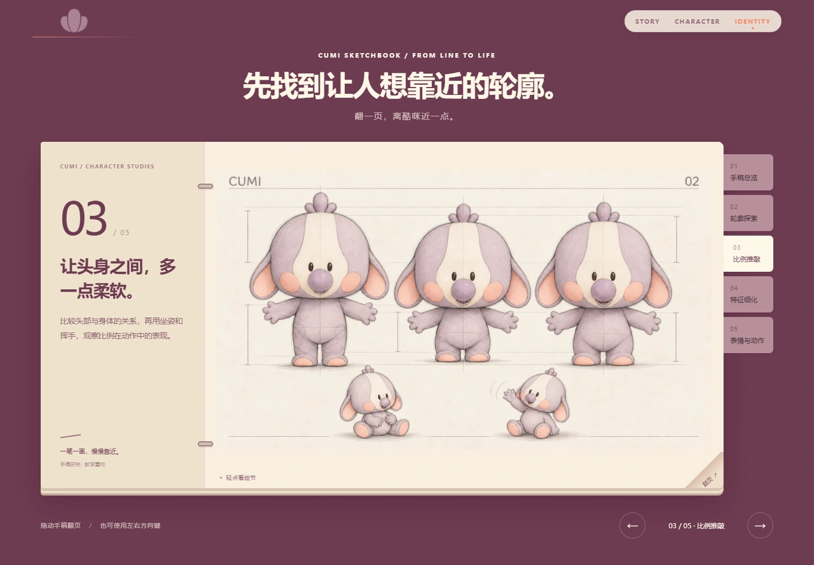

历史产物

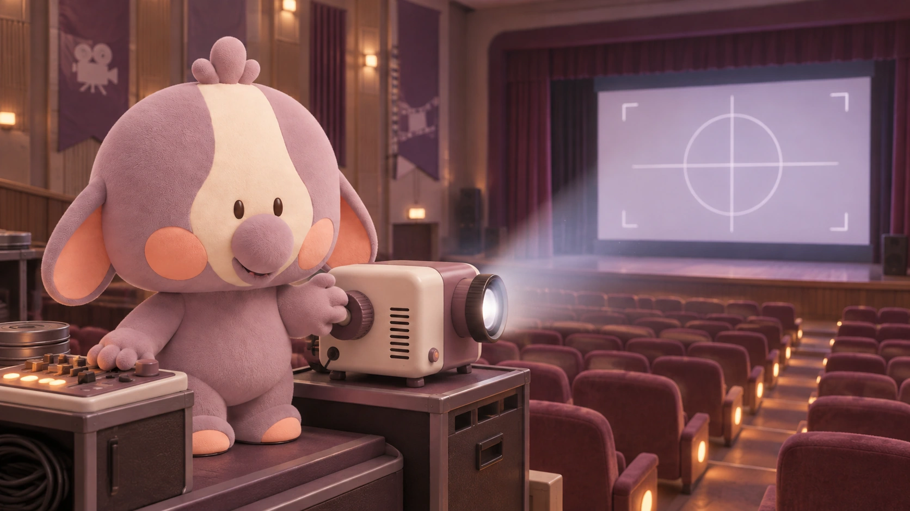

历史初稿/被指出问题

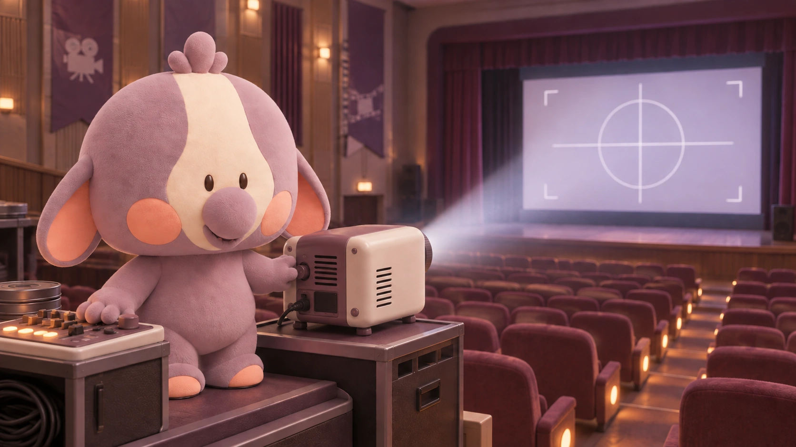

历史产物

### 怎么做

- 第1步：将手稿整理成5页小册子，加入翻页、拖动和最高300%的放大。
- 第2步：围绕开学、电影周、国际传播、运动会、AI影像和中秋制作场景图。
- 第3步：电影周首版的手势和放映机方向不对，按用户指出的位置重新修改。
- 第4步：中秋图按校园建筑和桌椅参考修订，并回到原角色图核对脸型与身材。
- 第5步：开学图制作了6秒轻动效，另外4个场景提供5秒视频提示词，不能都算成已完成视频。
- 第6步：9月10日把另行提供的5段视频做成放映室，先加入课堂网站，再接入角色手册。

### 踩过的坑

- 中秋清晰度重建时桌椅和灯笼也变化，交付答复已承认。
- 旧记忆曾把电影放映周记作未生成，但当前完整分段确有v1/v2产物记录，应以完整轨迹为准。

### 下次怎么避免

- 把角色比例、颜色、毛绒质感、道具方向、画幅列成每张图都检查的条件。
- 生成新场景不等于可以重设角色；修复清晰度要同时检查道具是否被换掉。

> 角色在重绘的过程中糊掉了 你自己检查处理一下

2026-09-09 16:21；[{"source": "rollout-2026-09-09T15-51-32-01a08139-ee71-7ab3-b569-487604bbf200_01a08526-8fdc-73c1-a06d-9869e5eb5b77.jsonl", "lines": [233], "date": "2026-09-09 16:21", "thread": null}]

依据：[{"source": "rollout-2026-09-08T21-34-12-01a08139-ee71-7ab3-b569-487604bbf200.jsonl", "lines": "", "date": "", "thread": null}, {"source": "rollout-2026-09-09T15-51-19-01a08139-ee71-7ab3-b569-487604bbf200_01a08526-5fe6-7b92-88e1-5e7c9547e343.jsonl", "lines": "", "date": "", "thread": null}, {"source": "rollout-2026-09-09T15-51-32-01a08139-ee71-7ab3-b569-487604bbf200_01a08526-8fdc-73c1-a06d-9869e5eb5b77.jsonl", "lines": "", "date": "", "thread": null}, {"source": "rollout-2026-09-07T18-27-28-01a07b68-9ba4-7560-8aeb-28d1888d8a01.jsonl", "lines": [517], "date": "2026-09-10T08:06:16.254Z", "thread": "01a07b68-9ba4-7560-8aeb-28d1888d8a01"}]

## 22 / 2026-09-13 / 从一个头像变成一套可用纹样

从原头像标识提取线条，做出可换颜色、粗细和大小的纹样，再用于纸巾、团扇和包装展示。

纹样调节与导出有功能验证；产品展示已整合，包装仍是概念效果图

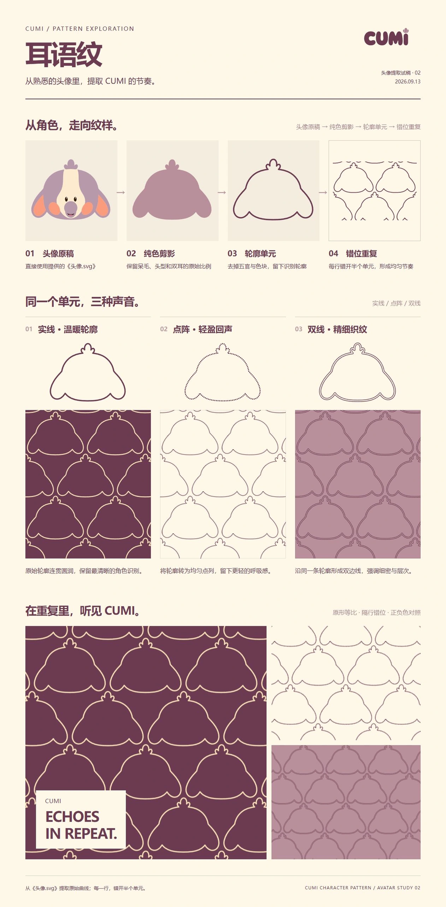

历史产物

早期已有素材，9月复用

### 怎么做

- 第1步：从用户指定的头像原图提取实线、点线和双线三种纹样。
- 第2步：制作调节面板，让使用者改变大小、线宽和颜色，并导出高清图片或矢量图。
- 第3步：补充4组标识组合纹样，调整疏密，并检查重复拼接处是否接得上。
- 第4步：纸巾页面加入原地放大，用几何纹样设计3款团扇和配套盒子。
- 第5步：纸巾包装反复修正学院标识、图案比例和侧面透视，选定展示图后接入完整网站。

### 踩过的坑

- 包装图片属于视觉概念，小字与学院标识需要放大核对，不能因为整体好看就视为印刷合格。

### 下次怎么避免

- 优先使用原始标识文件，调整角度时保持图形和文字本身不变。
- 纹样既要看单张构图，也要看左右上下能否连续拼接。
- 包装先说明结构与用途，再决定编号、英文和装饰的数量。

> 第一款学校的logo要竖着摆 你不要打乱组合方式

2026-09-13 21:03；[{"source": "rollout-2026-09-13T20-01-20-01a09aa4-b2cb-7cb3-ac2b-aed455fd85d1.jsonl", "lines": [632], "date": "2026-09-13 21:03", "thread": null}]

> 你已经打乱了所有纸巾的纹理 我需要你按照我给你的图 重新绘制纸巾的纹理部位 不要有任何修改 你做好透视就可以

2026-09-13 21:03；[{"source": "rollout-2026-09-13T20-01-20-01a09aa4-b2cb-7cb3-ac2b-aed455fd85d1.jsonl", "lines": [632], "date": "2026-09-13 21:03", "thread": null}]

依据：[{"source": "rollout-2026-09-07T18-27-28-01a07b68-9ba4-7560-8aeb-28d1888d8a01.jsonl", "lines": "", "date": "", "thread": null}, {"source": "rollout-2026-09-13T20-01-20-01a09aa4-b2cb-7cb3-ac2b-aed455fd85d1.jsonl", "lines": "", "date": "", "thread": null}]

## 23 / 2026-09-14 / 把标识放上衣服，别把照片改坏

把指定标识放到T恤和卫衣上，反复调整位置、刺绣和配色；过程中出现画面变糊、字形走样和旧网站内容丢失，随后逐项修正。

局部像素保护有验证；多轮视觉质量曾被否定；完成统一入口与服装集成；包含大量可规避返工

历史被否定版本

历史产物

历史产物

### 怎么做

- 第1步：先确定穿着者左胸的位置，再调整标识大小、角度和刺绣表现。
- 第2步：整张重画使脸与头发变糊后，改为只修标识区域，并检查其他部分有没有被改动。
- 第3步：背面呆毛、黑白配色和宽松加长版逐步展开，同时修正针脚、颜色与字形。
- 第4步：连续修改损坏画质时回到原始商品照；标识变形时回到原始矢量文件。
- 第5步：接入网站时误用了旧工作版，导致手稿、影片和动效缺失，于是按用户指定的完整入口重新整合。
- 第6步：最终接入6套服装，并替换4套短袖的16张图片，检查切换与放大。

### 踩过的坑

- 早期logo通过生成模拟，小字和颜色无法保证与原SVG完全一致；不同轮次不可一概写成精确矢量贴合。
- 曾使用1086×1448原生图导出1536×2048，明确不是原生2K。
- 这是先发生错误再补救的过程，不能只讲最终“已修好”。

### 下次怎么避免

- 明确“人物自身左胸”和“画面左侧”。
- 尺寸放大不能代替细节恢复；先检查完整成图，再展示给用户。
- 用户让查9月10日与现在的回归时，先比较那两个版本，不要跳去更新别的素材。
- 改页面前确认正在编辑的目录就是用户打开的交付目录。
- 母版、工作稿、生成候选和选定稿分开存。

> 不要重绘整个人物 现在脸和头发都糊掉 只移动logo 然后logo再往左移动一些

2026-09-14 18:51；[{"source": "rollout-2026-09-14T18-46-24-01a09f86-756c-7b51-ac89-e945c035d20e.jsonl", "lines": [134], "date": "2026-09-14 18:51", "thread": null}]

> 照片里的衣服好糊啊 我原始给你的图片分辨率很低 这就是为什么我要你提升分辨率 我是需要你帮我修复清晰度

2026-09-14 19:12；[{"source": "rollout-2026-09-14T18-46-24-01a09f86-756c-7b51-ac89-e945c035d20e.jsonl", "lines": [435], "date": "2026-09-14 19:12", "thread": null}]

> 你在瞎改cumi的logo 其他细节都保留 只把logo改回原来的样式

2026-09-14 21:06；[{"source": "rollout-2026-09-14T19-56-13-01a09fc6-6247-7180-91fa-b2ce396ea83b.jsonl", "lines": [775], "date": "2026-09-14 21:06", "thread": null}]

> 我不能接受重绘之后的任何污点 脏渍 和奇怪的几何纹理

2026-09-14 20:52；[{"source": "rollout-2026-09-14T19-56-13-01a09fc6-6247-7180-91fa-b2ce396ea83b.jsonl", "lines": [630], "date": "2026-09-14 20:52", "thread": null}]

> 我发现 这个文件夹里有三个网页文件  而且每个网页文件的内容都不一样 我需要的只有一个 目前看起来打开文创展示的这个文件是对的 只保留这一个 然后把刚刚做的服装展示页添加进来

2026-09-14 22:48；[{"source": "rollout-2026-09-14T22-42-44-01a09fc6-6247-7180-91fa-b2ce396ea83b_01a0a05e-d30a-7892-91b3-843f6a650e98.jsonl", "lines": [39], "date": "2026-09-14 22:48", "thread": null}]

依据：[{"source": "rollout-2026-09-14T18-46-24-01a09f86-756c-7b51-ac89-e945c035d20e.jsonl", "lines": "", "date": "", "thread": null}, {"source": "rollout-2026-09-14T19-56-13-01a09fc6-6247-7180-91fa-b2ce396ea83b.jsonl", "lines": "", "date": "", "thread": null}, {"source": "rollout-2026-09-14T22-42-44-01a09fc6-6247-7180-91fa-b2ce396ea83b_01a0a05e-d30a-7892-91b3-843f6a650e98.jsonl", "lines": "", "date": "", "thread": null}]

## 24 / 2026-09-14 / 真正统一粗圆字形

先用一页样张确认用户要的阿里妈妈粗圆字形，再统一全站，并补上用户实际打开的交付文件夹。

字形与包结构有证据验证

历史产物

历史产物

### 怎么做

- 第1步：检查字体文件，发现文件名写着粗圆体，实际字形仍受可变参数控制。
- 第2步：固定粗细和圆角参数，用“国”等实际汉字并排确认效果。
- 第3步：在服装页确认后，把同一字体应用到全站文字。
- 第4步：用户的交付版仍没变化，查出只改了工作目录，于是同步正确目录并重新打包。

### 踩过的坑

- 字体文件名和CSS声明不能单独证明浏览器实际用了对应字形。

### 下次怎么避免

- 用实际汉字样张验证字体，不只看名称。
- 先在一页验证再推广全站，并同步用户实际入口。

> 我明确要的是左上角的这个粗圆体 但你现在用的都是粗方体 跟我要的不是一个东西 先拿服装页做测试

2026-09-14 23:23；[{"source": "rollout-2026-09-14T23-23-52-01a0a084-7bc0-7fd2-a7ba-f0f73ebefbc3.jsonl", "lines": [9], "date": "2026-09-14 23:23", "thread": null}]

依据：[{"source": "rollout-2026-09-14T23-23-52-01a0a084-7bc0-7fd2-a7ba-f0f73ebefbc3.jsonl", "lines": "", "date": "", "thread": null}]

## 25 / 2026-09-15—09-18 / 从月饼概念到完整商品图库

从头像轮廓月饼开始，比较厚度、切面、外皮材质和礼盒，逐步整理商品图库；9月18日继续补做双抽屉开盒图。

商品图库与交互有验证；部分材质尝试失败，未做实物打样

历史探索稿

历史产物

历史产物

现有交付站原始图片；为设计效果图，非实物摄影

### 怎么做

- 第1步：带脸浮雕方案被否定后，改做素面头像轮廓，并修正过薄的厚度和切半形状。
- 第2步：继续尝试巧克力薄壳、喷绒、半透皮和酥皮四种外皮材质。
- 第3步：为月饼配纸盒、木盒和纸袋，反复调整标识和腰封；其中一轮材质修复仍未通过。
- 第4步：补拍式生成完整月饼、内馅和包装特写，整理成7张图的展示图库。
- 第5步：9月18日新增双抽屉开盒图，并补到用户实际打开的文件夹。
- 第6步：手写文字修改时字形被重做，最后换回用户提供的原始 SFB 标识。

### 踩过的坑

- 月饼和礼盒是视觉概念，不代表真实食品配方、模具、印刷和生产打样完成。
- v5材质修复明确木纹/金色月饼仍异常，不能放到“已成功修复”。

### 下次怎么避免

- 判断高级感要从材质、厚度、切面和摄影出发，不是给表面堆纹样。
- 恢复材质与改变物体位置/形状要分开。
- 新增版本后仍须核对用户正在打开哪个目录。

> 不要改变任何位置形状等信息 只回复材质质感

2026-09-15 20:32；[{"source": "rollout-2026-09-15T19-20-23-01a0a4cb-ef15-75e2-8576-86d511707c48.jsonl", "lines": [712], "date": "2026-09-15 20:32", "thread": null}]

> 开场第一幕右上角的花缩小50% 然后第三页的文案应该是 我是酷咪 现在缺少我是两个字 然后现在四个场景之间的停顿还是太长

2026-09-15 22:27；[{"source": "rollout-2026-09-15T19-20-23-01a0a4cb-ef15-75e2-8576-86d511707c48.jsonl", "lines": [1817], "date": "2026-09-15 22:27", "thread": null}]

> 你改我logo干嘛 就让你移除那个星星而已 还有要移除Friends后面的S

2026-09-18 16:58；[{"source": "rollout-2026-09-15T19-20-23-01a0a4cb-ef15-75e2-8576-86d511707c48.jsonl", "lines": [2752], "date": "2026-09-18 16:58", "thread": null}]

依据：[{"source": "rollout-2026-09-15T19-20-23-01a0a4cb-ef15-75e2-8576-86d511707c48.jsonl", "lines": "", "date": "", "thread": null}]

## 26 / 2026-09-15—09-18 / 把品牌元素接成连续动效

把已有标识、贴纸、纹样和角色接成连续动画，再整理页面顺序和入口；多次返工来自节奏、画面比例及工作目录与交付目录不同步。

动效整合、导航和清理有检查记录；曾有空白入口、画面拉伸和版本不同步

本次打开现存角色转场页面截图，非当日截图

本次回看动效页面的结束画面，非当日截图

### 怎么做

- 第1步：先做独立预览，再把18秒试作改成节奏更紧凑的品牌动画。
- 第2步：从原贴纸文件提取16个元素，设计聚拢、爆开和角色定格的连续画面。
- 第3步：加入旋转印章与渐变结尾，修正拉伸、裁切和共享样式误伤其他场景的问题。
- 第4步：让花带交错移动并旋转，再变成角色剪影，放大后衔接身体结构页。
- 第5步：按用户要求调短停留、删去进度条，并明确全宽16:9画面允许上下滚动。
- 第6步：整合导航和实际交付入口，检查链接与高亮；确认备份和引用后清理328个非运行文件。

### 踩过的坑

- 同一处改动曾只写进新包，用户打开的旧文件夹没有同步。
- 修改一个场景的尺寸时，共用样式连带拉伸了其他场景。
- 全宽16:9与整幅装入屏幕是不同显示方式，未先讲清就容易反复改。
- 早期花带页面曾漏图或空白，个别检查只验证文件和脚本，不能代表用户本地已经播放成功。

### 下次怎么避免

- 先核对用户正在打开哪个文件夹，再定位和修改页面。
- 先画出各幕的构图与衔接位置，再调时间和动画。
- 每次检查开头、中间和结束画面，同时回看其他场景。
- 菜单名称、目标链接、页面顺序和当前高亮一起核对。
- 清理前保留备份，并确认页面实际引用的图片、字体和视频都在。

> 但是前四个的比例出问题了

2026-09-16 21:26；[{"source": "rollout-2026-09-16T20-52-11-01a0aa3b-570d-73a2-a998-062e73ecd54a_01a0aa46-5492-73e1-907e-84cb4e1df40c.jsonl", "lines": [591], "date": "2026-09-16 21:26", "thread": null}]

> 3秒有点长 改成2秒吧 然后切换到第二幕的时候 大头为什么卡住了一会

2026-09-17 22:46；[{"source": "rollout-2026-09-17T22-04-10-01a0afae-9b0d-7a33-80e1-b65ea641d491.jsonl", "lines": [649], "date": "2026-09-17 22:46", "thread": null}]

依据：[{"source": "rollout-2026-09-15T19-20-23-01a0a4cb-ef15-75e2-8576-86d511707c48.jsonl", "lines": "", "date": "", "thread": null}, {"source": "rollout-2026-09-16T20-40-10-01a0aa3b-570d-73a2-a998-062e73ecd54a.jsonl", "lines": "", "date": "", "thread": null}, {"source": "rollout-2026-09-16T20-48-04-01a0aa3b-570d-73a2-a998-062e73ecd54a_01a0aa42-90ce-76d0-b1f4-74c42a686fea.jsonl", "lines": "", "date": "", "thread": null}, {"source": "rollout-2026-09-16T20-52-11-01a0aa3b-570d-73a2-a998-062e73ecd54a_01a0aa46-5492-73e1-907e-84cb4e1df40c.jsonl", "lines": "", "date": "", "thread": null}, {"source": "rollout-2026-09-17T22-04-10-01a0afae-9b0d-7a33-80e1-b65ea641d491.jsonl", "lines": "", "date": "", "thread": null}]

## 27 / 2026-09-18 / 先做平面稿，再做盲盒陈列

先确定六角色卡片和包装平面稿，再制作带透视、材质和灯光的盲盒效果图；这些交付属于设计模拟，并非制造完成的实物。

卡片和包装视觉设计已保存；非生产工程确认；效果图及展示页；不是物理实物生产

历史产物

历史产物

历史产物

### 怎么做

- 第1步：先做6张角色卡和2张背卡，逐一修正学院标识、比例和透视。
- 第2步：调整粉色压纹卡的光泽与重复方式，避免参考位置被误做成整张平铺。
- 第3步：按15厘米角色的展示需求设计包装四面，并统一文字与说明图标。
- 第4步：连续星空跨面效果不理想后，改用深梅色背景，保存可编辑的平面原稿。
- 第5步：把已确定的平面图贴到盒子上，调整厚度、尺寸、角度和铝箔袋，避免重新生成破坏图案。
- 第6步：选6张图接入完整网站；堆盒图仍反复出现大小和摆放问题，不能全部写成已通过。

### 踩过的坑

- 只有高度，不足以完成精确内托/包装工程尺寸；16×19cm仅概念比例，不是量产刀模。
- 卡片2K输出的像素数不能保证校徽和文字原生细节。
- 任务UI名为“制作盒子实物样品”，但记录实际是视觉效果图；课堂必须避免称已生产实物。
- 最终堆盒构图没有可据此宣称量产可行的证据。

### 下次怎么避免

- 先做独立平面稿，再做透视陈列。
- 把卡片间遮挡画成关系草图，检查完整尺寸和重复次数。
- 保留原始SVG整体比例，不拆改学院组合标。
- 精确包装面用原图贴图；生成只负责摄影环境、光和材质。
- 先锁定单一盒型尺寸，再排阵列，不让每个盒子自由长宽变化。

> 我只是框出来告诉你我要的是哪张图  而不是我框出来的比例和样式

2026-09-18 13:06；[{"source": "rollout-2026-09-18T12-26-35-01a0b2c4-28a6-7c93-aa9c-fe163355e9f8.jsonl", "lines": [469], "date": "2026-09-18 13:06", "thread": null}]

> 然后图片分辨率提升到2K 不是单独提升分辨率 是整体的清晰度

2026-09-18 14:21；[{"source": "rollout-2026-09-18T12-26-35-01a0b2c4-28a6-7c93-aa9c-fe163355e9f8.jsonl", "lines": [866], "date": "2026-09-18 14:21", "thread": null}]

> 现在有几个问题 1 角色之间没有间隔 甚至挤在一起重叠在一起 2 三个盒子的大小不一样 这个盒子只有一个尺寸 而且只能包的下一个角色的尺寸

2026-09-18 18:34；[{"source": "rollout-2026-09-18T17-47-29-01a0b3e9-f5e9-7e00-b6ad-bd45b1a2a753.jsonl", "lines": [416], "date": "2026-09-18 18:34", "thread": null}]

依据：[{"source": "rollout-2026-09-18T12-26-35-01a0b2c4-28a6-7c93-aa9c-fe163355e9f8.jsonl", "lines": "", "date": "", "thread": null}, {"source": "rollout-2026-09-18T17-47-29-01a0b3e9-f5e9-7e00-b6ad-bd45b1a2a753.jsonl", "lines": "", "date": "", "thread": null}]

## 28 / 2026-09-18 / 把同一套识别扩展到文具

把同一套 CUMI 标识用于胶带、笔袋、文具和日用品，重点处理图案取舍、指定位置和材质，最后整理成13张展示图。

13图展示与交互有验证；实物工艺为概念

历史产物

历史产物

历史产物

### 怎么做

- 第1步：先试5种胶带方向，再按用户要求保留大花、去掉小花，纠正第一次删错对象的问题。
- 第2步：毛绒笔袋按用户摆好的位置保留标识，只调整刺绣表现。
- 第3步：扩展笔、笔记本、便利贴、文件夹、纸巾盒、帆布袋、杯子和书签。
- 第4步：逐件检查图案比例、透视和材质，重做出现几何纹理的帆布袋。
- 第5步：把13张选定图片接入网站，按“序号＋名字”展示。
- 第6步：16:9展示框裁掉产品后，改为完整显示图片，并按要求去掉分类筛选。

### 踩过的坑

- 生成的工艺表现（刺绣、凹印、长绒）是效果表达，并无生产材料和成本证据。

### 下次怎么避免

- 每轮只改指定区域，保留用户摆好的位置。
- 先确认保留什么，再写删除指令；“去小花”不能变“去大花”。
- 画面容器16:9不等于图也必须裁成16:9，产品图用完整显示规则。

> 让你取消的是小花朵 你怎么把大花朵取消了

2026-09-18 16:28；[{"source": "rollout-2026-09-18T16-19-24-01a0b399-507e-76a0-858a-7592c3d3ade0.jsonl", "lines": [150], "date": "2026-09-18 16:28", "thread": null}]

> 位置我给你摆好了 现在我只需要你把左小角logo改成刺绣样式 其他的都不要动

2026-09-18 17:03；[{"source": "rollout-2026-09-18T16-19-24-01a0b399-507e-76a0-858a-7592c3d3ade0.jsonl", "lines": [383], "date": "2026-09-18 17:03", "thread": null}]

> 展示图片的时候要展示完整的图片 现在都被切掉了

2026-09-18 22:01；[{"source": "rollout-2026-09-18T17-57-50-01a0b399-507e-76a0-858a-7592c3d3ade0_01a0b3f3-7064-77d2-8fe6-845d1109d980.jsonl", "lines": [1494], "date": "2026-09-18 22:01", "thread": null}]

依据：[{"source": "rollout-2026-09-18T16-19-24-01a0b399-507e-76a0-858a-7592c3d3ade0.jsonl", "lines": "", "date": "", "thread": null}, {"source": "rollout-2026-09-18T17-57-50-01a0b399-507e-76a0-858a-7592c3d3ade0_01a0b3f3-7064-77d2-8fe6-845d1109d980.jsonl", "lines": "", "date": "", "thread": null}]

## 29 / 2026-09-18—09-19 / 扩图返工：接缝问题仍未解决

竖版星空图扩成横版后接入首页与告别动画；截至9月19日00:15接缝仍未通过，随后00:24用户决定采用当前候选，00:36另存打包交付。

00:15接缝未过；00:24用户选定后已替换，00:36独立交付；已知接缝差异保留

历史产物

历史失败路径

历史未通过候选

真实历史交付；在已知限制下由用户选定

### 怎么做

- 第1步：原本只需补画两侧，却先重画整图并降低分辨率，导致细节退化和几何纹理。
- 第2步：修改彩点与光晕后，把候选图接入首页，让尘埃绕开角色并持续约10秒。
- 第3步：用挥手场景制作约8秒的告别动画，再接入完整网站并保留原有42个章节。
- 第4步：用户再次指出扩图方法错误，随后改为保留原图，只分别补画左右区域。
- 第5步：检查确认4,477,648个受保护像素未变，但这只能证明原图保住了，不能证明接缝自然。
- 第6步：00:15说明接缝仍不自然；00:24用户要求替换，00:30要求另存，00:36完成独立包交付。

### 踩过的坑

- 右侧地面纹理仍有可辨接缝；用户在了解这一限制后决定采用当前候选，后续没有进一步修好接缝的证据。
- 像素保护通过只证明中央未变，不证明接缝自然；截图评审和数值检查缺一不可。

### 下次怎么避免

- 扩图先定目标画布和保留区，原图中央直接保留像素，只生成两翼。
- 不要先把高分辨率原稿变小再二次追求高清。
- 所有接缝必须看1:1局部和整体图，不能以中央零差异代替全图验收。

> 我要求和原来一样的颜色和构图以及银河的位置和走向

2026-09-18 22:02；[{"source": "rollout-2026-09-18T22-02-17-01a0b496-532a-76f3-a5f1-e34fcf387ae8_01a0b4d3-3aad-7ab0-868b-d62de8781151.jsonl", "lines": [7], "date": "2026-09-18 22:02", "thread": null}]

> 尘埃我很喜欢 但是要从角色背后飞过来 而不是穿过角色 同时尘埃动销的效果维持10秒

2026-09-18 22:09；[{"source": "rollout-2026-09-18T22-02-17-01a0b496-532a-76f3-a5f1-e34fcf387ae8_01a0b4d3-3aad-7ab0-868b-d62de8781151.jsonl", "lines": [65], "date": "2026-09-18 22:09", "thread": null}]

> 我不理解 我给你一张2048\**2432的图 你为什么给我做了一张1672*\*941的 然后你再去生高清和分辨率 这样又出现了奇怪的纹理 你这个做事情的逻辑不对呀 难怪每次做图有问题

2026-09-18 23:05；[{"source": "rollout-2026-09-18T22-02-17-01a0b496-532a-76f3-a5f1-e34fcf387ae8_01a0b4d3-3aad-7ab0-868b-d62de8781151.jsonl", "lines": [850], "date": "2026-09-18 23:05", "thread": null}]

> 图片上现在还有明显的两个大接缝 你就忽略了吗

2026-09-18 23:22；[{"source": "rollout-2026-09-18T22-02-17-01a0b496-532a-76f3-a5f1-e34fcf387ae8_01a0b4d3-3aad-7ab0-868b-d62de8781151.jsonl", "lines": [1019], "date": "2026-09-18 23:22", "thread": null}]

> 做替换吧

2026-09-19；[{"source": "rollout-2026-09-18T22-02-17-01a0b496-532a-76f3-a5f1-e34fcf387ae8_01a0b4d3-3aad-7ab0-868b-d62de8781151.jsonl", "lines": [1646], "date": "2026-09-19", "thread": null}]

> 另存打包吧

2026-09-19；[{"source": "rollout-2026-09-18T22-02-17-01a0b496-532a-76f3-a5f1-e34fcf387ae8_01a0b4d3-3aad-7ab0-868b-d62de8781151.jsonl", "lines": [1724], "date": "2026-09-19", "thread": null}]

依据：[{"source": "rollout-2026-09-18T20-55-45-01a0b496-532a-76f3-a5f1-e34fcf387ae8.jsonl", "lines": "", "date": "", "thread": null}, {"source": "rollout-2026-09-18T21-59-11-01a0b496-532a-76f3-a5f1-e34fcf387ae8_01a0b4d0-6438-7751-a814-27b7d777d9ad.jsonl", "lines": "", "date": "", "thread": null}, {"source": "rollout-2026-09-18T22-02-17-01a0b496-532a-76f3-a5f1-e34fcf387ae8_01a0b4d3-3aad-7ab0-868b-d62de8781151.jsonl", "lines": "", "date": "", "thread": null}, {"source": "rollout-2026-09-18T22-02-17-01a0b496-532a-76f3-a5f1-e34fcf387ae8_01a0b4d3-3aad-7ab0-868b-d62de8781151.jsonl", "lines": [1646], "date": "2026-09-18T16:24:19.381Z", "thread": "01a0b496-532a-76f3-a5f1-e34fcf387ae8"}, {"source": "rollout-2026-09-18T22-02-17-01a0b496-532a-76f3-a5f1-e34fcf387ae8_01a0b4d3-3aad-7ab0-868b-d62de8781151.jsonl", "lines": [1666], "date": "2026-09-18T16:25:56.135Z", "thread": "01a0b496-532a-76f3-a5f1-e34fcf387ae8"}, {"source": "rollout-2026-09-18T22-02-17-01a0b496-532a-76f3-a5f1-e34fcf387ae8_01a0b4d3-3aad-7ab0-868b-d62de8781151.jsonl", "lines": [1693], "date": "2026-09-18T16:27:49.496Z", "thread": "01a0b496-532a-76f3-a5f1-e34fcf387ae8"}, {"source": "rollout-2026-09-18T22-02-17-01a0b496-532a-76f3-a5f1-e34fcf387ae8_01a0b4d3-3aad-7ab0-868b-d62de8781151.jsonl", "lines": [1724], "date": "2026-09-18T16:30:20.176Z", "thread": "01a0b496-532a-76f3-a5f1-e34fcf387ae8"}, {"source": "rollout-2026-09-18T22-02-17-01a0b496-532a-76f3-a5f1-e34fcf387ae8_01a0b4d3-3aad-7ab0-868b-d62de8781151.jsonl", "lines": [1785], "date": "2026-09-18T16:35:41.182Z", "thread": "01a0b496-532a-76f3-a5f1-e34fcf387ae8"}, {"source": "rollout-2026-09-18T22-02-17-01a0b496-532a-76f3-a5f1-e34fcf387ae8_01a0b4d3-3aad-7ab0-868b-d62de8781151.jsonl", "lines": [1797], "date": "2026-09-18T16:36:24.285Z", "thread": "01a0b496-532a-76f3-a5f1-e34fcf387ae8"}, {"source": "rollout-2026-09-18T22-02-17-01a0b496-532a-76f3-a5f1-e34fcf387ae8_01a0b4d3-3aad-7ab0-868b-d62de8781151.jsonl", "lines": [1805], "date": "2026-09-18T16:36:51.899Z", "thread": "01a0b496-532a-76f3-a5f1-e34fcf387ae8"}]

## 反复强调的问题

### 先自己看过，再交给别人看

早期方案已经被认为不好看，仍不断交给用户初筛。后期又出现明显接缝、未对齐却声称完成。用户反复要求AI先审视自己的结果。

下次先做：先把候选与母版、参考并排看；放大检查问题区，再缩回整图检查。明确推荐一稿和它仍存在的问题。

[{"source": "rollout-2026-07-31T18-28-57-019fb7b8-4f75-7a70-a8b0-e174f7e9d1ca.jsonl", "lines": [4786], "thread": "019fb7b8-4f75-7a70-a8b0-e174f7e9d1ca", "date": "2026-08-08 21:32"}, {"source": "rollout-2026-07-31T18-28-57-019fb7b8-4f75-7a70-a8b0-e174f7e9d1ca.jsonl", "lines": [6154], "thread": "019fb7b8-4f75-7a70-a8b0-e174f7e9d1ca", "date": "2026-08-09 18:02"}, {"source": "rollout-2026-09-18T22-02-17-01a0b496-532a-76f3-a5f1-e34fcf387ae8_01a0b4d3-3aad-7ab0-868b-d62de8781151.jsonl", "lines": [1019], "thread": "01a0b496-532a-76f3-a5f1-e34fcf387ae8", "date": "2026-09-18 23:22"}]

### 先定方向，再做一页样本

方向没定就写完整剧本，字形没对就扩展整站，都会放大返工。用户要求先比较故事简介、先拿服装页测试。

下次先做：探索时给少量清楚不同的方向；选定后只做一个代表样本，通过再批量展开。

[{"source": "rollout-2026-09-03T20-25-11-01a0673a-f423-7921-b553-52cad5a390fc.jsonl", "lines": [226], "thread": "01a0673a-f423-7921-b553-52cad5a390fc", "date": "2026-09-03 20:33"}, {"source": "rollout-2026-09-14T23-23-52-01a0a084-7bc0-7fd2-a7ba-f0f73ebefbc3.jsonl", "lines": [9], "thread": "01a0a084-7bc0-7fd2-a7ba-f0f73ebefbc3", "date": "2026-09-14 23:23"}]

### 先认准要改的对象

圈选框被理解成了裁切比例，小花与大花被混淆，有问题的8帧没有改到。这些失败在真正动手之前就已经发生。

下次先做：用一句话指出要改的是哪个对象、哪一帧、哪一部分；把标注用途与设计要求分开。需要局部修复时，先截出目标区核对。

[{"source": "rollout-2026-08-20T11-38-34-01a01d3f-c91d-7f20-8c14-3685ae2bd502.jsonl", "lines": [3177], "thread": "01a01d3f-c91d-7f20-8c14-3685ae2bd502", "date": "2026-08-20 19:03"}, {"source": "rollout-2026-09-18T12-26-35-01a0b2c4-28a6-7c93-aa9c-fe163355e9f8.jsonl", "lines": [469], "thread": "01a0b2c4-28a6-7c93-aa9c-fe163355e9f8", "date": "2026-09-18 13:06"}, {"source": "rollout-2026-09-18T16-19-24-01a0b399-507e-76a0-858a-7592c3d3ade0.jsonl", "lines": [150], "thread": "01a0b399-507e-76a0-858a-7592c3d3ade0", "date": "2026-09-18 16:28"}]

### 有了母版，就别重新发明角色

角色定稿后，换服装、做2D图、做文创都应延续同一身份。历史中反复出现改身材、换Logo、重新生成已有资产的问题。

下次先做：制作前先定位用户指定的母版和原始SVG；锁定比例、颜色、标识组合。扩展时记录每张结果用了哪份原素材。

[{"source": "rollout-2026-07-31T18-28-57-019fb7b8-4f75-7a70-a8b0-e174f7e9d1ca.jsonl", "lines": [12923], "thread": "019fb7b8-4f75-7a70-a8b0-e174f7e9d1ca", "date": "2026-08-13 01:32"}, {"source": "rollout-2026-08-16T19-43-35-01a00a62-63d5-7162-b4cb-f5093dfa19ec.jsonl", "lines": [2637], "thread": "01a00a62-63d5-7162-b4cb-f5093dfa19ec", "date": "2026-08-20 16:40"}, {"source": "rollout-2026-09-14T19-56-13-01a09fc6-6247-7180-91fa-b2ce396ea83b.jsonl", "lines": [775], "thread": "01a09fc6-6247-7180-91fa-b2ce396ea83b", "date": "2026-09-14 21:06"}]

### 只改一处，就把其余部分锁住

移动Logo却重绘脸和头发；修改材质却改变位置；调整身体比例又改变颜色和动作。局部要求不能自动变成整张重做。

下次先做：把“要改什么”和“保留什么”写成两列；优先处理局部。交付时既检查改动区，也对比本来不该变化的区域。

[{"source": "rollout-2026-08-20T22-58-46-01a01fae-8737-7862-b65d-d54b1947f263.jsonl", "lines": [9], "thread": "01a01fae-8737-7862-b65d-d54b1947f263", "date": "2026-08-20 22:59"}, {"source": "rollout-2026-09-14T18-46-24-01a09f86-756c-7b51-ac89-e945c035d20e.jsonl", "lines": [134], "thread": "01a09f86-756c-7b51-ac89-e945c035d20e", "date": "2026-09-14 18:51"}, {"source": "rollout-2026-09-18T16-19-24-01a0b399-507e-76a0-858a-7592c3d3ade0.jsonl", "lines": [383], "thread": "01a0b399-507e-76a0-858a-7592c3d3ade0", "date": "2026-09-18 17:03"}]

### 干净的材质是底线

三角形纹路、黄脏色、污点和怪异几何纹理跨越多轮重绘反复出现。毛绒、布料、纸巾也不能在修图时变成另一种材质。

下次先做：保留一张已通过的干净母版作对照；局部放大看纹理，整图看颜色。连续修改开始变脏时，回到干净原图重新做必要的那一步。

[{"source": "rollout-2026-07-31T18-28-57-019fb7b8-4f75-7a70-a8b0-e174f7e9d1ca.jsonl", "lines": [7522], "thread": "019fb7b8-4f75-7a70-a8b0-e174f7e9d1ca", "date": "2026-08-10 19:32"}, {"source": "rollout-2026-09-14T19-56-13-01a09fc6-6247-7180-91fa-b2ce396ea83b.jsonl", "lines": [630], "thread": "01a09fc6-6247-7180-91fa-b2ce396ea83b", "date": "2026-09-14 20:52"}, {"source": "rollout-2026-09-15T19-20-23-01a0a4cb-ef15-75e2-8576-86d511707c48.jsonl", "lines": [712], "thread": "01a0a4cb-ef15-75e2-8576-86d511707c48", "date": "2026-09-15 20:32"}]

### 像素变大，不代表真的更清楚

衣服、角色和首屏图片多次出现“尺寸够了，细节仍糊”的情况。先把大图重绘成小图再放大，还会制造新的纹理。

下次先做：保留最高质量的原始素材；先说明目标是补细节、扩画面还是改尺寸。比较文字边缘、毛绒和布纹，分别报告原生尺寸与放大后尺寸。

[{"source": "rollout-2026-08-22T18-53-27-01a0291a-a7d1-7ed0-bb3c-1ac43ef9e1d5.jsonl", "lines": [576], "thread": "01a0291a-a7d1-7ed0-bb3c-1ac43ef9e1d5", "date": "2026-08-22 23:29"}, {"source": "rollout-2026-09-14T18-46-24-01a09f86-756c-7b51-ac89-e945c035d20e.jsonl", "lines": [435], "thread": "01a09f86-756c-7b51-ac89-e945c035d20e", "date": "2026-09-14 19:12"}, {"source": "rollout-2026-09-18T12-26-35-01a0b2c4-28a6-7c93-aa9c-fe163355e9f8.jsonl", "lines": [866], "thread": "01a0b2c4-28a6-7c93-aa9c-fe163355e9f8", "date": "2026-09-18 14:21"}]

### 字形和标识组合要逐项对照

粗圆体被换成粗方体，学校Logo竖向组合被打乱，呆毛与字母之间的距离也需要反复纠正。“看起来差不多”不适合品牌资产。

下次先做：拿原始字形和组合标识对照，检查方向、间距、粗细、比例和字母内容。优先复用矢量文件，不能凭记忆重画。

[{"source": "rollout-2026-08-14T19-52-03-01a0001d-6bdf-7f70-8026-4a9ad3d1aa9f.jsonl", "lines": [734], "thread": "01a0001d-6bdf-7f70-8026-4a9ad3d1aa9f", "date": "2026-08-14 20:41"}, {"source": "rollout-2026-09-13T20-01-20-01a09aa4-b2cb-7cb3-ac2b-aed455fd85d1.jsonl", "lines": [632], "thread": "01a09aa4-b2cb-7cb3-ac2b-aed455fd85d1", "date": "2026-09-13 21:03"}, {"source": "rollout-2026-09-14T23-23-52-01a0a084-7bc0-7fd2-a7ba-f0f73ebefbc3.jsonl", "lines": [9], "thread": "01a0a084-7bc0-7fd2-a7ba-f0f73ebefbc3", "date": "2026-09-14 23:23"}]

### 完整展示，不擅自改变构图

网站换展示方式后裁掉产品图，贴图任务改变既有排版，首屏扩展又挪动银河。用户在意的不只是有没有这张图，还有它怎样被看见。

下次先做：先确定图片需要完整显示还是允许裁切；保存原构图对照。在浏览器中检查角色、文字、Logo和产品边缘是否都在画面里。

[{"source": "rollout-2026-08-20T22-36-11-01a01f99-daf5-79c3-8fe5-be256d92534e.jsonl", "lines": [743], "thread": "01a01f99-daf5-79c3-8fe5-be256d92534e", "date": "2026-08-21 01:20"}, {"source": "rollout-2026-09-18T17-57-50-01a0b399-507e-76a0-858a-7592c3d3ade0_01a0b3f3-7064-77d2-8fe6-845d1109d980.jsonl", "lines": [1494], "thread": "01a0b399-507e-76a0-858a-7592c3d3ade0", "date": "2026-09-18 22:01"}, {"source": "rollout-2026-09-18T22-02-17-01a0b496-532a-76f3-a5f1-e34fcf387ae8_01a0b4d3-3aad-7ab0-868b-d62de8781151.jsonl", "lines": [7], "thread": "01a0b496-532a-76f3-a5f1-e34fcf387ae8", "date": "2026-09-18 22:02"}]

### 动起来以后，还要看中间过程

8张图轮播被当成平滑旋转，场景交接停顿，粒子穿过角色。只有第一帧和最后一帧正确，不足以说明动画已经完成。

下次先做：先做一小段试片；按实际速度完整播放，检查中间帧、停顿、遮挡和最终停止状态。修动作后再看原来的排版是否被带偏。

[{"source": "rollout-2026-08-14T19-52-03-01a0001d-6bdf-7f70-8026-4a9ad3d1aa9f.jsonl", "lines": [7425], "thread": "01a0001d-6bdf-7f70-8026-4a9ad3d1aa9f", "date": "2026-08-16 19:27"}, {"source": "rollout-2026-09-17T22-04-10-01a0afae-9b0d-7a33-80e1-b65ea641d491.jsonl", "lines": [649], "thread": "01a0afae-9b0d-7a33-80e1-b65ea641d491", "date": "2026-09-17 22:46"}, {"source": "rollout-2026-09-18T22-02-17-01a0b496-532a-76f3-a5f1-e34fcf387ae8_01a0b4d3-3aad-7ab0-868b-d62de8781151.jsonl", "lines": [65], "thread": "01a0b496-532a-76f3-a5f1-e34fcf387ae8", "date": "2026-09-18 22:09"}]

### 先打开对的版本，再判断有没有修好

同一文件夹里多个网页内容不同，源目录与交付包不同步；修改共享样式还会让前面已完成的内容变形。用户看到的页面才是验收对象。

下次先做：在页面标注版本，交付一个明确入口；先核对正在打开的文件。每次修订都回看与它共用字体、样式、脚本的旧页面。

[{"source": "rollout-2026-08-22T13-40-24-01a027fc-0c90-7120-9c43-50f6a1997d67.jsonl", "lines": [5033], "thread": "01a027fc-0c90-7120-9c43-50f6a1997d67", "date": "2026-08-23 17:17"}, {"source": "rollout-2026-09-14T22-42-44-01a09fc6-6247-7180-91fa-b2ce396ea83b_01a0a05e-d30a-7892-91b3-843f6a650e98.jsonl", "lines": [39], "thread": "01a09fc6-6247-7180-91fa-b2ce396ea83b", "date": "2026-09-14 22:48"}, {"source": "rollout-2026-09-16T20-52-11-01a0aa3b-570d-73a2-a998-062e73ecd54a_01a0aa46-5492-73e1-907e-84cb4e1df40c.jsonl", "lines": [591], "thread": "01a0aa3b-570d-73a2-a998-062e73ecd54a", "date": "2026-09-16 21:26"}]

### 能运行和好看，要分别验收

代码检查通过、文件能打开，并不保证材质正确、画面清楚或产品没有裁切。

下次先做：分别记录三件事：文件和功能是否正常，视觉是否符合母版，实际播放与交互是否正确。没有证据的部分标成候选或待检查。

[{"source": "rollout-2026-08-13T14-41-18-019ff9da-9086-7e71-a9ac-7ffb0f350661.jsonl", "lines": [7689], "thread": "019ff9da-9086-7e71-a9ac-7ffb0f350661", "date": "2026-08-15 23:19"}, {"source": "rollout-2026-08-22T13-40-24-01a027fc-0c90-7120-9c43-50f6a1997d67.jsonl", "lines": [5033], "thread": "01a027fc-0c90-7120-9c43-50f6a1997d67", "date": "2026-08-23 17:17"}]

### 把已经确定和明确不做的事写下来

长对话中已经确定的母版、排除项和改版要求会被忘记。用户多次强调只做电脑网页，也明确指出助手忘记之前做过的内容。

下次先做：用一份项目约定记录当前母版、通过的版本、不做的功能、未解决问题和交付入口；每次接续先读它，避免重新讨论和重做。

[{"source": "rollout-2026-08-13T14-41-18-019ff9da-9086-7e71-a9ac-7ffb0f350661.jsonl", "lines": [3674], "thread": "019ff9da-9086-7e71-a9ac-7ffb0f350661", "date": "2026-08-14 12:13"}, {"source": "rollout-2026-08-16T18-17-48-01a00a13-d903-7a51-a241-da36eb86287e.jsonl", "lines": [5074], "thread": "01a00a13-d903-7a51-a241-da36eb86287e", "date": "2026-08-18 19:14"}]

### 定稿要存好，交付要能直接打开

用户多次要求保存定稿、另存打包。只留下制作目录或临时预览，下一次很容易打开旧包、丢失正确资产或改坏已有成果。

下次先做：原稿保留，新版本另存；把网页、素材和启动入口放进同一个交付包。解压再检查图片引用、文件完整性和主要交互。

[{"source": "rollout-2026-08-13T14-41-18-019ff9da-9086-7e71-a9ac-7ffb0f350661.jsonl", "lines": [8015], "thread": "019ff9da-9086-7e71-a9ac-7ffb0f350661", "date": "2026-08-16 01:22"}, {"source": "rollout-2026-08-16T19-43-35-01a00a62-63d5-7162-b4cb-f5093dfa19ec.jsonl", "lines": [3860], "thread": "01a00a62-63d5-7162-b4cb-f5093dfa19ec", "date": "2026-08-20 22:12"}, {"source": "rollout-2026-08-20T11-38-34-01a01d3f-c91d-7f20-8c14-3685ae2bd502.jsonl", "lines": [6179], "thread": "01a01d3f-c91d-7f20-8c14-3685ae2bd502", "date": "2026-08-21 01:23"}]

## 历史使用的技能

### agent-reach

收集网页资料，选择合适的检索渠道。

命令不可用时换可用渠道；找到网页后仍要提炼可用的设计规律。

[{"source": "rollout-2026-07-31T18-28-57-019fb7b8-4f75-7a70-a8b0-e174f7e9d1ca.jsonl", "lines": [9094, 9095], "thread": "019fb7b8-4f75-7a70-a8b0-e174f7e9d1ca", "date": "2026-08-11 23:43"}, {"source": "rollout-2026-09-14T19-56-13-01a09fc6-6247-7180-91fa-b2ce396ea83b.jsonl", "lines": [1390], "thread": "01a09fc6-6247-7180-91fa-b2ce396ea83b", "date": "2026-09-14 22:30"}, {"source": "rollout-2026-09-14T23-23-52-01a0a084-7bc0-7fd2-a7ba-f0f73ebefbc3.jsonl", "lines": [13], "thread": "01a0a084-7bc0-7fd2-a7ba-f0f73ebefbc3", "date": "2026-09-14 23:24"}]

### brainstorming

在大量制作之前，把目标、限制和几个方向说清楚。

探索期多比较；方向锁定后，不要每一个小改动都重新走一遍选方向。

[{"source": "rollout-2026-07-31T18-28-57-019fb7b8-4f75-7a70-a8b0-e174f7e9d1ca.jsonl", "lines": [3745, 3746], "thread": "019fb7b8-4f75-7a70-a8b0-e174f7e9d1ca", "date": "2026-08-08 20:36"}]

### claude-design

把内容、素材、排版与动效组织成可看的网页设计。

先用真实品牌素材建立样页；读过设计方法并不能替代视觉自查。

[{"source": "rollout-2026-09-03T20-25-11-01a0673a-f423-7921-b553-52cad5a390fc.jsonl", "lines": [523], "thread": "01a0673a-f423-7921-b553-52cad5a390fc", "date": "2026-09-03 20:50"}, {"source": "rollout-2026-09-08T19-19-13-01a080be-5b21-72e3-837e-14854bbf9b61.jsonl", "lines": [124], "thread": "01a080be-5b21-72e3-837e-14854bbf9b61", "date": "2026-09-08 19:34"}, {"source": "rollout-2026-09-08T21-34-12-01a08139-ee71-7ab3-b569-487604bbf200.jsonl", "lines": [37], "thread": "01a08139-ee71-7ab3-b569-487604bbf200", "date": "2026-09-08 21:36"}]

### control-chrome

在Chrome里打开和检查真实页面。

先确认浏览器打开的是哪一份文件，再判断是不是浏览器差异。

[{"source": "rollout-2026-08-16T18-17-48-01a00a13-d903-7a51-a241-da36eb86287e.jsonl", "lines": [87, 88], "thread": "01a00a13-d903-7a51-a241-da36eb86287e", "date": "2026-08-16 18:21"}, {"source": "rollout-2026-08-20T11-38-34-01a01d3f-c91d-7f20-8c14-3685ae2bd502.jsonl", "lines": [2615, 2616], "thread": "01a01d3f-c91d-7f20-8c14-3685ae2bd502", "date": "2026-08-20 17:24"}]

### control-in-app-browser

在应用内浏览器查看参考和项目预览。

应用内预览正常，不代表用户打开的交付包也是同一版。

[{"source": "rollout-2026-07-31T18-28-57-019fb7b8-4f75-7a70-a8b0-e174f7e9d1ca.jsonl", "lines": [183, 184], "thread": "019fb7b8-4f75-7a70-a8b0-e174f7e9d1ca", "date": "2026-07-31 18:50"}]

### cumi-versioned-package-qa

按项目已有方法另存版本，并检查网页包和压缩包。

查缺失引用和文件一致性后，还要打开交付副本看画面与动效。

[{"source": "rollout-2026-09-17T22-04-10-01a0afae-9b0d-7a33-80e1-b65ea641d491.jsonl", "lines": [1206], "thread": "01a0afae-9b0d-7a33-80e1-b65ea641d491", "date": "2026-09-17 23:09"}, {"source": "rollout-2026-09-15T19-20-23-01a0a4cb-ef15-75e2-8576-86d511707c48.jsonl", "lines": [2439], "thread": "01a0a4cb-ef15-75e2-8576-86d511707c48", "date": "2026-09-18 13:51"}]

### design-is

用设计原则审视作品是否清楚、有用和一致。

把评价变成具体修改点；原则清单不能直接证明作品好看。

[{"source": "rollout-2026-08-16T19-43-35-01a00a62-63d5-7162-b4cb-f5093dfa19ec.jsonl", "lines": [279, 280], "thread": "01a00a62-63d5-7162-b4cb-f5093dfa19ec", "date": "2026-08-16 20:27"}, {"source": "rollout-2026-09-16T20-40-10-01a0aa3b-570d-73a2-a998-062e73ecd54a.jsonl", "lines": [13], "thread": "01a0aa3b-570d-73a2-a998-062e73ecd54a", "date": "2026-09-16 20:40"}]

### design-taste-frontend

在网页制作中关注字体、空间和整体视觉方向。

风格要服务CUMI和内容，不要把通用漂亮模板直接套进来。

[{"source": "rollout-2026-07-31T18-28-57-019fb7b8-4f75-7a70-a8b0-e174f7e9d1ca.jsonl", "lines": [8125, 8126], "thread": "019fb7b8-4f75-7a70-a8b0-e174f7e9d1ca", "date": "2026-08-10 23:25"}, {"source": "rollout-2026-09-18T20-55-45-01a0b496-532a-76f3-a5f1-e34fcf387ae8.jsonl", "lines": [187], "thread": "01a0b496-532a-76f3-a5f1-e34fcf387ae8", "date": "2026-09-18 21:15"}]

### executing-plans

按已经确定的步骤分阶段推进制作。

每阶段应有可看的结果；避免只完成计划文档却没有完成需求。

[{"source": "rollout-2026-07-31T18-28-57-019fb7b8-4f75-7a70-a8b0-e174f7e9d1ca.jsonl", "lines": [4988, 4989], "thread": "019fb7b8-4f75-7a70-a8b0-e174f7e9d1ca", "date": "2026-08-08 21:42"}]

### finishing-a-development-branch

整理一轮代码修改的收尾、检查和交付。

代码分支的结束不能代替最终网页的实际打开检查。

[{"source": "rollout-2026-08-13T14-41-18-019ff9da-9086-7e71-a9ac-7ffb0f350661.jsonl", "lines": [1213, 1214], "thread": "019ff9da-9086-7e71-a9ac-7ffb0f350661", "date": "2026-08-13 20:31"}]

### frontend-app-builder

把网页的内容与交互搭建成能运行的页面。

先确认用户要的是哪个网站和哪个入口，再新增页面。

[{"source": "rollout-2026-07-31T18-28-57-019fb7b8-4f75-7a70-a8b0-e174f7e9d1ca.jsonl", "lines": [12358, 12359], "thread": "019fb7b8-4f75-7a70-a8b0-e174f7e9d1ca", "date": "2026-08-12 22:48"}, {"source": "rollout-2026-08-13T14-41-18-019ff9da-9086-7e71-a9ac-7ffb0f350661.jsonl", "lines": [6734, 6735], "thread": "019ff9da-9086-7e71-a9ac-7ffb0f350661", "date": "2026-08-15 17:28"}]

### frontend-design

处理网页的字体、布局、配色和视觉层级。

修一页后回看共用样式的旧页，避免把已通过的比例改坏。

[{"source": "rollout-2026-07-31T18-28-57-019fb7b8-4f75-7a70-a8b0-e174f7e9d1ca.jsonl", "lines": [9472, 9473], "thread": "019fb7b8-4f75-7a70-a8b0-e174f7e9d1ca", "date": "2026-08-12 01:14"}, {"source": "rollout-2026-09-07T18-27-28-01a07b68-9ba4-7560-8aeb-28d1888d8a01.jsonl", "lines": [521], "thread": "01a07b68-9ba4-7560-8aeb-28d1888d8a01", "date": "2026-09-10 16:07"}, {"source": "rollout-2026-09-14T19-56-13-01a09fc6-6247-7180-91fa-b2ce396ea83b.jsonl", "lines": [1100], "thread": "01a09fc6-6247-7180-91fa-b2ce396ea83b", "date": "2026-09-14 21:50"}]

### frontend-testing-debugging

在浏览器中查找页面布局和交互问题。

检查画面真正出问题的位置；仅有测试通过的文字不够。

[{"source": "rollout-2026-07-31T18-28-57-019fb7b8-4f75-7a70-a8b0-e174f7e9d1ca.jsonl", "lines": [11676, 11677], "thread": "019fb7b8-4f75-7a70-a8b0-e174f7e9d1ca", "date": "2026-08-12 19:48"}]

### grilling

用连续追问检验想法和需求中的模糊处。

问题要推动决定；用户已明确的细节不必反复追问。

[{"source": "rollout-2026-08-16T19-43-35-01a00a62-63d5-7162-b4cb-f5093dfa19ec.jsonl", "lines": [279, 280], "thread": "01a00a62-63d5-7162-b4cb-f5093dfa19ec", "date": "2026-08-16 20:27"}]

### hyperframes

将画面和网页元素组织为按时间播放的动画。

时间表正确以后，还要检查中间帧、节奏和遮挡。

[{"source": "rollout-2026-08-14T19-53-47-01a0001f-035f-7770-9fae-1aa78be31285.jsonl", "lines": [24, 25], "thread": "01a0001f-035f-7770-9fae-1aa78be31285", "date": "2026-08-14 19:54"}, {"source": "rollout-2026-08-14T19-52-03-01a0001d-6bdf-7f70-8026-4a9ad3d1aa9f.jsonl", "lines": [6682, 6683], "thread": "01a0001d-6bdf-7f70-8026-4a9ad3d1aa9f", "date": "2026-08-16 18:41"}]

### hyperframes-cli

通过配套命令处理动画预览、检查或输出。

命令成功只是技术信号，必须实际播放输出文件。

[{"source": "rollout-2026-08-14T19-53-47-01a0001f-035f-7770-9fae-1aa78be31285.jsonl", "lines": [24, 25], "thread": "01a0001f-035f-7770-9fae-1aa78be31285", "date": "2026-08-14 19:54"}]

### imagegen

依据文字和参考图生成或编辑角色、产品与场景图。

只改变指定区域，并对照干净母版检查比例、颜色和纹理。

[{"source": "rollout-2026-07-31T18-28-57-019fb7b8-4f75-7a70-a8b0-e174f7e9d1ca.jsonl", "lines": [536, 537], "thread": "019fb7b8-4f75-7a70-a8b0-e174f7e9d1ca", "date": "2026-07-31 19:08"}, {"source": "rollout-2026-09-08T19-19-13-01a080be-5b21-72e3-837e-14854bbf9b61.jsonl", "lines": [124], "thread": "01a080be-5b21-72e3-837e-14854bbf9b61", "date": "2026-09-08 19:34"}, {"source": "rollout-2026-09-07T18-27-28-01a07b68-9ba4-7560-8aeb-28d1888d8a01.jsonl", "lines": [184], "thread": "01a07b68-9ba4-7560-8aeb-28d1888d8a01", "date": "2026-09-08 20:38"}]

### mem-search

检索之前讨论过的方案和决定。

历史摘要用于找到证据；会变化的文件和最终版本还要重新核对。

[{"source": "rollout-2026-08-13T14-41-18-019ff9da-9086-7e71-a9ac-7ffb0f350661.jsonl", "lines": [1046, 1047], "thread": "019ff9da-9086-7e71-a9ac-7ffb0f350661", "date": "2026-08-13 19:33"}, {"source": "rollout-2026-09-08T19-19-13-01a080be-5b21-72e3-837e-14854bbf9b61.jsonl", "lines": [22], "thread": "01a080be-5b21-72e3-837e-14854bbf9b61", "date": "2026-09-08 19:19"}]

### openai-docs

查阅模型、工具与产品能力的使用说明。

能力说明不等于本次已经成功做到；应检查实际输出。

[{"source": "rollout-2026-07-31T18-28-57-019fb7b8-4f75-7a70-a8b0-e174f7e9d1ca.jsonl", "lines": [1253, 1254], "thread": "019fb7b8-4f75-7a70-a8b0-e174f7e9d1ca", "date": "2026-07-31 20:26"}]

### pdf

读取课程PDF，并生成可分享的PDF内容。

文字抽取和页面排版分开检查，防止内容有了但页面不好读。

[{"source": "rollout-2026-09-03T20-25-11-01a0673a-f423-7921-b553-52cad5a390fc.jsonl", "lines": [15], "thread": "01a0673a-f423-7921-b553-52cad5a390fc", "date": "2026-09-03 20:25"}]

### plugin-management

检查相关插件和连接能力是否可用。

安装或连接状态不等于外部生成、导入或发布已经完成。

[{"source": "rollout-2026-09-08T21-34-12-01a08139-ee71-7ab3-b569-487604bbf200.jsonl", "lines": [385], "thread": "01a08139-ee71-7ab3-b569-487604bbf200", "date": "2026-09-09 15:45"}]

### ponytail

用较少步骤和依赖实现已经明确的需求。

简化实现，不能省掉母版核对和最终验收。

[{"source": "rollout-2026-09-08T19-19-13-01a080be-5b21-72e3-837e-14854bbf9b61.jsonl", "lines": [364], "thread": "01a080be-5b21-72e3-837e-14854bbf9b61", "date": "2026-09-08 19:57"}, {"source": "rollout-2026-09-07T18-27-28-01a07b68-9ba4-7560-8aeb-28d1888d8a01.jsonl", "lines": [258], "thread": "01a07b68-9ba4-7560-8aeb-28d1888d8a01", "date": "2026-09-08 20:44"}, {"source": "rollout-2026-09-08T21-34-12-01a08139-ee71-7ab3-b569-487604bbf200.jsonl", "lines": [37], "thread": "01a08139-ee71-7ab3-b569-487604bbf200", "date": "2026-09-08 21:36"}]

### ppt-master

按演示材料的方式组织内容、版式和页面制作。

先确认交付格式；仅出现读取记录不证明一份演示稿已完成。

[{"source": "rollout-2026-07-31T18-28-57-019fb7b8-4f75-7a70-a8b0-e174f7e9d1ca.jsonl", "lines": [7925, 7926], "thread": "019fb7b8-4f75-7a70-a8b0-e174f7e9d1ca", "date": "2026-08-10 21:31"}]

### product-design:audit

检查已有设计有哪些问题、先修什么。

指出具体页面和具体问题，避免笼统打分后直接大改。

[{"source": "rollout-2026-08-16T18-17-48-01a00a13-d903-7a51-a241-da36eb86287e.jsonl", "lines": [445, 446], "thread": "01a00a13-d903-7a51-a241-da36eb86287e", "date": "2026-08-16 18:38"}]

### product-design:design-qa

在交付前核对视觉和交互细节。

把对齐、字形、裁切和不同状态逐项看完。

[{"source": "rollout-2026-08-21T14-46-52-01a0225b-5468-71a2-b885-48209275af67_01a02312-885a-7a73-98fb-98607700b1c9.jsonl", "lines": [248, 250], "thread": "01a0225b-5468-71a2-b885-48209275af67", "date": "2026-08-21 14:59"}]

### product-design:get-context

在设计前取回项目背景和已有决定。

背景读取失败时应先定位正确资料，不能凭空补全。

[{"source": "rollout-2026-07-31T18-28-57-019fb7b8-4f75-7a70-a8b0-e174f7e9d1ca.jsonl", "lines": [4142, 4143], "thread": "019fb7b8-4f75-7a70-a8b0-e174f7e9d1ca", "date": "2026-08-08 20:55"}]

### product-design:ideate

探索多个设计方向，再比较和收敛。

候选必须有明确差异；数量多不等于质量高。

[{"source": "rollout-2026-07-31T18-28-57-019fb7b8-4f75-7a70-a8b0-e174f7e9d1ca.jsonl", "lines": [4122, 4123], "thread": "019fb7b8-4f75-7a70-a8b0-e174f7e9d1ca", "date": "2026-08-08 20:55"}]

### product-design:index

阅读产品设计流程的入口和分工。

知道有哪些步骤后，要根据当前阶段选择，不必每次全部重跑。

[{"source": "rollout-2026-07-31T18-28-57-019fb7b8-4f75-7a70-a8b0-e174f7e9d1ca.jsonl", "lines": [3790, 3791], "thread": "019fb7b8-4f75-7a70-a8b0-e174f7e9d1ca", "date": "2026-08-08 20:37"}]

### product-design:user-context

理解作品给谁使用、在什么场景使用。

把受众信息变成造型和展示选择，不能停留在口号。

[{"source": "rollout-2026-07-31T18-28-57-019fb7b8-4f75-7a70-a8b0-e174f7e9d1ca.jsonl", "lines": [4126, 4127], "thread": "019fb7b8-4f75-7a70-a8b0-e174f7e9d1ca", "date": "2026-08-08 20:55"}]

### receiving-code-review

理解收到的代码检查意见，并判断如何修复。

先核实问题是否存在，再改；不能为了消除意见改掉用户需求。

[{"source": "rollout-2026-07-31T18-28-57-019fb7b8-4f75-7a70-a8b0-e174f7e9d1ca.jsonl", "lines": [13511, 13512], "thread": "019fb7b8-4f75-7a70-a8b0-e174f7e9d1ca", "date": "2026-08-13 10:24"}, {"source": "rollout-2026-08-13T14-41-18-019ff9da-9086-7e71-a9ac-7ffb0f350661.jsonl", "lines": [1230, 1231], "thread": "019ff9da-9086-7e71-a9ac-7ffb0f350661", "date": "2026-08-13 20:41"}]

### requesting-code-review

请另一位协作者检查代码修改。

给评审明确范围与验收条件，尤其是哪些旧效果不能变。

[{"source": "rollout-2026-08-14T19-52-03-01a0001d-6bdf-7f70-8026-4a9ad3d1aa9f.jsonl", "lines": [6440, 6441], "thread": "01a0001d-6bdf-7f70-8026-4a9ad3d1aa9f", "date": "2026-08-15 14:16"}]

### self-improvement

整理被纠正的问题，减少之后重复犯错。

记录要写成可执行规则，并在下一次实际遵守。

[{"source": "rollout-2026-07-31T18-28-57-019fb7b8-4f75-7a70-a8b0-e174f7e9d1ca.jsonl", "lines": [7810, 7811], "thread": "019fb7b8-4f75-7a70-a8b0-e174f7e9d1ca", "date": "2026-08-10 21:01"}, {"source": "rollout-2026-09-03T20-25-11-01a0673a-f423-7921-b553-52cad5a390fc.jsonl", "lines": [232], "thread": "01a0673a-f423-7921-b553-52cad5a390fc", "date": "2026-09-03 20:33"}, {"source": "rollout-2026-09-13T20-01-20-01a09aa4-b2cb-7cb3-ac2b-aed455fd85d1.jsonl", "lines": [136], "thread": "01a09aa4-b2cb-7cb3-ac2b-aed455fd85d1", "date": "2026-09-13 20:11"}]

### sites-building

读取完整网站建设的相关流程。

历史只证明读取过说明，不能据此宣称网站已托管或发布。

[{"source": "rollout-2026-09-08T19-19-13-01a080be-5b21-72e3-837e-14854bbf9b61.jsonl", "lines": [374], "thread": "01a080be-5b21-72e3-837e-14854bbf9b61", "date": "2026-09-08 19:58"}]

### skill-creator

把可重复的方法整理为自己的技能说明。

技能应记录适用范围、输入和检查方式，而不只是泛泛建议。

[{"source": "rollout-2026-07-31T18-28-57-019fb7b8-4f75-7a70-a8b0-e174f7e9d1ca.jsonl", "lines": [5699, 5700], "thread": "019fb7b8-4f75-7a70-a8b0-e174f7e9d1ca", "date": "2026-08-09 16:45"}]

### skill-installer

寻找并安装需要的技能。

安装技能不会自动提升审美，仍要用实际作品和检查验证效果。

[{"source": "rollout-2026-07-31T18-28-57-019fb7b8-4f75-7a70-a8b0-e174f7e9d1ca.jsonl", "lines": [5663, 5664], "thread": "019fb7b8-4f75-7a70-a8b0-e174f7e9d1ca", "date": "2026-08-09 16:40"}]

### subagent-driven-development

将明确独立的制作或检查任务交给子agent。

统一母版和输出边界，再并行；最后由主任务核对合并结果。

[{"source": "rollout-2026-08-13T14-41-18-019ff9da-9086-7e71-a9ac-7ffb0f350661.jsonl", "lines": [4478, 4479], "thread": "019ff9da-9086-7e71-a9ac-7ffb0f350661", "date": "2026-08-14 14:03"}, {"source": "rollout-2026-08-14T19-52-03-01a0001d-6bdf-7f70-8026-4a9ad3d1aa9f.jsonl", "lines": [6258, 6259], "thread": "01a0001d-6bdf-7f70-8026-4a9ad3d1aa9f", "date": "2026-08-15 13:53"}]

### systematic-debugging

从现象追查原因，避免反复凭感觉修改。

先确认文件、版本和可复现问题，再决定改哪里。

[{"source": "rollout-2026-07-31T18-28-57-019fb7b8-4f75-7a70-a8b0-e174f7e9d1ca.jsonl", "lines": [4449, 4450], "thread": "019fb7b8-4f75-7a70-a8b0-e174f7e9d1ca", "date": "2026-08-08 21:12"}]

### test-driven-development

先描述代码应有的行为，再实现和验证它。

适用于可验证的功能；测试数字不能代替审美判断。

[{"source": "rollout-2026-07-31T18-28-57-019fb7b8-4f75-7a70-a8b0-e174f7e9d1ca.jsonl", "lines": [9703, 9704], "thread": "019fb7b8-4f75-7a70-a8b0-e174f7e9d1ca", "date": "2026-08-12 11:03"}]

### using-git-worktrees

了解如何在独立代码目录里隔离修改。

不同目录也会带来版本混淆，交付时必须明确最终入口。

[{"source": "rollout-2026-07-31T18-28-57-019fb7b8-4f75-7a70-a8b0-e174f7e9d1ca.jsonl", "lines": [9709, 9710], "thread": "019fb7b8-4f75-7a70-a8b0-e174f7e9d1ca", "date": "2026-08-12 11:03"}, {"source": "rollout-2026-08-13T14-41-18-019ff9da-9086-7e71-a9ac-7ffb0f350661.jsonl", "lines": [4478, 4479], "thread": "019ff9da-9086-7e71-a9ac-7ffb0f350661", "date": "2026-08-14 14:03"}]

### using-superpowers

读取一组开发工作方法的使用入口。

按任务需要采用方法，不能让方法本身增加无意义确认。

[{"source": "rollout-2026-07-31T18-28-57-019fb7b8-4f75-7a70-a8b0-e174f7e9d1ca.jsonl", "lines": [3725, 3726], "thread": "019fb7b8-4f75-7a70-a8b0-e174f7e9d1ca", "date": "2026-08-08 20:35"}]

### verification-before-completion

在说完成之前，先取得对应的检查证据。

“已保存”“测试通过”“看起来正确”是不同结论，分别证明。

[{"source": "rollout-2026-07-31T18-28-57-019fb7b8-4f75-7a70-a8b0-e174f7e9d1ca.jsonl", "lines": [4488, 4489], "thread": "019fb7b8-4f75-7a70-a8b0-e174f7e9d1ca", "date": "2026-08-08 21:15"}]

### visualize

将想法变成可看、可比较的图示或交互展示。

用视觉帮助选择，不要让示意图被误认作已完成的正式资产。

[{"source": "rollout-2026-07-31T18-28-57-019fb7b8-4f75-7a70-a8b0-e174f7e9d1ca.jsonl", "lines": [373, 374], "thread": "019fb7b8-4f75-7a70-a8b0-e174f7e9d1ca", "date": "2026-07-31 18:59"}]

### website-to-hyperframes

探索把网页表现转成按时间播放的动画。

转换后要逐段检查；网页能动不代表导出动画流畅。

[{"source": "rollout-2026-08-14T19-53-47-01a0001f-035f-7770-9fae-1aa78be31285.jsonl", "lines": [24, 25], "thread": "01a0001f-035f-7770-9fae-1aa78be31285", "date": "2026-08-14 19:54"}]

### writing-plans

把复杂任务拆成有顺序、可检查的步骤。

计划要写清母版和边界；小改动不必引入过长流程。

[{"source": "rollout-2026-07-31T18-28-57-019fb7b8-4f75-7a70-a8b0-e174f7e9d1ca.jsonl", "lines": [4945, 4946], "thread": "019fb7b8-4f75-7a70-a8b0-e174f7e9d1ca", "date": "2026-08-08 21:39"}]

## 时间与用量

# CUMI / IP设计项目：时间和 Token 如何统计

数据冻结于 **北京时间 2026年9月19日 00:55:59**。冻结快照中最新的历史工作记录为 **2026年9月19日 00:36:51**。本次制作教学案例网站的任务及其执行子agent不在历史消耗里。

统计覆盖完整项目历史记录；课堂内容经过选编，时间和 Token 数字未随选编扣减。

## 适合放在教学网站上的数字

| 指标 | 核验结果 | 应该怎样理解 |
|---|---:|---|
| 用户任务 | 29 个 | 完整历史统计范围；课堂档案另按教学内容选编 |
| 执行子agent | 24 个 | 为上述任务执行制作、检查、评审的协作者 |
| 工作任务合计 | 53 个 | 29 + 24；系统审批审计不算设计子任务 |
| 原始工作日志文件 | 63 份 | 一个任务恢复后可能有多份日志，不能把文件数当任务数 |
| 系统审批审计 | 56 个，另列 | 包含大量被复制的原对话，不能再把它们讲成新的设计过程 |
| 历史跨度 | 49 天 6 小时 7 分 54 秒 | 从 7月31日18:28:57 到 9月19日00:36:51，包含中间休息和停顿 |
| 有 Token 记录的日期 | 30 天 | 按北京时间统计；不意味着连续工作30整天 |
| 已结束或中断的轮次 | 1,446 轮 | 一轮从开始处理到完成或中断；不是1,446个设计版本 |
| 仍缺少结束记录的历史轮次 | 12 轮 | 不给它们补上“到现在”的时间，也不据此断言它们还在运行 |
| 合并并行后的轮次覆盖时间 | **159.35 小时** | 同时运行的任务只计一次；不是人工工时，也不是模型纯计算时间 |
| 各轮次时间直接相加 | 192.72 小时 | 多任务并行会重复占同一段钟表时间，不能拿这个当总制作时长 |
| 日志重建 Token | **1,946,894,827，约19.47亿** | 包含每次请求重复读入的上下文和缓存输入 |
| 逐笔可见 Token 核对值 | 1,946,213,829 | 独立累加每个有新增用量的事件里的最后一笔用量 |
| 两种 Token 口径差异 | 680,998，约0.0350% | 3处日志累计值包含更多用量，但最后一笔字段没有逐笔展开 |

推荐页面文案：**“项目记录覆盖约49天6小时。合并并行后，已闭合的处理轮次覆盖约159小时；这不是人工工时。日志处理量约19.47亿 Token，其中96.92%的输入命中缓存。两种可核对口径差0.035%，不将本地记录冒充精确账单。”**

若页面展示精确数字，要同时显示其口径和差异。重建数四舍五入至小数点后两位的亿单位为19.47亿。

## Token 不是生成了多少字

Token 是模型处理文本等内容时使用的计数单位，并不等于汉字数。连续讨论一个很长的任务时，模型往往需要反复读入先前对话、约束和工具结果；这些重复输入也会出现在累计处理量里。

| 项目工作口径 | 数量 | 包含关系 |
|---|---:|---|
| 全部输入 | 1,939,903,059 | 含缓存输入 |
| 其中缓存输入 | 1,880,068,736 | 是上行的子集，不能再加一次 |
| 未缓存输入 | 59,834,323 | 全部输入减去缓存输入 |
| 全部输出 | 6,991,768 | 含推理输出 |
| 其中推理输出 | 2,181,204 | 是输出的子集，不能再加一次 |
| 总量 | 1,946,894,827 | 输入 + 输出 |

缓存占全部输入 **96.9156%**。这个结构说明“大数字”主要来自反复处理长期上下文，不能解释成生成了19亿字，更不能把它全部按普通未缓存输入的价格计算。

这些数据没有覆盖外部图像、视频服务的所有资源消耗，也没有订阅账单、套餐结算和模型定价的完整证据。因此本案例报告 Token 的本地记录，不推算人民币或美元成本。

## 原始证据及范围

1. 只读查询 本机 Codex 任务数据库 `state_5.sqlite`，读取任务、父子关系、归档状态、日志路径、原始累计用量。
2. 扫描 `sessions` 和 `archived_sessions` 的 JSONL 首条元数据，并对目标项目的日志逐行统计。此次没有发现额外的归档项目日志，历史工作任务的归档标志均为 false。
3. 项目路径统一去掉 Windows 的 `\\?\` 前缀，统一路径分隔符，再与 `E:\Codex项目\ICUC\IP设计` 精确比较。
4. 通过元数据中的任务 ID 合并恢复后的多份日志；父子关系结合 `source.subagent.thread_spawn` 与 `thread_spawn_edges`。
5. 明确排除本次案例任务 `01a0b549-a8ed-7653-a2b3-abe62d09f59a`、其3个执行子agent和本次系统审批记录。
6. 用户任务按任务ID对应历史记录。课堂版按教学内容选编，部分记录题名和叙述不展示；原始界面题名和完整审计保留在内部研究材料中。数据库 `title` 有些是很长的首条消息，不作为课堂题名。

**统计范围是整个“IP设计”项目，不是纯 CUMI 设计费用。** 两个名称看起来像课程工作的任务后来也包含 CUMI 剧本、分镜、视频接入、手册修改和 monogram 工作，不能按标题整体剔除。这里没有假装完成逐轮的“核心设计/课程旁支”拆账。

## 怎样避免重复计算

### 1. 不把每次累计快照相加

假设三次日志的累计数字是100、250、400，实际新增量是100、150、150，总共400，而不是100 + 250 + 400 = 750。

本项目共有14,430条工作 Token 快照。其中336条累计值没有变化，直接忽略。151条未变化快照的 `last_token_usage` 是一种占位形式：只保留非零 `total_tokens`，输入和输出分项为零。这些占位快照没有被当成新消耗。

### 2. 处理计数器重新从零开始的情况

恢复任务、改变运行状态后，累计计数可能重新开始。本次识别了13次重置。识别条件包括累计总值减少、某个累计分项回退，或新累计值与“最后一笔”完全相同。

不能只看总值是否变小：9月8日有一次新段的第一笔84,592比上一段78,657更大，但输出等分项回退，且新累计值等于最后一笔。只比较总值会漏掉这次重置。

数据库中的 `tokens_used` 常只保留最后一段。所以29个用户任务的数据库简单求和为1,714,541,115，恢复完整历史后是1,905,065,278；两者不是同一口径。

### 3. 子agent继承的历史不算新的创作

新建执行子agent的日志可能含有父任务的完整或部分历史。对真正嵌入父任务 `session_meta` 的文件，按 `subagent_history_start_ordinal` 排除继承前缀。

还有一个迁移陷阱：部分8月旧日志的这个字段指向文件末尾，但文件从头到尾都是子agent自己的新事件，没有嵌入父任务元数据。机械删除“字段之前的全部记录”会把真实消耗误删。本审计先验证是否存在父任务前缀，再应用边界。最终24个执行子agent的日志合计41,829,549，与它们的数据库累计值完全一致。

### 4. 保留失败与被放弃分支的实际消耗

恢复前的旧日志中可能有后来未沿用的内容。这些内容即使没进入成品，也已经实际发生。本报告统计整个项目经历，所以保留它们；不会只统计最终成品保留的代码和素材。

不同物理文件中的相同 Token 事件使用时间戳与原始用量字段比对去重。已验证工作日志中不存在跨任务完全相同的 Token 事件；所有纳入的新事件也没有负增量。

## 大额任务核对举例

| 课堂展示题名 | 核验结果 | 为什么数值较大 |
|---|---:|---|
| 你现在用的是哪个模型 | 294,751,618 | 这是一条延续角色设计全过程的长任务；2,041次有新增用量的快照，逐笔合计与最终累计完全相等 |
| 规划页面改版方向 | 268,895,372 | 3份恢复日志、2次重置；数据库只保留最后一段179,621,266 |
| 统一6个角色尺寸并输出2K图 | 196,815,751 | 1,332次有新增用量的快照，逐笔合计与累计值一致 |
| 完善4个Logo设计 | 166,791,460 | 1,297次有新增用量的快照，逐笔合计与累计值一致 |
| 记录13（内容为页面优化与动效制作） | 165,266,561 | 存在1处累计增量比最后一笔多232,341；这处差异已公开计入对账限制 |

不能从这些数字推出“某个 Logo 本身消耗了这么多”。任务可能持续很久，题名也可能沿用最早的一句话；应该结合完整任务时间线理解。

## 如何计算时间

优先使用 `task_complete` 和 `turn_aborted` 中的 `duration_ms`，再结合结束记录的时间戳形成区间；缺少耗时字段时才用可配对的开始和结束时间。相同轮次ID的重复记录合并。

先得到每一轮已闭合的时间段，再把互相重叠的时间段合并。比如任务A从10:00到11:00，任务B从10:30到11:30，相加是2小时，但合并后的钟表时间是1.5小时。

本项目最长的一条记录轮次约10.58小时。这不说明模型持续计算了10.58小时；轮次中可以包含工具执行、等待、暂停。**因此没有把159.35小时写成“我投入了159.35个工时”，也没有据此宣称节省了多少人工。**

按日、按月统计均使用北京时间。跨午夜的时间段拆到两个自然日；Token 记到该条新增用量记录发生的日期。累计记录一次补报多笔用量时，只能按可见记录时间分配，不凭空猜测丢失事件的具体秒数。

## 两种用量口径及尚不能精确回答的部分

主任务与执行子agent的重建总量为1,946,894,827；逐笔可见最后一笔合计为1,946,213,829。差680,998来自3条记录：

- 2026年8月20日16:42:11，北京时间；文创调研相关任务，差162,847。
- 2026年8月20日23:16:46，北京时间；同一任务，差285,810。
- 2026年8月21日03:47:27，北京时间；设计展示研究相关任务，差232,341。

完整文件路径和行号位于 `metrics-audit.json` 的 `delta_last_mismatches`，逐条原始用量位于 `token-events-audit.jsonl`。区间 **1,946,213,829—1,946,894,827** 表示两个日志核算方法的结果范围，不是对账户真实结算总量的严格上下界。

56个系统审批审计另有累计重建30,793,259、逐笔可见21,818,715，且其中两条初始记录出现只有总数、分项为零的特殊历史记法。因此不把这部分混进教学网站的19.47亿主指标，更不把它包装成精确总账。

## 数据快照与本次刷新

本次冻结于北京时间 **2026年9月19日00:55:59**，最新纳入历史证据为 **00:36:51**。扩图任务的最后选图和独立展示包交付阶段已经纳入本次 Token 和已闭合轮次耗时。

与00:21:50的旧快照相比，新纳入4,289,320 Token：用户任务增加2,724,360，执行子agent增加1,564,960；已结束或中断轮次增加4轮。合并并行后的覆盖时间增加约12分15秒；各轮次时间直接相加增加约18分38秒。并行区间不同，两者增量不必相等。

旧快照完整保留于研究目录的 `snapshots/2026-09-19T002150+0800/`，便于复核。扫描期间和摘要生成时均未发现纳入范围的日志继续变动。各工作任务的最近轮次都有结束记录；12个未闭合轮次是更早的历史缺口，不被补到当前时间。

这只是冻结时点的记录，不保证未来不会继续制作。若历史任务再次推进，应重新审计并同步日期、正文和下载，避免把后续状态与旧数字混用。

## 文件与复核方式

- `compact-summary.json`：可公开用于网站；含通俗限制、53个工作任务、课堂展示题名、按日/月统计、分项及前10大任务。没有系统提示词、guardian复制对话或大型时间区间数组。
- `threads-inventory.json`：内部完整清单；含117条项目数据库记录、本次任务的排除标志、父子关系、所有日志路径、原始数据库标题和元数据。
- `metrics-audit.json`：内部逐任务、逐文件、重置与对账差异。
- `token-events-audit.jsonl`：去除继承前缀后，保留原始 Token 字段、路径、行号、时间及本次重建增量。
- `turn-intervals-audit.json`：原始轮次事件与已闭合时间段。
- `metrics-validation.json`：字段恒等式、负增量、跨任务重复及未采用的占位快照核验结果。
- `audit_metrics.py`：重新读取本机历史并生成新的审计快照；只读源数据库与日志。
- `summarize_metrics.py`：在已冻结审计结果上重建网站摘要，并执行最小必要的对账断言。

复核命令：`python case-study-research/summarize_metrics.py`。重新审计命令：`python case-study-research/audit_metrics.py` 后再运行摘要脚本。重新审计会采用新的时间快照，因此有持续任务时数字正常变化；不应把新版与本报告的冻结数字混用。

本次解析错误为0；14,430条工作累计快照均满足“总量=输入+输出”；新增用量的可见最后一笔也满足字段关系；按日/按月加总与项目总量一致；24个执行子agent独立合计与数据库一致。

## 课堂选编任务

### 你现在用的是哪个模型

任务编号：019fb7b8-4f75-7a70-a8b0-e174f7e9d1ca

从学院IP需求开始，逐步设计角色、命名、Logo与网页手册。

从学院IP需求开始，逐步设计角色、命名、Logo与网页手册。

- 问答和参考调研→大量形象尝试→紫色角色修正→用户PS锁母版→三阶段网页制作→独立打包。

角色母版、CUMI／酷咪命名、手册与首个网站包。

- 母版不是7月31日就定好；8月9只是方向成形，8月12用户PS图才成为后续明确基准。

处理量：294,751,618 Token。

[{"source": "rollout-2026-07-31T18-28-57-019fb7b8-4f75-7a70-a8b0-e174f7e9d1ca.jsonl", "lines": "31", "date": "2026-07-31T10:39:22.615Z", "thread": "019fb7b8-4f75-7a70-a8b0-e174f7e9d1ca"}, {"source": "rollout-2026-07-31T18-28-57-019fb7b8-4f75-7a70-a8b0-e174f7e9d1ca.jsonl", "lines": "7522", "date": "2026-08-10T11:32:26.249Z", "thread": "019fb7b8-4f75-7a70-a8b0-e174f7e9d1ca"}, {"source": "rollout-2026-07-31T18-28-57-019fb7b8-4f75-7a70-a8b0-e174f7e9d1ca.jsonl", "lines": "12923", "date": "2026-08-12T17:32:33.519Z", "thread": "019fb7b8-4f75-7a70-a8b0-e174f7e9d1ca"}, {"source": "rollout-2026-07-31T18-28-57-019fb7b8-4f75-7a70-a8b0-e174f7e9d1ca.jsonl", "lines": "14123", "date": "2026-08-13T11:27:33.252Z", "thread": "019fb7b8-4f75-7a70-a8b0-e174f7e9d1ca"}, {"source": "rollout-2026-07-31T18-28-57-019fb7b8-4f75-7a70-a8b0-e174f7e9d1ca.jsonl", "lines": "14131", "date": "2026-08-13T11:34:09.497Z", "thread": "019fb7b8-4f75-7a70-a8b0-e174f7e9d1ca"}]

### 统一6个角色尺寸并输出2K图

任务编号：019ff9da-9086-7e71-a9ac-7ffb0f350661

统一6角色大小，出2K且不穿鞋；继续完整网页。

统一6角色大小，出2K且不穿鞋；继续完整网页。

- 透明素材接入→六服装海报/三视图→2D/GIF→配色→Logo替换→字体与对齐→另存。

6套角色和扩展网页；2026-08-16备份包。

- 备份末条明确：字体最终修正暂未合入；前面多次完成声明后仍被指出素材是草图。

处理量：196,815,751 Token。

[{"source": "rollout-2026-08-13T14-41-18-019ff9da-9086-7e71-a9ac-7ffb0f350661.jsonl", "lines": "3412", "date": "2026-08-14T03:17:00.168Z", "thread": "019ff9da-9086-7e71-a9ac-7ffb0f350661"}, {"source": "rollout-2026-08-13T14-41-18-019ff9da-9086-7e71-a9ac-7ffb0f350661.jsonl", "lines": "4454", "date": "2026-08-14T06:01:11.969Z", "thread": "019ff9da-9086-7e71-a9ac-7ffb0f350661"}, {"source": "rollout-2026-08-13T14-41-18-019ff9da-9086-7e71-a9ac-7ffb0f350661.jsonl", "lines": "4975", "date": "2026-08-14T07:15:25.081Z", "thread": "019ff9da-9086-7e71-a9ac-7ffb0f350661"}, {"source": "rollout-2026-08-13T14-41-18-019ff9da-9086-7e71-a9ac-7ffb0f350661.jsonl", "lines": "8052", "date": "2026-08-15T17:39:03.896Z", "thread": "019ff9da-9086-7e71-a9ac-7ffb0f350661"}]

### 完善4个Logo设计

任务编号：01a0001d-6bdf-7f70-8026-4a9ad3d1aa9f

完善4个Logo，后续在同任务做透明转台。

完善4个Logo，后续在同任务做透明转台。

- 呆毛→英文→头像→中文→透明SVG子agent制作复核→10秒视频→RIFE返工。

Logo候选及头像SVG；透明10秒WebM。

- 不能把初版卡顿视频写成一遍成功；需区分Logo视觉确认和SVG结构确认。

处理量：166,791,460 Token。

[{"source": "rollout-2026-08-14T19-52-03-01a0001d-6bdf-7f70-8026-4a9ad3d1aa9f.jsonl", "lines": "733", "date": "2026-08-14T12:41:06.476Z", "thread": "01a0001d-6bdf-7f70-8026-4a9ad3d1aa9f"}, {"source": "rollout-2026-08-14T19-52-03-01a0001d-6bdf-7f70-8026-4a9ad3d1aa9f.jsonl", "lines": "5414", "date": "2026-08-14T18:13:20.735Z", "thread": "01a0001d-6bdf-7f70-8026-4a9ad3d1aa9f"}, {"source": "rollout-2026-08-14T19-52-03-01a0001d-6bdf-7f70-8026-4a9ad3d1aa9f.jsonl", "lines": "6253", "date": "2026-08-15T05:53:31.531Z", "thread": "01a0001d-6bdf-7f70-8026-4a9ad3d1aa9f"}, {"source": "rollout-2026-08-14T19-52-03-01a0001d-6bdf-7f70-8026-4a9ad3d1aa9f.jsonl", "lines": "7424", "date": "2026-08-16T11:27:09.618Z", "thread": "01a0001d-6bdf-7f70-8026-4a9ad3d1aa9f"}, {"source": "rollout-2026-08-14T19-52-03-01a0001d-6bdf-7f70-8026-4a9ad3d1aa9f.jsonl", "lines": "7987", "date": "2026-08-16T12:30:59.537Z", "thread": "01a0001d-6bdf-7f70-8026-4a9ad3d1aa9f"}]

### 完善六个角色2D终稿

任务编号：01a0001d-ef05-7611-970b-ec4d76e65151

完善六个2D角色终稿，保持比例和服装。

完善六个2D角色终稿，保持比例和服装。

- 统一站姿→V1/V2出图→逐套服装纠错→V3规格与候选。

2D各版文件、V3参考对比板。

- 不能以文件名2d-final代替用户批准。

处理量：26,842,426 Token。

[{"source": "rollout-2026-08-14T19-52-36-01a0001d-ef05-7611-970b-ec4d76e65151.jsonl", "lines": "371", "date": "2026-08-14T12:14:42.985Z", "thread": "01a0001d-ef05-7611-970b-ec4d76e65151"}, {"source": "rollout-2026-08-14T19-52-36-01a0001d-ef05-7611-970b-ec4d76e65151.jsonl", "lines": "1095", "date": "2026-08-14T14:47:53.591Z", "thread": "01a0001d-ef05-7611-970b-ec4d76e65151"}, {"source": "rollout-2026-08-14T19-52-36-01a0001d-ef05-7611-970b-ec4d76e65151.jsonl", "lines": "1149", "date": "2026-08-14T14:59:33.642Z", "thread": "01a0001d-ef05-7611-970b-ec4d76e65151"}]

### 制作turntable页完整视频

任务编号：01a0001f-035f-7770-9fae-1aa78be31285

给turntable页做完整透明视频。

给turntable页做完整透明视频。

- 确认无阴影/眨眼/替换交互→写规格计划→交8张角度图给用户抠透明。

8张900×1100原图ZIP与规范。

- 成片是在另一个Logo任务中继续完成，不要重复算成两次完整视频交付。

处理量：7,019,564 Token。

[{"source": "rollout-2026-08-14T19-53-47-01a0001f-035f-7770-9fae-1aa78be31285.jsonl", "lines": "435", "date": "2026-08-14T12:23:10.274Z", "thread": "01a0001f-035f-7770-9fae-1aa78be31285"}, {"source": "rollout-2026-08-14T19-53-47-01a0001f-035f-7770-9fae-1aa78be31285.jsonl", "lines": "454", "date": "2026-08-14T12:23:58.960Z", "thread": "01a0001f-035f-7770-9fae-1aa78be31285"}]

### /root/avatar_svg_task1

任务编号：01a003fc-d6ee-7401-aae4-8196eb7426ae

把已确认的头像几何转换成透明底矢量图，保留独立的三瓣呆毛和统一配色。先用测试确认程序确实缺失，再完成实现；审查发现防错检查不足后，补上禁止背景、外部图片、描边和特效的检查，避免以后改代码时悄悄破坏纯色标志。

头像透明SVG制作或独立复核

- 按父任务分工实施与审查，问题退回后复核。

专项检查最终 6 项通过；默认 Python 缺少依赖，改用项目已有运行环境完成验证。

- 全量手册测试有过范围外漂移，不能由单一SVG子任务宣称全站绿色。

处理量：2,586,994 Token。

[{"source": "rollout-2026-08-15T13-54-56-01a003fc-d6ee-7401-aae4-8196eb7426ae.jsonl", "lines": [161], "thread": "01a003fc-d6ee-7401-aae4-8196eb7426ae", "date": "2026-08-15 13:59:25"}, {"source": "rollout-2026-08-15T13-54-56-01a003fc-d6ee-7401-aae4-8196eb7426ae.jsonl", "lines": [240], "thread": "01a003fc-d6ee-7401-aae4-8196eb7426ae", "date": "2026-08-15 14:04:18"}]

### /root/avatar_svg_task1_review

任务编号：01a00401-b13e-7b31-ae43-5ac8172f8ecc

独立检查透明头像的代码与测试，确认三瓣呆毛分开、图形纯色、没有嵌入图片。第一次没有直接放行：虽然当前图正确，测试却挡不住以后误加背景、外链或阴影。把这个缺口交回制作方补齐后，再逐项复核，形成制作与审查之间的往返。

头像透明SVG制作或独立复核

- 按父任务分工实施与审查，问题退回后复核。

第一次要求修正，复核确认主要问题已解决；此任务没有承担最终图片的视觉验收。

- 全量手册测试有过范围外漂移，不能由单一SVG子任务宣称全站绿色。

处理量：253,748 Token。

[{"source": "rollout-2026-08-15T14-00-14-01a00401-b13e-7b31-ae43-5ac8172f8ecc.jsonl", "lines": [42], "thread": "01a00401-b13e-7b31-ae43-5ac8172f8ecc", "date": "2026-08-15 14:01:29"}, {"source": "rollout-2026-08-15T14-00-14-01a00401-b13e-7b31-ae43-5ac8172f8ecc.jsonl", "lines": [62], "thread": "01a00401-b13e-7b31-ae43-5ac8172f8ecc", "date": "2026-08-15 14:05:12"}]

### /root/avatar_svg_task2

任务编号：01a00406-c7f2-7da0-909b-56e908f87323

把头像矢量图和透明预览真正导出成文件，并补齐一条可重复执行的导出命令。检查透明通道、图片尺寸与图形内容；收到终审意见后，又加入四边留白、真实文件解析及连续两次导出一致的测试，让“文件存在”升级为“文件内容确实合格”。

头像透明SVG制作或独立复核

- 按父任务分工实施与审查，问题退回后复核。

专项 8 项通过，两次导出文件内容校验值一致；另有手册测试问题，不能据此宣称整个项目全部通过。

- 全量手册测试有过范围外漂移，不能由单一SVG子任务宣称全站绿色。

处理量：3,117,700 Token。

[{"source": "rollout-2026-08-15T14-05-48-01a00406-c7f2-7da0-909b-56e908f87323.jsonl", "lines": [155], "thread": "01a00406-c7f2-7da0-909b-56e908f87323", "date": "2026-08-15 14:12:47"}, {"source": "rollout-2026-08-15T14-05-48-01a00406-c7f2-7da0-909b-56e908f87323.jsonl", "lines": [254], "thread": "01a00406-c7f2-7da0-909b-56e908f87323", "date": "2026-08-15 14:26:37"}]

### /root/avatar_svg_task2_review

任务编号：01a0040d-d4b4-7052-b9b9-21758f9c00e6

从实际导出的矢量文件和透明预览开始复查，而不只看制作报告。核对耳尖、头底、呆毛与五官没有被切掉，独立运行专项测试，再连续导出两次比较文件。也指出命令输出的测试还可以加强，并把手册的其他失败留给相应任务处理。

头像透明SVG制作或独立复核

- 按父任务分工实施与审查，问题退回后复核。

资产审查通过：1952×1568 透明预览、8 项专项测试和重复导出一致性均已核对。

- 全量手册测试有过范围外漂移，不能由单一SVG子任务宣称全站绿色。

处理量：527,088 Token。

[{"source": "rollout-2026-08-15T14-13-30-01a0040d-d4b4-7052-b9b9-21758f9c00e6.jsonl", "lines": [84], "thread": "01a0040d-d4b4-7052-b9b9-21758f9c00e6", "date": "2026-08-15 14:15:58"}]

### /root/avatar_svg_final_review

任务编号：01a00410-c35b-7ac3-aab9-cc0ee2f581a5

做最后一次独立验收，把原头像与透明预览放在一起比较。图本身已可交付，但发现所谓“不裁切测试”只看四角，仍可能漏掉耳尖被切的问题；导出测试也只看文件是否存在。因此要求补查主体边界、实际文件内容和重复导出，再回来复核。

头像透明SVG制作或独立复核

- 按父任务分工实施与审查，问题退回后复核。

首次结论是补测后再完整交付；第二轮确认缺口已补齐，未发现新的重要问题。

- 全量手册测试有过范围外漂移，不能由单一SVG子任务宣称全站绿色。

处理量：1,946,732 Token。

[{"source": "rollout-2026-08-15T14-16-42-01a00410-c35b-7ac3-aab9-cc0ee2f581a5.jsonl", "lines": [162], "thread": "01a00410-c35b-7ac3-aab9-cc0ee2f581a5", "date": "2026-08-15 14:22:23"}, {"source": "rollout-2026-08-15T14-16-42-01a00410-c35b-7ac3-aab9-cc0ee2f581a5.jsonl", "lines": [193], "thread": "01a00410-c35b-7ac3-aab9-cc0ee2f581a5", "date": "2026-08-15 14:28:01"}]

### 美化网站界面

任务编号：01a00a13-d903-7a51-a241-da36eb86287e

逐页美化网站，解决Codex和Chrome差异。

逐页美化网站，解决Codex和Chrome差异。

- 审计24页→逐页改版→故事图和对齐→特征拆解→写项目总记录→打包。

512行记录、2026-08-19网站包。

- 视觉兼容根因不能一概归于Chrome；存在SVG、图层、打开版本等不同问题。

处理量：132,322,928 Token。

[{"source": "rollout-2026-08-16T18-17-48-01a00a13-d903-7a51-a241-da36eb86287e.jsonl", "lines": "32", "date": "2026-08-16T10:19:00.173Z", "thread": "01a00a13-d903-7a51-a241-da36eb86287e"}, {"source": "rollout-2026-08-16T18-17-48-01a00a13-d903-7a51-a241-da36eb86287e.jsonl", "lines": "3094", "date": "2026-08-16T15:38:46.066Z", "thread": "01a00a13-d903-7a51-a241-da36eb86287e"}, {"source": "rollout-2026-08-16T18-17-48-01a00a13-d903-7a51-a241-da36eb86287e.jsonl", "lines": "5073", "date": "2026-08-18T11:14:11.516Z", "thread": "01a00a13-d903-7a51-a241-da36eb86287e"}, {"source": "rollout-2026-08-16T18-17-48-01a00a13-d903-7a51-a241-da36eb86287e.jsonl", "lines": "5201", "date": "2026-08-18T12:51:19.230Z", "thread": "01a00a13-d903-7a51-a241-da36eb86287e"}, {"source": "rollout-2026-08-16T18-17-48-01a00a13-d903-7a51-a241-da36eb86287e.jsonl", "lines": "5593", "date": "2026-08-18T16:48:47.664Z", "thread": "01a00a13-d903-7a51-a241-da36eb86287e"}]

### 调研高人气文创设计方法

任务编号：01a00a62-63d5-7162-b4cb-f5093dfa19ec

先研究文创，再做实用、好看、区别于贴Logo的产品。

先研究文创，再做实用、好看、区别于贴Logo的产品。

- 调研→monogram→盲盒反复失败→转纸巾→质感/场景/透明袋→服装版型探索。

4纸巾+4场景归档与包装候选。

- 效果图不等于打样或成本证明。

处理量：90,882,294 Token。

[{"source": "rollout-2026-08-16T19-43-35-01a00a62-63d5-7162-b4cb-f5093dfa19ec.jsonl", "lines": "9", "date": "2026-08-16T11:44:29.394Z", "thread": "01a00a62-63d5-7162-b4cb-f5093dfa19ec"}, {"source": "rollout-2026-08-16T19-43-35-01a00a62-63d5-7162-b4cb-f5093dfa19ec.jsonl", "lines": "2637", "date": "2026-08-20T08:40:40.382Z", "thread": "01a00a62-63d5-7162-b4cb-f5093dfa19ec"}, {"source": "rollout-2026-08-16T19-43-35-01a00a62-63d5-7162-b4cb-f5093dfa19ec.jsonl", "lines": "3164", "date": "2026-08-20T11:00:38.874Z", "thread": "01a00a62-63d5-7162-b4cb-f5093dfa19ec"}, {"source": "rollout-2026-08-16T19-43-35-01a00a62-63d5-7162-b4cb-f5093dfa19ec.jsonl", "lines": "3859", "date": "2026-08-20T14:12:54.657Z", "thread": "01a00a62-63d5-7162-b4cb-f5093dfa19ec"}, {"source": "rollout-2026-08-16T19-43-35-01a00a62-63d5-7162-b4cb-f5093dfa19ec.jsonl", "lines": "4406", "date": "2026-08-20T16:41:22.962Z", "thread": "01a00a62-63d5-7162-b4cb-f5093dfa19ec"}]

### 工作记录 13

任务编号：01a01d3f-c91d-7f20-8c14-3685ae2bd502

逐页检查和优化展示，修复透明转台和卡片布局。

逐页检查和优化展示，修复透明转台和卡片布局。

- 调研→标准角色页→转台版式/清边→贴纸→卡片互动→图案整页→打包→结尾图。

2026-08-21-pattern-final包；结尾清噪图。

- 8帧去黑修复曾误伤整段，后纠正。

处理量：165,266,561 Token。

[{"source": "rollout-2026-08-20T11-38-34-01a01d3f-c91d-7f20-8c14-3685ae2bd502.jsonl", "lines": "10", "date": "2026-08-20T03:39:51.575Z", "thread": "01a01d3f-c91d-7f20-8c14-3685ae2bd502"}, {"source": "rollout-2026-08-20T11-38-34-01a01d3f-c91d-7f20-8c14-3685ae2bd502.jsonl", "lines": "2808", "date": "2026-08-20T09:52:35.775Z", "thread": "01a01d3f-c91d-7f20-8c14-3685ae2bd502"}, {"source": "rollout-2026-08-20T11-38-34-01a01d3f-c91d-7f20-8c14-3685ae2bd502.jsonl", "lines": "3721", "date": "2026-08-20T12:12:30.994Z", "thread": "01a01d3f-c91d-7f20-8c14-3685ae2bd502"}, {"source": "rollout-2026-08-20T11-38-34-01a01d3f-c91d-7f20-8c14-3685ae2bd502.jsonl", "lines": "6861", "date": "2026-08-20T20:43:55.009Z", "thread": "01a01d3f-c91d-7f20-8c14-3685ae2bd502"}, {"source": "rollout-2026-08-20T11-38-34-01a01d3f-c91d-7f20-8c14-3685ae2bd502.jsonl", "lines": "6942", "date": "2026-08-21T14:23:10.551Z", "thread": "01a01d3f-c91d-7f20-8c14-3685ae2bd502"}]

### 调整图1身材比例

任务编号：01a01f99-daf5-79c3-8fe5-be256d92534e

起初改腿长，后转6卡片与纹样。

起初改腿长，后转6卡片与纹样。

- 角色卡→严格原图复用→2K→图案独立重画→随机密度调整。

卡片和57位置密集纹样SVG/PNG/JSON。

- 展示图与无缝包装母版必须区分。

处理量：26,487,661 Token。

[{"source": "rollout-2026-08-20T22-36-11-01a01f99-daf5-79c3-8fe5-be256d92534e.jsonl", "lines": "10", "date": "2026-08-20T14:36:27.311Z", "thread": "01a01f99-daf5-79c3-8fe5-be256d92534e"}, {"source": "rollout-2026-08-20T22-36-11-01a01f99-daf5-79c3-8fe5-be256d92534e.jsonl", "lines": "339", "date": "2026-08-20T15:55:30.565Z", "thread": "01a01f99-daf5-79c3-8fe5-be256d92534e"}, {"source": "rollout-2026-08-20T22-36-11-01a01f99-daf5-79c3-8fe5-be256d92534e.jsonl", "lines": "743", "date": "2026-08-20T17:20:17.684Z", "thread": "01a01f99-daf5-79c3-8fe5-be256d92534e"}, {"source": "rollout-2026-08-20T22-36-11-01a01f99-daf5-79c3-8fe5-be256d92534e.jsonl", "lines": "1128", "date": "2026-08-20T19:45:14.980Z", "thread": "01a01f99-daf5-79c3-8fe5-be256d92534e"}]

### 按图6调整五角色身材比例

任务编号：01a01fae-8737-7862-b65d-d54b1947f263

按图6修五角色比例，不改其他外观。

按图6修五角色比例，不改其他外观。

- 图像编辑→候选另存→读尺寸和文件检查。

5张1254×1254候选PNG。

- 不要把候选描述成全部约束已获认可。

处理量：369,936 Token。

[{"source": "rollout-2026-08-20T22-58-46-01a01fae-8737-7862-b65d-d54b1947f263.jsonl", "lines": "9", "date": "2026-08-20T14:59:13.277Z", "thread": "01a01fae-8737-7862-b65d-d54b1947f263"}, {"source": "rollout-2026-08-20T22-58-46-01a01fae-8737-7862-b65d-d54b1947f263.jsonl", "lines": "54", "date": "2026-08-20T15:06:52.795Z", "thread": "01a01fae-8737-7862-b65d-d54b1947f263"}]

### 规划页面改版方向

任务编号：01a0225b-5468-71a2-b885-48209275af67

删无效动作页，重做重要Logo展示与动效。

删无效动作页，重做重要Logo展示与动效。

- 分镜→3D背景/WHO AM I→四Logo→纹样动画→2D/3D与结尾。

2026-08-22-closing-final包。

- 打包前完整测试仍有1项SVG一致性问题，不能笼统说全站测试全绿。

处理量：268,895,372 Token。

[{"source": "rollout-2026-08-21T14-46-52-01a0225b-5468-71a2-b885-48209275af67_01a02312-885a-7a73-98fb-98607700b1c9.jsonl", "lines": "986", "date": "2026-08-21T07:34:09.157Z", "thread": "01a0225b-5468-71a2-b885-48209275af67"}, {"source": "rollout-2026-08-21T14-46-52-01a0225b-5468-71a2-b885-48209275af67_01a02312-885a-7a73-98fb-98607700b1c9.jsonl", "lines": "4177", "date": "2026-08-21T10:12:44.341Z", "thread": "01a0225b-5468-71a2-b885-48209275af67"}, {"source": "rollout-2026-08-21T14-46-52-01a0225b-5468-71a2-b885-48209275af67_01a02312-885a-7a73-98fb-98607700b1c9.jsonl", "lines": "6898", "date": "2026-08-21T13:24:27.306Z", "thread": "01a0225b-5468-71a2-b885-48209275af67"}, {"source": "rollout-2026-08-21T14-46-52-01a0225b-5468-71a2-b885-48209275af67_01a02312-885a-7a73-98fb-98607700b1c9.jsonl", "lines": "8215", "date": "2026-08-21T16:40:25.253Z", "thread": "01a0225b-5468-71a2-b885-48209275af67"}, {"source": "rollout-2026-08-21T14-46-52-01a0225b-5468-71a2-b885-48209275af67_01a02312-885a-7a73-98fb-98607700b1c9.jsonl", "lines": "8292", "date": "2026-08-21T16:48:53.448Z", "thread": "01a0225b-5468-71a2-b885-48209275af67"}]

### 调整角色位置与背景白线

任务编号：01a027fc-0c90-7120-9c43-50f6a1997d67

继续光线、交互、材质对照与服装动效。

继续光线、交互、材质对照与服装动效。

- 光线反复修正→器官/配色交互→2D/3D对照→六服装/卡片动效→版本包。

material-final及motion-final历史包。

- 旧包与当前源混淆；动画中间帧裁字经历错误诊断与返工。

处理量：118,201,544 Token。

[{"source": "rollout-2026-08-22T13-40-24-01a027fc-0c90-7120-9c43-50f6a1997d67.jsonl", "lines": "1097", "date": "2026-08-22T09:17:46.207Z", "thread": "01a027fc-0c90-7120-9c43-50f6a1997d67"}, {"source": "rollout-2026-08-22T13-40-24-01a027fc-0c90-7120-9c43-50f6a1997d67.jsonl", "lines": "4931", "date": "2026-08-23T09:07:43.437Z", "thread": "01a027fc-0c90-7120-9c43-50f6a1997d67"}, {"source": "rollout-2026-08-22T13-40-24-01a027fc-0c90-7120-9c43-50f6a1997d67.jsonl", "lines": "5117", "date": "2026-08-23T09:26:30.008Z", "thread": "01a027fc-0c90-7120-9c43-50f6a1997d67"}, {"source": "rollout-2026-08-22T13-40-24-01a027fc-0c90-7120-9c43-50f6a1997d67.jsonl", "lines": "5975", "date": "2026-08-23T12:24:02.126Z", "thread": "01a027fc-0c90-7120-9c43-50f6a1997d67"}]

### 设计衣服Logo摆放

任务编号：01a0291a-a7d1-7ed0-bb3c-1ac43ef9e1d5

衣服左胸/后领Logo并做网站同风格展示。

衣服左胸/后领Logo并做网站同风格展示。

- 模板和透视→暖白色多稿→黑色款→人物→四张合成。

16:9 3840×2160候选v3。

- 保留候选身份，不能称已发布实物。

处理量：18,069,153 Token。

[{"source": "rollout-2026-08-22T18-53-27-01a0291a-a7d1-7ed0-bb3c-1ac43ef9e1d5.jsonl", "lines": "9", "date": "2026-08-22T10:55:20.244Z", "thread": "01a0291a-a7d1-7ed0-bb3c-1ac43ef9e1d5"}, {"source": "rollout-2026-08-22T18-53-27-01a0291a-a7d1-7ed0-bb3c-1ac43ef9e1d5.jsonl", "lines": "576", "date": "2026-08-22T15:29:02.778Z", "thread": "01a0291a-a7d1-7ed0-bb3c-1ac43ef9e1d5"}, {"source": "rollout-2026-08-22T18-53-27-01a0291a-a7d1-7ed0-bb3c-1ac43ef9e1d5.jsonl", "lines": "1181", "date": "2026-08-22T16:43:10.393Z", "thread": "01a0291a-a7d1-7ed0-bb3c-1ac43ef9e1d5"}]

### 我需要你先去学一下这个课程

任务编号：01a0673a-f423-7921-b553-52cad5a390fc

先读8份叙事课件，再做不超过3分钟的 CUMI 小电影；随后增加校园主题图像作业。

先读8份叙事课件，再做不超过3分钟的 CUMI 小电影；随后增加校园主题图像作业。

- 读取课程并提炼故事、世界观、角色、剧本、锁稿、分镜的顺序。
- 先直接写《先听一听》，被要求退回故事简介；列出6个方向后选《回声失物招领处》。
- 最初安排两名学生，用户要求 CUMI 是唯一角色后，用环境声音代替其他人物。
- 由27镜头调整为30镜头，逐镜核算180秒，制作分镜网页及31页PDF。
- 扩展40个校园主题，制作可筛选、搜索、抽两题的作业网站和6页PDF。

分镜交付记录核对30镜头和180秒；PDF逐页检查。；40题PDF工具结果出现 CONTENT_VERIFY_OK、missing_topics=0（rollout行1514）。

- 交付的是剧本、分镜、题库与教学网页；没有证据表明该3分钟完整电影已制作。
- 先选梗概，再扩写剧本；先锁定角色数量，再做镜头。
- 镜头数量要服务于观众理解，不要用空镜或长停顿硬凑3分钟。

处理量：22,004,946 Token。

[{"source": "rollout-2026-09-03T20-25-11-01a0673a-f423-7921-b553-52cad5a390fc.jsonl", "lines": "", "date": "", "thread": "01a0673a-f423-7921-b553-52cad5a390fc"}]

### 查找项目中的网站成品

任务编号：01a07b68-9ba4-7560-8aeb-28d1888d8a01

先寻找课程网站，随后补回 CUMI 手稿、加入校园视频，提取头像做纹样并加入手册。

先寻找课程网站，随后补回 CUMI 手稿、加入校园视频，提取头像做纹样并加入手册。

- 前8次交流属于AI国际传播课程网站查询，此后转向CUMI主线，不能按任务标题整段排除。
- 找回 sketches.png；补绘轮廓、比例、特征、表情动作4张教学稿，做41页课堂网站。
- 用户要求移除补绘图上的“教学重构·非历史原稿”字样；这只是当时显示要求，不改变图片的后补性质。
- 先在课堂网站加入5视频，再移植到角色手册，增加海报/放映/专注模式和全屏。
- 从用户指定头像SVG直接提取实线、点阵、双线纹样；做尺寸/线宽/颜色工作台和高清PNG/SVG导出。
- 加入4种Monogram展示、密度调整与原稿下载，导航改英文。

纹样设置、颜色、线宽、点阵几何、导出尺寸和页序测试 PASS（行1876）。；浏览器无缝边缘比较 pixelDifferences [0,0]（行1916）；4份原始SVG保留、重复数量和导出测试PASS（行2043）。

- 补绘手稿不可倒推成7月至8月真实制作记录。部分旧版本是否显示标识必须逐版看，不能用一次“去字”推断全项目。
- 建立“原始历史稿/后补教学图”素材元数据，展示字样可改，来源记录应保留。
- 视频加入哪个网站必须指明目录；课程网站和角色手册是不同成品。

处理量：38,588,097 Token。

[{"source": "rollout-2026-09-07T18-27-28-01a07b68-9ba4-7560-8aeb-28d1888d8a01.jsonl", "lines": "", "date": "", "thread": "01a07b68-9ba4-7560-8aeb-28d1888d8a01"}]

### 你还记不记得我们的cumi角色

任务编号：01a080be-5b21-72e3-837e-14854bbf9b61

用户明确说目前只有独立角色、缺少过程，希望倒推设计开发过程作为课堂案例。

用户明确说目前只有独立角色、缺少过程，希望倒推设计开发过程作为课堂案例。

- v1整理需求、定位、三方向、造型、比例、AI纠错、母版、标志、故事和场景测试十阶段。
- v2加入初始方案、头身比例、五官和单/双/三瓣呆毛候选图；受众分析采用用户提供的女性占90%以上这一背景。
- v3找到已有动物探索图，加入鹅、小鹿、睡鼠、蜗牛、海豹、甲虫、鱼、水獭和梦貘方向。
- 制作36页16:9课堂网站，提供方向键、目录、放大图与教师备注。

工具记录 PASS: 36 slides, teacher notes, 28 local references, font, palette and unchanged CUMI reference（行535）。

- 动物图可以是已有历史素材；具体选型理由含教学分析，比例候选图还存在头型变化，不能当严格测量图。
- 女性占比是用户提供的受众信息，不能包装成独立调查结论。
- 把“当时确实做过什么”和“现在为了教学怎样解释”分栏。
- 不要让新生成的候选图替代真实母版的尺寸规范。

处理量：8,998,029 Token。

[{"source": "rollout-2026-09-08T19-19-13-01a080be-5b21-72e3-837e-14854bbf9b61.jsonl", "lines": "", "date": "", "thread": "01a080be-5b21-72e3-837e-14854bbf9b61"}]

### 确认是否记得该项目

任务编号：01a08139-ee71-7ab3-b569-487604bbf200

整合四张手稿与原页面，再用标准 CUMI 做多张16:9校园场景及短视频提示词。

整合四张手稿与原页面，再用标准 CUMI 做多张16:9校园场景及短视频提示词。

- 把手稿编成总览、轮廓、比例、特征、表情动作5页，再做掀角、拖动、滑动、方向键翻页和300%放大。
- 生成开学第一课、电影放映周、国际传播日、运动会、AI影像实验日和中秋场景。
- 电影场景手掌过大、放映方向错误，用户指出后修正。
- 中秋按校园雕塑和银杏参考迭代，角色重绘变糊后回到原始3D参考。
- 开学图做6秒轻动画；另外4张提供5秒连续镜头提示词。

手稿包175个本地引用、0缺失；ZIP_CRC=PASS（原始rollout行219、251、257、276）。；场景图片和轻动画有具体生成/导出产物；后续5秒文案只是提示词，不等同视频已经生成。

- 中秋清晰度重建时桌椅和灯笼也变化，交付答复已承认。
- 旧记忆曾把电影放映周记作未生成，但当前完整分段确有v1/v2产物记录，应以完整轨迹为准。
- 把角色比例、颜色、毛绒质感、道具方向、画幅列成每张图都检查的条件。
- 生成新场景不等于可以重设角色；修复清晰度要同时检查道具是否被换掉。

处理量：12,076,126 Token。

[{"source": "rollout-2026-09-08T21-34-12-01a08139-ee71-7ab3-b569-487604bbf200.jsonl", "lines": "", "date": "", "thread": "01a08139-ee71-7ab3-b569-487604bbf200"}, {"source": "rollout-2026-09-09T15-51-19-01a08139-ee71-7ab3-b569-487604bbf200_01a08526-5fe6-7b92-88e1-5e7c9547e343.jsonl", "lines": "", "date": "", "thread": "01a08139-ee71-7ab3-b569-487604bbf200"}, {"source": "rollout-2026-09-09T15-51-32-01a08139-ee71-7ab3-b569-487604bbf200_01a08526-8fdc-73c1-a06d-9869e5eb5b77.jsonl", "lines": "", "date": "", "thread": "01a08139-ee71-7ab3-b569-487604bbf200"}]

### 添加文创纸巾展示页

任务编号：01a09aa4-b2cb-7cb3-ac2b-aed455fd85d1

用已有Monogram纸巾做文创页，再做折扇礼盒和更精致的纸巾包装。

用已有Monogram纸巾做文创页，再做折扇礼盒和更精致的纸巾包装。

- 纸巾页加入原位放大，避免跳新页面；新增Merch导航。
- 用既有纹样制作3把折扇及礼盒，并做切换展示。
- 纸巾包装提出3个方向，用户逐项纠正学院标识方向、数量排列、纹理内容、组合logo透视以及多余贴纸编号。
- 选定3张图替换包装区域，另存完整文创包。

6个折扇资源复制文件内容校验值与选定图一致，两个手册同步（行397）。；完整包CRC、内容文件内容校验值及missing_references []通过（行892）。

- 包装图是概念效果；生成画面并不证明纹样、校徽小字已达到印刷精度。
- 先锁定素材原图、排列数量和logo组合，透视变换只改变平面投影。
- 让包装高级不是擅加英文编号、装饰和重新发明纹理。

处理量：16,591,400 Token。

[{"source": "rollout-2026-09-13T20-01-20-01a09aa4-b2cb-7cb3-ac2b-aed455fd85d1.jsonl", "lines": "", "date": "", "thread": "01a09aa4-b2cb-7cb3-ac2b-aed455fd85d1"}]

### 添加左胸Logo并更换女孩脸

任务编号：01a09f86-756c-7b51-ac89-e945c035d20e

多套服装添加指定SVG、统一人物脸、保持logo颜色，得到清晰2K图。

多套服装添加指定SVG、统一人物脸、保持logo颜色，得到清晰2K图。

- 从左胸logo开始，连续调整大小、画面左右位置和刺绣。
- 整图重绘使脸与头发变糊后，改为只在logo区域处理，并比较区域外像素。
- 一度向用户展示换脸中间大头图；用户指出后给回完整构图。
- 背面呆毛、黑色款、组合logo和宽松加长米白/黑色T恤逐步扩展。

工具行192确认 changed_pixels_outside_two_logo_regions=0；行283确认原照logo之外未变。；最终有4张黑色长T恤2K导出；文件尺寸验证与脸/刺绣的视觉通过是两回事。

- 早期logo通过生成模拟，小字和颜色无法保证与原SVG完全一致；不同轮次不可一概写成精确矢量贴合。
- 明确“人物自身左胸”和“画面左侧”。
- 尺寸放大不能代替细节恢复；先检查完整成图，再展示给用户。

处理量：8,193,348 Token。

[{"source": "rollout-2026-09-14T18-46-24-01a09f86-756c-7b51-ac89-e945c035d20e.jsonl", "lines": "", "date": "", "thread": "01a09f86-756c-7b51-ac89-e945c035d20e"}]

### 替换女孩脸部并优化CUMI刺绣Logo

任务编号：01a09fc6-6247-7180-91fa-b2ce396ea83b

多张卫衣换脸、logo刺绣和颜色修改；后来要求把服装页加入完整文创网站。

多张卫衣换脸、logo刺绣和颜色修改；后来要求把服装页加入完整文创网站。

- 学院logo反复过大、透视错误，呆毛颜色被改、刺绣中缝和针脚比例不对，按反馈逐一修正。
- 连续重绘造成糊化和污纹，改用原始商品照恢复细节，后又重新生成3张干净图。
- 重生成又改变CUMI字形，回到原CUMI.svg局部恢复，随后修正刺绣表现。
- 服装页被接入较旧工作版，出现手稿/影片/动效等回归；用户指定“打开文创展示”为正确入口。
- 保留一个完整入口，接上6套服装；替换4套短袖16张图片，检查切换和放大。

多轮局部编辑记录声称并以像素比较证明logo外不变。；恢复后包manifest PASS、顶层HTML计数1（恢复分段行146），浏览器验证首页、翻页、影片及服装。

- 曾使用1086×1448原生图导出1536×2048，明确不是原生2K。
- 这是先发生错误再补救的过程，不能只讲最终“已修好”。
- 用户让查9月10日与现在的回归时，先比较那两个版本，不要跳去更新别的素材。
- 改页面前确认正在编辑的目录就是用户打开的交付目录。
- 母版、工作稿、生成候选和选定稿分开存。

处理量：31,332,451 Token。

[{"source": "rollout-2026-09-14T19-56-13-01a09fc6-6247-7180-91fa-b2ce396ea83b.jsonl", "lines": "", "date": "", "thread": "01a09fc6-6247-7180-91fa-b2ce396ea83b"}, {"source": "rollout-2026-09-14T22-42-44-01a09fc6-6247-7180-91fa-b2ce396ea83b_01a0a05e-d30a-7892-91b3-843f6a650e98.jsonl", "lines": "", "date": "", "thread": "01a09fc6-6247-7180-91fa-b2ce396ea83b"}]

### 修正服装页字体样式

任务编号：01a0a084-7bc0-7fd2-a7ba-f0f73ebefbc3

用户明确指定阿里妈妈左上角粗圆字形，先用服装页测试，再统一全站。

用户明确指定阿里妈妈左上角粗圆字形，先用服装页测试，再统一全站。

- 核对字体变化轴，发现标作BoldRound的文件仍是原可变字体。
- 固定字重700和BEVL=100生成独立粗圆字体，用“国”字实际对照。
- 扩展到全站文字并检查logo原稿不变。
- 用户打开交付版仍旧字体，查出只改了外部manual；补到实际交付目录，再另存打包。

服装页面粗圆字形逐像素对应700/100字体；全站715文字元素使用粗圆，oldFonts []（行495）。；565份复制文件内容校验值一致（行527），ZIP CRC PASS、缺失引用[]（行541）。

- 字体文件名和CSS声明不能单独证明浏览器实际用了对应字形。
- 用实际汉字样张验证字体，不只看名称。
- 先在一页验证再推广全站，并同步用户实际入口。

处理量：9,463,329 Token。

[{"source": "rollout-2026-09-14T23-23-52-01a0a084-7bc0-7fd2-a7ba-f0f73ebefbc3.jsonl", "lines": "", "date": "", "thread": "01a0a084-7bc0-7fd2-a7ba-f0f73ebefbc3"}]

### 设计CUMI头像轮廓月饼

任务编号：01a0a4cb-ef15-75e2-8576-86d511707c48

头像轮廓月饼与四种馅料、纸盒木盒纸袋礼盒、交互展示；随后改开场动效并续做开盒图。

头像轮廓月饼与四种馅料、纸盒木盒纸袋礼盒、交互展示；随后改开场动效并续做开盒图。

- 有脸浮雕被否定，转为纯轮廓四款，再加厚并修正切半形状。
- 浅浮雕/月相方案仍不受欢迎，改做巧克力薄壳、喷绒、半透皮、酥皮四种材质。
- 包装logo缩放、木盒窄腰封等多次误解；重绘出现几何纹理，材质修复v5明确仍不合格。
- 做整月饼、内馅和包装四类特写，7图合并16:9图库。
- 从18秒试作开始，逐步改成短促、连续、纯画面的动态品牌海报。
- 使用原贴纸SVG提取16枚元素，聚拢后爆开连接角色定格，合并三个网站入口并打包。
- 9/18新增双抽屉开盒图；只更新另存版导致实际目录没有，随后补回。
- 手写文案只要求去星星和末尾s，却被重做字形，最后替换用户给出的SFB.svg。

动效末态实际为time=9.800、playing=false、scene=4；包265本地引用、0缺失，ZIP文件内容校验值与CRC通过。；月饼新增图在用户指定版第7/8张可显示、放大；当前8图不等于当时最早只有7图。

- 月饼和礼盒是视觉概念，不代表真实食品配方、模具、印刷和生产打样完成。
- v5材质修复明确木纹/金色月饼仍异常，不能放到“已成功修复”。
- 判断高级感要从材质、厚度、切面和摄影出发，不是给表面堆纹样。
- 恢复材质与改变物体位置/形状要分开。
- 新增版本后仍须核对用户正在打开哪个目录。

处理量：52,241,406 Token。

[{"source": "rollout-2026-09-15T19-20-23-01a0a4cb-ef15-75e2-8576-86d511707c48.jsonl", "lines": "", "date": "", "thread": "01a0a4cb-ef15-75e2-8576-86d511707c48"}]

### 工作记录 28

任务编号：01a0aa3b-570d-73a2-a998-062e73ecd54a

改善品牌页，先做16:9预览，再与现有动效整合。

改善品牌页，先做16:9预览，再与现有动效整合。

- 两个只读子任务分别整理构图与文案需求，随后提出品牌系统图鉴。
- 预览从分区布局调整为完整渐变底；按用户要求逐层删掉说明、编号、框线，调整左对齐。
- 旋转印章进入第五段；解决用户实际文件夹没同步。
- 把第五幕铺满浏览器时误伤前四幕比例，之后缩小页面样式的影响范围；恢复滚动条。
- 加入五种纹样动效，调节1.95秒停留和流速；加上旋转花、印章位移及角色解剖特写拉远。
- Story返回首屏，导航按Story→Character→Films→Colors→Patterns→Merch并校正高亮。
- 审计引用与备份后删除328个非运行文件，约508MB降至254MB，统一一个入口。

瘦身后271本地引用、0缺失（行1874）；浏览器145图加载且broken []（行1879）。；图库切换仍正常、broken 0（行1900）；删文件先确认备份匹配。

- 动态效果需要单独播放检查，静态截图不能代替时序验证。
- 不同屏幕比例下“16:9内容完整”和“铺满窗口”需要先约定显示规则。
- 单页修复只影响该页，改共享缩放逻辑必须回归检查所有旧场景。
- 导航名称、链接、页面顺序和高亮一起检查。
- 删除前追踪动态资源路径并保留包备份。

处理量：44,413,843 Token。

[{"source": "rollout-2026-09-16T20-40-10-01a0aa3b-570d-73a2-a998-062e73ecd54a.jsonl", "lines": "", "date": "", "thread": "01a0aa3b-570d-73a2-a998-062e73ecd54a"}, {"source": "rollout-2026-09-16T20-48-04-01a0aa3b-570d-73a2-a998-062e73ecd54a_01a0aa42-90ce-76d0-b1f4-74c42a686fea.jsonl", "lines": "", "date": "", "thread": "01a0aa3b-570d-73a2-a998-062e73ecd54a"}, {"source": "rollout-2026-09-16T20-52-11-01a0aa3b-570d-73a2-a998-062e73ecd54a_01a0aa46-5492-73e1-907e-84cb4e1df40c.jsonl", "lines": "", "date": "", "thread": "01a0aa3b-570d-73a2-a998-062e73ecd54a"}]

### /root/visual_evidence

任务编号：01a0aa3c-6a44-7031-a866-9117eec34179

围绕一张首页截图，逐项记录角色、标志、标题的大小和位置，以及留白、配色、字体、对齐与背景层次。发现同一屏有多个强视觉重点和重复标志，为主任务判断页面为何显得拥挤提供具体证据；没有把静态截图看不见的动效和交互当成已检查。

完成只读视觉证据表；只能支持这张截图的构图分析，不能证明整个网站的交互或性能。

处理量：71,390 Token。

[{"source": "rollout-2026-09-16T20-41-21-01a0aa3c-6a44-7031-a866-9117eec34179.jsonl", "lines": [25], "thread": "01a0aa3c-6a44-7031-a866-9117eec34179", "date": "2026-09-16 20:41:58"}]

### /root/copy_structure_evidence

任务编号：01a0aa3c-880a-7170-a605-45a0cd448f04

从同一张首页截图提取可见文字，检查每段文案在告诉观众什么。指出“四种声音”没有解释，品牌名反复出现，学院归属却放得较小；英文宣言占了大面积，但角色是谁仍需观众自己猜。把文案问题和画面问题分开，帮助主任务重排阅读顺序。

完成文案与信息层级审查；没有修改网页，也未把截图外的导航和可访问性列为已验证。

处理量：71,416 Token。

[{"source": "rollout-2026-09-16T20-41-28-01a0aa3c-880a-7170-a605-45a0cd448f04.jsonl", "lines": [28], "thread": "01a0aa3c-880a-7170-a605-45a0cd448f04", "date": "2026-09-16 20:42:03"}]

### 我做了一个16:9的页面 我希望这个页面的动效是 每一行的位置都错开 同时上下交错的移动 然后每条线里的花都在旋转

任务编号：01a0afae-9b0d-7a33-80e1-b65ea641d491

16:9花带错位上下移动，每条花旋转；加入角色剪影并连接解剖页。

16:9花带错位上下移动，每条花旋转；加入角色剪影并连接解剖页。

- 最初page.html漏图案，用户本地打开空白；补齐离线内容。
- 从白色头像留白试到粉色头像、粉色全身与细紫描边，修复手指水平切口。
- 最终用白色全身，花带舒缓播放3秒后接角色；用户改成2秒并要求放大的剪影对齐第二幕大头。
- 消除原动画延迟叠加造成的大头卡顿，统一1920×1080舞台。
- 用户明确选择铺满宽度、保持16:9、允许上下滚动；删除进度栏并整合到Character页。
- 另存flower-anatomy包；次日修复本地服务入口和启动脚本。

259本地引用、0缺失，ZIP CRC和内容文件内容校验值通过（行1231、1239）。；整合后检查播放、重播、细节交互和离页暂停；本地预览URL依赖服务运行。

- 第一次离线修复只做静态文件/脚本检查，助手当时已说明内置预览不支持file协议，不能写成已验证本地播放。
- file双击入口、HTTP预览入口各自验证。
- 动效衔接先对齐同一物体的位置与大小，再处理时间曲线。

处理量：24,469,557 Token。

[{"source": "rollout-2026-09-17T22-04-10-01a0afae-9b0d-7a33-80e1-b65ea641d491.jsonl", "lines": "", "date": "", "thread": "01a0afae-9b0d-7a33-80e1-b65ea641d491"}]

### 制作六角色卡贴纸头像图

任务编号：01a0b2c4-28a6-7c93-aa9c-fe163355e9f8

按参考构图摆6张角色卡和2张背卡，再制作适配15厘米角色的盲盒。

按参考构图摆6张角色卡和2张背卡，再制作适配15厘米角色的盲盒。

- 生图中断后过早提出API备用，用户质疑；重试内置生图成功。
- 卡面校徽糊、歪、过大，先回到8张平面卡；找到6份独立1536×2048角色卡，换用阿里妈妈粗圆标题。
- 参考框只标位置，却被误解成裁切比例，之后做满版背卡。
- 悬浮卡阵列出现1/3残卡、重叠和重复卡；回参考构图重生成，再调反光和重复分布。
- 确认15cm含头饰总高，按16×19cm比例逐面做包装：正面、角色面、产品说明、品牌寄语。
- 四面连续星空效果不佳，除封面改纯色；浅灰紫与封面不匹配，最终改深梅紫#20141D。
- 统一说明面和寄语面字体，保留可编辑可放大不糊的原始标识文件（SVG）。

明确区分多数2K文件为放大导出；正面最终2048×2432。；SVG原稿、四面母版、生成提示词和预览一起保存。

- 只有高度，不足以完成精确内托/包装工程尺寸；16×19cm仅概念比例，不是量产刀模。
- 卡片2K输出的像素数不能保证校徽和文字原生细节。
- 先做独立平面稿，再做透视陈列。
- 把卡片间遮挡画成关系草图，检查完整尺寸和重复次数。
- 保留原始SVG整体比例，不拆改学院组合标。

处理量：24,096,816 Token。

[{"source": "rollout-2026-09-18T12-26-35-01a0b2c4-28a6-7c93-aa9c-fe163355e9f8.jsonl", "lines": "", "date": "", "thread": "01a0b2c4-28a6-7c93-aa9c-fe163355e9f8"}]

### 制作素材胶带方案

任务编号：01a0b399-507e-76a0-858a-7592c3d3ade0

先做胶带，扩展笔袋、笔、笔记本、便利贴、文件袋及其他文创，最后加入完整网站。

先做胶带，扩展笔袋、笔、笔记本、便利贴、文件袋及其他文创，最后加入完整网站。

- 5种胶带探索，误删大花后纠正应删小花、缩小大花。
- 毛绒笔袋采用CUMI紫和呆毛拉链；学院标识太大、歪、无刺绣，用户亲自放好位置后仅改材质。
- 扩展主题笔、凹印本、长毛绒本、便利贴、文件袋、毛绒纸巾盒、帆布袋、杯和书签。
- 多个子任务分别检查品牌识别、尺寸、logo透视和材质；如半宽logo和花标缩半，给出图形实际占据的宽度和高度。
- 毛绒反复重绘出现几何纹理后重生成；笔去掉头像和补丁，保留指定组合SVG。
- 整合13张展示图到手办页下，统一三字+四字标题并合并两个网站入口。
- 用户要求16:9后又发现图被裁掉，改为完整图显示，再移除分类。

最终工具报告13图、13缩略图、分类控件0、errors []、missing []，放大/箭头/Esc/焦点恢复通过（恢复分段行1566）。；主图完整显示发现来自独立子任务审阅；ZIP320文件CRC_OK（行1583）。

- 生成的工艺表现（刺绣、凹印、长绒）是效果表达，并无生产材料和成本证据。
- 每轮只改指定区域，保留用户摆好的位置。
- 先确认保留什么，再写删除指令；“去小花”不能变“去大花”。
- 画面容器16:9不等于图也必须裁成16:9，产品图用完整显示规则。

处理量：27,987,044 Token。

[{"source": "rollout-2026-09-18T16-19-24-01a0b399-507e-76a0-858a-7592c3d3ade0.jsonl", "lines": "", "date": "", "thread": "01a0b399-507e-76a0-858a-7592c3d3ade0"}, {"source": "rollout-2026-09-18T17-57-50-01a0b399-507e-76a0-858a-7592c3d3ade0_01a0b3f3-7064-77d2-8fe6-845d1109d980.jsonl", "lines": "", "date": "", "thread": "01a0b399-507e-76a0-858a-7592c3d3ade0"}]

### 制作盒子实物样品

任务编号：01a0b3e9-f5e9-7e00-b6ad-bd45b1a2a753

把指定包装各面做成立体效果图、盒阵列、角色卡组图、铝箔袋，并加入手册。

把指定包装各面做成立体效果图、盒阵列、角色卡组图、铝箔袋，并加入手册。

- 生成立体盒后加反光和2K；阵列反复改坏正面/侧面原图，用户明确改用原图透视贴图。
- 调整景深到半强度，六角色六卡片组图检查间隔、统一盒尺寸和躺盒真实性。
- 完成EXCHANGE/GRADUATION双角色陈列与深梅紫铝箔袋。
- 6图放入手办页，按用户反馈改16:9、取消两侧留白、三字+四字标题、更新6张卡图。
- 把新增内容同步至用户指定flower-anatomy完整站。
- 后续堆盒图再次出现盒子大小、正方形顶面、姿势、摆放和侧面图被改变，继续纠正。

用户明确授权原图透视贴图（行224）；展示页资源与交互通过后续验证。；当前存在6张展示图片，不能等同真实包装打样或制造。

- 任务UI名为“制作盒子实物样品”，但记录实际是视觉效果图；课堂必须避免称已生产实物。
- 最终堆盒构图没有可据此宣称量产可行的证据。
- 精确包装面用原图贴图；生成只负责摄影环境、光和材质。
- 先锁定单一盒型尺寸，再排阵列，不让每个盒子自由长宽变化。

处理量：22,792,254 Token。

[{"source": "rollout-2026-09-18T17-47-29-01a0b3e9-f5e9-7e00-b6ad-bd45b1a2a753.jsonl", "lines": "", "date": "", "thread": "01a0b3e9-f5e9-7e00-b6ad-bd45b1a2a753"}]

### /root/notebook_asset_check

任务编号：01a0b407-0e76-7320-911f-809aa0a2753c

在生成笔记本前先看三份角色素材，列出不能改错的识别点：奶油色面部贯通额头、长耳下垂、灰紫圆鼻、三瓣呆毛。再为精装本、毛绒本和异形线圈本分别指出风险，尤其防止把呆毛做成普通花瓣，或让装订孔切掉角色耳朵。

交付三款笔记本的素材使用与防错清单；本任务本身没有生成笔记本或证明实物可生产。

处理量：82,559 Token。

[{"source": "rollout-2026-09-18T18-19-16-01a0b407-0e76-7320-911f-809aa0a2753c.jsonl", "lines": [93], "thread": "01a0b407-0e76-7320-911f-809aa0a2753c", "date": "2026-09-18 18:19:41"}]

### /root/sticky_folder_check

任务编号：01a0b453-2d3d-7763-af96-f23467909abe

为便利贴和文件袋提供制作前的用途检查。头像便利贴把五官放在下沿，探头款只占一角，给手写文字留地方；透明文件袋不能被图案铺满，要看得见里面的文件；拉链头除了像三瓣呆毛，还要留出能用手抓住的厚度，让设计同时考虑使用方式。

完成四款产品的防错建议；属于设计约束审查，没有验证纸张、拉链或文件袋的实际工艺。

处理量：44,267 Token。

[{"source": "rollout-2026-09-18T19-42-25-01a0b453-2d3d-7763-af96-f23467909abe.jsonl", "lines": [99], "thread": "01a0b453-2d3d-7763-af96-f23467909abe", "date": "2026-09-18 19:42:41"}]

### /root/folder_logo_review

任务编号：01a0b45b-d54e-79f0-8e03-772565e666fc

核对文件袋旧标志的位置，为新组合标志给出四角坐标与袋面倾斜角，要求保留翻盖、按扣、纸张纹理和右下角色。用户继续要求缩小后，又量出当前标志宽度，按“缩小六成”计算新尺寸并固定左上角，避免改大小时连位置和透视一起漂移。

给出可直接执行的位置与缩放规格；本任务是只读测量，没有独立证明最终替换图通过。

处理量：303,250 Token。

[{"source": "rollout-2026-09-18T19-51-52-01a0b45b-d54e-79f0-8e03-772565e666fc.jsonl", "lines": [32], "thread": "01a0b45b-d54e-79f0-8e03-772565e666fc", "date": "2026-09-18 19:52:24"}, {"source": "rollout-2026-09-18T19-51-52-01a0b45b-d54e-79f0-8e03-772565e666fc.jsonl", "lines": [58], "thread": "01a0b45b-d54e-79f0-8e03-772565e666fc", "date": "2026-09-18 19:55:39"}]

### /root/notebook_palette_check

任务编号：01a0b464-019e-7d40-aad3-97eab08e528f

为拼色笔记本核对颜色出处：粉色取自用户指定的条纹素材，灰紫优先取身体母版，并提醒平面头像另有一套近似色。随后查看生成图，认为配色和构图基本符合，但上半字标像平印、花形像凸起，尚未达到统一凹印，避免把颜色正确当成材质也正确。

配色依据已确认；凹印效果仍需修正，上半图案不能按已完成处理。

处理量：448,349 Token。

[{"source": "rollout-2026-09-18T20-00-48-01a0b464-019e-7d40-aad3-97eab08e528f.jsonl", "lines": [53], "thread": "01a0b464-019e-7d40-aad3-97eab08e528f", "date": "2026-09-18 20:01:44"}, {"source": "rollout-2026-09-18T20-00-48-01a0b464-019e-7d40-aad3-97eab08e528f.jsonl", "lines": [74], "thread": "01a0b464-019e-7d40-aad3-97eab08e528f", "date": "2026-09-18 20:04:31"}]

### /root/plush_flower_check

任务编号：01a0b46e-1cbd-7d12-9ecd-6c5ce5bbba51

拆解花形标志，确认它由四组三瓣呆毛组成，中央留空而不是普通花心。对毛绒笔记本再量出旧花标中心和宽高，给出缩小一半后的范围，并强调仍要随封面倾斜。检查要点同时覆盖长绒质感、瓣间缝隙、粉色使用范围和原构图保留。

交付结构、位置及材质验收标准；该轮只提出检查要求，未宣告新版毛绒效果已合格。

处理量：366,202 Token。

[{"source": "rollout-2026-09-18T20-11-50-01a0b46e-1cbd-7d12-9ecd-6c5ce5bbba51.jsonl", "lines": [53], "thread": "01a0b46e-1cbd-7d12-9ecd-6c5ce5bbba51", "date": "2026-09-18 20:12:24"}, {"source": "rollout-2026-09-18T20-11-50-01a0b46e-1cbd-7d12-9ecd-6c5ce5bbba51.jsonl", "lines": [83], "thread": "01a0b46e-1cbd-7d12-9ecd-6c5ce5bbba51", "date": "2026-09-18 20:16:07"}]

### /root/notebook_bottom_logo_check

任务编号：01a0b476-5628-7972-aa75-1f69404d566f

给笔记本底部组合标志确定四角坐标、封面占比和底边留白，要求用四角透视贴合封面，避免只旋转一张平图造成悬浮感。修改后再次目视核对，确认标志大约占封面一半，方向与底边一致，既不碰花标，也不压到页边。

位置与透视复核通过；验收针对画面中的贴合关系，不代表刺绣或印刷实物已打样。

处理量：228,149 Token。

[{"source": "rollout-2026-09-18T20-20-49-01a0b476-5628-7972-aa75-1f69404d566f.jsonl", "lines": [58], "thread": "01a0b476-5628-7972-aa75-1f69404d566f", "date": "2026-09-18 20:21:39"}, {"source": "rollout-2026-09-18T20-20-49-01a0b476-5628-7972-aa75-1f69404d566f.jsonl", "lines": [72], "thread": "01a0b476-5628-7972-aa75-1f69404d566f", "date": "2026-09-18 20:26:44"}]

### /root/tissue_box_logo_review

任务编号：01a0b47f-cd22-79c0-ab5c-db6e11d0038f

查看毛绒抽纸盒效果图，量出组合标志已经占正面一半宽度，因此建议缩至当前的五成半，让视觉更轻。给出新的宽高、中心和透视角度，同时确认盒型、抽纸口、长绒以及组合标志的组成没有明显缺失，帮助主任务只改需要改的大小。

完成缩小标志的具体建议与原图检查；这里没有包含缩小后成品的独立复验。

处理量：134,728 Token。

[{"source": "rollout-2026-09-18T20-31-09-01a0b47f-cd22-79c0-ab5c-db6e11d0038f.jsonl", "lines": [64], "thread": "01a0b47f-cd22-79c0-ab5c-db6e11d0038f", "date": "2026-09-18 20:31:52"}]

### /root/plush_texture_regen_review

任务编号：01a0b484-259f-7fd0-830c-be4a78135800

先审查毛绒笔记本失败图，指出密集迷宫卷纹与斜纹带不是自然长绒，要求新图出现方向和长短有变化的独立纤维。随后任务转为制作细杆金属笔，按暖银灰六角笔杆、灰紫尾端及完整组合标志生成效果图，并保存提示词和原图复制校验。

材质问题被明确记录；金属笔候选已生成并核对复制一致，但不能据此认定前一张毛绒本已修好。

处理量：527,148 Token。

[{"source": "rollout-2026-09-18T20-35-54-01a0b484-259f-7fd0-830c-be4a78135800.jsonl", "lines": [75], "thread": "01a0b484-259f-7fd0-830c-be4a78135800", "date": "2026-09-18 20:36:22"}, {"source": "rollout-2026-09-18T20-35-54-01a0b484-259f-7fd0-830c-be4a78135800.jsonl", "lines": [120], "thread": "01a0b484-259f-7fd0-830c-be4a78135800", "date": "2026-09-18 21:23:45"}]

### /root/merch_tote_card

任务编号：01a0b488-adb1-7aa2-84f5-fcc730c65e22

生成托特包和证件卡套，再为包面花标及学院组合标志测量位置并复查布纹贴合；之后参与主题笔检查，指出有一版所谓刺绣仍像平印。最后转入网页整合，查明盲盒和完整展示本来共用页面，给出文具插入位置、导航连接和不可丢的图片放大功能。

产品候选和整合方案已交付；新增文具核验脚本按当时要求尚未运行，不能写成子任务验收通过。

处理量：2,919,271 Token。

[{"source": "rollout-2026-09-18T20-40-51-01a0b488-adb1-7aa2-84f5-fcc730c65e22.jsonl", "lines": [98], "thread": "01a0b488-adb1-7aa2-84f5-fcc730c65e22", "date": "2026-09-18 20:43:08"}, {"source": "rollout-2026-09-18T20-40-51-01a0b488-adb1-7aa2-84f5-fcc730c65e22.jsonl", "lines": [130], "thread": "01a0b488-adb1-7aa2-84f5-fcc730c65e22", "date": "2026-09-18 20:56:24"}, {"source": "rollout-2026-09-18T20-40-51-01a0b488-adb1-7aa2-84f5-fcc730c65e22.jsonl", "lines": [166], "thread": "01a0b488-adb1-7aa2-84f5-fcc730c65e22", "date": "2026-09-18 21:13:49"}, {"source": "rollout-2026-09-18T20-40-51-01a0b488-adb1-7aa2-84f5-fcc730c65e22.jsonl", "lines": [269], "thread": "01a0b488-adb1-7aa2-84f5-fcc730c65e22", "date": "2026-09-18 21:44:49"}, {"source": "rollout-2026-09-18T20-40-51-01a0b488-adb1-7aa2-84f5-fcc730c65e22.jsonl", "lines": [306], "thread": "01a0b488-adb1-7aa2-84f5-fcc730c65e22", "date": "2026-09-18 21:50:38"}]

### /root/merch_cup_bookmark

任务编号：01a0b489-3153-7940-942e-ef8d1dc2783a

生成保温杯、磁吸书签及两款笔的候选，发现生成的校徽细字会变形，因此另把原始组合标志直接转成透明图片。之后整理十三张网页图片，在保留原图的前提下压缩体积；复查文具页面时发现主图底部被容器切掉，指出约六十三像素的缺口。

素材与压缩文件完成；页面审查提出裁切问题，要求调整图片适配方式后再检查。

处理量：2,605,658 Token。

[{"source": "rollout-2026-09-18T20-41-25-01a0b489-3153-7940-942e-ef8d1dc2783a.jsonl", "lines": [106], "thread": "01a0b489-3153-7940-942e-ef8d1dc2783a", "date": "2026-09-18 20:43:47"}, {"source": "rollout-2026-09-18T20-41-25-01a0b489-3153-7940-942e-ef8d1dc2783a.jsonl", "lines": [144], "thread": "01a0b489-3153-7940-942e-ef8d1dc2783a", "date": "2026-09-18 21:07:25"}, {"source": "rollout-2026-09-18T20-41-25-01a0b489-3153-7940-942e-ef8d1dc2783a.jsonl", "lines": [181], "thread": "01a0b489-3153-7940-942e-ef8d1dc2783a", "date": "2026-09-18 21:19:51"}, {"source": "rollout-2026-09-18T20-41-25-01a0b489-3153-7940-942e-ef8d1dc2783a.jsonl", "lines": [218], "thread": "01a0b489-3153-7940-942e-ef8d1dc2783a", "date": "2026-09-18 21:23:06"}, {"source": "rollout-2026-09-18T20-41-25-01a0b489-3153-7940-942e-ef8d1dc2783a.jsonl", "lines": [246], "thread": "01a0b489-3153-7940-942e-ef8d1dc2783a", "date": "2026-09-18 21:43:27"}, {"source": "rollout-2026-09-18T20-41-25-01a0b489-3153-7940-942e-ef8d1dc2783a.jsonl", "lines": [287], "thread": "01a0b489-3153-7940-942e-ef8d1dc2783a", "date": "2026-09-18 22:03:39"}]

### 扩展图片比例并移除彩色点

任务编号：01a0b496-532a-76f3-a5f1-e34fcf387ae8

原2048×2432包装图左右延展为16:9、去色点，随后做首屏动效与清晰告别页。

原2048×2432包装图左右延展为16:9、去色点，随后做首屏动效与清晰告别页。

- 最初把扩图做成整张重生成，输出1664×936，再增强/放大到2560×1440，引入几何纹理。
- 用户持续要求保留颜色、构图、银河位置走向；多次生成仍材质异常。
- 把选定图接入首屏，Story回首页，SFB原SVG替换文案，按要求隐藏首屏导航和按钮。
- 给角色留出不绘制尘埃的保护区让尘埃从角色背后飞出，完整维持10秒，并考虑cover缩放与离屏暂停。
- 整合进指定flower-anatomy完整站，保留42个原章节。
- 结束页换首轮生成图，分离网页文字/SVG，加入约8秒光门与挥别。
- 用户指出最初只要扩两边；助手承认未锁原像素、降低分辨率、后续反复重绘的根本错误。
- 改为4352×2448画布保留中央原区、两侧分块生成；4,477,648保护像素零差异，但用户发现两个接缝。
- 多个审阅子任务定位边界亮带和纹理断层；截至9月19日00:15，候选接缝仍未通过，当时未换入网站。
- 00:24用户知悉接缝差异后要求替换，候选原样复制为approved图并换入指定完整展示目录。
- 00:30用户要求另存打包，00:36交付独立cosmic-v1目录与ZIP，旧版保留。

10秒粒子脚本测试与轮廓遮罩检查通过；原区保护像素零差异有两名子任务独立核对。；00:15前的审阅指出右侧粗铜色波纹与原图细暗颗粒仍有结构差；随后用户决定采用，不能改写为质量已通过。；后续浏览器确认加载4352×2448的approved图，图像与候选文件内容校验值一致；替换前后HTML只有两处图片引用变化。；独立包331文件、301本地引用0缺失、ZIP完整性与成员文件内容校验值校验通过，新包入口浏览器检查通过。

- 右侧地面接缝差异仍然存在；00:24用户在了解限制后决定采用，00:36已经完成替换与独立交付。
- 像素保护通过只证明中央未变，不证明接缝自然；截图评审和数值检查缺一不可。
- 扩图先定目标画布和保留区，原图中央直接保留像素，只生成两翼。
- 不要先把高分辨率原稿变小再二次追求高清。
- 所有接缝必须看1:1局部和整体图，不能以中央零差异代替全图验收。

处理量：39,793,087 Token。

[{"source": "rollout-2026-09-18T20-55-45-01a0b496-532a-76f3-a5f1-e34fcf387ae8.jsonl", "lines": "", "date": "", "thread": "01a0b496-532a-76f3-a5f1-e34fcf387ae8"}, {"source": "rollout-2026-09-18T21-59-11-01a0b496-532a-76f3-a5f1-e34fcf387ae8_01a0b4d0-6438-7751-a814-27b7d777d9ad.jsonl", "lines": "", "date": "", "thread": "01a0b496-532a-76f3-a5f1-e34fcf387ae8"}, {"source": "rollout-2026-09-18T22-02-17-01a0b496-532a-76f3-a5f1-e34fcf387ae8_01a0b4d3-3aad-7ab0-868b-d62de8781151.jsonl", "lines": "", "date": "", "thread": "01a0b496-532a-76f3-a5f1-e34fcf387ae8"}, {"source": "rollout-2026-09-18T22-02-17-01a0b496-532a-76f3-a5f1-e34fcf387ae8_01a0b4d3-3aad-7ab0-868b-d62de8781151.jsonl", "lines": [1646], "date": "2026-09-18T16:24:19.381Z", "thread": "01a0b496-532a-76f3-a5f1-e34fcf387ae8"}, {"source": "rollout-2026-09-18T22-02-17-01a0b496-532a-76f3-a5f1-e34fcf387ae8_01a0b4d3-3aad-7ab0-868b-d62de8781151.jsonl", "lines": [1666], "date": "2026-09-18T16:25:56.135Z", "thread": "01a0b496-532a-76f3-a5f1-e34fcf387ae8"}, {"source": "rollout-2026-09-18T22-02-17-01a0b496-532a-76f3-a5f1-e34fcf387ae8_01a0b4d3-3aad-7ab0-868b-d62de8781151.jsonl", "lines": [1693], "date": "2026-09-18T16:27:49.496Z", "thread": "01a0b496-532a-76f3-a5f1-e34fcf387ae8"}, {"source": "rollout-2026-09-18T22-02-17-01a0b496-532a-76f3-a5f1-e34fcf387ae8_01a0b4d3-3aad-7ab0-868b-d62de8781151.jsonl", "lines": [1724], "date": "2026-09-18T16:30:20.176Z", "thread": "01a0b496-532a-76f3-a5f1-e34fcf387ae8"}, {"source": "rollout-2026-09-18T22-02-17-01a0b496-532a-76f3-a5f1-e34fcf387ae8_01a0b4d3-3aad-7ab0-868b-d62de8781151.jsonl", "lines": [1785], "date": "2026-09-18T16:35:41.182Z", "thread": "01a0b496-532a-76f3-a5f1-e34fcf387ae8"}, {"source": "rollout-2026-09-18T22-02-17-01a0b496-532a-76f3-a5f1-e34fcf387ae8_01a0b4d3-3aad-7ab0-868b-d62de8781151.jsonl", "lines": [1797], "date": "2026-09-18T16:36:24.285Z", "thread": "01a0b496-532a-76f3-a5f1-e34fcf387ae8"}, {"source": "rollout-2026-09-18T22-02-17-01a0b496-532a-76f3-a5f1-e34fcf387ae8_01a0b4d3-3aad-7ab0-868b-d62de8781151.jsonl", "lines": [1805], "date": "2026-09-18T16:36:51.899Z", "thread": "01a0b496-532a-76f3-a5f1-e34fcf387ae8"}]

### /root/audit_cosmic_integration

任务编号：01a0b4d1-5bb1-7103-993d-700b0dde21ac

先确认宇宙首屏在工作目录和正式交付目录中的接入位置，提醒两份网页内容不同，不能整页覆盖。再检查星球重绘候选，虽然构图和配色保住了，星球仍像蜡状浮雕、银河仍有碎石纹，所以明确判定不符合用户想要的自然星球与银河材质。

整合结构核对完成；该重绘候选未通过材质要求，不能以“构图没变”替代材质验收。

处理量：507,080 Token。

[{"source": "rollout-2026-09-18T22-00-14-01a0b4d1-5bb1-7103-993d-700b0dde21ac.jsonl", "lines": [65], "thread": "01a0b4d1-5bb1-7103-993d-700b0dde21ac", "date": "2026-09-18 22:01:28"}, {"source": "rollout-2026-09-18T22-00-14-01a0b4d1-5bb1-7103-993d-700b0dde21ac.jsonl", "lines": [89], "thread": "01a0b4d1-5bb1-7103-993d-700b0dde21ac", "date": "2026-09-18 22:04:47"}]

### /root/particle_occlusion_review

任务编号：01a0b4da-73a6-7890-990e-906f2e6080b2

为十秒星尘制作角色遮挡方案，检查缩放、滚动和暂停时粒子仍从背后经过；又写自动检查确认第九秒仍可见、第十秒清空。扩图阶段继续核对受保护像素，查出色点残影来自羽化过宽，建议只缩小该区域羽化，复核灰弧消失且原图保护区不变。

粒子逻辑检查通过；最终 4,477,648 个保护像素零差异。像素保护通过不代表扩图接缝全部无瑕。

处理量：3,794,978 Token。

[{"source": "rollout-2026-09-18T22-10-10-01a0b4da-73a6-7890-990e-906f2e6080b2.jsonl", "lines": [86], "thread": "01a0b4da-73a6-7890-990e-906f2e6080b2", "date": "2026-09-18 22:11:40"}, {"source": "rollout-2026-09-18T22-10-10-01a0b4da-73a6-7890-990e-906f2e6080b2.jsonl", "lines": [172], "thread": "01a0b4da-73a6-7890-990e-906f2e6080b2", "date": "2026-09-18 22:17:07"}, {"source": "rollout-2026-09-18T22-10-10-01a0b4da-73a6-7890-990e-906f2e6080b2.jsonl", "lines": [220], "thread": "01a0b4da-73a6-7890-990e-906f2e6080b2", "date": "2026-09-18 22:23:08"}, {"source": "rollout-2026-09-18T22-10-10-01a0b4da-73a6-7890-990e-906f2e6080b2.jsonl", "lines": [299], "thread": "01a0b4da-73a6-7890-990e-906f2e6080b2", "date": "2026-09-18 23:02:35"}, {"source": "rollout-2026-09-18T22-10-10-01a0b4da-73a6-7890-990e-906f2e6080b2.jsonl", "lines": [392], "thread": "01a0b4da-73a6-7890-990e-906f2e6080b2", "date": "2026-09-19 00:01:20"}, {"source": "rollout-2026-09-18T22-10-10-01a0b4da-73a6-7890-990e-906f2e6080b2.jsonl", "lines": [423], "thread": "01a0b4da-73a6-7890-990e-906f2e6080b2", "date": "2026-09-19 00:07:29"}]

### /root/target_showcase_audit

任务编号：01a0b4eb-ec62-7622-8c77-ef724bb13a69

先审查如何把宇宙首屏放进用户指定的展示包，找出旧导航会把页面拉回旧首页的问题，并保留目标包已有文具内容。随后负责左侧扩图：从分区生成到接缝补片，再到地面补图，保留每次原生尺寸与提示词，发现透明区隐藏颜色干扰生成后改用明确标记。

左侧候选文件已保存，未擅改中央原图或网页；最终接缝仍需合成后验收。

处理量：5,685,587 Token。

[{"source": "rollout-2026-09-18T22-29-15-01a0b4eb-ec62-7622-8c77-ef724bb13a69.jsonl", "lines": [101], "thread": "01a0b4eb-ec62-7622-8c77-ef724bb13a69", "date": "2026-09-18 22:30:49"}, {"source": "rollout-2026-09-18T22-29-15-01a0b4eb-ec62-7622-8c77-ef724bb13a69.jsonl", "lines": [179], "thread": "01a0b4eb-ec62-7622-8c77-ef724bb13a69", "date": "2026-09-18 23:12:30"}, {"source": "rollout-2026-09-18T22-29-15-01a0b4eb-ec62-7622-8c77-ef724bb13a69.jsonl", "lines": [259], "thread": "01a0b4eb-ec62-7622-8c77-ef724bb13a69", "date": "2026-09-18 23:34:40"}, {"source": "rollout-2026-09-18T22-29-15-01a0b4eb-ec62-7622-8c77-ef724bb13a69.jsonl", "lines": [322], "thread": "01a0b4eb-ec62-7622-8c77-ef724bb13a69", "date": "2026-09-18 23:44:07"}, {"source": "rollout-2026-09-18T22-29-15-01a0b4eb-ec62-7622-8c77-ef724bb13a69.jsonl", "lines": [358], "thread": "01a0b4eb-ec62-7622-8c77-ef724bb13a69", "date": "2026-09-18 23:57:41"}]

### /root/closing_layout_audit

任务编号：01a0b4f3-1e82-7502-b2c6-e3dc1bbf5865

先拆查结束页，把烘焙在背景中的文字和标志改为可独立排版的方案，并复核新动效未影响其他章节。之后负责右侧扩图与接缝诊断，发现透明带仍藏着亮星颜色、全宽亮度补偿会拉出横纹。多轮补图与对照后，仍如实保留“不能判定无缝通过”的结论。

结束页集成审查通过；右侧扩图保护像素未变，但地面纹理接缝仍可见，最终候选未获无缝验收。

处理量：10,897,399 Token。

[{"source": "rollout-2026-09-18T22-37-07-01a0b4f3-1e82-7502-b2c6-e3dc1bbf5865.jsonl", "lines": [139], "thread": "01a0b4f3-1e82-7502-b2c6-e3dc1bbf5865", "date": "2026-09-18 22:40:11"}, {"source": "rollout-2026-09-18T22-37-07-01a0b4f3-1e82-7502-b2c6-e3dc1bbf5865.jsonl", "lines": [235], "thread": "01a0b4f3-1e82-7502-b2c6-e3dc1bbf5865", "date": "2026-09-18 22:46:38"}, {"source": "rollout-2026-09-18T22-37-07-01a0b4f3-1e82-7502-b2c6-e3dc1bbf5865.jsonl", "lines": [293], "thread": "01a0b4f3-1e82-7502-b2c6-e3dc1bbf5865", "date": "2026-09-18 22:51:53"}, {"source": "rollout-2026-09-18T22-37-07-01a0b4f3-1e82-7502-b2c6-e3dc1bbf5865.jsonl", "lines": [382], "thread": "01a0b4f3-1e82-7502-b2c6-e3dc1bbf5865", "date": "2026-09-18 23:17:26"}, {"source": "rollout-2026-09-18T22-37-07-01a0b4f3-1e82-7502-b2c6-e3dc1bbf5865.jsonl", "lines": [497], "thread": "01a0b4f3-1e82-7502-b2c6-e3dc1bbf5865", "date": "2026-09-18 23:35:29"}, {"source": "rollout-2026-09-18T22-37-07-01a0b4f3-1e82-7502-b2c6-e3dc1bbf5865.jsonl", "lines": [565], "thread": "01a0b4f3-1e82-7502-b2c6-e3dc1bbf5865", "date": "2026-09-18 23:46:26"}, {"source": "rollout-2026-09-18T22-37-07-01a0b4f3-1e82-7502-b2c6-e3dc1bbf5865.jsonl", "lines": [605], "thread": "01a0b4f3-1e82-7502-b2c6-e3dc1bbf5865", "date": "2026-09-18 23:55:57"}, {"source": "rollout-2026-09-18T22-37-07-01a0b4f3-1e82-7502-b2c6-e3dc1bbf5865.jsonl", "lines": [707], "thread": "01a0b4f3-1e82-7502-b2c6-e3dc1bbf5865", "date": "2026-09-19 00:12:45"}]
<!-- CHARACTER_EVOLUTION -->

## 最初角色设计：逐版记录

2026 年 7 月 31 日至 8 月 13 日（北京时间）；聚焦角色方向、候选选择与紫色角色 v1–v20 的造型修正。服装、动作、网站的后续修正见完整任务档案。

### 2026-07-31 18:39 / 先明确什么样的角色值得继续做

从学院吉祥物的需求出发，逐项讨论受众、性格、用途、比例和记忆点；先画双向开口环、交叠引号、折叠视窗、共振双瓣四种符号，再扩展到 20 个头部符号。

本轮版本：四种早期符号方向（原始图形方案，本次重新排版截图）；20 个头部符号方向（用户否定本轮）

历史图形，本次补做阅读版截图；early-directions.png

历史图形，本次补做阅读版截图；early-symbols.png

选择状态：用户明确否定

这一轮的决定：未记录明确选定版本

具体修改：
- 把受众与用途写清楚：年轻女性为主，温柔陪伴，能做校园文创。
- 用户看重身体比例、五官和能单独提取的强烈符号，同时适用于平面与立体。
- 图形数量增加后仍没有找到满意的主角。

原因：只把学院含义拼成图标，还不足以成为有魅力的角色。应先验证轮廓与性格，再解释寓意。

记录出处：[{"source": "rollout-2026-07-31T18-28-57-019fb7b8-4f75-7a70-a8b0-e174f7e9d1ca.jsonl", "lines": [32], "timestamp": "2026-07-31T10:39:22.615Z", "thread": "019fb7b8-4f75-7a70-a8b0-e174f7e9d1ca"}, {"source": "rollout-2026-07-31T18-28-57-019fb7b8-4f75-7a70-a8b0-e174f7e9d1ca.jsonl", "lines": [67], "timestamp": "2026-07-31T10:43:03.580Z", "thread": "019fb7b8-4f75-7a70-a8b0-e174f7e9d1ca"}, {"source": "rollout-2026-07-31T18-28-57-019fb7b8-4f75-7a70-a8b0-e174f7e9d1ca.jsonl", "lines": [255], "timestamp": "2026-07-31T10:54:02.715Z", "thread": "019fb7b8-4f75-7a70-a8b0-e174f7e9d1ca"}, {"source": "rollout-2026-07-31T18-28-57-019fb7b8-4f75-7a70-a8b0-e174f7e9d1ca.jsonl", "lines": [403], "timestamp": "2026-07-31T11:02:00.850Z", "thread": "019fb7b8-4f75-7a70-a8b0-e174f7e9d1ca"}, {"source": "rollout-2026-07-31T18-28-57-019fb7b8-4f75-7a70-a8b0-e174f7e9d1ca.jsonl", "lines": [528], "timestamp": "2026-07-31T11:08:45.980Z", "thread": "019fb7b8-4f75-7a70-a8b0-e174f7e9d1ca"}, {"source": "rollout-2026-07-31T18-28-57-019fb7b8-4f75-7a70-a8b0-e174f7e9d1ca.jsonl", "lines": [566], "timestamp": "2026-07-31T11:11:37.471Z", "thread": "019fb7b8-4f75-7a70-a8b0-e174f7e9d1ca"}, {"source": "rollout-2026-07-31T18-28-57-019fb7b8-4f75-7a70-a8b0-e174f7e9d1ca.jsonl", "lines": [572], "timestamp": "2026-07-31T11:11:56.537Z", "thread": "019fb7b8-4f75-7a70-a8b0-e174f7e9d1ca"}, {"source": "rollout-2026-07-31T18-28-57-019fb7b8-4f75-7a70-a8b0-e174f7e9d1ca.jsonl", "lines": [382], "timestamp": "2026-07-31T11:00:34.389Z", "thread": "019fb7b8-4f75-7a70-a8b0-e174f7e9d1ca"}]

> 身材比例 五官风格 可被提取的强烈符号 既可以做成扁平的2D风格 也可以做3D立体化 同时很适合做文创

### 2026-07-31 19:13 / 四角光芒与太阳头：有符号，不等于好看

从圆角对称的头部符号，试到现代太阳、书页开口、四向圆角光芒；四角角色出图后被否定，又比较短光芒和胖光芒两种太阳头。

本轮版本：四向圆角光芒角色（用户明确否定）；两种太阳头草图（两种均被用户否定）

历史原图；f97784bb99fe436593ea7261d1bd2ebc.png

历史图形，本次补做阅读版截图；early-sun.png

选择状态：用户明确否定

这一轮的决定：未记录明确选定版本

具体修改：
- 尝试暖亮配色、珊瑚粉和较大眼睛。
- 把脸放在符号本身，而不是另戴一个头盔。
- 成图仍像符号头加人类衣服，未形成满意的整体。

原因：一句寓意说明无法补救不讨喜的比例。头、躯干、服装需要一起看，不能只看头部标记。

记录出处：[{"source": "rollout-2026-07-31T18-28-57-019fb7b8-4f75-7a70-a8b0-e174f7e9d1ca.jsonl", "lines": [598], "timestamp": "2026-07-31T11:13:11.710Z", "thread": "019fb7b8-4f75-7a70-a8b0-e174f7e9d1ca"}, {"source": "rollout-2026-07-31T18-28-57-019fb7b8-4f75-7a70-a8b0-e174f7e9d1ca.jsonl", "lines": [608], "timestamp": "2026-07-31T11:13:27.418Z", "thread": "019fb7b8-4f75-7a70-a8b0-e174f7e9d1ca"}, {"source": "rollout-2026-07-31T18-28-57-019fb7b8-4f75-7a70-a8b0-e174f7e9d1ca.jsonl", "lines": [721], "timestamp": "2026-07-31T11:20:30.565Z", "thread": "019fb7b8-4f75-7a70-a8b0-e174f7e9d1ca"}, {"source": "rollout-2026-07-31T18-28-57-019fb7b8-4f75-7a70-a8b0-e174f7e9d1ca.jsonl", "lines": [872], "timestamp": "2026-07-31T12:09:41.867Z", "thread": "019fb7b8-4f75-7a70-a8b0-e174f7e9d1ca"}, {"source": "rollout-2026-07-31T18-28-57-019fb7b8-4f75-7a70-a8b0-e174f7e9d1ca.jsonl", "lines": [918], "timestamp": "2026-07-31T12:11:51.130Z", "thread": "019fb7b8-4f75-7a70-a8b0-e174f7e9d1ca"}, {"source": "rollout-2026-07-31T18-28-57-019fb7b8-4f75-7a70-a8b0-e174f7e9d1ca.jsonl", "lines": [929], "timestamp": "2026-07-31T12:12:10.398Z", "thread": "019fb7b8-4f75-7a70-a8b0-e174f7e9d1ca"}, {"source": "rollout-2026-07-31T18-28-57-019fb7b8-4f75-7a70-a8b0-e174f7e9d1ca.jsonl", "lines": [960], "timestamp": "2026-07-31T12:13:32.272Z", "thread": "019fb7b8-4f75-7a70-a8b0-e174f7e9d1ca"}, {"source": "rollout-2026-07-31T18-28-57-019fb7b8-4f75-7a70-a8b0-e174f7e9d1ca.jsonl", "lines": [1161], "timestamp": "2026-07-31T12:22:33.214Z", "thread": "019fb7b8-4f75-7a70-a8b0-e174f7e9d1ca"}, {"source": "rollout-2026-07-31T18-28-57-019fb7b8-4f75-7a70-a8b0-e174f7e9d1ca.jsonl", "lines": [1170], "timestamp": "2026-07-31T12:22:55.888Z", "thread": "019fb7b8-4f75-7a70-a8b0-e174f7e9d1ca"}, {"source": "rollout-2026-07-31T18-28-57-019fb7b8-4f75-7a70-a8b0-e174f7e9d1ca.jsonl", "lines": [1376], "timestamp": "2026-07-31T12:47:48.641Z", "thread": "019fb7b8-4f75-7a70-a8b0-e174f7e9d1ca"}, {"source": "rollout-2026-07-31T18-28-57-019fb7b8-4f75-7a70-a8b0-e174f7e9d1ca.jsonl", "lines": [1382], "timestamp": "2026-07-31T12:50:42.543Z", "thread": "019fb7b8-4f75-7a70-a8b0-e174f7e9d1ca"}, {"source": "rollout-2026-07-31T18-28-57-019fb7b8-4f75-7a70-a8b0-e174f7e9d1ca.jsonl", "lines": [1459], "timestamp": "2026-07-31T12:55:15.241Z", "thread": "019fb7b8-4f75-7a70-a8b0-e174f7e9d1ca"}, {"source": "rollout-2026-07-31T18-28-57-019fb7b8-4f75-7a70-a8b0-e174f7e9d1ca.jsonl", "lines": [1465], "timestamp": "2026-07-31T12:55:28.879Z", "thread": "019fb7b8-4f75-7a70-a8b0-e174f7e9d1ca"}]

> 给了我一张这个图 但是丑死了

### 2026-07-31 21:10 / 校园里的猫：至少三轮生成仍未选定

用户提出学院楼下养的猫。讨论奶油色、焦糖斑块、绿色眼睛，又连续查看三张生成结果，反复调整大头小身、脸部和头的外轮廓。

本轮版本：猫候选第一轮（用户否定；历史附件当前未找到）；猫候选第二轮（继续修改；历史附件当前未找到）；猫候选第三轮（继续修改；历史附件当前未找到）

教学补绘 · 本次生成 · 非历史原图；teaching-char-03-v2.png

选择状态：未记录最终选择

这一轮的决定：未记录明确选定版本

具体修改：
- 去掉不适合真实猫色的珊瑚粉主色，改讨论奶油衣服与橙色细节。
- 头占比提高，身体缩小，五官简化；进一步要求头更宽。
- 要求保留真实猫的颜色，避免越改越像普通穿衣小人。

原因：这一支有文字记录，但三张历史生成附件没有在现有路径找到；不能用后来的紫色角色代替猫候选。

记录出处：[{"source": "rollout-2026-07-31T18-28-57-019fb7b8-4f75-7a70-a8b0-e174f7e9d1ca.jsonl", "lines": [1544], "timestamp": "2026-07-31T13:10:29.983Z", "thread": "019fb7b8-4f75-7a70-a8b0-e174f7e9d1ca"}, {"source": "rollout-2026-07-31T18-28-57-019fb7b8-4f75-7a70-a8b0-e174f7e9d1ca.jsonl", "lines": [1555], "timestamp": "2026-07-31T13:21:05.120Z", "thread": "019fb7b8-4f75-7a70-a8b0-e174f7e9d1ca"}, {"source": "rollout-2026-07-31T18-28-57-019fb7b8-4f75-7a70-a8b0-e174f7e9d1ca.jsonl", "lines": [1560], "timestamp": "2026-07-31T13:21:14.398Z", "thread": "019fb7b8-4f75-7a70-a8b0-e174f7e9d1ca"}, {"source": "rollout-2026-07-31T18-28-57-019fb7b8-4f75-7a70-a8b0-e174f7e9d1ca.jsonl", "lines": [1640], "timestamp": "2026-07-31T13:24:37.680Z", "thread": "019fb7b8-4f75-7a70-a8b0-e174f7e9d1ca"}, {"source": "rollout-2026-07-31T18-28-57-019fb7b8-4f75-7a70-a8b0-e174f7e9d1ca.jsonl", "lines": [1662], "timestamp": "2026-07-31T13:25:24.597Z", "thread": "019fb7b8-4f75-7a70-a8b0-e174f7e9d1ca"}, {"source": "rollout-2026-07-31T18-28-57-019fb7b8-4f75-7a70-a8b0-e174f7e9d1ca.jsonl", "lines": [1733], "timestamp": "2026-07-31T13:30:02.494Z", "thread": "019fb7b8-4f75-7a70-a8b0-e174f7e9d1ca"}, {"source": "rollout-2026-07-31T18-28-57-019fb7b8-4f75-7a70-a8b0-e174f7e9d1ca.jsonl", "lines": [1748], "timestamp": "2026-07-31T13:33:28.789Z", "thread": "019fb7b8-4f75-7a70-a8b0-e174f7e9d1ca"}, {"source": "rollout-2026-07-31T18-28-57-019fb7b8-4f75-7a70-a8b0-e174f7e9d1ca.jsonl", "lines": [1754], "timestamp": "2026-07-31T13:34:55.575Z", "thread": "019fb7b8-4f75-7a70-a8b0-e174f7e9d1ca"}, {"source": "rollout-2026-07-31T18-28-57-019fb7b8-4f75-7a70-a8b0-e174f7e9d1ca.jsonl", "lines": [1802], "timestamp": "2026-07-31T13:37:40.028Z", "thread": "019fb7b8-4f75-7a70-a8b0-e174f7e9d1ca"}, {"source": "rollout-2026-07-31T18-28-57-019fb7b8-4f75-7a70-a8b0-e174f7e9d1ca.jsonl", "lines": [1813], "timestamp": "2026-07-31T13:39:32.324Z", "thread": "019fb7b8-4f75-7a70-a8b0-e174f7e9d1ca"}, {"source": "rollout-2026-07-31T18-28-57-019fb7b8-4f75-7a70-a8b0-e174f7e9d1ca.jsonl", "lines": [1912], "timestamp": "2026-07-31T13:45:04.768Z", "thread": "019fb7b8-4f75-7a70-a8b0-e174f7e9d1ca"}, {"source": "rollout-2026-07-31T18-28-57-019fb7b8-4f75-7a70-a8b0-e174f7e9d1ca.jsonl", "lines": [1959], "timestamp": "2026-07-31T13:48:10.004Z", "thread": "019fb7b8-4f75-7a70-a8b0-e174f7e9d1ca"}, {"source": "rollout-2026-07-31T18-28-57-019fb7b8-4f75-7a70-a8b0-e174f7e9d1ca.jsonl", "lines": [1970], "timestamp": "2026-07-31T13:48:52.620Z", "thread": "019fb7b8-4f75-7a70-a8b0-e174f7e9d1ca"}, {"source": "rollout-2026-07-31T18-28-57-019fb7b8-4f75-7a70-a8b0-e174f7e9d1ca.jsonl", "lines": [1985], "timestamp": "2026-07-31T13:50:13.653Z", "thread": "019fb7b8-4f75-7a70-a8b0-e174f7e9d1ca"}, {"source": "rollout-2026-07-31T18-28-57-019fb7b8-4f75-7a70-a8b0-e174f7e9d1ca.jsonl", "lines": [2016], "timestamp": "2026-07-31T13:51:49.856Z", "thread": "019fb7b8-4f75-7a70-a8b0-e174f7e9d1ca"}]

> 猫吧 学院办公室楼下养了很多只猫

### 2026-08-01 15:52 / 第一次重启：不先规定物种的软身体

8 月 1 日重新开始：放下学院符号和具体动物，讨论有手有脚、裸基础款、安静陪伴的圆润生命体。先试编号 01，又否定；后选 A 方向继续改腮红、脚和外轮廓。

本轮版本：抽象形体 01（用户先要求试做，后明确否定）；抽象形体 A（用户选择继续改，未成为最终主角）

教学补绘 · 本次生成 · 非历史原图；teaching-char-04-v2.png

选择状态：局部认可继续修正

这一轮的决定：当轮 A 方向继续修改；不代表项目最终选型

具体修改：
- 尝试奶油软身体、对称轮廓、少量五官和自然嵌入的第二颜色。
- 放弃栗子、玉米粒等具象原型。
- A 方向低位腮红变大，配暖杏黄，轮廓从方形往圆润方向改。

原因：每次重启都应记录已经否定的理由，否则会继续在方圆轮廓与小五官之间重复试错。

记录出处：[{"source": "rollout-2026-07-31T18-28-57-019fb7b8-4f75-7a70-a8b0-e174f7e9d1ca.jsonl", "lines": [2065], "timestamp": "2026-08-01T07:52:43.067Z", "thread": "019fb7b8-4f75-7a70-a8b0-e174f7e9d1ca"}, {"source": "rollout-2026-07-31T18-28-57-019fb7b8-4f75-7a70-a8b0-e174f7e9d1ca.jsonl", "lines": [2120], "timestamp": "2026-08-01T07:55:32.487Z", "thread": "019fb7b8-4f75-7a70-a8b0-e174f7e9d1ca"}, {"source": "rollout-2026-07-31T18-28-57-019fb7b8-4f75-7a70-a8b0-e174f7e9d1ca.jsonl", "lines": [2231], "timestamp": "2026-08-01T08:05:57.807Z", "thread": "019fb7b8-4f75-7a70-a8b0-e174f7e9d1ca"}, {"source": "rollout-2026-07-31T18-28-57-019fb7b8-4f75-7a70-a8b0-e174f7e9d1ca.jsonl", "lines": [2241], "timestamp": "2026-08-01T08:06:30.491Z", "thread": "019fb7b8-4f75-7a70-a8b0-e174f7e9d1ca"}, {"source": "rollout-2026-07-31T18-28-57-019fb7b8-4f75-7a70-a8b0-e174f7e9d1ca.jsonl", "lines": [2251], "timestamp": "2026-08-01T08:07:18.518Z", "thread": "019fb7b8-4f75-7a70-a8b0-e174f7e9d1ca"}, {"source": "rollout-2026-07-31T18-28-57-019fb7b8-4f75-7a70-a8b0-e174f7e9d1ca.jsonl", "lines": [2271], "timestamp": "2026-08-01T08:08:21.718Z", "thread": "019fb7b8-4f75-7a70-a8b0-e174f7e9d1ca"}, {"source": "rollout-2026-07-31T18-28-57-019fb7b8-4f75-7a70-a8b0-e174f7e9d1ca.jsonl", "lines": [2292], "timestamp": "2026-08-01T08:09:06.350Z", "thread": "019fb7b8-4f75-7a70-a8b0-e174f7e9d1ca"}, {"source": "rollout-2026-07-31T18-28-57-019fb7b8-4f75-7a70-a8b0-e174f7e9d1ca.jsonl", "lines": [2302], "timestamp": "2026-08-01T08:09:30.243Z", "thread": "019fb7b8-4f75-7a70-a8b0-e174f7e9d1ca"}, {"source": "rollout-2026-07-31T18-28-57-019fb7b8-4f75-7a70-a8b0-e174f7e9d1ca.jsonl", "lines": [2322], "timestamp": "2026-08-01T08:23:03.391Z", "thread": "019fb7b8-4f75-7a70-a8b0-e174f7e9d1ca"}, {"source": "rollout-2026-07-31T18-28-57-019fb7b8-4f75-7a70-a8b0-e174f7e9d1ca.jsonl", "lines": [2390], "timestamp": "2026-08-01T08:27:39.551Z", "thread": "019fb7b8-4f75-7a70-a8b0-e174f7e9d1ca"}, {"source": "rollout-2026-07-31T18-28-57-019fb7b8-4f75-7a70-a8b0-e174f7e9d1ca.jsonl", "lines": [2400], "timestamp": "2026-08-01T08:27:58.938Z", "thread": "019fb7b8-4f75-7a70-a8b0-e174f7e9d1ca"}, {"source": "rollout-2026-07-31T18-28-57-019fb7b8-4f75-7a70-a8b0-e174f7e9d1ca.jsonl", "lines": [3025], "timestamp": "2026-08-01T09:05:15.371Z", "thread": "019fb7b8-4f75-7a70-a8b0-e174f7e9d1ca"}, {"source": "rollout-2026-07-31T18-28-57-019fb7b8-4f75-7a70-a8b0-e174f7e9d1ca.jsonl", "lines": [3152], "timestamp": "2026-08-01T09:12:19.736Z", "thread": "019fb7b8-4f75-7a70-a8b0-e174f7e9d1ca"}, {"source": "rollout-2026-07-31T18-28-57-019fb7b8-4f75-7a70-a8b0-e174f7e9d1ca.jsonl", "lines": [3166], "timestamp": "2026-08-01T09:13:39.320Z", "thread": "019fb7b8-4f75-7a70-a8b0-e174f7e9d1ca"}, {"source": "rollout-2026-07-31T18-28-57-019fb7b8-4f75-7a70-a8b0-e174f7e9d1ca.jsonl", "lines": [3192], "timestamp": "2026-08-01T09:14:59.407Z", "thread": "019fb7b8-4f75-7a70-a8b0-e174f7e9d1ca"}, {"source": "rollout-2026-07-31T18-28-57-019fb7b8-4f75-7a70-a8b0-e174f7e9d1ca.jsonl", "lines": [3247], "timestamp": "2026-08-01T09:21:56.352Z", "thread": "019fb7b8-4f75-7a70-a8b0-e174f7e9d1ca"}, {"source": "rollout-2026-07-31T18-28-57-019fb7b8-4f75-7a70-a8b0-e174f7e9d1ca.jsonl", "lines": [3466], "timestamp": "2026-08-01T09:41:22.155Z", "thread": "019fb7b8-4f75-7a70-a8b0-e174f7e9d1ca"}, {"source": "rollout-2026-07-31T18-28-57-019fb7b8-4f75-7a70-a8b0-e174f7e9d1ca.jsonl", "lines": [3486], "timestamp": "2026-08-01T09:42:37.433Z", "thread": "019fb7b8-4f75-7a70-a8b0-e174f7e9d1ca"}, {"source": "rollout-2026-07-31T18-28-57-019fb7b8-4f75-7a70-a8b0-e174f7e9d1ca.jsonl", "lines": [3543], "timestamp": "2026-08-01T13:30:17.991Z", "thread": "019fb7b8-4f75-7a70-a8b0-e174f7e9d1ca"}, {"source": "rollout-2026-07-31T18-28-57-019fb7b8-4f75-7a70-a8b0-e174f7e9d1ca.jsonl", "lines": [3574], "timestamp": "2026-08-01T13:35:52.387Z", "thread": "019fb7b8-4f75-7a70-a8b0-e174f7e9d1ca"}, {"source": "rollout-2026-07-31T18-28-57-019fb7b8-4f75-7a70-a8b0-e174f7e9d1ca.jsonl", "lines": [3695], "timestamp": "2026-08-01T13:46:55.719Z", "thread": "019fb7b8-4f75-7a70-a8b0-e174f7e9d1ca"}, {"source": "rollout-2026-07-31T18-28-57-019fb7b8-4f75-7a70-a8b0-e174f7e9d1ca.jsonl", "lines": [3734], "timestamp": "2026-08-08T12:36:05.669Z", "thread": "019fb7b8-4f75-7a70-a8b0-e174f7e9d1ca"}]

> 试试01

> 01不好看

### 2026-08-08 20:36 / 鹅的第一轮：从动物特征建立基础款

8 月 8 日再次重启后，用户明确提出鹅。依次确定长脖子、大嘴、宽脚、闭眼、梨形身体、圆玩具脚和能拿东西的手；助手列出 A 长颈呆鹅、B 宽嘴玩具鹅、C 小帽斑鹅。

本轮版本：A 长颈呆鹅（助手推荐，用户同意先试）；B 宽嘴玩具鹅（文字备选）；C 小帽斑鹅（文字备选）；第一张提示词生成鹅（用户认为不好看；临时附件当前未找到）

教学补绘 · 本次生成 · 非历史原图；teaching-char-05-v2.png

选择状态：局部认可继续修正

这一轮的决定：先试 A 长颈呆鹅，随后否定成图

具体修改：
- 先讨论裸基础角色，不靠衣服掩盖形体。
- 第一张的长脖子与身体显得像瓶子，嘴像贴上去的面罩。
- 随后把脖子缩短至总高约五分之一，扩大头部、缩小身体。

原因：把“长脖子、大嘴、宽脚”逐项加上去，容易变成零件拼接。需要先确定统一的整体轮廓。

记录出处：[{"source": "rollout-2026-07-31T18-28-57-019fb7b8-4f75-7a70-a8b0-e174f7e9d1ca.jsonl", "lines": [3741], "timestamp": "2026-08-08T12:36:06.250Z", "thread": "019fb7b8-4f75-7a70-a8b0-e174f7e9d1ca"}, {"source": "rollout-2026-07-31T18-28-57-019fb7b8-4f75-7a70-a8b0-e174f7e9d1ca.jsonl", "lines": [3961], "timestamp": "2026-08-08T12:47:20.089Z", "thread": "019fb7b8-4f75-7a70-a8b0-e174f7e9d1ca"}, {"source": "rollout-2026-07-31T18-28-57-019fb7b8-4f75-7a70-a8b0-e174f7e9d1ca.jsonl", "lines": [3971], "timestamp": "2026-08-08T12:47:55.721Z", "thread": "019fb7b8-4f75-7a70-a8b0-e174f7e9d1ca"}, {"source": "rollout-2026-07-31T18-28-57-019fb7b8-4f75-7a70-a8b0-e174f7e9d1ca.jsonl", "lines": [4001], "timestamp": "2026-08-08T12:48:52.018Z", "thread": "019fb7b8-4f75-7a70-a8b0-e174f7e9d1ca"}, {"source": "rollout-2026-07-31T18-28-57-019fb7b8-4f75-7a70-a8b0-e174f7e9d1ca.jsonl", "lines": [4021], "timestamp": "2026-08-08T12:49:59.857Z", "thread": "019fb7b8-4f75-7a70-a8b0-e174f7e9d1ca"}, {"source": "rollout-2026-07-31T18-28-57-019fb7b8-4f75-7a70-a8b0-e174f7e9d1ca.jsonl", "lines": [4031], "timestamp": "2026-08-08T12:50:37.394Z", "thread": "019fb7b8-4f75-7a70-a8b0-e174f7e9d1ca"}, {"source": "rollout-2026-07-31T18-28-57-019fb7b8-4f75-7a70-a8b0-e174f7e9d1ca.jsonl", "lines": [4041], "timestamp": "2026-08-08T12:51:09.146Z", "thread": "019fb7b8-4f75-7a70-a8b0-e174f7e9d1ca"}, {"source": "rollout-2026-07-31T18-28-57-019fb7b8-4f75-7a70-a8b0-e174f7e9d1ca.jsonl", "lines": [4051], "timestamp": "2026-08-08T12:51:22.434Z", "thread": "019fb7b8-4f75-7a70-a8b0-e174f7e9d1ca"}, {"source": "rollout-2026-07-31T18-28-57-019fb7b8-4f75-7a70-a8b0-e174f7e9d1ca.jsonl", "lines": [4092], "timestamp": "2026-08-08T12:54:16.397Z", "thread": "019fb7b8-4f75-7a70-a8b0-e174f7e9d1ca"}, {"source": "rollout-2026-07-31T18-28-57-019fb7b8-4f75-7a70-a8b0-e174f7e9d1ca.jsonl", "lines": [4096], "timestamp": "2026-08-08T12:54:35.198Z", "thread": "019fb7b8-4f75-7a70-a8b0-e174f7e9d1ca"}, {"source": "rollout-2026-07-31T18-28-57-019fb7b8-4f75-7a70-a8b0-e174f7e9d1ca.jsonl", "lines": [4103], "timestamp": "2026-08-08T12:54:46.710Z", "thread": "019fb7b8-4f75-7a70-a8b0-e174f7e9d1ca"}, {"source": "rollout-2026-07-31T18-28-57-019fb7b8-4f75-7a70-a8b0-e174f7e9d1ca.jsonl", "lines": [4287], "timestamp": "2026-08-08T13:01:22.118Z", "thread": "019fb7b8-4f75-7a70-a8b0-e174f7e9d1ca"}, {"source": "rollout-2026-07-31T18-28-57-019fb7b8-4f75-7a70-a8b0-e174f7e9d1ca.jsonl", "lines": [4293], "timestamp": "2026-08-08T13:03:55.445Z", "thread": "019fb7b8-4f75-7a70-a8b0-e174f7e9d1ca"}, {"source": "rollout-2026-07-31T18-28-57-019fb7b8-4f75-7a70-a8b0-e174f7e9d1ca.jsonl", "lines": [4299], "timestamp": "2026-08-08T13:04:45.860Z", "thread": "019fb7b8-4f75-7a70-a8b0-e174f7e9d1ca"}, {"source": "rollout-2026-07-31T18-28-57-019fb7b8-4f75-7a70-a8b0-e174f7e9d1ca.jsonl", "lines": [4320], "timestamp": "2026-08-08T13:05:25.929Z", "thread": "019fb7b8-4f75-7a70-a8b0-e174f7e9d1ca"}]

> 我其实觉得鹅就不错

### 2026-08-08 21:05 / 鹅的比例对照：三种草图全部被否定

助手做了 A 头嘴主导、B 长颈平衡、C 短身宽脚的浏览器对照页，让用户只看比例。三种都没有获得认可，接着讨论把大嘴作为主要记忆点。

本轮版本：A 头嘴主导（用户否定）；B 长颈平衡（用户否定）；C 短身宽脚（用户否定）

教学补绘 · 本次生成 · 非历史原图；teaching-char-06-v2.png

选择状态：用户明确否定

这一轮的决定：未记录明确选定版本

具体修改：
- 把同一个物种拆成三种比例，而不是只换颜色。
- 发现单独改变头、脖子、脚的大小仍没解决可爱程度。
- 下一轮集中尝试嘴的体积与形状。

原因：草图比较有价值，但不能因为画了 A/B/C 就默认必有一个值得深化。用户可以全部否定。

记录出处：[{"source": "rollout-2026-07-31T18-28-57-019fb7b8-4f75-7a70-a8b0-e174f7e9d1ca.jsonl", "lines": [4320], "timestamp": "2026-08-08T13:05:25.929Z", "thread": "019fb7b8-4f75-7a70-a8b0-e174f7e9d1ca"}, {"source": "rollout-2026-07-31T18-28-57-019fb7b8-4f75-7a70-a8b0-e174f7e9d1ca.jsonl", "lines": [4411], "timestamp": "2026-08-08T13:10:34.600Z", "thread": "019fb7b8-4f75-7a70-a8b0-e174f7e9d1ca"}, {"source": "rollout-2026-07-31T18-28-57-019fb7b8-4f75-7a70-a8b0-e174f7e9d1ca.jsonl", "lines": [4591], "timestamp": "2026-08-08T13:23:32.124Z", "thread": "019fb7b8-4f75-7a70-a8b0-e174f7e9d1ca"}, {"source": "rollout-2026-07-31T18-28-57-019fb7b8-4f75-7a70-a8b0-e174f7e9d1ca.jsonl", "lines": [4623], "timestamp": "2026-08-08T13:25:07.551Z", "thread": "019fb7b8-4f75-7a70-a8b0-e174f7e9d1ca"}, {"source": "rollout-2026-07-31T18-28-57-019fb7b8-4f75-7a70-a8b0-e174f7e9d1ca.jsonl", "lines": [4630], "timestamp": "2026-08-08T13:25:42.090Z", "thread": "019fb7b8-4f75-7a70-a8b0-e174f7e9d1ca"}, {"source": "rollout-2026-07-31T18-28-57-019fb7b8-4f75-7a70-a8b0-e174f7e9d1ca.jsonl", "lines": [4641], "timestamp": "2026-08-08T13:26:02.287Z", "thread": "019fb7b8-4f75-7a70-a8b0-e174f7e9d1ca"}]

### 2026-08-08 21:26 / 鹅嘴实验一：月牙厚嘴像胡子

只画鹅头的正面和四分之三面，把大嘴设计成厚厚的月牙软垫，配米白头和浅杏色嘴。

本轮版本：月牙厚嘴头部研究（助手自检也认为像胡子；用户明确否定）

历史原图；exec-06afd8fd-5440-48b2-a113-f97471a5d0f9.png

选择状态：用户明确否定

这一轮的决定：未记录明确选定版本

具体修改：
- 暂时拿掉身体，把问题缩小到头和标志性嘴。
- 月牙两端上扬虽明显，却产生胡子或嘴唇的误读。

原因：独特轮廓要同时检查“像什么”和“会不会看错”，不能只追求辨识度。

记录出处：[{"source": "rollout-2026-07-31T18-28-57-019fb7b8-4f75-7a70-a8b0-e174f7e9d1ca.jsonl", "lines": [4651], "timestamp": "2026-08-08T13:26:31.592Z", "thread": "019fb7b8-4f75-7a70-a8b0-e174f7e9d1ca"}, {"source": "rollout-2026-07-31T18-28-57-019fb7b8-4f75-7a70-a8b0-e174f7e9d1ca.jsonl", "lines": [4653], "timestamp": "2026-08-08T13:26:56.923Z", "thread": "019fb7b8-4f75-7a70-a8b0-e174f7e9d1ca"}, {"source": "rollout-2026-07-31T18-28-57-019fb7b8-4f75-7a70-a8b0-e174f7e9d1ca.jsonl", "lines": [4657], "timestamp": "2026-08-08T13:27:10.430Z", "thread": "019fb7b8-4f75-7a70-a8b0-e174f7e9d1ca"}, {"source": "rollout-2026-07-31T18-28-57-019fb7b8-4f75-7a70-a8b0-e174f7e9d1ca.jsonl", "lines": [4664], "timestamp": "2026-08-08T13:27:11.963Z", "thread": "019fb7b8-4f75-7a70-a8b0-e174f7e9d1ca"}]

> 丑死了

### 2026-08-08 21:27 / 鹅嘴实验二：恢复自然嘴型，身体仍不成立

放弃特殊几何嘴，换回自然椭圆嘴，生成整只正面鹅。嘴更接近动物，但头、脖子、身体仍像葫芦或保龄球瓶。

本轮版本：自然嘴型全身鹅（用户再次否定）

历史原图；exec-5df81a8a-30b9-4d6a-8b05-b615d3220e5c.png

选择状态：用户明确否定

这一轮的决定：未记录明确选定版本

具体修改：
- 把嘴的造型从特殊月牙改回更自然的厚椭圆。
- 回到整身图检验连接关系，暴露出细腰与过大身体。

原因：局部看起来合理不等于全身合理；头部试验之后应立即检查整体体块。

记录出处：[{"source": "rollout-2026-07-31T18-28-57-019fb7b8-4f75-7a70-a8b0-e174f7e9d1ca.jsonl", "lines": [4674], "timestamp": "2026-08-08T13:27:30.384Z", "thread": "019fb7b8-4f75-7a70-a8b0-e174f7e9d1ca"}, {"source": "rollout-2026-07-31T18-28-57-019fb7b8-4f75-7a70-a8b0-e174f7e9d1ca.jsonl", "lines": [4681], "timestamp": "2026-08-08T13:27:37.804Z", "thread": "019fb7b8-4f75-7a70-a8b0-e174f7e9d1ca"}, {"source": "rollout-2026-07-31T18-28-57-019fb7b8-4f75-7a70-a8b0-e174f7e9d1ca.jsonl", "lines": [4692], "timestamp": "2026-08-08T13:28:16.337Z", "thread": "019fb7b8-4f75-7a70-a8b0-e174f7e9d1ca"}, {"source": "rollout-2026-07-31T18-28-57-019fb7b8-4f75-7a70-a8b0-e174f7e9d1ca.jsonl", "lines": [4694], "timestamp": "2026-08-08T13:28:38.918Z", "thread": "019fb7b8-4f75-7a70-a8b0-e174f7e9d1ca"}, {"source": "rollout-2026-07-31T18-28-57-019fb7b8-4f75-7a70-a8b0-e174f7e9d1ca.jsonl", "lines": [4699], "timestamp": "2026-08-08T13:28:54.914Z", "thread": "019fb7b8-4f75-7a70-a8b0-e174f7e9d1ca"}, {"source": "rollout-2026-07-31T18-28-57-019fb7b8-4f75-7a70-a8b0-e174f7e9d1ca.jsonl", "lines": [4706], "timestamp": "2026-08-08T13:30:09.453Z", "thread": "019fb7b8-4f75-7a70-a8b0-e174f7e9d1ca"}]

### 2026-08-08 21:32 / 鹅的最后三轮：前倾豆荚形，仍然停止

改用侧面或四分之三面，选择前倾豆荚鹅作为执行方向。连续生成三版：第一版确定融合轮廓，第二版收腹，第三版把重心上移；最终用户要求停下重新开始。

本轮版本：豆荚鹅第一版（进入下一轮收腹）；豆荚鹅第二版：腹部缩小（继续调整重心）；豆荚鹅第三版：重心上移（用户停止此方向）

历史原图；exec-f6b6c690-54ae-4d82-a07f-5987a3f90ce5.png

历史原图；exec-50da4128-6765-4d34-b681-df7f0011029d.png

历史原图；exec-4bcdb405-b673-4fa2-a6a7-8d703c59a64d.png

选择状态：用户明确否定

这一轮的决定：未记录明确选定版本

具体修改：
- 头、短脖子、背部连成一条弧线，总高宽约 1.35:1。
- 使用向下收尖但圆润的长嘴，参考嘴型但不照用颜色。
- 第二轮收小梨形腹部，第三轮继续把体量向上移。
- 出图前增加轮廓、比例、表情、材质和误读检查，但并未换来用户认可。

原因：这里的“1”指在当前对话执行方案，不是用户选中了第 1 张鹅图。鹅支线至此结束，没有鹅定稿。

记录出处：[{"source": "rollout-2026-07-31T18-28-57-019fb7b8-4f75-7a70-a8b0-e174f7e9d1ca.jsonl", "lines": [4777], "timestamp": "2026-08-08T13:32:26.731Z", "thread": "019fb7b8-4f75-7a70-a8b0-e174f7e9d1ca"}, {"source": "rollout-2026-07-31T18-28-57-019fb7b8-4f75-7a70-a8b0-e174f7e9d1ca.jsonl", "lines": [4786], "timestamp": "2026-08-08T13:32:59.087Z", "thread": "019fb7b8-4f75-7a70-a8b0-e174f7e9d1ca"}, {"source": "rollout-2026-07-31T18-28-57-019fb7b8-4f75-7a70-a8b0-e174f7e9d1ca.jsonl", "lines": [4806], "timestamp": "2026-08-08T13:33:49.991Z", "thread": "019fb7b8-4f75-7a70-a8b0-e174f7e9d1ca"}, {"source": "rollout-2026-07-31T18-28-57-019fb7b8-4f75-7a70-a8b0-e174f7e9d1ca.jsonl", "lines": [4825], "timestamp": "2026-08-08T13:34:42.483Z", "thread": "019fb7b8-4f75-7a70-a8b0-e174f7e9d1ca"}, {"source": "rollout-2026-07-31T18-28-57-019fb7b8-4f75-7a70-a8b0-e174f7e9d1ca.jsonl", "lines": [4832], "timestamp": "2026-08-08T13:34:51.349Z", "thread": "019fb7b8-4f75-7a70-a8b0-e174f7e9d1ca"}, {"source": "rollout-2026-07-31T18-28-57-019fb7b8-4f75-7a70-a8b0-e174f7e9d1ca.jsonl", "lines": [4842], "timestamp": "2026-08-08T13:35:19.801Z", "thread": "019fb7b8-4f75-7a70-a8b0-e174f7e9d1ca"}, {"source": "rollout-2026-07-31T18-28-57-019fb7b8-4f75-7a70-a8b0-e174f7e9d1ca.jsonl", "lines": [4876], "timestamp": "2026-08-08T13:36:59.311Z", "thread": "019fb7b8-4f75-7a70-a8b0-e174f7e9d1ca"}, {"source": "rollout-2026-07-31T18-28-57-019fb7b8-4f75-7a70-a8b0-e174f7e9d1ca.jsonl", "lines": [4883], "timestamp": "2026-08-08T13:37:17.650Z", "thread": "019fb7b8-4f75-7a70-a8b0-e174f7e9d1ca"}, {"source": "rollout-2026-07-31T18-28-57-019fb7b8-4f75-7a70-a8b0-e174f7e9d1ca.jsonl", "lines": [4934], "timestamp": "2026-08-08T13:39:18.739Z", "thread": "019fb7b8-4f75-7a70-a8b0-e174f7e9d1ca"}, {"source": "rollout-2026-07-31T18-28-57-019fb7b8-4f75-7a70-a8b0-e174f7e9d1ca.jsonl", "lines": [4975], "timestamp": "2026-08-08T13:41:22.894Z", "thread": "019fb7b8-4f75-7a70-a8b0-e174f7e9d1ca"}, {"source": "rollout-2026-07-31T18-28-57-019fb7b8-4f75-7a70-a8b0-e174f7e9d1ca.jsonl", "lines": [4984], "timestamp": "2026-08-08T13:42:28.765Z", "thread": "019fb7b8-4f75-7a70-a8b0-e174f7e9d1ca"}, {"source": "rollout-2026-07-31T18-28-57-019fb7b8-4f75-7a70-a8b0-e174f7e9d1ca.jsonl", "lines": [5013], "timestamp": "2026-08-08T13:44:02.115Z", "thread": "019fb7b8-4f75-7a70-a8b0-e174f7e9d1ca"}, {"source": "rollout-2026-07-31T18-28-57-019fb7b8-4f75-7a70-a8b0-e174f7e9d1ca.jsonl", "lines": [5015], "timestamp": "2026-08-08T13:44:29.288Z", "thread": "019fb7b8-4f75-7a70-a8b0-e174f7e9d1ca"}, {"source": "rollout-2026-07-31T18-28-57-019fb7b8-4f75-7a70-a8b0-e174f7e9d1ca.jsonl", "lines": [5027], "timestamp": "2026-08-08T13:45:26.880Z", "thread": "019fb7b8-4f75-7a70-a8b0-e174f7e9d1ca"}, {"source": "rollout-2026-07-31T18-28-57-019fb7b8-4f75-7a70-a8b0-e174f7e9d1ca.jsonl", "lines": [5035], "timestamp": "2026-08-08T13:46:02.141Z", "thread": "019fb7b8-4f75-7a70-a8b0-e174f7e9d1ca"}, {"source": "rollout-2026-07-31T18-28-57-019fb7b8-4f75-7a70-a8b0-e174f7e9d1ca.jsonl", "lines": [5046], "timestamp": "2026-08-08T13:46:48.023Z", "thread": "019fb7b8-4f75-7a70-a8b0-e174f7e9d1ca"}, {"source": "rollout-2026-07-31T18-28-57-019fb7b8-4f75-7a70-a8b0-e174f7e9d1ca.jsonl", "lines": [5048], "timestamp": "2026-08-08T13:47:10.386Z", "thread": "019fb7b8-4f75-7a70-a8b0-e174f7e9d1ca"}, {"source": "rollout-2026-07-31T18-28-57-019fb7b8-4f75-7a70-a8b0-e174f7e9d1ca.jsonl", "lines": [5063], "timestamp": "2026-08-08T13:47:46.898Z", "thread": "019fb7b8-4f75-7a70-a8b0-e174f7e9d1ca"}]

> 我能接受 但是我认为你给我出图之前 需要自己审视一下到底好不好看再发给我

> 算了 停吧 我们重新来

### 2026-08-08 21:55 / 第二条新路：20 个镂空剪影没有入选

鹅结束后并未马上进入紫色角色。先尝试不限定动物的抽象角色，围绕抱环形身体与镂空负形做了 20 个黑色剪影。

本轮版本：20 个镂空比例与负形方案（浏览器方案已交付；用户放弃整轮）

教学补绘 · 本次生成 · 非历史原图；teaching-char-10-v2.png

选择状态：用户明确否定

这一轮的决定：未记录明确选定版本

具体修改：
- 暂时去掉材质与颜色，只比较静态轮廓。
- 用内部留白作为记忆点，允许用户最多选 5 个继续深化。

原因：候选数量不是进展本身；20 个都不成立时，应改问题定义，而非继续微调同一结构。

记录出处：[{"source": "rollout-2026-07-31T18-28-57-019fb7b8-4f75-7a70-a8b0-e174f7e9d1ca.jsonl", "lines": [5145], "timestamp": "2026-08-08T13:55:25.396Z", "thread": "019fb7b8-4f75-7a70-a8b0-e174f7e9d1ca"}, {"source": "rollout-2026-07-31T18-28-57-019fb7b8-4f75-7a70-a8b0-e174f7e9d1ca.jsonl", "lines": [5161], "timestamp": "2026-08-08T13:56:48.002Z", "thread": "019fb7b8-4f75-7a70-a8b0-e174f7e9d1ca"}, {"source": "rollout-2026-07-31T18-28-57-019fb7b8-4f75-7a70-a8b0-e174f7e9d1ca.jsonl", "lines": [5205], "timestamp": "2026-08-08T14:00:17.441Z", "thread": "019fb7b8-4f75-7a70-a8b0-e174f7e9d1ca"}, {"source": "rollout-2026-07-31T18-28-57-019fb7b8-4f75-7a70-a8b0-e174f7e9d1ca.jsonl", "lines": [5222], "timestamp": "2026-08-08T14:01:27.750Z", "thread": "019fb7b8-4f75-7a70-a8b0-e174f7e9d1ca"}, {"source": "rollout-2026-07-31T18-28-57-019fb7b8-4f75-7a70-a8b0-e174f7e9d1ca.jsonl", "lines": [5240], "timestamp": "2026-08-08T14:03:34.586Z", "thread": "019fb7b8-4f75-7a70-a8b0-e174f7e9d1ca"}, {"source": "rollout-2026-07-31T18-28-57-019fb7b8-4f75-7a70-a8b0-e174f7e9d1ca.jsonl", "lines": [5291], "timestamp": "2026-08-08T14:10:23.702Z", "thread": "019fb7b8-4f75-7a70-a8b0-e174f7e9d1ca"}, {"source": "rollout-2026-07-31T18-28-57-019fb7b8-4f75-7a70-a8b0-e174f7e9d1ca.jsonl", "lines": [5300], "timestamp": "2026-08-08T14:49:31.170Z", "thread": "019fb7b8-4f75-7a70-a8b0-e174f7e9d1ca"}]

> 放弃吧 重新开始吧

### 2026-08-08 22:50 / 星星人第一轮：对称与微歪两种头形

用户提出星星人：星形头接小身体，头占三分之二以上，五角可以有轻微变化。先做对称星形和微歪星形两张。

本轮版本：星星人 1：较对称（候选）；星星人 2：微歪星形（助手偏好此张；未记录用户最终选择）

历史原图；exec-670bb425-7b39-45af-9b8d-17fecd8c0963.png

历史原图；exec-a40c0500-42a8-4ab5-b42a-799c7842bf3d.png

选择状态：助手推荐或声称通过

这一轮的决定：未记录明确选定版本

具体修改：
- 头部保留五角，尖端变圆，身体尽量小。
- 两张的差别先放在星形轮廓的规则程度。

原因：助手说更喜欢第二张，不能写成用户已经选中第二张。后续还要区分另一轮睁眼、闭眼的编号。

记录出处：[{"source": "rollout-2026-07-31T18-28-57-019fb7b8-4f75-7a70-a8b0-e174f7e9d1ca.jsonl", "lines": [5327], "timestamp": "2026-08-08T14:50:27.160Z", "thread": "019fb7b8-4f75-7a70-a8b0-e174f7e9d1ca"}, {"source": "rollout-2026-07-31T18-28-57-019fb7b8-4f75-7a70-a8b0-e174f7e9d1ca.jsonl", "lines": [5337], "timestamp": "2026-08-08T14:52:07.281Z", "thread": "019fb7b8-4f75-7a70-a8b0-e174f7e9d1ca"}, {"source": "rollout-2026-07-31T18-28-57-019fb7b8-4f75-7a70-a8b0-e174f7e9d1ca.jsonl", "lines": [5347], "timestamp": "2026-08-08T14:52:33.210Z", "thread": "019fb7b8-4f75-7a70-a8b0-e174f7e9d1ca"}, {"source": "rollout-2026-07-31T18-28-57-019fb7b8-4f75-7a70-a8b0-e174f7e9d1ca.jsonl", "lines": [5357], "timestamp": "2026-08-08T14:54:09.582Z", "thread": "019fb7b8-4f75-7a70-a8b0-e174f7e9d1ca"}, {"source": "rollout-2026-07-31T18-28-57-019fb7b8-4f75-7a70-a8b0-e174f7e9d1ca.jsonl", "lines": [5367], "timestamp": "2026-08-08T14:54:45.501Z", "thread": "019fb7b8-4f75-7a70-a8b0-e174f7e9d1ca"}, {"source": "rollout-2026-07-31T18-28-57-019fb7b8-4f75-7a70-a8b0-e174f7e9d1ca.jsonl", "lines": [5377], "timestamp": "2026-08-08T14:55:33.621Z", "thread": "019fb7b8-4f75-7a70-a8b0-e174f7e9d1ca"}, {"source": "rollout-2026-07-31T18-28-57-019fb7b8-4f75-7a70-a8b0-e174f7e9d1ca.jsonl", "lines": [5379], "timestamp": "2026-08-08T14:56:00.719Z", "thread": "019fb7b8-4f75-7a70-a8b0-e174f7e9d1ca"}, {"source": "rollout-2026-07-31T18-28-57-019fb7b8-4f75-7a70-a8b0-e174f7e9d1ca.jsonl", "lines": [5382], "timestamp": "2026-08-08T14:56:13.752Z", "thread": "019fb7b8-4f75-7a70-a8b0-e174f7e9d1ca"}, {"source": "rollout-2026-07-31T18-28-57-019fb7b8-4f75-7a70-a8b0-e174f7e9d1ca.jsonl", "lines": [5384], "timestamp": "2026-08-08T14:56:55.963Z", "thread": "019fb7b8-4f75-7a70-a8b0-e174f7e9d1ca"}, {"source": "rollout-2026-07-31T18-28-57-019fb7b8-4f75-7a70-a8b0-e174f7e9d1ca.jsonl", "lines": [5388], "timestamp": "2026-08-08T14:57:04.016Z", "thread": "019fb7b8-4f75-7a70-a8b0-e174f7e9d1ca"}]

### 2026-08-08 23:01 / 星星人第二轮：用户选中闭眼表情，补独立躯干

新一轮比较睁眼与闭眼。用户先把“第二个不错”打成“第二个不对”，随后明确纠正，并要求在星星下方接一个独立小躯干。

本轮版本：睁眼星星人（本轮第一张）；闭眼星星人（本轮第二张；用户明确表示不错）；根据最初误读添加躯干（误读后试作）；按纠正要求保留闭眼并接小躯干（进入身体修正）

历史原图；exec-47c1d264-c518-4dcd-b40b-bb2d5983ef11.png

历史原图；exec-739186d7-9b63-49c9-9961-667671f22ff5.png

历史原图；exec-5f2e1154-89a9-4547-988f-f830c486065f.png

历史原图；exec-a4f019f9-e4e5-4482-aea1-ca12c7f1b00c.png

选择状态：局部认可继续修正

这一轮的决定：第二轮的闭眼表情，不是第一轮微歪星形的编号

具体修改：
- 把“静静陪伴”的性格转成闭眼表情。
- 确认错字后回到用户真正喜欢的第二张。
- 头部保留，补一个独立小身体。

原因：收到否定与后续操作矛盾的短回复时，应结合用户的更正更新选择记录，不能永久沿用错字。

记录出处：[{"source": "rollout-2026-07-31T18-28-57-019fb7b8-4f75-7a70-a8b0-e174f7e9d1ca.jsonl", "lines": [5482], "timestamp": "2026-08-08T15:01:20.516Z", "thread": "019fb7b8-4f75-7a70-a8b0-e174f7e9d1ca"}, {"source": "rollout-2026-07-31T18-28-57-019fb7b8-4f75-7a70-a8b0-e174f7e9d1ca.jsonl", "lines": [5492], "timestamp": "2026-08-08T15:01:58.520Z", "thread": "019fb7b8-4f75-7a70-a8b0-e174f7e9d1ca"}, {"source": "rollout-2026-07-31T18-28-57-019fb7b8-4f75-7a70-a8b0-e174f7e9d1ca.jsonl", "lines": [5496], "timestamp": "2026-08-08T15:02:21.845Z", "thread": "019fb7b8-4f75-7a70-a8b0-e174f7e9d1ca"}, {"source": "rollout-2026-07-31T18-28-57-019fb7b8-4f75-7a70-a8b0-e174f7e9d1ca.jsonl", "lines": [5498], "timestamp": "2026-08-08T15:02:42.889Z", "thread": "019fb7b8-4f75-7a70-a8b0-e174f7e9d1ca"}, {"source": "rollout-2026-07-31T18-28-57-019fb7b8-4f75-7a70-a8b0-e174f7e9d1ca.jsonl", "lines": [5501], "timestamp": "2026-08-08T15:03:56.023Z", "thread": "019fb7b8-4f75-7a70-a8b0-e174f7e9d1ca"}, {"source": "rollout-2026-07-31T18-28-57-019fb7b8-4f75-7a70-a8b0-e174f7e9d1ca.jsonl", "lines": [5503], "timestamp": "2026-08-08T15:04:18.057Z", "thread": "019fb7b8-4f75-7a70-a8b0-e174f7e9d1ca"}, {"source": "rollout-2026-07-31T18-28-57-019fb7b8-4f75-7a70-a8b0-e174f7e9d1ca.jsonl", "lines": [5514], "timestamp": "2026-08-08T15:04:52.528Z", "thread": "019fb7b8-4f75-7a70-a8b0-e174f7e9d1ca"}, {"source": "rollout-2026-07-31T18-28-57-019fb7b8-4f75-7a70-a8b0-e174f7e9d1ca.jsonl", "lines": [5519], "timestamp": "2026-08-08T15:05:28.369Z", "thread": "019fb7b8-4f75-7a70-a8b0-e174f7e9d1ca"}, {"source": "rollout-2026-07-31T18-28-57-019fb7b8-4f75-7a70-a8b0-e174f7e9d1ca.jsonl", "lines": [5521], "timestamp": "2026-08-08T15:05:57.829Z", "thread": "019fb7b8-4f75-7a70-a8b0-e174f7e9d1ca"}, {"source": "rollout-2026-07-31T18-28-57-019fb7b8-4f75-7a70-a8b0-e174f7e9d1ca.jsonl", "lines": [5532], "timestamp": "2026-08-08T15:07:10.634Z", "thread": "019fb7b8-4f75-7a70-a8b0-e174f7e9d1ca"}, {"source": "rollout-2026-07-31T18-28-57-019fb7b8-4f75-7a70-a8b0-e174f7e9d1ca.jsonl", "lines": [5542], "timestamp": "2026-08-08T15:08:03.661Z", "thread": "019fb7b8-4f75-7a70-a8b0-e174f7e9d1ca"}, {"source": "rollout-2026-07-31T18-28-57-019fb7b8-4f75-7a70-a8b0-e174f7e9d1ca.jsonl", "lines": [5547], "timestamp": "2026-08-08T15:08:35.394Z", "thread": "019fb7b8-4f75-7a70-a8b0-e174f7e9d1ca"}, {"source": "rollout-2026-07-31T18-28-57-019fb7b8-4f75-7a70-a8b0-e174f7e9d1ca.jsonl", "lines": [5549], "timestamp": "2026-08-08T15:09:07.078Z", "thread": "019fb7b8-4f75-7a70-a8b0-e174f7e9d1ca"}]

> 我刚刚打错字了 应该是第二个不错

> 星星下面再接一个独立的小躯干

### 2026-08-08 23:09 / 星星人第三轮：反复修身体，最后半融合

独立身体看着别扭，连续重建身体、四肢和星形下端的连接；最后尝试星头与躯干半融合。助手只认可结构方向，用户次日仍要求全部重启。

本轮版本：独立身体修正 1（继续改）；独立身体修正 2（继续改）；头身连接修正（助手声称结构通过）；半融合版本（助手承认手臂和脚仍不理想；随后重启）

历史原图；exec-178a623c-a26e-47c3-bc0f-fdba72e726ec.png

历史原图；exec-1cc22f1c-e100-47a5-bd29-7434786d524a.png

历史原图；exec-196f81b3-7f4b-4ed3-9899-45493ff4cd85.png

历史原图；exec-bf7291af-b650-485c-888a-7289eec2f837.png

选择状态：未记录最终选择

这一轮的决定：未记录明确选定版本

具体修改：
- 先修身体，再修头底部与躯干的过渡。
- 半融合意在避免大头简单插在小人身上的感觉。
- 助手仍指出手臂太像真人、脚像香肠。

原因：用户要求的“出图前自己审视”是连续质量门槛。不能只因一处结构改善，就把整个角色说成通过。

记录出处：[{"source": "rollout-2026-07-31T18-28-57-019fb7b8-4f75-7a70-a8b0-e174f7e9d1ca.jsonl", "lines": [5560], "timestamp": "2026-08-08T15:09:49.613Z", "thread": "019fb7b8-4f75-7a70-a8b0-e174f7e9d1ca"}, {"source": "rollout-2026-07-31T18-28-57-019fb7b8-4f75-7a70-a8b0-e174f7e9d1ca.jsonl", "lines": [5569], "timestamp": "2026-08-08T15:11:09.456Z", "thread": "019fb7b8-4f75-7a70-a8b0-e174f7e9d1ca"}, {"source": "rollout-2026-07-31T18-28-57-019fb7b8-4f75-7a70-a8b0-e174f7e9d1ca.jsonl", "lines": [5571], "timestamp": "2026-08-08T15:11:39.497Z", "thread": "019fb7b8-4f75-7a70-a8b0-e174f7e9d1ca"}, {"source": "rollout-2026-07-31T18-28-57-019fb7b8-4f75-7a70-a8b0-e174f7e9d1ca.jsonl", "lines": [5582], "timestamp": "2026-08-08T15:13:37.214Z", "thread": "019fb7b8-4f75-7a70-a8b0-e174f7e9d1ca"}, {"source": "rollout-2026-07-31T18-28-57-019fb7b8-4f75-7a70-a8b0-e174f7e9d1ca.jsonl", "lines": [5584], "timestamp": "2026-08-08T15:14:09.925Z", "thread": "019fb7b8-4f75-7a70-a8b0-e174f7e9d1ca"}, {"source": "rollout-2026-07-31T18-28-57-019fb7b8-4f75-7a70-a8b0-e174f7e9d1ca.jsonl", "lines": [5594], "timestamp": "2026-08-08T15:15:30.344Z", "thread": "019fb7b8-4f75-7a70-a8b0-e174f7e9d1ca"}, {"source": "rollout-2026-07-31T18-28-57-019fb7b8-4f75-7a70-a8b0-e174f7e9d1ca.jsonl", "lines": [5596], "timestamp": "2026-08-08T15:16:07.144Z", "thread": "019fb7b8-4f75-7a70-a8b0-e174f7e9d1ca"}, {"source": "rollout-2026-07-31T18-28-57-019fb7b8-4f75-7a70-a8b0-e174f7e9d1ca.jsonl", "lines": [5600], "timestamp": "2026-08-08T15:17:02.976Z", "thread": "019fb7b8-4f75-7a70-a8b0-e174f7e9d1ca"}, {"source": "rollout-2026-07-31T18-28-57-019fb7b8-4f75-7a70-a8b0-e174f7e9d1ca.jsonl", "lines": [5606], "timestamp": "2026-08-08T15:17:40.191Z", "thread": "019fb7b8-4f75-7a70-a8b0-e174f7e9d1ca"}, {"source": "rollout-2026-07-31T18-28-57-019fb7b8-4f75-7a70-a8b0-e174f7e9d1ca.jsonl", "lines": [5633], "timestamp": "2026-08-08T15:20:55.389Z", "thread": "019fb7b8-4f75-7a70-a8b0-e174f7e9d1ca"}, {"source": "rollout-2026-07-31T18-28-57-019fb7b8-4f75-7a70-a8b0-e174f7e9d1ca.jsonl", "lines": [5635], "timestamp": "2026-08-08T15:21:34.682Z", "thread": "019fb7b8-4f75-7a70-a8b0-e174f7e9d1ca"}, {"source": "rollout-2026-07-31T18-28-57-019fb7b8-4f75-7a70-a8b0-e174f7e9d1ca.jsonl", "lines": [5639], "timestamp": "2026-08-08T15:22:14.066Z", "thread": "019fb7b8-4f75-7a70-a8b0-e174f7e9d1ca"}, {"source": "rollout-2026-07-31T18-28-57-019fb7b8-4f75-7a70-a8b0-e174f7e9d1ca.jsonl", "lines": [5648], "timestamp": "2026-08-09T08:37:23.773Z", "thread": "019fb7b8-4f75-7a70-a8b0-e174f7e9d1ca"}]

### 2026-08-09 16:37 / 8 月 9 日重启：先比较三种扑抱轮廓

重新回到受众与性格：年轻女性为主，希望角色让人想抱，主动温暖、圆润柔软、大头且有独立躯干。先把身体和扑抱动作固定，只换三种头部轮廓。

本轮版本：三种同动作轮廓 A/B/C（用户三种都否定）

教学补绘 · 本次生成 · 非历史原图；teaching-char-14-v2.png

选择状态：用户明确否定

这一轮的决定：未记录明确选定版本

具体修改：
- 这次比较把身体、体型和动作保持一致，避免一次变太多因素。
- 三个头形仍未达到用户期待，于是继续寻找更完整的设计。

原因：控制变量有助比较，但草图完成度必须足以支持用户判断；过于粗糙仍会全部被否定。

记录出处：[{"source": "rollout-2026-07-31T18-28-57-019fb7b8-4f75-7a70-a8b0-e174f7e9d1ca.jsonl", "lines": [5648], "timestamp": "2026-08-09T08:37:23.773Z", "thread": "019fb7b8-4f75-7a70-a8b0-e174f7e9d1ca"}, {"source": "rollout-2026-07-31T18-28-57-019fb7b8-4f75-7a70-a8b0-e174f7e9d1ca.jsonl", "lines": [5742], "timestamp": "2026-08-09T08:51:40.440Z", "thread": "019fb7b8-4f75-7a70-a8b0-e174f7e9d1ca"}, {"source": "rollout-2026-07-31T18-28-57-019fb7b8-4f75-7a70-a8b0-e174f7e9d1ca.jsonl", "lines": [5752], "timestamp": "2026-08-09T08:53:20.898Z", "thread": "019fb7b8-4f75-7a70-a8b0-e174f7e9d1ca"}, {"source": "rollout-2026-07-31T18-28-57-019fb7b8-4f75-7a70-a8b0-e174f7e9d1ca.jsonl", "lines": [5762], "timestamp": "2026-08-09T08:55:14.483Z", "thread": "019fb7b8-4f75-7a70-a8b0-e174f7e9d1ca"}, {"source": "rollout-2026-07-31T18-28-57-019fb7b8-4f75-7a70-a8b0-e174f7e9d1ca.jsonl", "lines": [5772], "timestamp": "2026-08-09T08:57:06.711Z", "thread": "019fb7b8-4f75-7a70-a8b0-e174f7e9d1ca"}, {"source": "rollout-2026-07-31T18-28-57-019fb7b8-4f75-7a70-a8b0-e174f7e9d1ca.jsonl", "lines": [5782], "timestamp": "2026-08-09T08:58:53.874Z", "thread": "019fb7b8-4f75-7a70-a8b0-e174f7e9d1ca"}, {"source": "rollout-2026-07-31T18-28-57-019fb7b8-4f75-7a70-a8b0-e174f7e9d1ca.jsonl", "lines": [5792], "timestamp": "2026-08-09T08:59:56.223Z", "thread": "019fb7b8-4f75-7a70-a8b0-e174f7e9d1ca"}, {"source": "rollout-2026-07-31T18-28-57-019fb7b8-4f75-7a70-a8b0-e174f7e9d1ca.jsonl", "lines": [5802], "timestamp": "2026-08-09T09:01:05.825Z", "thread": "019fb7b8-4f75-7a70-a8b0-e174f7e9d1ca"}, {"source": "rollout-2026-07-31T18-28-57-019fb7b8-4f75-7a70-a8b0-e174f7e9d1ca.jsonl", "lines": [5908], "timestamp": "2026-08-09T09:25:36.074Z", "thread": "019fb7b8-4f75-7a70-a8b0-e174f7e9d1ca"}, {"source": "rollout-2026-07-31T18-28-57-019fb7b8-4f75-7a70-a8b0-e174f7e9d1ca.jsonl", "lines": [5915], "timestamp": "2026-08-09T09:25:37.222Z", "thread": "019fb7b8-4f75-7a70-a8b0-e174f7e9d1ca"}]

> 都丑死了 你自己觉得好看吗

### 2026-08-09 18:09 / 抱抱生命体与三块完整概念板

先生成两张抱抱生命体，发现双臂更像护住自己而非欢迎别人。用户要求直接看完成度高的成品，于是又做折环、花瓣披肩、绒翼小生物三块概念板。

本轮版本：抱抱生命体第一张（继续比较）；抱抱生命体第二张（助手认为像交叉面包，动作偏自我保护）；折环概念板（助手推荐过，未成为用户最终选择）；花瓣披肩概念板（备选）；绒翼小生物概念板（备选）

历史原图；exec-763ab038-052b-4470-9bd3-8d1e034d033e.png

历史原图；exec-53b08c93-d47c-4e4b-bddc-44733f638125.png

历史原图；exec-b4cdb6a4-a820-4696-bb95-6369e48d9ed2.png

历史原图；exec-e7198a91-52b6-4491-99a3-5a877c64fd92.png

选择状态：未记录最终选择

这一轮的决定：未记录明确选定版本

具体修改：
- 从简单轮廓推进到主视图、三视图、表情与材质的完整板式。
- 主动拥抱的性格要通过打开的动作与表情体现。
- 用户认为有所改善，但仍要求新的设计方向。

原因：教学时应区分“画面更完整”和“角色已选定”。做成概念板并没有自动完成角色选型。

记录出处：[{"source": "rollout-2026-07-31T18-28-57-019fb7b8-4f75-7a70-a8b0-e174f7e9d1ca.jsonl", "lines": [6240], "timestamp": "2026-08-09T10:09:19.535Z", "thread": "019fb7b8-4f75-7a70-a8b0-e174f7e9d1ca"}, {"source": "rollout-2026-07-31T18-28-57-019fb7b8-4f75-7a70-a8b0-e174f7e9d1ca.jsonl", "lines": [6242], "timestamp": "2026-08-09T10:09:46.587Z", "thread": "019fb7b8-4f75-7a70-a8b0-e174f7e9d1ca"}, {"source": "rollout-2026-07-31T18-28-57-019fb7b8-4f75-7a70-a8b0-e174f7e9d1ca.jsonl", "lines": [6276], "timestamp": "2026-08-09T10:12:44.361Z", "thread": "019fb7b8-4f75-7a70-a8b0-e174f7e9d1ca"}, {"source": "rollout-2026-07-31T18-28-57-019fb7b8-4f75-7a70-a8b0-e174f7e9d1ca.jsonl", "lines": [6278], "timestamp": "2026-08-09T10:13:07.679Z", "thread": "019fb7b8-4f75-7a70-a8b0-e174f7e9d1ca"}, {"source": "rollout-2026-07-31T18-28-57-019fb7b8-4f75-7a70-a8b0-e174f7e9d1ca.jsonl", "lines": [6284], "timestamp": "2026-08-09T10:13:47.078Z", "thread": "019fb7b8-4f75-7a70-a8b0-e174f7e9d1ca"}, {"source": "rollout-2026-07-31T18-28-57-019fb7b8-4f75-7a70-a8b0-e174f7e9d1ca.jsonl", "lines": [6290], "timestamp": "2026-08-09T10:13:47.638Z", "thread": "019fb7b8-4f75-7a70-a8b0-e174f7e9d1ca"}, {"source": "rollout-2026-07-31T18-28-57-019fb7b8-4f75-7a70-a8b0-e174f7e9d1ca.jsonl", "lines": [6358], "timestamp": "2026-08-09T10:22:14.898Z", "thread": "019fb7b8-4f75-7a70-a8b0-e174f7e9d1ca"}, {"source": "rollout-2026-07-31T18-28-57-019fb7b8-4f75-7a70-a8b0-e174f7e9d1ca.jsonl", "lines": [6364], "timestamp": "2026-08-09T10:23:32.520Z", "thread": "019fb7b8-4f75-7a70-a8b0-e174f7e9d1ca"}, {"source": "rollout-2026-07-31T18-28-57-019fb7b8-4f75-7a70-a8b0-e174f7e9d1ca.jsonl", "lines": [6368], "timestamp": "2026-08-09T10:24:51.151Z", "thread": "019fb7b8-4f75-7a70-a8b0-e174f7e9d1ca"}, {"source": "rollout-2026-07-31T18-28-57-019fb7b8-4f75-7a70-a8b0-e174f7e9d1ca.jsonl", "lines": [6374], "timestamp": "2026-08-09T10:25:39.130Z", "thread": "019fb7b8-4f75-7a70-a8b0-e174f7e9d1ca"}, {"source": "rollout-2026-07-31T18-28-57-019fb7b8-4f75-7a70-a8b0-e174f7e9d1ca.jsonl", "lines": [6377], "timestamp": "2026-08-09T10:26:48.617Z", "thread": "019fb7b8-4f75-7a70-a8b0-e174f7e9d1ca"}, {"source": "rollout-2026-07-31T18-28-57-019fb7b8-4f75-7a70-a8b0-e174f7e9d1ca.jsonl", "lines": [6383], "timestamp": "2026-08-09T10:28:21.365Z", "thread": "019fb7b8-4f75-7a70-a8b0-e174f7e9d1ca"}, {"source": "rollout-2026-07-31T18-28-57-019fb7b8-4f75-7a70-a8b0-e174f7e9d1ca.jsonl", "lines": [6395], "timestamp": "2026-08-09T10:29:51.306Z", "thread": "019fb7b8-4f75-7a70-a8b0-e174f7e9d1ca"}, {"source": "rollout-2026-07-31T18-28-57-019fb7b8-4f75-7a70-a8b0-e174f7e9d1ca.jsonl", "lines": [6661], "timestamp": "2026-08-09T10:58:05.416Z", "thread": "019fb7b8-4f75-7a70-a8b0-e174f7e9d1ca"}, {"source": "rollout-2026-07-31T18-28-57-019fb7b8-4f75-7a70-a8b0-e174f7e9d1ca.jsonl", "lines": [6668], "timestamp": "2026-08-09T13:20:35.395Z", "thread": "019fb7b8-4f75-7a70-a8b0-e174f7e9d1ca"}]

### 2026-08-09 21:25 / 天空滑翔小生物：三次缩头修轮廓后被放弃

尝试大幅展开的头顶轮廓与小身体。第二张缩小头盖、调整双弧和身体，第三张大幅缩短两端，让头身比例更紧凑。

本轮版本：滑翔候选第一张（进入缩头修正）；滑翔候选第二张（继续缩短两端）；滑翔候选第三张／该支线 v1（保存为 sky-glider-ip-v1.png，用户随后否定）

历史原图；exec-b790338d-e481-4153-b668-017a543ca13d.png

历史原图；exec-6afcabca-b9dd-4c35-aa19-8636cb44e967.png

历史原图；exec-ac1bd852-b89f-4788-92d3-40d32be6e271.png

选择状态：用户明确否定

这一轮的决定：未记录明确选定版本

具体修改：
- 第二轮头盖约缩小 18%，身体缩小约 12%。
- 第三轮两端约缩短 55%，调整眼睛方向。
- 助手自评较高，但用户明确不喜欢。

原因：支线自己的 v1 不能与后来紫色角色的 v1 混为一张。助手评分不能替代用户认可。

记录出处：[{"source": "rollout-2026-07-31T18-28-57-019fb7b8-4f75-7a70-a8b0-e174f7e9d1ca.jsonl", "lines": [6712], "timestamp": "2026-08-09T13:25:57.765Z", "thread": "019fb7b8-4f75-7a70-a8b0-e174f7e9d1ca"}, {"source": "rollout-2026-07-31T18-28-57-019fb7b8-4f75-7a70-a8b0-e174f7e9d1ca.jsonl", "lines": [6714], "timestamp": "2026-08-09T13:26:36.261Z", "thread": "019fb7b8-4f75-7a70-a8b0-e174f7e9d1ca"}, {"source": "rollout-2026-07-31T18-28-57-019fb7b8-4f75-7a70-a8b0-e174f7e9d1ca.jsonl", "lines": [6720], "timestamp": "2026-08-09T13:27:13.572Z", "thread": "019fb7b8-4f75-7a70-a8b0-e174f7e9d1ca"}, {"source": "rollout-2026-07-31T18-28-57-019fb7b8-4f75-7a70-a8b0-e174f7e9d1ca.jsonl", "lines": [6722], "timestamp": "2026-08-09T13:27:48.865Z", "thread": "019fb7b8-4f75-7a70-a8b0-e174f7e9d1ca"}, {"source": "rollout-2026-07-31T18-28-57-019fb7b8-4f75-7a70-a8b0-e174f7e9d1ca.jsonl", "lines": [6728], "timestamp": "2026-08-09T13:28:27.503Z", "thread": "019fb7b8-4f75-7a70-a8b0-e174f7e9d1ca"}, {"source": "rollout-2026-07-31T18-28-57-019fb7b8-4f75-7a70-a8b0-e174f7e9d1ca.jsonl", "lines": [6730], "timestamp": "2026-08-09T13:28:58.454Z", "thread": "019fb7b8-4f75-7a70-a8b0-e174f7e9d1ca"}, {"source": "rollout-2026-07-31T18-28-57-019fb7b8-4f75-7a70-a8b0-e174f7e9d1ca.jsonl", "lines": [6744], "timestamp": "2026-08-09T13:30:19.962Z", "thread": "019fb7b8-4f75-7a70-a8b0-e174f7e9d1ca"}, {"source": "rollout-2026-07-31T18-28-57-019fb7b8-4f75-7a70-a8b0-e174f7e9d1ca.jsonl", "lines": [6751], "timestamp": "2026-08-09T13:43:59.778Z", "thread": "019fb7b8-4f75-7a70-a8b0-e174f7e9d1ca"}]

> 我不喜欢这个 换一个吧

### 2026-08-09 21:45 / 紫色角色出现：最初原图与另存 v1 是两张

新方向在历史提示词中叫“梦貘幼兽”：宽大软耳、圆头小身体、奶油色中轴、杏色脸颊和头顶单个小卷。先生成原图，助手又自行压短鼻口、缩脸颊、改耳与身体，才保存为 v1。

本轮版本：紫色角色最初原图（后来用户明确选中这一张）；助手修改后的第二张／文件 v1（保存版本；不是用户后来贴回的最初原图）

历史原图；exec-8593ace8-5180-48d1-a6a3-c462353606f3.png

历史原图；exec-9489c706-5c6c-4ada-9249-df7761785ef2.png

选择状态：助手推荐或声称通过

这一轮的决定：未记录明确选定版本

具体修改：
- 原图建立灰紫、奶油、杏色、深棕的配色关系。
- 第二张鼻口约占头高 18%，脸颊减少约 35%，身体继续缩小。
- 中轴色带、低位脸颊、圆鼻和宽耳逐渐形成以后 CUMI 的识别组合。

原因：宽耳、奶油色中轴、圆鼻与低位脸颊形成了清楚的组合。后续继续修改时，需要记住到底是哪张图让老师觉得有潜力。

记录出处：[{"source": "rollout-2026-07-31T18-28-57-019fb7b8-4f75-7a70-a8b0-e174f7e9d1ca.jsonl", "lines": [6770], "timestamp": "2026-08-09T13:45:51.174Z", "thread": "019fb7b8-4f75-7a70-a8b0-e174f7e9d1ca"}, {"source": "rollout-2026-07-31T18-28-57-019fb7b8-4f75-7a70-a8b0-e174f7e9d1ca.jsonl", "lines": [6772], "timestamp": "2026-08-09T13:46:28.438Z", "thread": "019fb7b8-4f75-7a70-a8b0-e174f7e9d1ca"}, {"source": "rollout-2026-07-31T18-28-57-019fb7b8-4f75-7a70-a8b0-e174f7e9d1ca.jsonl", "lines": [6782], "timestamp": "2026-08-09T13:47:24.414Z", "thread": "019fb7b8-4f75-7a70-a8b0-e174f7e9d1ca"}, {"source": "rollout-2026-07-31T18-28-57-019fb7b8-4f75-7a70-a8b0-e174f7e9d1ca.jsonl", "lines": [6784], "timestamp": "2026-08-09T13:48:10.423Z", "thread": "019fb7b8-4f75-7a70-a8b0-e174f7e9d1ca"}, {"source": "rollout-2026-07-31T18-28-57-019fb7b8-4f75-7a70-a8b0-e174f7e9d1ca.jsonl", "lines": [6792], "timestamp": "2026-08-09T13:49:27.740Z", "thread": "019fb7b8-4f75-7a70-a8b0-e174f7e9d1ca"}]

### 2026-08-09 21:49 / 看过十种新方案，回头选中最初紫色原图

用户要求一次做十种差异明显的角色。十张完成后，用户贴回更早的紫色原图，认为有潜力，但鼻子有点怪。

本轮版本：01 软角小鹿（本轮新候选；未记录最终选中）；02 卷尾睡鼠（本轮新候选；未记录最终选中）；03 珍珠壳蜗牛（本轮新候选；未记录最终选中）；04 月弯海豹（本轮新候选；未记录最终选中）；05 灯笼小精灵（本轮新候选；未记录最终选中）；06 口袋龙（本轮新候选；未记录最终选中）；07 软壳甲虫（本轮新候选；未记录最终选中）；08 水滴鱼（本轮新候选；未记录最终选中）；09 月尾水獭（本轮新候选；未记录最终选中）；10 纽扣芽小精灵（本轮新候选；未记录最终选中）；明确选中的早期紫色原图（用户贴回原文件并表示有潜力）

历史原图；01-soft-horn-fawn.png

历史原图；02-curl-tail-dormouse.png

历史原图；03-pearl-shell-snail.png

历史原图；04-moon-cove-seal.png

历史原图；05-paper-lantern-sprite.png

历史原图；06-pocket-dragon.png

历史原图；07-velvet-shell-beetle.png

历史原图；08-dewdrop-fish.png

历史原图；09-moon-tail-otter.png

历史原图；10-button-sprout.png

历史原图；exec-8593ace8-5180-48d1-a6a3-c462353606f3.png

选择状态：用户明确选择

这一轮的决定：回到最早的紫色圆鼻原图；不是十款新候选中的某一张。

具体修改：
- 十种探索扩大选择范围，帮助确认已有方向更有潜力。
- 此时选中的是早期原图，不是十张候选中的某个编号。
- 进入局部修改，不再把所有特征推倒重来。

原因：保存“用户实际贴回哪张图”比记住“选了紫色”更重要，否则下一步很容易改错底图。

记录出处：[{"source": "rollout-2026-07-31T18-28-57-019fb7b8-4f75-7a70-a8b0-e174f7e9d1ca.jsonl", "lines": [6799], "timestamp": "2026-08-09T13:49:38.457Z", "thread": "019fb7b8-4f75-7a70-a8b0-e174f7e9d1ca"}, {"source": "rollout-2026-07-31T18-28-57-019fb7b8-4f75-7a70-a8b0-e174f7e9d1ca.jsonl", "lines": [6827], "timestamp": "2026-08-09T13:53:24.403Z", "thread": "019fb7b8-4f75-7a70-a8b0-e174f7e9d1ca"}, {"source": "rollout-2026-07-31T18-28-57-019fb7b8-4f75-7a70-a8b0-e174f7e9d1ca.jsonl", "lines": [6832], "timestamp": "2026-08-09T13:54:52.660Z", "thread": "019fb7b8-4f75-7a70-a8b0-e174f7e9d1ca"}, {"source": "rollout-2026-07-31T18-28-57-019fb7b8-4f75-7a70-a8b0-e174f7e9d1ca.jsonl", "lines": [6843], "timestamp": "2026-08-09T13:57:20.297Z", "thread": "019fb7b8-4f75-7a70-a8b0-e174f7e9d1ca"}, {"source": "rollout-2026-07-31T18-28-57-019fb7b8-4f75-7a70-a8b0-e174f7e9d1ca.jsonl", "lines": [6848], "timestamp": "2026-08-09T13:59:16.736Z", "thread": "019fb7b8-4f75-7a70-a8b0-e174f7e9d1ca"}, {"source": "rollout-2026-07-31T18-28-57-019fb7b8-4f75-7a70-a8b0-e174f7e9d1ca.jsonl", "lines": [6859], "timestamp": "2026-08-09T14:01:49.291Z", "thread": "019fb7b8-4f75-7a70-a8b0-e174f7e9d1ca"}, {"source": "rollout-2026-07-31T18-28-57-019fb7b8-4f75-7a70-a8b0-e174f7e9d1ca.jsonl", "lines": [6864], "timestamp": "2026-08-09T14:03:36.996Z", "thread": "019fb7b8-4f75-7a70-a8b0-e174f7e9d1ca"}, {"source": "rollout-2026-07-31T18-28-57-019fb7b8-4f75-7a70-a8b0-e174f7e9d1ca.jsonl", "lines": [6875], "timestamp": "2026-08-09T14:07:04.273Z", "thread": "019fb7b8-4f75-7a70-a8b0-e174f7e9d1ca"}, {"source": "rollout-2026-07-31T18-28-57-019fb7b8-4f75-7a70-a8b0-e174f7e9d1ca.jsonl", "lines": [6880], "timestamp": "2026-08-09T14:08:33.127Z", "thread": "019fb7b8-4f75-7a70-a8b0-e174f7e9d1ca"}, {"source": "rollout-2026-07-31T18-28-57-019fb7b8-4f75-7a70-a8b0-e174f7e9d1ca.jsonl", "lines": [6891], "timestamp": "2026-08-09T14:12:13.279Z", "thread": "019fb7b8-4f75-7a70-a8b0-e174f7e9d1ca"}, {"source": "rollout-2026-07-31T18-28-57-019fb7b8-4f75-7a70-a8b0-e174f7e9d1ca.jsonl", "lines": [6896], "timestamp": "2026-08-09T14:14:11.134Z", "thread": "019fb7b8-4f75-7a70-a8b0-e174f7e9d1ca"}, {"source": "rollout-2026-07-31T18-28-57-019fb7b8-4f75-7a70-a8b0-e174f7e9d1ca.jsonl", "lines": [6911], "timestamp": "2026-08-09T14:37:03.901Z", "thread": "019fb7b8-4f75-7a70-a8b0-e174f7e9d1ca"}]

> 我觉得这个比较有潜力 但是鼻子看起来有点怪怪的

### 2026-08-09 22:39 / 鼻子修正 v2：两张结果，侧面没同步

根据选中的原图缩短鼻口、减轻突起，再试更平的鼻口。第二张保存为 v2；用户反馈时贴回了第一张中间结果，指出侧视图似乎没有变化，并问头顶是什么。

本轮版本：鼻口修改第一张（用户随后贴回并指出侧面问题）；更平鼻口第二张／v2（保存为 v2；不能把对第一张的反馈直接套到此图）

历史原图；exec-0e6040a0-bc65-4d36-941c-11cc78ef334a.png

历史原图；exec-3d5e0b58-e14f-477a-8bff-743036b59e0d.png

选择状态：局部认可继续修正

这一轮的决定：未记录明确选定版本

具体修改：
- 将鼻口从伸出的体块向短、软、平的形态调整。
- 脸颊跟着收敛，让五官更简单。
- 检查发现正面改了，侧面不一定跟着改。

原因：三视图并不是一张图里多画几次就自然一致；鼻子的长度、体积和连接方式需要逐视图核对。

记录出处：[{"source": "rollout-2026-07-31T18-28-57-019fb7b8-4f75-7a70-a8b0-e174f7e9d1ca.jsonl", "lines": [6911], "timestamp": "2026-08-09T14:37:03.901Z", "thread": "019fb7b8-4f75-7a70-a8b0-e174f7e9d1ca"}, {"source": "rollout-2026-07-31T18-28-57-019fb7b8-4f75-7a70-a8b0-e174f7e9d1ca.jsonl", "lines": [6927], "timestamp": "2026-08-09T14:39:14.228Z", "thread": "019fb7b8-4f75-7a70-a8b0-e174f7e9d1ca"}, {"source": "rollout-2026-07-31T18-28-57-019fb7b8-4f75-7a70-a8b0-e174f7e9d1ca.jsonl", "lines": [6929], "timestamp": "2026-08-09T14:40:29.032Z", "thread": "019fb7b8-4f75-7a70-a8b0-e174f7e9d1ca"}, {"source": "rollout-2026-07-31T18-28-57-019fb7b8-4f75-7a70-a8b0-e174f7e9d1ca.jsonl", "lines": [6939], "timestamp": "2026-08-09T14:44:40.151Z", "thread": "019fb7b8-4f75-7a70-a8b0-e174f7e9d1ca"}, {"source": "rollout-2026-07-31T18-28-57-019fb7b8-4f75-7a70-a8b0-e174f7e9d1ca.jsonl", "lines": [6941], "timestamp": "2026-08-09T14:45:18.682Z", "thread": "019fb7b8-4f75-7a70-a8b0-e174f7e9d1ca"}, {"source": "rollout-2026-07-31T18-28-57-019fb7b8-4f75-7a70-a8b0-e174f7e9d1ca.jsonl", "lines": [6949], "timestamp": "2026-08-09T14:47:27.120Z", "thread": "019fb7b8-4f75-7a70-a8b0-e174f7e9d1ca"}, {"source": "rollout-2026-07-31T18-28-57-019fb7b8-4f75-7a70-a8b0-e174f7e9d1ca.jsonl", "lines": [6955], "timestamp": "2026-08-09T14:47:28.124Z", "thread": "019fb7b8-4f75-7a70-a8b0-e174f7e9d1ca"}]

### 2026-08-09 22:50 / v3、v4：删除头顶小卷并不是用户真正要的

助手先去掉头顶小卷并同步平鼻，得到 v3。用户又贴回最初原图，表示喜欢原图，只担心头顶形状产生不合适的联想；助手再次整块删除，得到 v4。用户随后说明其实喜欢这个特征，希望改形状而不是拿掉。

本轮版本：平鼻＋光头 v3（没有成为最终方向）；原始圆鼻＋光头 v4（助手认为完成；用户随后要求恢复并改造头顶特征）

历史原图；exec-0bd92ec7-6b4a-4c42-961c-bfed23aecb0a.png

历史原图；exec-4eabbbf4-8e47-4f18-a046-3cfd2bf7e075.png

选择状态：局部认可继续修正

这一轮的决定：保留原始圆鼻与整体风格，继续重做头顶特征

具体修改：
- v3 沿用平鼻方向删除头顶。
- 用户再次以最初原图作为喜欢的基础。
- v4 恢复原来鼻子与脸，只拿掉头顶；仍未理解保留识别点的需求。

原因：当用户指出某个特征有问题，应先分清“删除它”还是“保留功能但改造它”。此次直接删除造成一轮返工。

记录出处：[{"source": "rollout-2026-07-31T18-28-57-019fb7b8-4f75-7a70-a8b0-e174f7e9d1ca.jsonl", "lines": [6971], "timestamp": "2026-08-09T14:50:39.241Z", "thread": "019fb7b8-4f75-7a70-a8b0-e174f7e9d1ca"}, {"source": "rollout-2026-07-31T18-28-57-019fb7b8-4f75-7a70-a8b0-e174f7e9d1ca.jsonl", "lines": [6973], "timestamp": "2026-08-09T14:51:16.031Z", "thread": "019fb7b8-4f75-7a70-a8b0-e174f7e9d1ca"}, {"source": "rollout-2026-07-31T18-28-57-019fb7b8-4f75-7a70-a8b0-e174f7e9d1ca.jsonl", "lines": [6987], "timestamp": "2026-08-09T14:54:57.046Z", "thread": "019fb7b8-4f75-7a70-a8b0-e174f7e9d1ca"}, {"source": "rollout-2026-07-31T18-28-57-019fb7b8-4f75-7a70-a8b0-e174f7e9d1ca.jsonl", "lines": [6997], "timestamp": "2026-08-09T14:58:51.716Z", "thread": "019fb7b8-4f75-7a70-a8b0-e174f7e9d1ca"}, {"source": "rollout-2026-07-31T18-28-57-019fb7b8-4f75-7a70-a8b0-e174f7e9d1ca.jsonl", "lines": [6999], "timestamp": "2026-08-09T14:59:31.961Z", "thread": "019fb7b8-4f75-7a70-a8b0-e174f7e9d1ca"}, {"source": "rollout-2026-07-31T18-28-57-019fb7b8-4f75-7a70-a8b0-e174f7e9d1ca.jsonl", "lines": [7007], "timestamp": "2026-08-09T15:02:39.254Z", "thread": "019fb7b8-4f75-7a70-a8b0-e174f7e9d1ca"}, {"source": "rollout-2026-07-31T18-28-57-019fb7b8-4f75-7a70-a8b0-e174f7e9d1ca.jsonl", "lines": [7014], "timestamp": "2026-08-09T15:02:40.280Z", "thread": "019fb7b8-4f75-7a70-a8b0-e174f7e9d1ca"}]

> 我觉得这个版就挺好的

### 2026-08-09 23:02 / v5：三瓣呆毛首次出现，同时改耳、后脑与尾巴

用户明确要求保留头顶特征但换形状，同时指出后脑偏平、耳朵在各视图不一致、尾巴要更大。v5 一次改四处，引入三瓣软呆毛。

本轮版本：三瓣呆毛版本 v5（三瓣方向获得局部认可；后脑仍被指出偏平）

历史原图；exec-7813ced7-20ac-48bf-8c11-47506cacec99.png

选择状态：局部认可继续修正

这一轮的决定：三瓣呆毛方向保留

具体修改：
- 把单个凸起改成低矮的三瓣软毛。
- 侧面后脑补圆；侧耳改为与主视图一致的宽垂耳，保留杏色内耳。
- 尾巴改成更大、更饱满的短水滴，提示词要求约原体积 2.5 倍。

原因：一次改四处时，助手宣称都修好了仍不可靠；用户接着指出后脑没有达到要求。需要按部位逐项看图。

记录出处：[{"source": "rollout-2026-07-31T18-28-57-019fb7b8-4f75-7a70-a8b0-e174f7e9d1ca.jsonl", "lines": [7014], "timestamp": "2026-08-09T15:02:40.280Z", "thread": "019fb7b8-4f75-7a70-a8b0-e174f7e9d1ca"}, {"source": "rollout-2026-07-31T18-28-57-019fb7b8-4f75-7a70-a8b0-e174f7e9d1ca.jsonl", "lines": [7025], "timestamp": "2026-08-09T15:06:21.986Z", "thread": "019fb7b8-4f75-7a70-a8b0-e174f7e9d1ca"}, {"source": "rollout-2026-07-31T18-28-57-019fb7b8-4f75-7a70-a8b0-e174f7e9d1ca.jsonl", "lines": [7027], "timestamp": "2026-08-09T15:06:58.491Z", "thread": "019fb7b8-4f75-7a70-a8b0-e174f7e9d1ca"}, {"source": "rollout-2026-07-31T18-28-57-019fb7b8-4f75-7a70-a8b0-e174f7e9d1ca.jsonl", "lines": [7035], "timestamp": "2026-08-09T15:10:11.229Z", "thread": "019fb7b8-4f75-7a70-a8b0-e174f7e9d1ca"}, {"source": "rollout-2026-07-31T18-28-57-019fb7b8-4f75-7a70-a8b0-e174f7e9d1ca.jsonl", "lines": [7041], "timestamp": "2026-08-09T15:12:58.250Z", "thread": "019fb7b8-4f75-7a70-a8b0-e174f7e9d1ca"}]

### 2026-08-09 23:12 / v6：只改后脑线条，三瓣建立高低顺序

用户限制修改范围：只改侧视图后脑勺的线条；同时保留三瓣，要求中间长一些、左边短一些。v6 把后脑做圆，三瓣变成左短、中长、右居中。

本轮版本：圆后脑与不等长三瓣 v6（用户说差不多了；随后要求恢复干净颜色和画面）

历史原图；exec-dacdba1f-e67e-41e3-9c75-c93b38564764.png

选择状态：局部认可继续修正

这一轮的决定：后脑与三瓣方向基本认可，材质继续修

具体修改：
- 避免继续动已接受的鼻子、脸颊、配色和身体。
- 侧面后脑从较平的线条改成饱满弧线。
- 用三瓣的高低顺序增强头部识别度。

原因：用户的“差不多了”带着下一条修改要求，不能写成整张正式定稿。

记录出处：[{"source": "rollout-2026-07-31T18-28-57-019fb7b8-4f75-7a70-a8b0-e174f7e9d1ca.jsonl", "lines": [7041], "timestamp": "2026-08-09T15:12:58.250Z", "thread": "019fb7b8-4f75-7a70-a8b0-e174f7e9d1ca"}, {"source": "rollout-2026-07-31T18-28-57-019fb7b8-4f75-7a70-a8b0-e174f7e9d1ca.jsonl", "lines": [7051], "timestamp": "2026-08-09T15:16:39.593Z", "thread": "019fb7b8-4f75-7a70-a8b0-e174f7e9d1ca"}, {"source": "rollout-2026-07-31T18-28-57-019fb7b8-4f75-7a70-a8b0-e174f7e9d1ca.jsonl", "lines": [7053], "timestamp": "2026-08-09T15:17:14.402Z", "thread": "019fb7b8-4f75-7a70-a8b0-e174f7e9d1ca"}, {"source": "rollout-2026-07-31T18-28-57-019fb7b8-4f75-7a70-a8b0-e174f7e9d1ca.jsonl", "lines": [7061], "timestamp": "2026-08-09T15:21:12.868Z", "thread": "019fb7b8-4f75-7a70-a8b0-e174f7e9d1ca"}, {"source": "rollout-2026-07-31T18-28-57-019fb7b8-4f75-7a70-a8b0-e174f7e9d1ca.jsonl", "lines": [7067], "timestamp": "2026-08-09T15:21:42.641Z", "thread": "019fb7b8-4f75-7a70-a8b0-e174f7e9d1ca"}]

> 差不多了 但是我觉得画面越来越脏了呢 你能回复最初的干净颜色和画面吗

### 2026-08-09 23:25 / v7 与三套配色：结构保留，最后仍选原始紫色

用 v6 管结构、最初原图管材质与颜色，尝试清理重绘造成的脏感。随后比较杏仁奶桃色、青瓷薄荷色、蓝莓奶油色三套配色，用户明确保留原始紫色。

本轮版本：干净渲染 v7（进入配色比较）；配色 1：杏仁奶与桃色（未选）；配色 2：青瓷薄荷（未选）；配色 3：蓝莓奶油（未选）

历史原图；exec-b4aa8edf-5dfe-466d-8dff-974ebc4a8ee4.png

历史原图；exec-7e88a0d3-ab7a-400a-aeec-0eb98a1b1b3b.png

历史原图；exec-3eee4780-e0e3-4168-8877-d0302261af6c.png

历史原图；exec-8e02c77e-0606-4341-9ea3-45c8f41afb83.png

选择状态：用户明确选择

这一轮的决定：原始紫色

具体修改：
- 把参考图分成结构参考和外观参考，尝试降低反复重绘的漂移。
- 换色时要求鼻子、呆毛、耳朵、尾巴、视图和版面不动。
- 接着把圆头宽耳、不等长三瓣、奶油中轴、圆鼻与小眼提取成平面标识。

原因：换色是比较，不代表紫色曾被永久放弃；原始紫色有明确用户选择证据。

记录出处：[{"source": "rollout-2026-07-31T18-28-57-019fb7b8-4f75-7a70-a8b0-e174f7e9d1ca.jsonl", "lines": [7078], "timestamp": "2026-08-09T15:25:25.211Z", "thread": "019fb7b8-4f75-7a70-a8b0-e174f7e9d1ca"}, {"source": "rollout-2026-07-31T18-28-57-019fb7b8-4f75-7a70-a8b0-e174f7e9d1ca.jsonl", "lines": [7080], "timestamp": "2026-08-09T15:26:09.569Z", "thread": "019fb7b8-4f75-7a70-a8b0-e174f7e9d1ca"}, {"source": "rollout-2026-07-31T18-28-57-019fb7b8-4f75-7a70-a8b0-e174f7e9d1ca.jsonl", "lines": [7094], "timestamp": "2026-08-09T15:30:54.401Z", "thread": "019fb7b8-4f75-7a70-a8b0-e174f7e9d1ca"}, {"source": "rollout-2026-07-31T18-28-57-019fb7b8-4f75-7a70-a8b0-e174f7e9d1ca.jsonl", "lines": [7105], "timestamp": "2026-08-09T15:34:31.504Z", "thread": "019fb7b8-4f75-7a70-a8b0-e174f7e9d1ca"}, {"source": "rollout-2026-07-31T18-28-57-019fb7b8-4f75-7a70-a8b0-e174f7e9d1ca.jsonl", "lines": [7107], "timestamp": "2026-08-09T15:35:12.239Z", "thread": "019fb7b8-4f75-7a70-a8b0-e174f7e9d1ca"}, {"source": "rollout-2026-07-31T18-28-57-019fb7b8-4f75-7a70-a8b0-e174f7e9d1ca.jsonl", "lines": [7110], "timestamp": "2026-08-09T15:37:27.467Z", "thread": "019fb7b8-4f75-7a70-a8b0-e174f7e9d1ca"}, {"source": "rollout-2026-07-31T18-28-57-019fb7b8-4f75-7a70-a8b0-e174f7e9d1ca.jsonl", "lines": [7112], "timestamp": "2026-08-09T15:38:13.899Z", "thread": "019fb7b8-4f75-7a70-a8b0-e174f7e9d1ca"}, {"source": "rollout-2026-07-31T18-28-57-019fb7b8-4f75-7a70-a8b0-e174f7e9d1ca.jsonl", "lines": [7121], "timestamp": "2026-08-09T15:43:05.966Z", "thread": "019fb7b8-4f75-7a70-a8b0-e174f7e9d1ca"}, {"source": "rollout-2026-07-31T18-28-57-019fb7b8-4f75-7a70-a8b0-e174f7e9d1ca.jsonl", "lines": [7123], "timestamp": "2026-08-09T15:43:42.866Z", "thread": "019fb7b8-4f75-7a70-a8b0-e174f7e9d1ca"}, {"source": "rollout-2026-07-31T18-28-57-019fb7b8-4f75-7a70-a8b0-e174f7e9d1ca.jsonl", "lines": [7137], "timestamp": "2026-08-09T15:48:02.786Z", "thread": "019fb7b8-4f75-7a70-a8b0-e174f7e9d1ca"}, {"source": "rollout-2026-07-31T18-28-57-019fb7b8-4f75-7a70-a8b0-e174f7e9d1ca.jsonl", "lines": [7170], "timestamp": "2026-08-09T16:00:59.233Z", "thread": "019fb7b8-4f75-7a70-a8b0-e174f7e9d1ca"}, {"source": "rollout-2026-07-31T18-28-57-019fb7b8-4f75-7a70-a8b0-e174f7e9d1ca.jsonl", "lines": [7198], "timestamp": "2026-08-09T16:07:36.170Z", "thread": "019fb7b8-4f75-7a70-a8b0-e174f7e9d1ca"}, {"source": "rollout-2026-07-31T18-28-57-019fb7b8-4f75-7a70-a8b0-e174f7e9d1ca.jsonl", "lines": [7203], "timestamp": "2026-08-09T16:10:49.309Z", "thread": "019fb7b8-4f75-7a70-a8b0-e174f7e9d1ca"}, {"source": "rollout-2026-07-31T18-28-57-019fb7b8-4f75-7a70-a8b0-e174f7e9d1ca.jsonl", "lines": [7214], "timestamp": "2026-08-09T16:17:06.180Z", "thread": "019fb7b8-4f75-7a70-a8b0-e174f7e9d1ca"}]

> 保留原始的紫色吧

### 2026-08-10 00:24 / v8：背面耳朵与黑剪影要跟着更新

用户发现背面耳朵不对，黑色剪影缺少呆毛，要求中间一瓣更高。生成两张修正版：第一张被助手自己判为错误重绘，第二张才保存为 v8。

本轮版本：v8 修复尝试第一张（助手废弃：发生错误重绘）；v8 修复尝试第二张／保存版（保存；用户认为细节接近，但剪影仍不准且画质变糊）

历史原图；exec-a2cd6384-05d2-49d3-ab59-23964278c8d0.png

历史原图；exec-5541fac5-b74e-489c-b3b8-9f6ffc7d151c.png

选择状态：局部认可继续修正

这一轮的决定：未记录明确选定版本

具体修改：
- 背面耳朵应表现外侧灰紫，而不是把前面的杏色内耳翻到背面。
- 三瓣高低顺序要同时出现在各视图和黑色剪影中。
- 修人物细节时要把剪影小图也当成同一资产检查。

原因：角色板里的小图容易成为遗漏点；主图更新而剪影不更新，会把错误带入后来的手册。

记录出处：[{"source": "rollout-2026-07-31T18-28-57-019fb7b8-4f75-7a70-a8b0-e174f7e9d1ca.jsonl", "lines": [7231], "timestamp": "2026-08-09T16:24:45.707Z", "thread": "019fb7b8-4f75-7a70-a8b0-e174f7e9d1ca"}, {"source": "rollout-2026-07-31T18-28-57-019fb7b8-4f75-7a70-a8b0-e174f7e9d1ca.jsonl", "lines": [7246], "timestamp": "2026-08-09T16:31:25.705Z", "thread": "019fb7b8-4f75-7a70-a8b0-e174f7e9d1ca"}, {"source": "rollout-2026-07-31T18-28-57-019fb7b8-4f75-7a70-a8b0-e174f7e9d1ca.jsonl", "lines": [7248], "timestamp": "2026-08-09T16:32:14.852Z", "thread": "019fb7b8-4f75-7a70-a8b0-e174f7e9d1ca"}, {"source": "rollout-2026-07-31T18-28-57-019fb7b8-4f75-7a70-a8b0-e174f7e9d1ca.jsonl", "lines": [7258], "timestamp": "2026-08-09T16:33:15.928Z", "thread": "019fb7b8-4f75-7a70-a8b0-e174f7e9d1ca"}, {"source": "rollout-2026-07-31T18-28-57-019fb7b8-4f75-7a70-a8b0-e174f7e9d1ca.jsonl", "lines": [7260], "timestamp": "2026-08-09T16:33:52.350Z", "thread": "019fb7b8-4f75-7a70-a8b0-e174f7e9d1ca"}, {"source": "rollout-2026-07-31T18-28-57-019fb7b8-4f75-7a70-a8b0-e174f7e9d1ca.jsonl", "lines": [7277], "timestamp": "2026-08-09T16:35:31.084Z", "thread": "019fb7b8-4f75-7a70-a8b0-e174f7e9d1ca"}, {"source": "rollout-2026-07-31T18-28-57-019fb7b8-4f75-7a70-a8b0-e174f7e9d1ca.jsonl", "lines": [7283], "timestamp": "2026-08-09T16:37:31.029Z", "thread": "019fb7b8-4f75-7a70-a8b0-e174f7e9d1ca"}]

### 2026-08-10 00:39 / v9 前后四次：想恢复原色，却越改越脏

为解决 v8 的材质漂移，连续尝试恢复原始颜色与绒感。第一张被助手认为偏粉发雾，第二张保存为 v9；用户仍要求回到第一张原图的色彩，之后又做两张修正。

本轮版本：材质恢复尝试 1（助手认为偏粉、发雾；用户之后另行贴回此图要求修材质）；材质恢复尝试 2／v9（保存版本；用户仍不满意颜色）；原色恢复尝试 3（未完全恢复原图）；补背面手部尝试 4（助手承认未精确恢复）

历史原图；exec-aaa8921a-f29a-48b1-9ba6-7b6ce710114f.png

历史原图；exec-e57f7755-4bd6-4954-9117-92253b12dcf4.png

历史原图；exec-53dfc3f8-9769-4e75-b3bb-b54f7d541d41.png

历史原图；exec-c536287a-714d-4e25-bf5f-5d4e8e4024e1.png

选择状态：未记录最终选择

这一轮的决定：未记录明确选定版本

具体修改：
- 结构修复与材质恢复互相影响，出现粉雾、偏黄和模糊。
- 后两轮还补背面手部，说明修改范围再次扩大。
- 用户进一步指出三角形纹理，成为之后持续禁止的问题。

原因：“颜色差不多”对固定 IP 不够。应直接锁定原图并限制改动区域，避免每次整张重绘都重新解释材质。

记录出处：[{"source": "rollout-2026-07-31T18-28-57-019fb7b8-4f75-7a70-a8b0-e174f7e9d1ca.jsonl", "lines": [7283], "timestamp": "2026-08-09T16:37:31.029Z", "thread": "019fb7b8-4f75-7a70-a8b0-e174f7e9d1ca"}, {"source": "rollout-2026-07-31T18-28-57-019fb7b8-4f75-7a70-a8b0-e174f7e9d1ca.jsonl", "lines": [7304], "timestamp": "2026-08-09T16:39:32.992Z", "thread": "019fb7b8-4f75-7a70-a8b0-e174f7e9d1ca"}, {"source": "rollout-2026-07-31T18-28-57-019fb7b8-4f75-7a70-a8b0-e174f7e9d1ca.jsonl", "lines": [7306], "timestamp": "2026-08-09T16:40:17.823Z", "thread": "019fb7b8-4f75-7a70-a8b0-e174f7e9d1ca"}, {"source": "rollout-2026-07-31T18-28-57-019fb7b8-4f75-7a70-a8b0-e174f7e9d1ca.jsonl", "lines": [7312], "timestamp": "2026-08-09T16:40:55.929Z", "thread": "019fb7b8-4f75-7a70-a8b0-e174f7e9d1ca"}, {"source": "rollout-2026-07-31T18-28-57-019fb7b8-4f75-7a70-a8b0-e174f7e9d1ca.jsonl", "lines": [7314], "timestamp": "2026-08-09T16:41:42.336Z", "thread": "019fb7b8-4f75-7a70-a8b0-e174f7e9d1ca"}, {"source": "rollout-2026-07-31T18-28-57-019fb7b8-4f75-7a70-a8b0-e174f7e9d1ca.jsonl", "lines": [7323], "timestamp": "2026-08-09T16:43:26.316Z", "thread": "019fb7b8-4f75-7a70-a8b0-e174f7e9d1ca"}, {"source": "rollout-2026-07-31T18-28-57-019fb7b8-4f75-7a70-a8b0-e174f7e9d1ca.jsonl", "lines": [7329], "timestamp": "2026-08-09T16:44:43.054Z", "thread": "019fb7b8-4f75-7a70-a8b0-e174f7e9d1ca"}, {"source": "rollout-2026-07-31T18-28-57-019fb7b8-4f75-7a70-a8b0-e174f7e9d1ca.jsonl", "lines": [7339], "timestamp": "2026-08-09T16:46:21.159Z", "thread": "019fb7b8-4f75-7a70-a8b0-e174f7e9d1ca"}, {"source": "rollout-2026-07-31T18-28-57-019fb7b8-4f75-7a70-a8b0-e174f7e9d1ca.jsonl", "lines": [7341], "timestamp": "2026-08-09T16:46:58.226Z", "thread": "019fb7b8-4f75-7a70-a8b0-e174f7e9d1ca"}, {"source": "rollout-2026-07-31T18-28-57-019fb7b8-4f75-7a70-a8b0-e174f7e9d1ca.jsonl", "lines": [7351], "timestamp": "2026-08-09T16:48:22.150Z", "thread": "019fb7b8-4f75-7a70-a8b0-e174f7e9d1ca"}, {"source": "rollout-2026-07-31T18-28-57-019fb7b8-4f75-7a70-a8b0-e174f7e9d1ca.jsonl", "lines": [7353], "timestamp": "2026-08-09T16:49:22.831Z", "thread": "019fb7b8-4f75-7a70-a8b0-e174f7e9d1ca"}, {"source": "rollout-2026-07-31T18-28-57-019fb7b8-4f75-7a70-a8b0-e174f7e9d1ca.jsonl", "lines": [7363], "timestamp": "2026-08-09T16:50:15.933Z", "thread": "019fb7b8-4f75-7a70-a8b0-e174f7e9d1ca"}, {"source": "rollout-2026-07-31T18-28-57-019fb7b8-4f75-7a70-a8b0-e174f7e9d1ca.jsonl", "lines": [7369], "timestamp": "2026-08-09T16:50:56.561Z", "thread": "019fb7b8-4f75-7a70-a8b0-e174f7e9d1ca"}]

### 2026-08-10 00:55 / v10、v11 与 4K：分清原始像素和放大输出

v10 用两张参考分别锁结构与原始绒感。随后用户贴回前一轮的另一张图要求同样修正；第一张仍有纹路，第二张成为 v11。用户说“给第二张出 4K”，指这次两张中的第二张。

本轮版本：恢复原始绒感 v10 的生成原图（历史原图；当前 outputs 同名保存文件已与它不同）；v11 第一张尝试（助手认为仍有纹路，继续修）；v11 第二张／保存版（用户指定此张出 4K）；4K 生成式增强尝试（工具确实生成过；最终交付采用原图插值放大）；v11 的 3840×2560 交付（分辨率与 300 DPI 已核验；是插值放大而非原生细节增加）

历史原图；exec-d339ddda-ef37-46cf-b901-0d691ce3a773.png

历史原图；exec-a8111c7d-86ae-4398-bbee-689efa2d55b9.png

历史原图；exec-8a6dff88-4005-4345-b490-931fc2c267f7.png

历史原图；exec-3d29399e-84d0-48d5-b9dd-333e45f28f3b.png

历史原图；purple-character-alt-plush-4k-3840x2560.png

选择状态：用户明确选择

这一轮的决定：v11 这一轮的第二张，作为 4K 输出基础

具体修改：
- 要求精细短绒，禁止三角形、拼贴、浮雕和几何纹。
- 生成式增强有调用记录，但最终文件来自 v11 原图的普通图片放大；像素尺寸变大，不代表自动补回真实细节。
- 第一次保存大图时报错，修正保存方法后才成功。

原因：版本号、当轮顺序和交付分辨率是三件事。3840×2560 可以验证尺寸，却不能证明新增了真实细节。

记录出处：[{"source": "rollout-2026-07-31T18-28-57-019fb7b8-4f75-7a70-a8b0-e174f7e9d1ca.jsonl", "lines": [7388], "timestamp": "2026-08-09T16:55:19.658Z", "thread": "019fb7b8-4f75-7a70-a8b0-e174f7e9d1ca"}, {"source": "rollout-2026-07-31T18-28-57-019fb7b8-4f75-7a70-a8b0-e174f7e9d1ca.jsonl", "lines": [7390], "timestamp": "2026-08-09T16:55:55.970Z", "thread": "019fb7b8-4f75-7a70-a8b0-e174f7e9d1ca"}, {"source": "rollout-2026-07-31T18-28-57-019fb7b8-4f75-7a70-a8b0-e174f7e9d1ca.jsonl", "lines": [7405], "timestamp": "2026-08-09T16:59:17.408Z", "thread": "019fb7b8-4f75-7a70-a8b0-e174f7e9d1ca"}, {"source": "rollout-2026-07-31T18-28-57-019fb7b8-4f75-7a70-a8b0-e174f7e9d1ca.jsonl", "lines": [7415], "timestamp": "2026-08-09T17:01:25.593Z", "thread": "019fb7b8-4f75-7a70-a8b0-e174f7e9d1ca"}, {"source": "rollout-2026-07-31T18-28-57-019fb7b8-4f75-7a70-a8b0-e174f7e9d1ca.jsonl", "lines": [7417], "timestamp": "2026-08-09T17:02:06.853Z", "thread": "019fb7b8-4f75-7a70-a8b0-e174f7e9d1ca"}, {"source": "rollout-2026-07-31T18-28-57-019fb7b8-4f75-7a70-a8b0-e174f7e9d1ca.jsonl", "lines": [7427], "timestamp": "2026-08-09T17:04:16.874Z", "thread": "019fb7b8-4f75-7a70-a8b0-e174f7e9d1ca"}, {"source": "rollout-2026-07-31T18-28-57-019fb7b8-4f75-7a70-a8b0-e174f7e9d1ca.jsonl", "lines": [7429], "timestamp": "2026-08-09T17:05:05.651Z", "thread": "019fb7b8-4f75-7a70-a8b0-e174f7e9d1ca"}, {"source": "rollout-2026-07-31T18-28-57-019fb7b8-4f75-7a70-a8b0-e174f7e9d1ca.jsonl", "lines": [7444], "timestamp": "2026-08-09T17:08:07.531Z", "thread": "019fb7b8-4f75-7a70-a8b0-e174f7e9d1ca"}, {"source": "rollout-2026-07-31T18-28-57-019fb7b8-4f75-7a70-a8b0-e174f7e9d1ca.jsonl", "lines": [7466], "timestamp": "2026-08-09T17:13:39.402Z", "thread": "019fb7b8-4f75-7a70-a8b0-e174f7e9d1ca"}, {"source": "rollout-2026-07-31T18-28-57-019fb7b8-4f75-7a70-a8b0-e174f7e9d1ca.jsonl", "lines": [7468], "timestamp": "2026-08-09T17:14:16.209Z", "thread": "019fb7b8-4f75-7a70-a8b0-e174f7e9d1ca"}, {"source": "rollout-2026-07-31T18-28-57-019fb7b8-4f75-7a70-a8b0-e174f7e9d1ca.jsonl", "lines": [7474], "timestamp": "2026-08-09T17:15:44.285Z", "thread": "019fb7b8-4f75-7a70-a8b0-e174f7e9d1ca"}, {"source": "rollout-2026-07-31T18-28-57-019fb7b8-4f75-7a70-a8b0-e174f7e9d1ca.jsonl", "lines": [7475], "timestamp": "2026-08-09T17:15:44.752Z", "thread": "019fb7b8-4f75-7a70-a8b0-e174f7e9d1ca"}, {"source": "rollout-2026-07-31T18-28-57-019fb7b8-4f75-7a70-a8b0-e174f7e9d1ca.jsonl", "lines": [7478], "timestamp": "2026-08-09T17:16:51.420Z", "thread": "019fb7b8-4f75-7a70-a8b0-e174f7e9d1ca"}, {"source": "rollout-2026-07-31T18-28-57-019fb7b8-4f75-7a70-a8b0-e174f7e9d1ca.jsonl", "lines": [7479], "timestamp": "2026-08-09T17:16:52.334Z", "thread": "019fb7b8-4f75-7a70-a8b0-e174f7e9d1ca"}, {"source": "rollout-2026-07-31T18-28-57-019fb7b8-4f75-7a70-a8b0-e174f7e9d1ca.jsonl", "lines": [7488], "timestamp": "2026-08-09T17:20:04.466Z", "thread": "019fb7b8-4f75-7a70-a8b0-e174f7e9d1ca"}]

> 给第二张出一个4K超高清图

### 2026-08-10 01:23 / v12–v19：转做局部编辑，技术通过仍被指出尾巴不对

用户指定更早的 v10 原图，只加高中央呆毛、把尾巴放大一倍，保留颜色。v12 生成式修改仍有三角纹，之后转为局部像素处理，连续保存 v13–v19。

本轮版本：放大呆毛和尾巴 v12（用户仍认为三角纹理不可接受）；v13：首次局部放大中央呆毛与尾巴（助手内部修订；不等于用户逐版批准）；v14：收小呆毛幅度，改用更紧的尾巴取样（助手内部修订；不等于用户逐版批准）；v15：修尾巴背景遮罩，减少周围颜色污染（助手内部修订；不等于用户逐版批准）；v16：用取样绒纹和明暗重建圆尾巴（助手内部修订；不等于用户逐版批准）；v17：调整侧尾巴尺寸与落点（助手内部修订；不等于用户逐版批准）；v18：侧尾巴向身体左移（助手内部修订；不等于用户逐版批准）；v19：再次左移侧尾巴并输出 4K（助手内部修订；不等于用户逐版批准）

历史原图；exec-a98e1689-ee9c-456a-b2ab-1c163b984c8c.png

历史原图；purple-character-clean-local-edit-v13.png

历史原图；purple-character-clean-local-edit-v14.png

历史原图；purple-character-clean-local-edit-v15.png

历史原图；purple-character-clean-local-edit-v16.png

历史原图；purple-character-clean-local-edit-v17.png

历史原图；purple-character-clean-local-edit-v18.png

历史原图；purple-character-clean-local-edit-v19.png

选择状态：用户明确否定

这一轮的决定：未记录明确选定版本

具体修改：
- v13/v14 调整呆毛与尾巴的放大量；v15 修选区，保护不该动的位置。
- v16 重建尾巴球面与绒感；v17–v19 连续修侧面大小和连接位置。
- v19 检查显示允许修改区域以外没有变化；助手据此交付“最终版”。
- 用户仍指出尾巴不对，说明局部范围正确不等于形体合理。

原因：这是重要反例：自动检查能证明没有误改其他地方，但不能证明尾巴长在正确位置、形状自然。还需要肉眼核对。

记录出处：[{"source": "rollout-2026-07-31T18-28-57-019fb7b8-4f75-7a70-a8b0-e174f7e9d1ca.jsonl", "lines": [7494], "timestamp": "2026-08-09T17:23:53.692Z", "thread": "019fb7b8-4f75-7a70-a8b0-e174f7e9d1ca"}, {"source": "rollout-2026-07-31T18-28-57-019fb7b8-4f75-7a70-a8b0-e174f7e9d1ca.jsonl", "lines": [7508], "timestamp": "2026-08-09T17:28:17.367Z", "thread": "019fb7b8-4f75-7a70-a8b0-e174f7e9d1ca"}, {"source": "rollout-2026-07-31T18-28-57-019fb7b8-4f75-7a70-a8b0-e174f7e9d1ca.jsonl", "lines": [7510], "timestamp": "2026-08-09T17:28:51.222Z", "thread": "019fb7b8-4f75-7a70-a8b0-e174f7e9d1ca"}, {"source": "rollout-2026-07-31T18-28-57-019fb7b8-4f75-7a70-a8b0-e174f7e9d1ca.jsonl", "lines": [7522], "timestamp": "2026-08-10T11:32:26.249Z", "thread": "019fb7b8-4f75-7a70-a8b0-e174f7e9d1ca"}, {"source": "rollout-2026-07-31T18-28-57-019fb7b8-4f75-7a70-a8b0-e174f7e9d1ca.jsonl", "lines": [7604], "timestamp": "2026-08-10T11:50:14.078Z", "thread": "019fb7b8-4f75-7a70-a8b0-e174f7e9d1ca"}, {"source": "rollout-2026-07-31T18-28-57-019fb7b8-4f75-7a70-a8b0-e174f7e9d1ca.jsonl", "lines": [7609], "timestamp": "2026-08-10T11:52:04.420Z", "thread": "019fb7b8-4f75-7a70-a8b0-e174f7e9d1ca"}, {"source": "rollout-2026-07-31T18-28-57-019fb7b8-4f75-7a70-a8b0-e174f7e9d1ca.jsonl", "lines": [7634], "timestamp": "2026-08-10T11:56:22.677Z", "thread": "019fb7b8-4f75-7a70-a8b0-e174f7e9d1ca"}, {"source": "rollout-2026-07-31T18-28-57-019fb7b8-4f75-7a70-a8b0-e174f7e9d1ca.jsonl", "lines": [7639], "timestamp": "2026-08-10T11:58:31.311Z", "thread": "019fb7b8-4f75-7a70-a8b0-e174f7e9d1ca"}, {"source": "rollout-2026-07-31T18-28-57-019fb7b8-4f75-7a70-a8b0-e174f7e9d1ca.jsonl", "lines": [7659], "timestamp": "2026-08-10T12:03:19.822Z", "thread": "019fb7b8-4f75-7a70-a8b0-e174f7e9d1ca"}, {"source": "rollout-2026-07-31T18-28-57-019fb7b8-4f75-7a70-a8b0-e174f7e9d1ca.jsonl", "lines": [7664], "timestamp": "2026-08-10T12:05:21.609Z", "thread": "019fb7b8-4f75-7a70-a8b0-e174f7e9d1ca"}, {"source": "rollout-2026-07-31T18-28-57-019fb7b8-4f75-7a70-a8b0-e174f7e9d1ca.jsonl", "lines": [7700], "timestamp": "2026-08-10T12:20:11.023Z", "thread": "019fb7b8-4f75-7a70-a8b0-e174f7e9d1ca"}, {"source": "rollout-2026-07-31T18-28-57-019fb7b8-4f75-7a70-a8b0-e174f7e9d1ca.jsonl", "lines": [7705], "timestamp": "2026-08-10T12:22:24.167Z", "thread": "019fb7b8-4f75-7a70-a8b0-e174f7e9d1ca"}, {"source": "rollout-2026-07-31T18-28-57-019fb7b8-4f75-7a70-a8b0-e174f7e9d1ca.jsonl", "lines": [7719], "timestamp": "2026-08-10T12:26:21.794Z", "thread": "019fb7b8-4f75-7a70-a8b0-e174f7e9d1ca"}, {"source": "rollout-2026-07-31T18-28-57-019fb7b8-4f75-7a70-a8b0-e174f7e9d1ca.jsonl", "lines": [7724], "timestamp": "2026-08-10T12:28:03.946Z", "thread": "019fb7b8-4f75-7a70-a8b0-e174f7e9d1ca"}, {"source": "rollout-2026-07-31T18-28-57-019fb7b8-4f75-7a70-a8b0-e174f7e9d1ca.jsonl", "lines": [7732], "timestamp": "2026-08-10T12:32:00.525Z", "thread": "019fb7b8-4f75-7a70-a8b0-e174f7e9d1ca"}, {"source": "rollout-2026-07-31T18-28-57-019fb7b8-4f75-7a70-a8b0-e174f7e9d1ca.jsonl", "lines": [7737], "timestamp": "2026-08-10T12:34:26.258Z", "thread": "019fb7b8-4f75-7a70-a8b0-e174f7e9d1ca"}, {"source": "rollout-2026-07-31T18-28-57-019fb7b8-4f75-7a70-a8b0-e174f7e9d1ca.jsonl", "lines": [7745], "timestamp": "2026-08-10T12:38:45.580Z", "thread": "019fb7b8-4f75-7a70-a8b0-e174f7e9d1ca"}, {"source": "rollout-2026-07-31T18-28-57-019fb7b8-4f75-7a70-a8b0-e174f7e9d1ca.jsonl", "lines": [7750], "timestamp": "2026-08-10T12:41:30.457Z", "thread": "019fb7b8-4f75-7a70-a8b0-e174f7e9d1ca"}, {"source": "rollout-2026-07-31T18-28-57-019fb7b8-4f75-7a70-a8b0-e174f7e9d1ca.jsonl", "lines": [7774], "timestamp": "2026-08-10T12:54:59.429Z", "thread": "019fb7b8-4f75-7a70-a8b0-e174f7e9d1ca"}, {"source": "rollout-2026-07-31T18-28-57-019fb7b8-4f75-7a70-a8b0-e174f7e9d1ca.jsonl", "lines": [7775], "timestamp": "2026-08-10T12:55:05.959Z", "thread": "019fb7b8-4f75-7a70-a8b0-e174f7e9d1ca"}, {"source": "rollout-2026-07-31T18-28-57-019fb7b8-4f75-7a70-a8b0-e174f7e9d1ca.jsonl", "lines": [7780], "timestamp": "2026-08-10T12:57:20.546Z", "thread": "019fb7b8-4f75-7a70-a8b0-e174f7e9d1ca"}, {"source": "rollout-2026-07-31T18-28-57-019fb7b8-4f75-7a70-a8b0-e174f7e9d1ca.jsonl", "lines": [7788], "timestamp": "2026-08-10T12:58:05.972Z", "thread": "019fb7b8-4f75-7a70-a8b0-e174f7e9d1ca"}]

> 这尾巴不对吧

### 2026-08-10 21:10 / v20：只修尾巴连接，随后进入角色故事

在用户指出尾巴错误后，生成尾巴修正素材，再合成回原底图，仅改尾巴相关区域，重新导出基础图和 4K。之后用户转向故事与设计手册。

本轮版本：尾巴修正素材（用于局部合成）；尾巴连接修正版 v20（助手完成局部验证；未见用户明确逐项视觉验收）；v20 的 4K 输出（交付文件）

历史原图；exec-9dacbba0-d60b-47ee-a39a-c3156c013ce2.png

历史原图；purple-character-clean-tail-fixed-v20.png

历史原图；purple-character-clean-tail-fixed-v20-4k-3840x2560.png

选择状态：助手推荐或声称通过

这一轮的决定：未记录明确选定版本

具体修改：
- 重点修正尾巴从身体生长出的方向与接触阴影。
- 合成回原图，检查尾巴区域外没有变化。
- 不再把素材整张重绘作为最后修正。

原因：用户开始下一阶段，可说明项目继续推进，但不能改写成“用户明确确认所有细节均通过”。

记录出处：[{"source": "rollout-2026-07-31T18-28-57-019fb7b8-4f75-7a70-a8b0-e174f7e9d1ca.jsonl", "lines": [7848], "timestamp": "2026-08-10T13:10:44.855Z", "thread": "019fb7b8-4f75-7a70-a8b0-e174f7e9d1ca"}, {"source": "rollout-2026-07-31T18-28-57-019fb7b8-4f75-7a70-a8b0-e174f7e9d1ca.jsonl", "lines": [7856], "timestamp": "2026-08-10T13:13:50.935Z", "thread": "019fb7b8-4f75-7a70-a8b0-e174f7e9d1ca"}, {"source": "rollout-2026-07-31T18-28-57-019fb7b8-4f75-7a70-a8b0-e174f7e9d1ca.jsonl", "lines": [7882], "timestamp": "2026-08-10T13:18:45.724Z", "thread": "019fb7b8-4f75-7a70-a8b0-e174f7e9d1ca"}, {"source": "rollout-2026-07-31T18-28-57-019fb7b8-4f75-7a70-a8b0-e174f7e9d1ca.jsonl", "lines": [7905], "timestamp": "2026-08-10T13:26:54.503Z", "thread": "019fb7b8-4f75-7a70-a8b0-e174f7e9d1ca"}, {"source": "rollout-2026-07-31T18-28-57-019fb7b8-4f75-7a70-a8b0-e174f7e9d1ca.jsonl", "lines": [7909], "timestamp": "2026-08-10T13:28:09.259Z", "thread": "019fb7b8-4f75-7a70-a8b0-e174f7e9d1ca"}, {"source": "rollout-2026-07-31T18-28-57-019fb7b8-4f75-7a70-a8b0-e174f7e9d1ca.jsonl", "lines": [7915], "timestamp": "2026-08-10T13:29:13.019Z", "thread": "019fb7b8-4f75-7a70-a8b0-e174f7e9d1ca"}]

### 2026-08-11 22:44 / 名字与鼻子规范：酷咪，全部去掉黑鼻孔

用户确定中文名“酷咪”。随后做网页和衍生角色时发现鼻子上出现两个小黑点，明确要求去掉；并补充 3D 角色也要全部去掉黑鼻孔。

本轮版本：鼻子规范的旧图对照（历史旧图，仅用于指出曾出现的小黑鼻孔；不是删除后的成品）

历史原图；exec-8a6dff88-4005-4345-b490-931fc2c267f7.png

选择状态：用户明确选择

这一轮的决定：中文名酷咪；无黑鼻孔成为统一规范

具体修改：
- 命名是单独决策，不能反过来把早期全部候选叫 CUMI。
- 无黑鼻孔要求覆盖平面与 3D，不只修网页里一张。
- 有帽子时，呆毛颜色和材质要与帽子一致。

原因：角色规范要拆成能检查的条目：鼻子有没有黑点、头顶三瓣有没有被衣帽改坏。不能只笼统写“保持一致”。

记录出处：[{"source": "rollout-2026-07-31T18-28-57-019fb7b8-4f75-7a70-a8b0-e174f7e9d1ca.jsonl", "lines": [8870], "timestamp": "2026-08-11T14:44:51.799Z", "thread": "019fb7b8-4f75-7a70-a8b0-e174f7e9d1ca"}, {"source": "rollout-2026-07-31T18-28-57-019fb7b8-4f75-7a70-a8b0-e174f7e9d1ca.jsonl", "lines": [12047], "timestamp": "2026-08-12T13:32:18.344Z", "thread": "019fb7b8-4f75-7a70-a8b0-e174f7e9d1ca"}, {"source": "rollout-2026-07-31T18-28-57-019fb7b8-4f75-7a70-a8b0-e174f7e9d1ca.jsonl", "lines": [12174], "timestamp": "2026-08-12T14:00:06.404Z", "thread": "019fb7b8-4f75-7a70-a8b0-e174f7e9d1ca"}, {"source": "rollout-2026-07-31T18-28-57-019fb7b8-4f75-7a70-a8b0-e174f7e9d1ca.jsonl", "lines": [12216], "timestamp": "2026-08-12T14:09:25.294Z", "thread": "019fb7b8-4f75-7a70-a8b0-e174f7e9d1ca"}]

> 酷咪吧

> 我发现大部分角色的鼻子上有2个小黑点 这个要去掉

### 2026-08-13 01:32 / 用户 PS 母版：后续所有角色都以这张为准

用户亲自在 PS 中放大尾巴、修圆侧面后脑，上传新的母版，并要求所有后续角色生成都以它为基础。助手把母版复制到 references，再建立约束并重做转身与服装。

本轮版本：用户 PS 修改后的桌面母版（用户明确指定后续统一使用）；项目内保存的 PS 母版（供后续制作复用）；按母版生成的转身素材（生成素材；不等于全部角度获得最终批准）

用户提供的 PS 修改母版；exec-8a6dff88-4005-4345-b490-931fc2c267f7.png / cumi-master-ps-v2.png

历史原图；turntable-master-v2.png

选择状态：用户明确选择

这一轮的决定：用户 PS 修改后的 cumi-master-ps-v2.png

具体修改：
- 后脑和尾巴以用户亲改图为准，停止混用旧候选。
- 母版图里残留的黑鼻孔仍按此前规范全部去掉；用户再次明确确认。
- 衣帽要检查衣服和身体互相穿透、按钮与配色；帽上的三瓣和帽子同色同材质。
- 同名 exec-8a6dff88… 文件有两个：生成目录是 1536×1024 的旧图，桌面是 3840×2560 的用户 PS 修改图。

原因：文件名一样不代表图一样。应把原图、用户修改母版、派生输出放在不同目录并记录关系；只口头说“用第二张”非常容易改错。

记录出处：[{"source": "rollout-2026-07-31T18-28-57-019fb7b8-4f75-7a70-a8b0-e174f7e9d1ca.jsonl", "lines": [12923], "timestamp": "2026-08-12T17:32:33.519Z", "thread": "019fb7b8-4f75-7a70-a8b0-e174f7e9d1ca"}, {"source": "rollout-2026-07-31T18-28-57-019fb7b8-4f75-7a70-a8b0-e174f7e9d1ca.jsonl", "lines": [12935], "timestamp": "2026-08-12T17:34:44.795Z", "thread": "019fb7b8-4f75-7a70-a8b0-e174f7e9d1ca"}, {"source": "rollout-2026-07-31T18-28-57-019fb7b8-4f75-7a70-a8b0-e174f7e9d1ca.jsonl", "lines": [12941], "timestamp": "2026-08-12T17:35:14.612Z", "thread": "019fb7b8-4f75-7a70-a8b0-e174f7e9d1ca"}, {"source": "rollout-2026-07-31T18-28-57-019fb7b8-4f75-7a70-a8b0-e174f7e9d1ca.jsonl", "lines": [12994], "timestamp": "2026-08-12T17:45:56.364Z", "thread": "019fb7b8-4f75-7a70-a8b0-e174f7e9d1ca"}, {"source": "rollout-2026-07-31T18-28-57-019fb7b8-4f75-7a70-a8b0-e174f7e9d1ca.jsonl", "lines": [13002], "timestamp": "2026-08-12T17:47:45.346Z", "thread": "019fb7b8-4f75-7a70-a8b0-e174f7e9d1ca"}, {"source": "rollout-2026-07-31T18-28-57-019fb7b8-4f75-7a70-a8b0-e174f7e9d1ca.jsonl", "lines": [13023], "timestamp": "2026-08-12T17:53:35.442Z", "thread": "019fb7b8-4f75-7a70-a8b0-e174f7e9d1ca"}, {"source": "rollout-2026-07-31T18-28-57-019fb7b8-4f75-7a70-a8b0-e174f7e9d1ca.jsonl", "lines": [13031], "timestamp": "2026-08-12T17:56:09.053Z", "thread": "019fb7b8-4f75-7a70-a8b0-e174f7e9d1ca"}, {"source": "rollout-2026-07-31T18-28-57-019fb7b8-4f75-7a70-a8b0-e174f7e9d1ca.jsonl", "lines": [13034], "timestamp": "2026-08-12T17:57:58.610Z", "thread": "019fb7b8-4f75-7a70-a8b0-e174f7e9d1ca"}, {"source": "rollout-2026-07-31T18-28-57-019fb7b8-4f75-7a70-a8b0-e174f7e9d1ca.jsonl", "lines": [13051], "timestamp": "2026-08-12T18:02:51.121Z", "thread": "019fb7b8-4f75-7a70-a8b0-e174f7e9d1ca"}]

> 我用本地PS修改了一下 加大了尾巴和调整了角色侧视图后脑勺的圆润度 后续所有角色生成的图片都基于给我你的这张图来制作

> 按之前确定的规范全部去掉

### 版本编号索引

[
  {
    "nodeId": "char-01",
    "date": "2026-07-31 18:39",
    "label": "四种早期符号方向",
    "historicalFilename": "early-directions.png",
    "status": "原始图形方案，本次重新排版截图",
    "source": {
      "source": "rollout-2026-07-31T18-28-57-019fb7b8-4f75-7a70-a8b0-e174f7e9d1ca.jsonl",
      "lines": [
        382
      ],
      "timestamp": "2026-07-31T11:00:34.389Z",
      "thread": "019fb7b8-4f75-7a70-a8b0-e174f7e9d1ca"
    },
    "imageAvailability": "现有文件已验证",
    "pixelSize": {
      "width": 1280,
      "height": 720
    },
    "sha256": "faffed7dcca9717d1c21568b01e1cb2db4440b9e557de6b2b6c92ab02fe21baf"
  },
  {
    "nodeId": "char-01",
    "date": "2026-07-31 18:39",
    "label": "20 个头部符号方向",
    "historicalFilename": "early-symbols.png",
    "status": "用户否定本轮",
    "source": {
      "source": "rollout-2026-07-31T18-28-57-019fb7b8-4f75-7a70-a8b0-e174f7e9d1ca.jsonl",
      "lines": [
        566
      ],
      "timestamp": "2026-07-31T11:11:37.471Z",
      "thread": "019fb7b8-4f75-7a70-a8b0-e174f7e9d1ca"
    },
    "imageAvailability": "现有文件已验证",
    "pixelSize": {
      "width": 1265,
      "height": 976
    },
    "sha256": "b04202673691b049bd07e067cfc1dd72c237a07cd5d6e1e070e841feec05ed5b"
  },
  {
    "nodeId": "char-02",
    "date": "2026-07-31 19:13",
    "label": "四向圆角光芒角色",
    "historicalFilename": "f97784bb99fe436593ea7261d1bd2ebc.png",
    "status": "用户明确否定",
    "source": {
      "source": "rollout-2026-07-31T18-28-57-019fb7b8-4f75-7a70-a8b0-e174f7e9d1ca.jsonl",
      "lines": [
        1382
      ],
      "timestamp": "2026-07-31T12:50:42.543Z",
      "thread": "019fb7b8-4f75-7a70-a8b0-e174f7e9d1ca"
    },
    "imageAvailability": "现有文件已验证",
    "pixelSize": {
      "width": 1672,
      "height": 941
    },
    "sha256": "729df98e14b7b03fd65b69d30108f0353d3c6db438f0108fc362ee779914e8d8"
  },
  {
    "nodeId": "char-02",
    "date": "2026-07-31 19:13",
    "label": "两种太阳头草图",
    "historicalFilename": "early-sun.png",
    "status": "两种均被用户否定",
    "source": {
      "source": "rollout-2026-07-31T18-28-57-019fb7b8-4f75-7a70-a8b0-e174f7e9d1ca.jsonl",
      "lines": [
        1459
      ],
      "timestamp": "2026-07-31T12:55:15.241Z",
      "thread": "019fb7b8-4f75-7a70-a8b0-e174f7e9d1ca"
    },
    "imageAvailability": "现有文件已验证",
    "pixelSize": {
      "width": 1265,
      "height": 1133
    },
    "sha256": "247f2137791b6c7dd9032a2e209ee980ad2dd84a9985363259d59b703e056332"
  },
  {
    "nodeId": "char-03",
    "date": "2026-07-31 21:10",
    "label": "猫候选第一轮",
    "historicalFilename": "图片生成-1785504860593.png",
    "status": "用户否定；历史附件当前未找到",
    "source": {
      "source": "rollout-2026-07-31T18-28-57-019fb7b8-4f75-7a70-a8b0-e174f7e9d1ca.jsonl",
      "lines": [
        1754
      ],
      "timestamp": "2026-07-31T13:34:55.575Z",
      "thread": "019fb7b8-4f75-7a70-a8b0-e174f7e9d1ca"
    },
    "imageAvailability": "未找到该历史图；本条不补图"
  },
  {
    "nodeId": "char-03",
    "date": "2026-07-31 21:10",
    "label": "猫候选第二轮",
    "historicalFilename": "图片生成-1785505164068.png",
    "status": "继续修改；历史附件当前未找到",
    "source": {
      "source": "rollout-2026-07-31T18-28-57-019fb7b8-4f75-7a70-a8b0-e174f7e9d1ca.jsonl",
      "lines": [
        1813
      ],
      "timestamp": "2026-07-31T13:39:32.324Z",
      "thread": "019fb7b8-4f75-7a70-a8b0-e174f7e9d1ca"
    },
    "imageAvailability": "未找到该历史图；本条不补图"
  },
  {
    "nodeId": "char-03",
    "date": "2026-07-31 21:10",
    "label": "猫候选第三轮",
    "historicalFilename": "图片生成-1785505496575.png",
    "status": "继续修改；历史附件当前未找到",
    "source": {
      "source": "rollout-2026-07-31T18-28-57-019fb7b8-4f75-7a70-a8b0-e174f7e9d1ca.jsonl",
      "lines": [
        1912
      ],
      "timestamp": "2026-07-31T13:45:04.768Z",
      "thread": "019fb7b8-4f75-7a70-a8b0-e174f7e9d1ca"
    },
    "imageAvailability": "未找到该历史图；本条不补图"
  },
  {
    "nodeId": "char-04",
    "date": "2026-08-01 15:52",
    "label": "抽象形体 01",
    "historicalFilename": "01（当轮编号）",
    "status": "用户先要求试做，后明确否定",
    "source": {
      "source": "rollout-2026-07-31T18-28-57-019fb7b8-4f75-7a70-a8b0-e174f7e9d1ca.jsonl",
      "lines": [
        3192
      ],
      "timestamp": "2026-08-01T09:14:59.407Z",
      "thread": "019fb7b8-4f75-7a70-a8b0-e174f7e9d1ca"
    },
    "imageAvailability": "未找到该历史图；本条不补图"
  },
  {
    "nodeId": "char-04",
    "date": "2026-08-01 15:52",
    "label": "抽象形体 A",
    "historicalFilename": "A（当轮方向）",
    "status": "用户选择继续改，未成为最终主角",
    "source": {
      "source": "rollout-2026-07-31T18-28-57-019fb7b8-4f75-7a70-a8b0-e174f7e9d1ca.jsonl",
      "lines": [
        3466
      ],
      "timestamp": "2026-08-01T09:41:22.155Z",
      "thread": "019fb7b8-4f75-7a70-a8b0-e174f7e9d1ca"
    },
    "imageAvailability": "未找到该历史图；本条不补图"
  },
  {
    "nodeId": "char-05",
    "date": "2026-08-08 20:36",
    "label": "A 长颈呆鹅",
    "historicalFilename": null,
    "status": "助手推荐，用户同意先试",
    "source": {
      "source": "rollout-2026-07-31T18-28-57-019fb7b8-4f75-7a70-a8b0-e174f7e9d1ca.jsonl",
      "lines": [
        4096
      ],
      "timestamp": "2026-08-08T12:54:35.198Z",
      "thread": "019fb7b8-4f75-7a70-a8b0-e174f7e9d1ca"
    },
    "imageAvailability": "未找到该历史图；本条不补图"
  },
  {
    "nodeId": "char-05",
    "date": "2026-08-08 20:36",
    "label": "B 宽嘴玩具鹅",
    "historicalFilename": null,
    "status": "文字备选",
    "source": {
      "source": "rollout-2026-07-31T18-28-57-019fb7b8-4f75-7a70-a8b0-e174f7e9d1ca.jsonl",
      "lines": [
        4096
      ],
      "timestamp": "2026-08-08T12:54:35.198Z",
      "thread": "019fb7b8-4f75-7a70-a8b0-e174f7e9d1ca"
    },
    "imageAvailability": "未找到该历史图；本条不补图"
  },
  {
    "nodeId": "char-05",
    "date": "2026-08-08 20:36",
    "label": "C 小帽斑鹅",
    "historicalFilename": null,
    "status": "文字备选",
    "source": {
      "source": "rollout-2026-07-31T18-28-57-019fb7b8-4f75-7a70-a8b0-e174f7e9d1ca.jsonl",
      "lines": [
        4096
      ],
      "timestamp": "2026-08-08T12:54:35.198Z",
      "thread": "019fb7b8-4f75-7a70-a8b0-e174f7e9d1ca"
    },
    "imageAvailability": "未找到该历史图；本条不补图"
  },
  {
    "nodeId": "char-05",
    "date": "2026-08-08 20:36",
    "label": "第一张提示词生成鹅",
    "historicalFilename": null,
    "status": "用户认为不好看；临时附件当前未找到",
    "source": {
      "source": "rollout-2026-07-31T18-28-57-019fb7b8-4f75-7a70-a8b0-e174f7e9d1ca.jsonl",
      "lines": [
        4293
      ],
      "timestamp": "2026-08-08T13:03:55.445Z",
      "thread": "019fb7b8-4f75-7a70-a8b0-e174f7e9d1ca"
    },
    "imageAvailability": "未找到该历史图；本条不补图"
  },
  {
    "nodeId": "char-06",
    "date": "2026-08-08 21:05",
    "label": "A 头嘴主导",
    "historicalFilename": null,
    "status": "用户否定",
    "source": {
      "source": "rollout-2026-07-31T18-28-57-019fb7b8-4f75-7a70-a8b0-e174f7e9d1ca.jsonl",
      "lines": [
        4411
      ],
      "timestamp": "2026-08-08T13:10:34.600Z",
      "thread": "019fb7b8-4f75-7a70-a8b0-e174f7e9d1ca"
    },
    "imageAvailability": "未找到该历史图；本条不补图"
  },
  {
    "nodeId": "char-06",
    "date": "2026-08-08 21:05",
    "label": "B 长颈平衡",
    "historicalFilename": null,
    "status": "用户否定",
    "source": {
      "source": "rollout-2026-07-31T18-28-57-019fb7b8-4f75-7a70-a8b0-e174f7e9d1ca.jsonl",
      "lines": [
        4411
      ],
      "timestamp": "2026-08-08T13:10:34.600Z",
      "thread": "019fb7b8-4f75-7a70-a8b0-e174f7e9d1ca"
    },
    "imageAvailability": "未找到该历史图；本条不补图"
  },
  {
    "nodeId": "char-06",
    "date": "2026-08-08 21:05",
    "label": "C 短身宽脚",
    "historicalFilename": null,
    "status": "用户否定",
    "source": {
      "source": "rollout-2026-07-31T18-28-57-019fb7b8-4f75-7a70-a8b0-e174f7e9d1ca.jsonl",
      "lines": [
        4411
      ],
      "timestamp": "2026-08-08T13:10:34.600Z",
      "thread": "019fb7b8-4f75-7a70-a8b0-e174f7e9d1ca"
    },
    "imageAvailability": "未找到该历史图；本条不补图"
  },
  {
    "nodeId": "char-07",
    "date": "2026-08-08 21:26",
    "label": "月牙厚嘴头部研究",
    "historicalFilename": "exec-06afd8fd-5440-48b2-a113-f97471a5d0f9.png",
    "status": "助手自检也认为像胡子；用户明确否定",
    "source": {
      "source": "rollout-2026-07-31T18-28-57-019fb7b8-4f75-7a70-a8b0-e174f7e9d1ca.jsonl",
      "lines": [
        4653
      ],
      "timestamp": "2026-08-08T13:26:56.923Z",
      "thread": "019fb7b8-4f75-7a70-a8b0-e174f7e9d1ca"
    },
    "imageAvailability": "现有文件已验证",
    "pixelSize": {
      "width": 1254,
      "height": 1254
    },
    "sha256": "c9fb42989429120c73fb9f029eb6d139f55c07a58fb41cfb9842c5dd64543687"
  },
  {
    "nodeId": "char-08",
    "date": "2026-08-08 21:27",
    "label": "自然嘴型全身鹅",
    "historicalFilename": "exec-5df81a8a-30b9-4d6a-8b05-b615d3220e5c.png",
    "status": "用户再次否定",
    "source": {
      "source": "rollout-2026-07-31T18-28-57-019fb7b8-4f75-7a70-a8b0-e174f7e9d1ca.jsonl",
      "lines": [
        4694
      ],
      "timestamp": "2026-08-08T13:28:38.918Z",
      "thread": "019fb7b8-4f75-7a70-a8b0-e174f7e9d1ca"
    },
    "imageAvailability": "现有文件已验证",
    "pixelSize": {
      "width": 1102,
      "height": 1428
    },
    "sha256": "ad9c8ff005561a202b73a5b53f9fde58d8235b8cffa253e27c9d4d707c9ff7dd"
  },
  {
    "nodeId": "char-09",
    "date": "2026-08-08 21:32",
    "label": "豆荚鹅第一版",
    "historicalFilename": "exec-f6b6c690-54ae-4d82-a07f-5987a3f90ce5.png",
    "status": "进入下一轮收腹",
    "source": {
      "source": "rollout-2026-07-31T18-28-57-019fb7b8-4f75-7a70-a8b0-e174f7e9d1ca.jsonl",
      "lines": [
        5015
      ],
      "timestamp": "2026-08-08T13:44:29.288Z",
      "thread": "019fb7b8-4f75-7a70-a8b0-e174f7e9d1ca"
    },
    "imageAvailability": "现有文件已验证",
    "pixelSize": {
      "width": 1122,
      "height": 1402
    },
    "sha256": "83b7d69c8f4e60a33269c50751472ab64e11392b4ef1b3b56e8333fd9399d44f"
  },
  {
    "nodeId": "char-09",
    "date": "2026-08-08 21:32",
    "label": "豆荚鹅第二版：腹部缩小",
    "historicalFilename": "exec-50da4128-6765-4d34-b681-df7f0011029d.png",
    "status": "继续调整重心",
    "source": {
      "source": "rollout-2026-07-31T18-28-57-019fb7b8-4f75-7a70-a8b0-e174f7e9d1ca.jsonl",
      "lines": [
        5035
      ],
      "timestamp": "2026-08-08T13:46:02.141Z",
      "thread": "019fb7b8-4f75-7a70-a8b0-e174f7e9d1ca"
    },
    "imageAvailability": "现有文件已验证",
    "pixelSize": {
      "width": 1122,
      "height": 1402
    },
    "sha256": "55834bac7d5f6926466904cb2a961ba91c0f2d5a6ee90813a8c207dc5ff58c22"
  },
  {
    "nodeId": "char-09",
    "date": "2026-08-08 21:32",
    "label": "豆荚鹅第三版：重心上移",
    "historicalFilename": "exec-4bcdb405-b673-4fa2-a6a7-8d703c59a64d.png",
    "status": "用户停止此方向",
    "source": {
      "source": "rollout-2026-07-31T18-28-57-019fb7b8-4f75-7a70-a8b0-e174f7e9d1ca.jsonl",
      "lines": [
        5048
      ],
      "timestamp": "2026-08-08T13:47:10.386Z",
      "thread": "019fb7b8-4f75-7a70-a8b0-e174f7e9d1ca"
    },
    "imageAvailability": "现有文件已验证",
    "pixelSize": {
      "width": 1124,
      "height": 1399
    },
    "sha256": "2c47dc391c16563ce1daeb17ab07b9b9fa0f309461d00aa6a3fc2d09422b6a12"
  },
  {
    "nodeId": "char-10",
    "date": "2026-08-08 21:55",
    "label": "20 个镂空比例与负形方案",
    "historicalFilename": null,
    "status": "浏览器方案已交付；用户放弃整轮",
    "source": {
      "source": "rollout-2026-07-31T18-28-57-019fb7b8-4f75-7a70-a8b0-e174f7e9d1ca.jsonl",
      "lines": [
        5291
      ],
      "timestamp": "2026-08-08T14:10:23.702Z",
      "thread": "019fb7b8-4f75-7a70-a8b0-e174f7e9d1ca"
    },
    "imageAvailability": "未找到该历史图；本条不补图"
  },
  {
    "nodeId": "char-11",
    "date": "2026-08-08 22:50",
    "label": "星星人 1：较对称",
    "historicalFilename": "exec-670bb425-7b39-45af-9b8d-17fecd8c0963.png",
    "status": "候选",
    "source": {
      "source": "rollout-2026-07-31T18-28-57-019fb7b8-4f75-7a70-a8b0-e174f7e9d1ca.jsonl",
      "lines": [
        5379
      ],
      "timestamp": "2026-08-08T14:56:00.719Z",
      "thread": "019fb7b8-4f75-7a70-a8b0-e174f7e9d1ca"
    },
    "imageAvailability": "现有文件已验证",
    "pixelSize": {
      "width": 1254,
      "height": 1254
    },
    "sha256": "98880bd046b543ec9ba460b844f6610bd1a9a0cb5d33d550b3761b7f303af17b"
  },
  {
    "nodeId": "char-11",
    "date": "2026-08-08 22:50",
    "label": "星星人 2：微歪星形",
    "historicalFilename": "exec-a40c0500-42a8-4ab5-b42a-799c7842bf3d.png",
    "status": "助手偏好此张；未记录用户最终选择",
    "source": {
      "source": "rollout-2026-07-31T18-28-57-019fb7b8-4f75-7a70-a8b0-e174f7e9d1ca.jsonl",
      "lines": [
        5384
      ],
      "timestamp": "2026-08-08T14:56:55.963Z",
      "thread": "019fb7b8-4f75-7a70-a8b0-e174f7e9d1ca"
    },
    "imageAvailability": "现有文件已验证",
    "pixelSize": {
      "width": 1254,
      "height": 1254
    },
    "sha256": "362774be8aac93750becd412df2ad18801f75320778f2ff9c023fae8f3fe5798"
  },
  {
    "nodeId": "char-12",
    "date": "2026-08-08 23:01",
    "label": "睁眼星星人",
    "historicalFilename": "exec-47c1d264-c518-4dcd-b40b-bb2d5983ef11.png",
    "status": "本轮第一张",
    "source": {
      "source": "rollout-2026-07-31T18-28-57-019fb7b8-4f75-7a70-a8b0-e174f7e9d1ca.jsonl",
      "lines": [
        5498
      ],
      "timestamp": "2026-08-08T15:02:42.889Z",
      "thread": "019fb7b8-4f75-7a70-a8b0-e174f7e9d1ca"
    },
    "imageAvailability": "现有文件已验证",
    "pixelSize": {
      "width": 1254,
      "height": 1254
    },
    "sha256": "41fa767f4ee96999d30feb0adbf3b45d806bc0079c588270bdb608cdc42cb95a"
  },
  {
    "nodeId": "char-12",
    "date": "2026-08-08 23:01",
    "label": "闭眼星星人",
    "historicalFilename": "exec-739186d7-9b63-49c9-9961-667671f22ff5.png",
    "status": "本轮第二张；用户明确表示不错",
    "source": {
      "source": "rollout-2026-07-31T18-28-57-019fb7b8-4f75-7a70-a8b0-e174f7e9d1ca.jsonl",
      "lines": [
        5503
      ],
      "timestamp": "2026-08-08T15:04:18.057Z",
      "thread": "019fb7b8-4f75-7a70-a8b0-e174f7e9d1ca"
    },
    "imageAvailability": "现有文件已验证",
    "pixelSize": {
      "width": 1254,
      "height": 1254
    },
    "sha256": "2217d2b66fc2da1c1c1b99762ef0dafe6884afed5e3c79319603a084a3294078"
  },
  {
    "nodeId": "char-12",
    "date": "2026-08-08 23:01",
    "label": "根据最初误读添加躯干",
    "historicalFilename": "exec-5f2e1154-89a9-4547-988f-f830c486065f.png",
    "status": "误读后试作",
    "source": {
      "source": "rollout-2026-07-31T18-28-57-019fb7b8-4f75-7a70-a8b0-e174f7e9d1ca.jsonl",
      "lines": [
        5521
      ],
      "timestamp": "2026-08-08T15:05:57.829Z",
      "thread": "019fb7b8-4f75-7a70-a8b0-e174f7e9d1ca"
    },
    "imageAvailability": "现有文件已验证",
    "pixelSize": {
      "width": 1254,
      "height": 1254
    },
    "sha256": "a7398c86cd2df300221ecc4841c4842f24e36da8528999856f8ca5068a9333f3"
  },
  {
    "nodeId": "char-12",
    "date": "2026-08-08 23:01",
    "label": "按纠正要求保留闭眼并接小躯干",
    "historicalFilename": "exec-a4f019f9-e4e5-4482-aea1-ca12c7f1b00c.png",
    "status": "进入身体修正",
    "source": {
      "source": "rollout-2026-07-31T18-28-57-019fb7b8-4f75-7a70-a8b0-e174f7e9d1ca.jsonl",
      "lines": [
        5549
      ],
      "timestamp": "2026-08-08T15:09:07.078Z",
      "thread": "019fb7b8-4f75-7a70-a8b0-e174f7e9d1ca"
    },
    "imageAvailability": "现有文件已验证",
    "pixelSize": {
      "width": 1254,
      "height": 1254
    },
    "sha256": "af0008b09331720dceb2ad3c5b0a434454dd6451e31780829935b0b9e9a76fbb"
  },
  {
    "nodeId": "char-13",
    "date": "2026-08-08 23:09",
    "label": "独立身体修正 1",
    "historicalFilename": "exec-178a623c-a26e-47c3-bc0f-fdba72e726ec.png",
    "status": "继续改",
    "source": {
      "source": "rollout-2026-07-31T18-28-57-019fb7b8-4f75-7a70-a8b0-e174f7e9d1ca.jsonl",
      "lines": [
        5571
      ],
      "timestamp": "2026-08-08T15:11:39.497Z",
      "thread": "019fb7b8-4f75-7a70-a8b0-e174f7e9d1ca"
    },
    "imageAvailability": "现有文件已验证",
    "pixelSize": {
      "width": 1254,
      "height": 1254
    },
    "sha256": "b2582d64a55544696e3fdb9f50f1dec0a47732348a8719c18a35a1165ff11b1f"
  },
  {
    "nodeId": "char-13",
    "date": "2026-08-08 23:09",
    "label": "独立身体修正 2",
    "historicalFilename": "exec-1cc22f1c-e100-47a5-bd29-7434786d524a.png",
    "status": "继续改",
    "source": {
      "source": "rollout-2026-07-31T18-28-57-019fb7b8-4f75-7a70-a8b0-e174f7e9d1ca.jsonl",
      "lines": [
        5584
      ],
      "timestamp": "2026-08-08T15:14:09.925Z",
      "thread": "019fb7b8-4f75-7a70-a8b0-e174f7e9d1ca"
    },
    "imageAvailability": "现有文件已验证",
    "pixelSize": {
      "width": 1254,
      "height": 1254
    },
    "sha256": "26b6a6487865552b0bb0fa25c3e0e870f52800e741e8ee129b0d6134d1745a71"
  },
  {
    "nodeId": "char-13",
    "date": "2026-08-08 23:09",
    "label": "头身连接修正",
    "historicalFilename": "exec-196f81b3-7f4b-4ed3-9899-45493ff4cd85.png",
    "status": "助手声称结构通过",
    "source": {
      "source": "rollout-2026-07-31T18-28-57-019fb7b8-4f75-7a70-a8b0-e174f7e9d1ca.jsonl",
      "lines": [
        5596
      ],
      "timestamp": "2026-08-08T15:16:07.144Z",
      "thread": "019fb7b8-4f75-7a70-a8b0-e174f7e9d1ca"
    },
    "imageAvailability": "现有文件已验证",
    "pixelSize": {
      "width": 1254,
      "height": 1254
    },
    "sha256": "8befb266b8aa33c557594b6a38b47fd635203c512cd473106dfe003ba3b4eaae"
  },
  {
    "nodeId": "char-13",
    "date": "2026-08-08 23:09",
    "label": "半融合版本",
    "historicalFilename": "exec-bf7291af-b650-485c-888a-7289eec2f837.png",
    "status": "助手承认手臂和脚仍不理想；随后重启",
    "source": {
      "source": "rollout-2026-07-31T18-28-57-019fb7b8-4f75-7a70-a8b0-e174f7e9d1ca.jsonl",
      "lines": [
        5635
      ],
      "timestamp": "2026-08-08T15:21:34.682Z",
      "thread": "019fb7b8-4f75-7a70-a8b0-e174f7e9d1ca"
    },
    "imageAvailability": "现有文件已验证",
    "pixelSize": {
      "width": 1254,
      "height": 1254
    },
    "sha256": "04b31d41f52be2e7098de2e69922fcd05449a5869d877b11154facd8025d94fb"
  },
  {
    "nodeId": "char-14",
    "date": "2026-08-09 16:37",
    "label": "三种同动作轮廓 A/B/C",
    "historicalFilename": null,
    "status": "用户三种都否定",
    "source": {
      "source": "rollout-2026-07-31T18-28-57-019fb7b8-4f75-7a70-a8b0-e174f7e9d1ca.jsonl",
      "lines": [
        5908
      ],
      "timestamp": "2026-08-09T09:25:36.074Z",
      "thread": "019fb7b8-4f75-7a70-a8b0-e174f7e9d1ca"
    },
    "imageAvailability": "未找到该历史图；本条不补图"
  },
  {
    "nodeId": "char-15",
    "date": "2026-08-09 18:09",
    "label": "抱抱生命体第一张",
    "historicalFilename": "exec-acce2f34-58e4-4161-9352-6cf0b20c2d1c.png",
    "status": "继续比较",
    "source": {
      "source": "rollout-2026-07-31T18-28-57-019fb7b8-4f75-7a70-a8b0-e174f7e9d1ca.jsonl",
      "lines": [
        6242
      ],
      "timestamp": "2026-08-09T10:09:46.587Z",
      "thread": "019fb7b8-4f75-7a70-a8b0-e174f7e9d1ca"
    },
    "imageAvailability": "未找到该历史图；本条不补图"
  },
  {
    "nodeId": "char-15",
    "date": "2026-08-09 18:09",
    "label": "抱抱生命体第二张",
    "historicalFilename": "exec-763ab038-052b-4470-9bd3-8d1e034d033e.png",
    "status": "助手认为像交叉面包，动作偏自我保护",
    "source": {
      "source": "rollout-2026-07-31T18-28-57-019fb7b8-4f75-7a70-a8b0-e174f7e9d1ca.jsonl",
      "lines": [
        6278
      ],
      "timestamp": "2026-08-09T10:13:07.679Z",
      "thread": "019fb7b8-4f75-7a70-a8b0-e174f7e9d1ca"
    },
    "imageAvailability": "现有文件已验证",
    "pixelSize": {
      "width": 1536,
      "height": 1024
    },
    "sha256": "3da50bf9b93d143fc3027500b311d7279d80e4583a546fb1ebbf194697540871"
  },
  {
    "nodeId": "char-15",
    "date": "2026-08-09 18:09",
    "label": "折环概念板",
    "historicalFilename": "exec-53b08c93-d47c-4e4b-bddc-44733f638125.png",
    "status": "助手推荐过，未成为用户最终选择",
    "source": {
      "source": "rollout-2026-07-31T18-28-57-019fb7b8-4f75-7a70-a8b0-e174f7e9d1ca.jsonl",
      "lines": [
        6364
      ],
      "timestamp": "2026-08-09T10:23:32.520Z",
      "thread": "019fb7b8-4f75-7a70-a8b0-e174f7e9d1ca"
    },
    "imageAvailability": "现有文件已验证",
    "pixelSize": {
      "width": 1536,
      "height": 1024
    },
    "sha256": "d2841eec3bb3ea4e307daeeeb36e7483dcc9e6aa71e657c86b1c85c5be7e0021"
  },
  {
    "nodeId": "char-15",
    "date": "2026-08-09 18:09",
    "label": "花瓣披肩概念板",
    "historicalFilename": "exec-b4cdb6a4-a820-4696-bb95-6369e48d9ed2.png",
    "status": "备选",
    "source": {
      "source": "rollout-2026-07-31T18-28-57-019fb7b8-4f75-7a70-a8b0-e174f7e9d1ca.jsonl",
      "lines": [
        6374
      ],
      "timestamp": "2026-08-09T10:25:39.130Z",
      "thread": "019fb7b8-4f75-7a70-a8b0-e174f7e9d1ca"
    },
    "imageAvailability": "现有文件已验证",
    "pixelSize": {
      "width": 1536,
      "height": 1024
    },
    "sha256": "d398a79dbb7fd8730e534b3791e07a1a7605b247e797c4ba257ef4311364e111"
  },
  {
    "nodeId": "char-15",
    "date": "2026-08-09 18:09",
    "label": "绒翼小生物概念板",
    "historicalFilename": "exec-e7198a91-52b6-4491-99a3-5a877c64fd92.png",
    "status": "备选",
    "source": {
      "source": "rollout-2026-07-31T18-28-57-019fb7b8-4f75-7a70-a8b0-e174f7e9d1ca.jsonl",
      "lines": [
        6383
      ],
      "timestamp": "2026-08-09T10:28:21.365Z",
      "thread": "019fb7b8-4f75-7a70-a8b0-e174f7e9d1ca"
    },
    "imageAvailability": "现有文件已验证",
    "pixelSize": {
      "width": 1536,
      "height": 1024
    },
    "sha256": "62cedc01d19c5e627547210c7f9f617638bb43f1cf079f551b4ea00e1cac011a"
  },
  {
    "nodeId": "char-16",
    "date": "2026-08-09 21:25",
    "label": "滑翔候选第一张",
    "historicalFilename": "exec-b790338d-e481-4153-b668-017a543ca13d.png",
    "status": "进入缩头修正",
    "source": {
      "source": "rollout-2026-07-31T18-28-57-019fb7b8-4f75-7a70-a8b0-e174f7e9d1ca.jsonl",
      "lines": [
        6714
      ],
      "timestamp": "2026-08-09T13:26:36.261Z",
      "thread": "019fb7b8-4f75-7a70-a8b0-e174f7e9d1ca"
    },
    "imageAvailability": "现有文件已验证",
    "pixelSize": {
      "width": 1536,
      "height": 1024
    },
    "sha256": "924531eb548c7a234aca9d75483bdcda2a1e127f82f56f89126dfa95ee6e5423"
  },
  {
    "nodeId": "char-16",
    "date": "2026-08-09 21:25",
    "label": "滑翔候选第二张",
    "historicalFilename": "exec-6afcabca-b9dd-4c35-aa19-8636cb44e967.png",
    "status": "继续缩短两端",
    "source": {
      "source": "rollout-2026-07-31T18-28-57-019fb7b8-4f75-7a70-a8b0-e174f7e9d1ca.jsonl",
      "lines": [
        6722
      ],
      "timestamp": "2026-08-09T13:27:48.865Z",
      "thread": "019fb7b8-4f75-7a70-a8b0-e174f7e9d1ca"
    },
    "imageAvailability": "现有文件已验证",
    "pixelSize": {
      "width": 1536,
      "height": 1024
    },
    "sha256": "d11b33ffba6cabff7be53fe45dfff5f315ca8b78d3eec99617b4fbbc06dcd16d"
  },
  {
    "nodeId": "char-16",
    "date": "2026-08-09 21:25",
    "label": "滑翔候选第三张／该支线 v1",
    "historicalFilename": "sky-glider-ip-v1.png",
    "status": "保存为 sky-glider-ip-v1.png，用户随后否定",
    "source": {
      "source": "rollout-2026-07-31T18-28-57-019fb7b8-4f75-7a70-a8b0-e174f7e9d1ca.jsonl",
      "lines": [
        6730
      ],
      "timestamp": "2026-08-09T13:28:58.454Z",
      "thread": "019fb7b8-4f75-7a70-a8b0-e174f7e9d1ca"
    },
    "savedPath": "sky-glider-ip-v1.png",
    "savedFileMatchesShownImage": true,
    "imageAvailability": "现有文件已验证",
    "pixelSize": {
      "width": 1536,
      "height": 1024
    },
    "sha256": "a5ef1d06a226423c9b6dccb89eb4430276a06131aab8a430f40acd6a40848a86"
  },
  {
    "nodeId": "char-17",
    "date": "2026-08-09 21:45",
    "label": "紫色角色最初原图",
    "historicalFilename": "exec-8593ace8-5180-48d1-a6a3-c462353606f3.png",
    "status": "后来用户明确选中这一张",
    "source": {
      "source": "rollout-2026-07-31T18-28-57-019fb7b8-4f75-7a70-a8b0-e174f7e9d1ca.jsonl",
      "lines": [
        6772
      ],
      "timestamp": "2026-08-09T13:46:28.438Z",
      "thread": "019fb7b8-4f75-7a70-a8b0-e174f7e9d1ca"
    },
    "imageAvailability": "现有文件已验证",
    "pixelSize": {
      "width": 1536,
      "height": 1024
    },
    "sha256": "e57c515f55e7b7a24e04cbb60aa51b26aef49ad9929920538381827faeef297f"
  },
  {
    "nodeId": "char-17",
    "date": "2026-08-09 21:45",
    "label": "助手修改后的第二张／文件 v1",
    "historicalFilename": "dream-tapir-ip-v1.png",
    "status": "保存版本；不是用户后来贴回的最初原图",
    "source": {
      "source": "rollout-2026-07-31T18-28-57-019fb7b8-4f75-7a70-a8b0-e174f7e9d1ca.jsonl",
      "lines": [
        6784
      ],
      "timestamp": "2026-08-09T13:48:10.423Z",
      "thread": "019fb7b8-4f75-7a70-a8b0-e174f7e9d1ca"
    },
    "savedPath": "dream-tapir-ip-v1.png",
    "savedFileMatchesShownImage": true,
    "imageAvailability": "现有文件已验证",
    "pixelSize": {
      "width": 1536,
      "height": 1024
    },
    "sha256": "9db5da980f97b9c3533ef48d828e536acd16e8d250ffe8331c9c5d4569f65c14"
  },
  {
    "nodeId": "char-18",
    "date": "2026-08-09 21:49",
    "label": "01 软角小鹿",
    "historicalFilename": "01-soft-horn-fawn.png",
    "status": "本轮新候选；未记录最终选中",
    "source": {
      "source": "rollout-2026-07-31T18-28-57-019fb7b8-4f75-7a70-a8b0-e174f7e9d1ca.jsonl",
      "lines": [
        6827
      ],
      "timestamp": "2026-08-09T13:53:24.403Z",
      "thread": "019fb7b8-4f75-7a70-a8b0-e174f7e9d1ca"
    },
    "imageAvailability": "现有文件已验证",
    "pixelSize": {
      "width": 1536,
      "height": 1024
    },
    "sha256": "468c0e5c08732fa67e6a996ce1f12938883ad9e5c0bc9b6ddb1e32aeb6dbe578"
  },
  {
    "nodeId": "char-18",
    "date": "2026-08-09 21:49",
    "label": "02 卷尾睡鼠",
    "historicalFilename": "02-curl-tail-dormouse.png",
    "status": "本轮新候选；未记录最终选中",
    "source": {
      "source": "rollout-2026-07-31T18-28-57-019fb7b8-4f75-7a70-a8b0-e174f7e9d1ca.jsonl",
      "lines": [
        6832
      ],
      "timestamp": "2026-08-09T13:54:52.660Z",
      "thread": "019fb7b8-4f75-7a70-a8b0-e174f7e9d1ca"
    },
    "imageAvailability": "现有文件已验证",
    "pixelSize": {
      "width": 1536,
      "height": 1024
    },
    "sha256": "684e0fb829e8550af7bdd7e464104cdd30efabbd4c83d718cf4b224cffdcad73"
  },
  {
    "nodeId": "char-18",
    "date": "2026-08-09 21:49",
    "label": "03 珍珠壳蜗牛",
    "historicalFilename": "03-pearl-shell-snail.png",
    "status": "本轮新候选；未记录最终选中",
    "source": {
      "source": "rollout-2026-07-31T18-28-57-019fb7b8-4f75-7a70-a8b0-e174f7e9d1ca.jsonl",
      "lines": [
        6843
      ],
      "timestamp": "2026-08-09T13:57:20.297Z",
      "thread": "019fb7b8-4f75-7a70-a8b0-e174f7e9d1ca"
    },
    "imageAvailability": "现有文件已验证",
    "pixelSize": {
      "width": 1536,
      "height": 1024
    },
    "sha256": "6763fd373882a4b598569730a0beb876b0846c4dde66322b576b2763874a6161"
  },
  {
    "nodeId": "char-18",
    "date": "2026-08-09 21:49",
    "label": "04 月弯海豹",
    "historicalFilename": "04-moon-cove-seal.png",
    "status": "本轮新候选；未记录最终选中",
    "source": {
      "source": "rollout-2026-07-31T18-28-57-019fb7b8-4f75-7a70-a8b0-e174f7e9d1ca.jsonl",
      "lines": [
        6848
      ],
      "timestamp": "2026-08-09T13:59:16.736Z",
      "thread": "019fb7b8-4f75-7a70-a8b0-e174f7e9d1ca"
    },
    "imageAvailability": "现有文件已验证",
    "pixelSize": {
      "width": 1536,
      "height": 1024
    },
    "sha256": "5582e799fd623c84f9a3773183470601526c3a37a3d4a7ec654427d82bd17442"
  },
  {
    "nodeId": "char-18",
    "date": "2026-08-09 21:49",
    "label": "05 灯笼小精灵",
    "historicalFilename": "05-paper-lantern-sprite.png",
    "status": "本轮新候选；未记录最终选中",
    "source": {
      "source": "rollout-2026-07-31T18-28-57-019fb7b8-4f75-7a70-a8b0-e174f7e9d1ca.jsonl",
      "lines": [
        6859
      ],
      "timestamp": "2026-08-09T14:01:49.291Z",
      "thread": "019fb7b8-4f75-7a70-a8b0-e174f7e9d1ca"
    },
    "imageAvailability": "现有文件已验证",
    "pixelSize": {
      "width": 1536,
      "height": 1024
    },
    "sha256": "44432a743f7610d2ba63eb65edda89d9798141aa9012bf12ac3a6849923e1eea"
  },
  {
    "nodeId": "char-18",
    "date": "2026-08-09 21:49",
    "label": "06 口袋龙",
    "historicalFilename": "06-pocket-dragon.png",
    "status": "本轮新候选；未记录最终选中",
    "source": {
      "source": "rollout-2026-07-31T18-28-57-019fb7b8-4f75-7a70-a8b0-e174f7e9d1ca.jsonl",
      "lines": [
        6864
      ],
      "timestamp": "2026-08-09T14:03:36.996Z",
      "thread": "019fb7b8-4f75-7a70-a8b0-e174f7e9d1ca"
    },
    "imageAvailability": "现有文件已验证",
    "pixelSize": {
      "width": 1536,
      "height": 1024
    },
    "sha256": "a091ffda1533d231b3775040b597a91b997db608bf6478e76fc85fd2133110da"
  },
  {
    "nodeId": "char-18",
    "date": "2026-08-09 21:49",
    "label": "07 软壳甲虫",
    "historicalFilename": "07-velvet-shell-beetle.png",
    "status": "本轮新候选；未记录最终选中",
    "source": {
      "source": "rollout-2026-07-31T18-28-57-019fb7b8-4f75-7a70-a8b0-e174f7e9d1ca.jsonl",
      "lines": [
        6875
      ],
      "timestamp": "2026-08-09T14:07:04.273Z",
      "thread": "019fb7b8-4f75-7a70-a8b0-e174f7e9d1ca"
    },
    "imageAvailability": "现有文件已验证",
    "pixelSize": {
      "width": 1536,
      "height": 1024
    },
    "sha256": "9bf8adc7cfcf7614cc79668285e0b337a87727caefff0d1c9ceb8cf174e37b3c"
  },
  {
    "nodeId": "char-18",
    "date": "2026-08-09 21:49",
    "label": "08 水滴鱼",
    "historicalFilename": "08-dewdrop-fish.png",
    "status": "本轮新候选；未记录最终选中",
    "source": {
      "source": "rollout-2026-07-31T18-28-57-019fb7b8-4f75-7a70-a8b0-e174f7e9d1ca.jsonl",
      "lines": [
        6880
      ],
      "timestamp": "2026-08-09T14:08:33.127Z",
      "thread": "019fb7b8-4f75-7a70-a8b0-e174f7e9d1ca"
    },
    "imageAvailability": "现有文件已验证",
    "pixelSize": {
      "width": 1536,
      "height": 1024
    },
    "sha256": "f0289701061e282186f7e334433c6f118122da1ac2ad6ea4fc9c449bc887543a"
  },
  {
    "nodeId": "char-18",
    "date": "2026-08-09 21:49",
    "label": "09 月尾水獭",
    "historicalFilename": "09-moon-tail-otter.png",
    "status": "本轮新候选；未记录最终选中",
    "source": {
      "source": "rollout-2026-07-31T18-28-57-019fb7b8-4f75-7a70-a8b0-e174f7e9d1ca.jsonl",
      "lines": [
        6891
      ],
      "timestamp": "2026-08-09T14:12:13.279Z",
      "thread": "019fb7b8-4f75-7a70-a8b0-e174f7e9d1ca"
    },
    "imageAvailability": "现有文件已验证",
    "pixelSize": {
      "width": 1536,
      "height": 1024
    },
    "sha256": "4898c884030859255b52559a5b7bde646ffd70fdcf442c00a636e6ec5472f73f"
  },
  {
    "nodeId": "char-18",
    "date": "2026-08-09 21:49",
    "label": "10 纽扣芽小精灵",
    "historicalFilename": "10-button-sprout.png",
    "status": "本轮新候选；未记录最终选中",
    "source": {
      "source": "rollout-2026-07-31T18-28-57-019fb7b8-4f75-7a70-a8b0-e174f7e9d1ca.jsonl",
      "lines": [
        6896
      ],
      "timestamp": "2026-08-09T14:14:11.134Z",
      "thread": "019fb7b8-4f75-7a70-a8b0-e174f7e9d1ca"
    },
    "imageAvailability": "现有文件已验证",
    "pixelSize": {
      "width": 1536,
      "height": 1024
    },
    "sha256": "413daf810572a0e63f3610f7fd1a666efe5fdeff81f9f6c547738abe0f324769"
  },
  {
    "nodeId": "char-18",
    "date": "2026-08-09 21:49",
    "label": "明确选中的早期紫色原图",
    "historicalFilename": "exec-8593ace8-5180-48d1-a6a3-c462353606f3.png",
    "status": "用户贴回原文件并表示有潜力",
    "source": {
      "source": "rollout-2026-07-31T18-28-57-019fb7b8-4f75-7a70-a8b0-e174f7e9d1ca.jsonl",
      "lines": [
        6772
      ],
      "timestamp": "2026-08-09T13:46:28.438Z",
      "thread": "019fb7b8-4f75-7a70-a8b0-e174f7e9d1ca"
    },
    "imageAvailability": "现有文件已验证",
    "pixelSize": {
      "width": 1536,
      "height": 1024
    },
    "sha256": "e57c515f55e7b7a24e04cbb60aa51b26aef49ad9929920538381827faeef297f"
  },
  {
    "nodeId": "char-19",
    "date": "2026-08-09 22:39",
    "label": "鼻口修改第一张",
    "historicalFilename": "exec-0e6040a0-bc65-4d36-941c-11cc78ef334a.png",
    "status": "用户随后贴回并指出侧面问题",
    "source": {
      "source": "rollout-2026-07-31T18-28-57-019fb7b8-4f75-7a70-a8b0-e174f7e9d1ca.jsonl",
      "lines": [
        6929
      ],
      "timestamp": "2026-08-09T14:40:29.032Z",
      "thread": "019fb7b8-4f75-7a70-a8b0-e174f7e9d1ca"
    },
    "imageAvailability": "现有文件已验证",
    "pixelSize": {
      "width": 1536,
      "height": 1024
    },
    "sha256": "3310da441c757a7feb31dd5cf2312c0c3e544fa9c37a2dfe13b9028d3bdbfa4f"
  },
  {
    "nodeId": "char-19",
    "date": "2026-08-09 22:39",
    "label": "更平鼻口第二张／v2",
    "historicalFilename": "dream-creature-flat-nose-v2.png",
    "status": "保存为 v2；不能把对第一张的反馈直接套到此图",
    "source": {
      "source": "rollout-2026-07-31T18-28-57-019fb7b8-4f75-7a70-a8b0-e174f7e9d1ca.jsonl",
      "lines": [
        6941
      ],
      "timestamp": "2026-08-09T14:45:18.682Z",
      "thread": "019fb7b8-4f75-7a70-a8b0-e174f7e9d1ca"
    },
    "savedPath": "dream-creature-flat-nose-v2.png",
    "savedFileMatchesShownImage": true,
    "imageAvailability": "现有文件已验证",
    "pixelSize": {
      "width": 1536,
      "height": 1024
    },
    "sha256": "cd45c4b0f454ab142fa6c793653d251d6ff12d5648867444b818cadcb0fd47e3"
  },
  {
    "nodeId": "char-20",
    "date": "2026-08-09 22:50",
    "label": "平鼻＋光头 v3",
    "historicalFilename": "dream-creature-smooth-head-v3.png",
    "status": "没有成为最终方向",
    "source": {
      "source": "rollout-2026-07-31T18-28-57-019fb7b8-4f75-7a70-a8b0-e174f7e9d1ca.jsonl",
      "lines": [
        6973
      ],
      "timestamp": "2026-08-09T14:51:16.031Z",
      "thread": "019fb7b8-4f75-7a70-a8b0-e174f7e9d1ca"
    },
    "savedPath": "dream-creature-smooth-head-v3.png",
    "savedFileMatchesShownImage": true,
    "imageAvailability": "现有文件已验证",
    "pixelSize": {
      "width": 1536,
      "height": 1024
    },
    "sha256": "307e4fdd3079ad1ce2f0c11473b8bce4acd8c7b670b4a62b145599c65cb964df"
  },
  {
    "nodeId": "char-20",
    "date": "2026-08-09 22:50",
    "label": "原始圆鼻＋光头 v4",
    "historicalFilename": "dream-creature-original-smooth-crown-v4.png",
    "status": "助手认为完成；用户随后要求恢复并改造头顶特征",
    "source": {
      "source": "rollout-2026-07-31T18-28-57-019fb7b8-4f75-7a70-a8b0-e174f7e9d1ca.jsonl",
      "lines": [
        6999
      ],
      "timestamp": "2026-08-09T14:59:31.961Z",
      "thread": "019fb7b8-4f75-7a70-a8b0-e174f7e9d1ca"
    },
    "savedPath": "dream-creature-original-smooth-crown-v4.png",
    "savedFileMatchesShownImage": true,
    "imageAvailability": "现有文件已验证",
    "pixelSize": {
      "width": 1536,
      "height": 1024
    },
    "sha256": "501067e13f00f8c76e80705f55dfdea9ec72af0f853004d290a63d5fbc45fbad"
  },
  {
    "nodeId": "char-21",
    "date": "2026-08-09 23:02",
    "label": "三瓣呆毛版本 v5",
    "historicalFilename": "dream-creature-three-petal-tuft-v5.png",
    "status": "三瓣方向获得局部认可；后脑仍被指出偏平",
    "source": {
      "source": "rollout-2026-07-31T18-28-57-019fb7b8-4f75-7a70-a8b0-e174f7e9d1ca.jsonl",
      "lines": [
        7027
      ],
      "timestamp": "2026-08-09T15:06:58.491Z",
      "thread": "019fb7b8-4f75-7a70-a8b0-e174f7e9d1ca"
    },
    "savedPath": "dream-creature-three-petal-tuft-v5.png",
    "savedFileMatchesShownImage": true,
    "imageAvailability": "现有文件已验证",
    "pixelSize": {
      "width": 1536,
      "height": 1024
    },
    "sha256": "1d381bd34ecd0fad27804a877d2c4a2447195058cffc4d4d287711fc95cf1d58"
  },
  {
    "nodeId": "char-22",
    "date": "2026-08-09 23:12",
    "label": "圆后脑与不等长三瓣 v6",
    "historicalFilename": "dream-creature-round-profile-v6.png",
    "status": "用户说差不多了；随后要求恢复干净颜色和画面",
    "source": {
      "source": "rollout-2026-07-31T18-28-57-019fb7b8-4f75-7a70-a8b0-e174f7e9d1ca.jsonl",
      "lines": [
        7053
      ],
      "timestamp": "2026-08-09T15:17:14.402Z",
      "thread": "019fb7b8-4f75-7a70-a8b0-e174f7e9d1ca"
    },
    "savedPath": "dream-creature-round-profile-v6.png",
    "savedFileMatchesShownImage": true,
    "imageAvailability": "现有文件已验证",
    "pixelSize": {
      "width": 1536,
      "height": 1024
    },
    "sha256": "99e9c55e93458ad50ab31b980cf048cb8cc84477ee9f50fe942c483b3c7b2ac3"
  },
  {
    "nodeId": "char-23",
    "date": "2026-08-09 23:25",
    "label": "干净渲染 v7",
    "historicalFilename": "dream-creature-clean-render-v7.png",
    "status": "进入配色比较",
    "source": {
      "source": "rollout-2026-07-31T18-28-57-019fb7b8-4f75-7a70-a8b0-e174f7e9d1ca.jsonl",
      "lines": [
        7080
      ],
      "timestamp": "2026-08-09T15:26:09.569Z",
      "thread": "019fb7b8-4f75-7a70-a8b0-e174f7e9d1ca"
    },
    "savedPath": "dream-creature-clean-render-v7.png",
    "savedFileMatchesShownImage": true,
    "imageAvailability": "现有文件已验证",
    "pixelSize": {
      "width": 1536,
      "height": 1024
    },
    "sha256": "6fba8a0fd3079c6295492ad9fa8c4eb0b73959156626937892a00206f0abb0d9"
  },
  {
    "nodeId": "char-23",
    "date": "2026-08-09 23:25",
    "label": "配色 1：杏仁奶与桃色",
    "historicalFilename": "exec-7e88a0d3-ab7a-400a-aeec-0eb98a1b1b3b.png",
    "status": "未选",
    "source": {
      "source": "rollout-2026-07-31T18-28-57-019fb7b8-4f75-7a70-a8b0-e174f7e9d1ca.jsonl",
      "lines": [
        7107
      ],
      "timestamp": "2026-08-09T15:35:12.239Z",
      "thread": "019fb7b8-4f75-7a70-a8b0-e174f7e9d1ca"
    },
    "imageAvailability": "现有文件已验证",
    "pixelSize": {
      "width": 1536,
      "height": 1024
    },
    "sha256": "33e6f9871661c432a4bf772025991f4950d4a936bc25c0d4dd362b8915761f76"
  },
  {
    "nodeId": "char-23",
    "date": "2026-08-09 23:25",
    "label": "配色 2：青瓷薄荷",
    "historicalFilename": "exec-3eee4780-e0e3-4168-8877-d0302261af6c.png",
    "status": "未选",
    "source": {
      "source": "rollout-2026-07-31T18-28-57-019fb7b8-4f75-7a70-a8b0-e174f7e9d1ca.jsonl",
      "lines": [
        7112
      ],
      "timestamp": "2026-08-09T15:38:13.899Z",
      "thread": "019fb7b8-4f75-7a70-a8b0-e174f7e9d1ca"
    },
    "imageAvailability": "现有文件已验证",
    "pixelSize": {
      "width": 1536,
      "height": 1024
    },
    "sha256": "60c847e808715a66865cfd5e6706dd473e43f00c93ac2cac06581b060026ab85"
  },
  {
    "nodeId": "char-23",
    "date": "2026-08-09 23:25",
    "label": "配色 3：蓝莓奶油",
    "historicalFilename": "exec-8e02c77e-0606-4341-9ea3-45c8f41afb83.png",
    "status": "未选",
    "source": {
      "source": "rollout-2026-07-31T18-28-57-019fb7b8-4f75-7a70-a8b0-e174f7e9d1ca.jsonl",
      "lines": [
        7123
      ],
      "timestamp": "2026-08-09T15:43:42.866Z",
      "thread": "019fb7b8-4f75-7a70-a8b0-e174f7e9d1ca"
    },
    "imageAvailability": "现有文件已验证",
    "pixelSize": {
      "width": 1536,
      "height": 1024
    },
    "sha256": "36e769f0239e70f064ef2b4d0ac834b72aa292cd031c149a37108780cab3aa37"
  },
  {
    "nodeId": "char-24",
    "date": "2026-08-10 00:24",
    "label": "v8 修复尝试第一张",
    "historicalFilename": "exec-a2cd6384-05d2-49d3-ab59-23964278c8d0.png",
    "status": "助手废弃：发生错误重绘",
    "source": {
      "source": "rollout-2026-07-31T18-28-57-019fb7b8-4f75-7a70-a8b0-e174f7e9d1ca.jsonl",
      "lines": [
        7248
      ],
      "timestamp": "2026-08-09T16:32:14.852Z",
      "thread": "019fb7b8-4f75-7a70-a8b0-e174f7e9d1ca"
    },
    "imageAvailability": "现有文件已验证",
    "pixelSize": {
      "width": 1536,
      "height": 1024
    },
    "sha256": "d9ab8b94adbcea491586e1c551d9b2e41ceabd8fd1b5ba6e7dee5943581cacd9"
  },
  {
    "nodeId": "char-24",
    "date": "2026-08-10 00:24",
    "label": "v8 修复尝试第二张／保存版",
    "historicalFilename": "purple-character-tuft-ear-correction-v8.png",
    "status": "保存；用户认为细节接近，但剪影仍不准且画质变糊",
    "source": {
      "source": "rollout-2026-07-31T18-28-57-019fb7b8-4f75-7a70-a8b0-e174f7e9d1ca.jsonl",
      "lines": [
        7260
      ],
      "timestamp": "2026-08-09T16:33:52.350Z",
      "thread": "019fb7b8-4f75-7a70-a8b0-e174f7e9d1ca"
    },
    "savedPath": "purple-character-tuft-ear-correction-v8.png",
    "savedFileMatchesShownImage": true,
    "imageAvailability": "现有文件已验证",
    "pixelSize": {
      "width": 1536,
      "height": 1024
    },
    "sha256": "468ea6434a1d0c67a6f4464964c4cf9c3efc29226f7282b125ee66cca32941f4"
  },
  {
    "nodeId": "char-25",
    "date": "2026-08-10 00:39",
    "label": "材质恢复尝试 1",
    "historicalFilename": "exec-aaa8921a-f29a-48b1-9ba6-7b6ce710114f.png",
    "status": "助手认为偏粉、发雾；用户之后另行贴回此图要求修材质",
    "source": {
      "source": "rollout-2026-07-31T18-28-57-019fb7b8-4f75-7a70-a8b0-e174f7e9d1ca.jsonl",
      "lines": [
        7306
      ],
      "timestamp": "2026-08-09T16:40:17.823Z",
      "thread": "019fb7b8-4f75-7a70-a8b0-e174f7e9d1ca"
    },
    "imageAvailability": "现有文件已验证",
    "pixelSize": {
      "width": 1536,
      "height": 1024
    },
    "sha256": "69ea98182609a53d655a27933f78c9c67e88c16c0cc171893f78a2724ecf4ef7"
  },
  {
    "nodeId": "char-25",
    "date": "2026-08-10 00:39",
    "label": "材质恢复尝试 2／v9",
    "historicalFilename": "purple-character-original-finish-v9.png",
    "status": "保存版本；用户仍不满意颜色",
    "source": {
      "source": "rollout-2026-07-31T18-28-57-019fb7b8-4f75-7a70-a8b0-e174f7e9d1ca.jsonl",
      "lines": [
        7314
      ],
      "timestamp": "2026-08-09T16:41:42.336Z",
      "thread": "019fb7b8-4f75-7a70-a8b0-e174f7e9d1ca"
    },
    "savedPath": "purple-character-original-finish-v9.png",
    "savedFileMatchesShownImage": true,
    "imageAvailability": "现有文件已验证",
    "pixelSize": {
      "width": 1536,
      "height": 1024
    },
    "sha256": "f41f7d710f197c3360e11e3e56c0082cd489e393e9a1128dcbaa950a84a06116"
  },
  {
    "nodeId": "char-25",
    "date": "2026-08-10 00:39",
    "label": "原色恢复尝试 3",
    "historicalFilename": "exec-53dfc3f8-9769-4e75-b3bb-b54f7d541d41.png",
    "status": "未完全恢复原图",
    "source": {
      "source": "rollout-2026-07-31T18-28-57-019fb7b8-4f75-7a70-a8b0-e174f7e9d1ca.jsonl",
      "lines": [
        7341
      ],
      "timestamp": "2026-08-09T16:46:58.226Z",
      "thread": "019fb7b8-4f75-7a70-a8b0-e174f7e9d1ca"
    },
    "imageAvailability": "现有文件已验证",
    "pixelSize": {
      "width": 1536,
      "height": 1024
    },
    "sha256": "5a83e94d993ff1d8afb3a2d058242af3bd14bbe1b6269b05ba167388800fcd73"
  },
  {
    "nodeId": "char-25",
    "date": "2026-08-10 00:39",
    "label": "补背面手部尝试 4",
    "historicalFilename": "exec-c536287a-714d-4e25-bf5f-5d4e8e4024e1.png",
    "status": "助手承认未精确恢复",
    "source": {
      "source": "rollout-2026-07-31T18-28-57-019fb7b8-4f75-7a70-a8b0-e174f7e9d1ca.jsonl",
      "lines": [
        7353
      ],
      "timestamp": "2026-08-09T16:49:22.831Z",
      "thread": "019fb7b8-4f75-7a70-a8b0-e174f7e9d1ca"
    },
    "imageAvailability": "现有文件已验证",
    "pixelSize": {
      "width": 1536,
      "height": 1024
    },
    "sha256": "b32b70db84df1977045716d42a9775d730202b684a1e296e16bc83d5d3e628d6"
  },
  {
    "nodeId": "char-26",
    "date": "2026-08-10 00:55",
    "label": "恢复原始绒感 v10 的生成原图",
    "historicalFilename": "purple-character-original-plush-restored-v10.png",
    "status": "历史原图；当前 outputs 同名保存文件已与它不同",
    "source": {
      "source": "rollout-2026-07-31T18-28-57-019fb7b8-4f75-7a70-a8b0-e174f7e9d1ca.jsonl",
      "lines": [
        7390
      ],
      "timestamp": "2026-08-09T16:55:55.970Z",
      "thread": "019fb7b8-4f75-7a70-a8b0-e174f7e9d1ca"
    },
    "note": "本条展示 generated_images 的原始输出，不以当前同名文件冒充历史像素。",
    "savedPath": "purple-character-original-plush-restored-v10.png",
    "savedFileMatchesShownImage": false,
    "imageAvailability": "现有文件已验证",
    "pixelSize": {
      "width": 1536,
      "height": 1024
    },
    "sha256": "c37023a7c8f1eb6e99ec9e36d20f5e79d86ddd4ed97643d7ed9ca70f2594ec40"
  },
  {
    "nodeId": "char-26",
    "date": "2026-08-10 00:55",
    "label": "v11 第一张尝试",
    "historicalFilename": "exec-a8111c7d-86ae-4398-bbee-689efa2d55b9.png",
    "status": "助手认为仍有纹路，继续修",
    "source": {
      "source": "rollout-2026-07-31T18-28-57-019fb7b8-4f75-7a70-a8b0-e174f7e9d1ca.jsonl",
      "lines": [
        7417
      ],
      "timestamp": "2026-08-09T17:02:06.853Z",
      "thread": "019fb7b8-4f75-7a70-a8b0-e174f7e9d1ca"
    },
    "imageAvailability": "现有文件已验证",
    "pixelSize": {
      "width": 1536,
      "height": 1024
    },
    "sha256": "851203e885028240bb8bb586b6ce8fcce747c0a96df7a8dcca550a360c7283dd"
  },
  {
    "nodeId": "char-26",
    "date": "2026-08-10 00:55",
    "label": "v11 第二张／保存版",
    "historicalFilename": "purple-character-alt-original-plush-restored-v11.png",
    "status": "用户指定此张出 4K",
    "source": {
      "source": "rollout-2026-07-31T18-28-57-019fb7b8-4f75-7a70-a8b0-e174f7e9d1ca.jsonl",
      "lines": [
        7429
      ],
      "timestamp": "2026-08-09T17:05:05.651Z",
      "thread": "019fb7b8-4f75-7a70-a8b0-e174f7e9d1ca"
    },
    "savedPath": "purple-character-alt-original-plush-restored-v11.png",
    "savedFileMatchesShownImage": true,
    "imageAvailability": "现有文件已验证",
    "pixelSize": {
      "width": 1536,
      "height": 1024
    },
    "sha256": "ed337fd49b2d73407eeb696af4e976f2e713e4f99f4e2860a3ee9be63214128f"
  },
  {
    "nodeId": "char-26",
    "date": "2026-08-10 00:55",
    "label": "4K 生成式增强尝试",
    "historicalFilename": "exec-3d29399e-84d0-48d5-b9dd-333e45f28f3b.png",
    "status": "工具确实生成过；最终交付采用原图插值放大",
    "source": {
      "source": "rollout-2026-07-31T18-28-57-019fb7b8-4f75-7a70-a8b0-e174f7e9d1ca.jsonl",
      "lines": [
        7468
      ],
      "timestamp": "2026-08-09T17:14:16.209Z",
      "thread": "019fb7b8-4f75-7a70-a8b0-e174f7e9d1ca"
    },
    "imageAvailability": "现有文件已验证",
    "pixelSize": {
      "width": 1536,
      "height": 1024
    },
    "sha256": "7c54e219dd84c0cb66b48fc346f2248b03524da6a5f6eaf48c40db88215f1a8c"
  },
  {
    "nodeId": "char-26",
    "date": "2026-08-10 00:55",
    "label": "v11 的 3840×2560 交付",
    "historicalFilename": "purple-character-alt-plush-4k-3840x2560.png",
    "status": "分辨率与 300 DPI 已核验；是插值放大而非原生细节增加",
    "source": {
      "source": "rollout-2026-07-31T18-28-57-019fb7b8-4f75-7a70-a8b0-e174f7e9d1ca.jsonl",
      "lines": [
        7479
      ],
      "timestamp": "2026-08-09T17:16:52.334Z",
      "thread": "019fb7b8-4f75-7a70-a8b0-e174f7e9d1ca"
    },
    "savedPath": "purple-character-alt-plush-4k-3840x2560.png",
    "savedFileMatchesShownImage": true,
    "imageAvailability": "现有文件已验证",
    "pixelSize": {
      "width": 3840,
      "height": 2560
    },
    "sha256": "6ccc3f1b5c4bc5463540a059729bdd5e685c3ef00757d459fbdf73226be5a222"
  },
  {
    "nodeId": "char-27",
    "date": "2026-08-10 01:23",
    "label": "放大呆毛和尾巴 v12",
    "historicalFilename": "purple-character-large-tail-tuft-v12.png",
    "status": "用户仍认为三角纹理不可接受",
    "source": {
      "source": "rollout-2026-07-31T18-28-57-019fb7b8-4f75-7a70-a8b0-e174f7e9d1ca.jsonl",
      "lines": [
        7510
      ],
      "timestamp": "2026-08-09T17:28:51.222Z",
      "thread": "019fb7b8-4f75-7a70-a8b0-e174f7e9d1ca"
    },
    "savedPath": "purple-character-large-tail-tuft-v12.png",
    "savedFileMatchesShownImage": true,
    "imageAvailability": "现有文件已验证",
    "pixelSize": {
      "width": 1536,
      "height": 1024
    },
    "sha256": "7bad17f306d61254b8d9ec726b62bf9ba02663173ac8c330476e2f9e4553c631"
  },
  {
    "nodeId": "char-27",
    "date": "2026-08-10 01:23",
    "label": "v13：首次局部放大中央呆毛与尾巴",
    "historicalFilename": "purple-character-clean-local-edit-v13.png",
    "status": "助手内部修订；不等于用户逐版批准",
    "source": {
      "source": "rollout-2026-07-31T18-28-57-019fb7b8-4f75-7a70-a8b0-e174f7e9d1ca.jsonl",
      "lines": [
        7609
      ],
      "timestamp": "2026-08-10T11:52:04.420Z",
      "thread": "019fb7b8-4f75-7a70-a8b0-e174f7e9d1ca"
    },
    "savedPath": "purple-character-clean-local-edit-v13.png",
    "savedFileMatchesShownImage": true,
    "export4kPath": "purple-character-clean-local-edit-v13-4k-3840x2560.png",
    "imageAvailability": "现有文件已验证",
    "pixelSize": {
      "width": 1536,
      "height": 1024
    },
    "sha256": "c2837ffccb506a2449e2a15747cd6260eb049f49cf7fbb984795153da1e07857"
  },
  {
    "nodeId": "char-27",
    "date": "2026-08-10 01:23",
    "label": "v14：收小呆毛幅度，改用更紧的尾巴取样",
    "historicalFilename": "purple-character-clean-local-edit-v14.png",
    "status": "助手内部修订；不等于用户逐版批准",
    "source": {
      "source": "rollout-2026-07-31T18-28-57-019fb7b8-4f75-7a70-a8b0-e174f7e9d1ca.jsonl",
      "lines": [
        7639
      ],
      "timestamp": "2026-08-10T11:58:31.311Z",
      "thread": "019fb7b8-4f75-7a70-a8b0-e174f7e9d1ca"
    },
    "savedPath": "purple-character-clean-local-edit-v14.png",
    "savedFileMatchesShownImage": true,
    "export4kPath": "purple-character-clean-local-edit-v14-4k-3840x2560.png",
    "imageAvailability": "现有文件已验证",
    "pixelSize": {
      "width": 1536,
      "height": 1024
    },
    "sha256": "2dde05b1edae171315936844e171b484a18aaaa2d42c940cbf650d65f587c249"
  },
  {
    "nodeId": "char-27",
    "date": "2026-08-10 01:23",
    "label": "v15：修尾巴背景遮罩，减少周围颜色污染",
    "historicalFilename": "purple-character-clean-local-edit-v15.png",
    "status": "助手内部修订；不等于用户逐版批准",
    "source": {
      "source": "rollout-2026-07-31T18-28-57-019fb7b8-4f75-7a70-a8b0-e174f7e9d1ca.jsonl",
      "lines": [
        7664
      ],
      "timestamp": "2026-08-10T12:05:21.609Z",
      "thread": "019fb7b8-4f75-7a70-a8b0-e174f7e9d1ca"
    },
    "savedPath": "purple-character-clean-local-edit-v15.png",
    "savedFileMatchesShownImage": true,
    "export4kPath": "purple-character-clean-local-edit-v15-4k-3840x2560.png",
    "imageAvailability": "现有文件已验证",
    "pixelSize": {
      "width": 1536,
      "height": 1024
    },
    "sha256": "29c35f57c130a06729d617e1435540b2f96adc5ba87f68e42c2b144b05e47759"
  },
  {
    "nodeId": "char-27",
    "date": "2026-08-10 01:23",
    "label": "v16：用取样绒纹和明暗重建圆尾巴",
    "historicalFilename": "purple-character-clean-local-edit-v16.png",
    "status": "助手内部修订；不等于用户逐版批准",
    "source": {
      "source": "rollout-2026-07-31T18-28-57-019fb7b8-4f75-7a70-a8b0-e174f7e9d1ca.jsonl",
      "lines": [
        7705
      ],
      "timestamp": "2026-08-10T12:22:24.167Z",
      "thread": "019fb7b8-4f75-7a70-a8b0-e174f7e9d1ca"
    },
    "savedPath": "purple-character-clean-local-edit-v16.png",
    "savedFileMatchesShownImage": true,
    "export4kPath": "purple-character-clean-local-edit-v16-4k-3840x2560.png",
    "imageAvailability": "现有文件已验证",
    "pixelSize": {
      "width": 1536,
      "height": 1024
    },
    "sha256": "98553d5d9ff583b6639c87227196084ff9c4ecf5956c94a38af10eff87e2df04"
  },
  {
    "nodeId": "char-27",
    "date": "2026-08-10 01:23",
    "label": "v17：调整侧尾巴尺寸与落点",
    "historicalFilename": "purple-character-clean-local-edit-v17.png",
    "status": "助手内部修订；不等于用户逐版批准",
    "source": {
      "source": "rollout-2026-07-31T18-28-57-019fb7b8-4f75-7a70-a8b0-e174f7e9d1ca.jsonl",
      "lines": [
        7724
      ],
      "timestamp": "2026-08-10T12:28:03.946Z",
      "thread": "019fb7b8-4f75-7a70-a8b0-e174f7e9d1ca"
    },
    "savedPath": "purple-character-clean-local-edit-v17.png",
    "savedFileMatchesShownImage": true,
    "export4kPath": "purple-character-clean-local-edit-v17-4k-3840x2560.png",
    "imageAvailability": "现有文件已验证",
    "pixelSize": {
      "width": 1536,
      "height": 1024
    },
    "sha256": "e6a4500215723e8108be1d71d4d34a49a8157f8e9c940dcef7f1f15042d33d4c"
  },
  {
    "nodeId": "char-27",
    "date": "2026-08-10 01:23",
    "label": "v18：侧尾巴向身体左移",
    "historicalFilename": "purple-character-clean-local-edit-v18.png",
    "status": "助手内部修订；不等于用户逐版批准",
    "source": {
      "source": "rollout-2026-07-31T18-28-57-019fb7b8-4f75-7a70-a8b0-e174f7e9d1ca.jsonl",
      "lines": [
        7737
      ],
      "timestamp": "2026-08-10T12:34:26.258Z",
      "thread": "019fb7b8-4f75-7a70-a8b0-e174f7e9d1ca"
    },
    "savedPath": "purple-character-clean-local-edit-v18.png",
    "savedFileMatchesShownImage": true,
    "export4kPath": "purple-character-clean-local-edit-v18-4k-3840x2560.png",
    "imageAvailability": "现有文件已验证",
    "pixelSize": {
      "width": 1536,
      "height": 1024
    },
    "sha256": "0ad98d3b35e4fb223748fa2eacde5053de39bf0937e2c60ba6ed611c238b8bbf"
  },
  {
    "nodeId": "char-27",
    "date": "2026-08-10 01:23",
    "label": "v19：再次左移侧尾巴并输出 4K",
    "historicalFilename": "purple-character-clean-local-edit-v19.png",
    "status": "助手内部修订；不等于用户逐版批准",
    "source": {
      "source": "rollout-2026-07-31T18-28-57-019fb7b8-4f75-7a70-a8b0-e174f7e9d1ca.jsonl",
      "lines": [
        7750
      ],
      "timestamp": "2026-08-10T12:41:30.457Z",
      "thread": "019fb7b8-4f75-7a70-a8b0-e174f7e9d1ca"
    },
    "savedPath": "purple-character-clean-local-edit-v19.png",
    "savedFileMatchesShownImage": true,
    "export4kPath": "purple-character-clean-local-edit-v19-4k-3840x2560.png",
    "imageAvailability": "现有文件已验证",
    "pixelSize": {
      "width": 1536,
      "height": 1024
    },
    "sha256": "0f0dd9e4f2b30587360e6daa3c53bd83d05cb204d1f66ed4ee3cbc66a5780a59"
  },
  {
    "nodeId": "char-28",
    "date": "2026-08-10 21:10",
    "label": "尾巴修正素材",
    "historicalFilename": "exec-9dacbba0-d60b-47ee-a39a-c3156c013ce2.png",
    "status": "用于局部合成",
    "source": {
      "source": "rollout-2026-07-31T18-28-57-019fb7b8-4f75-7a70-a8b0-e174f7e9d1ca.jsonl",
      "lines": [
        7856
      ],
      "timestamp": "2026-08-10T13:13:50.935Z",
      "thread": "019fb7b8-4f75-7a70-a8b0-e174f7e9d1ca"
    },
    "imageAvailability": "现有文件已验证",
    "pixelSize": {
      "width": 1536,
      "height": 1024
    },
    "sha256": "ff8006a69a237e287d2ade1b1ecfd2b7ebcdb9ae6056e4f4c8578e9db02f514e"
  },
  {
    "nodeId": "char-28",
    "date": "2026-08-10 21:10",
    "label": "尾巴连接修正版 v20",
    "historicalFilename": "purple-character-clean-tail-fixed-v20.png",
    "status": "助手完成局部验证；未见用户明确逐项视觉验收",
    "source": {
      "source": "rollout-2026-07-31T18-28-57-019fb7b8-4f75-7a70-a8b0-e174f7e9d1ca.jsonl",
      "lines": [
        7882
      ],
      "timestamp": "2026-08-10T13:18:45.724Z",
      "thread": "019fb7b8-4f75-7a70-a8b0-e174f7e9d1ca"
    },
    "savedPath": "purple-character-clean-tail-fixed-v20.png",
    "savedFileMatchesShownImage": true,
    "imageAvailability": "现有文件已验证",
    "pixelSize": {
      "width": 1536,
      "height": 1024
    },
    "sha256": "db684dc17a4e426b3d81fcf038af280c662d796052a6888d9cb64046948c7394"
  },
  {
    "nodeId": "char-28",
    "date": "2026-08-10 21:10",
    "label": "v20 的 4K 输出",
    "historicalFilename": "purple-character-clean-tail-fixed-v20-4k-3840x2560.png",
    "status": "交付文件",
    "source": {
      "source": "rollout-2026-07-31T18-28-57-019fb7b8-4f75-7a70-a8b0-e174f7e9d1ca.jsonl",
      "lines": [
        7905
      ],
      "timestamp": "2026-08-10T13:26:54.503Z",
      "thread": "019fb7b8-4f75-7a70-a8b0-e174f7e9d1ca"
    },
    "savedPath": "purple-character-clean-tail-fixed-v20-4k-3840x2560.png",
    "savedFileMatchesShownImage": true,
    "imageAvailability": "现有文件已验证",
    "pixelSize": {
      "width": 3840,
      "height": 2560
    },
    "sha256": "8743ac4a2635104237fb4fe7ccd490292b690f2e8a91bb2e03c1451acb061704"
  },
  {
    "nodeId": "char-29",
    "date": "2026-08-11 22:44",
    "label": "鼻子规范的旧图对照",
    "historicalFilename": "exec-8a6dff88-4005-4345-b490-931fc2c267f7.png",
    "status": "历史旧图，仅用于指出曾出现的小黑鼻孔；不是删除后的成品",
    "source": {
      "source": "rollout-2026-07-31T18-28-57-019fb7b8-4f75-7a70-a8b0-e174f7e9d1ca.jsonl",
      "lines": [
        7429
      ],
      "timestamp": "2026-08-09T17:05:05.651Z",
      "thread": "019fb7b8-4f75-7a70-a8b0-e174f7e9d1ca"
    },
    "imageAvailability": "现有文件已验证",
    "pixelSize": {
      "width": 1536,
      "height": 1024
    },
    "sha256": "ed337fd49b2d73407eeb696af4e976f2e713e4f99f4e2860a3ee9be63214128f"
  },
  {
    "nodeId": "char-30",
    "date": "2026-08-13 01:32",
    "label": "用户 PS 修改后的桌面母版",
    "historicalFilename": "exec-8a6dff88-4005-4345-b490-931fc2c267f7.png",
    "status": "用户明确指定后续统一使用",
    "source": {
      "source": "rollout-2026-07-31T18-28-57-019fb7b8-4f75-7a70-a8b0-e174f7e9d1ca.jsonl",
      "lines": [
        12923
      ],
      "timestamp": "2026-08-12T17:32:33.519Z",
      "thread": "019fb7b8-4f75-7a70-a8b0-e174f7e9d1ca"
    },
    "imageAvailability": "现有文件已验证",
    "pixelSize": {
      "width": 3840,
      "height": 2560
    },
    "sha256": "27e55bab8ee302a0257425164fcda6d39d6184382a3f7e36656dd186c3bf150b",
    "note": "与生成目录的同名旧图不同；以路径、尺寸和像素内容区分。"
  },
  {
    "nodeId": "char-30",
    "date": "2026-08-13 01:32",
    "label": "项目内保存的 PS 母版",
    "historicalFilename": "cumi-master-ps-v2.png",
    "status": "供后续制作复用",
    "source": {
      "source": "rollout-2026-07-31T18-28-57-019fb7b8-4f75-7a70-a8b0-e174f7e9d1ca.jsonl",
      "lines": [
        12994
      ],
      "timestamp": "2026-08-12T17:45:56.364Z",
      "thread": "019fb7b8-4f75-7a70-a8b0-e174f7e9d1ca"
    },
    "imageAvailability": "现有文件已验证",
    "pixelSize": {
      "width": 3840,
      "height": 2560
    },
    "sha256": "27e55bab8ee302a0257425164fcda6d39d6184382a3f7e36656dd186c3bf150b",
    "matchesSuppliedDesktopMaster": true
  },
  {
    "nodeId": "char-30",
    "date": "2026-08-13 01:32",
    "label": "按母版生成的转身素材",
    "historicalFilename": "turntable-master-v2.png",
    "status": "生成素材；不等于全部角度获得最终批准",
    "source": {
      "source": "rollout-2026-07-31T18-28-57-019fb7b8-4f75-7a70-a8b0-e174f7e9d1ca.jsonl",
      "lines": [
        13031
      ],
      "timestamp": "2026-08-12T17:56:09.053Z",
      "thread": "019fb7b8-4f75-7a70-a8b0-e174f7e9d1ca"
    },
    "imageAvailability": "现有文件已验证",
    "pixelSize": {
      "width": 1536,
      "height": 1024
    },
    "sha256": "03f39e12227ced28d65666c31845a4ae67ccb94b44b55a1383712a5acd19e06a"
  }
]
